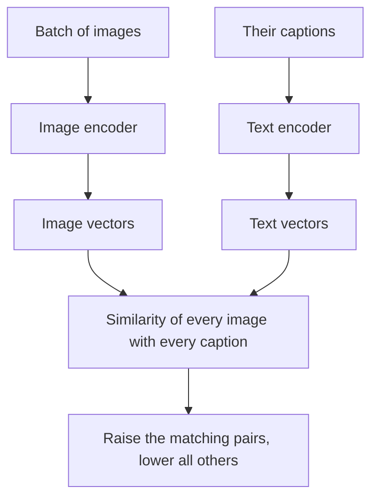

## The hook

To teach a computer to recognise dogs, cats and 998 other things, ImageNet's creators organised thousands of crowd workers to label over a million photos. Every new kind of object a model needed to know meant more labeling.

Meanwhile, the internet was already full of labels nobody had to pay for. Every photo of a golden retriever posted online comes with some text: a caption, a file name, an alt description, a tweet. Messy, yes. But free, enormous and endlessly varied.

In January 2021, OpenAI showed what happens if you learn vision from that text. Their model, CLIP, could classify images into categories it was never trained on, just by reading the category names. Type "a photo of a samosa" and it would find the samosas. It also became the bridge between language and images inside the image generators that arrived a year later.

## Before you start

You should know the Vision Transformer from [What If an Image Is Just a Sentence of Patches?](article:paper-vit), and the idea of embeddings as a map of meaning from [word2vec](article:paper-word2vec) and [How Words Become Numbers With Meaning](article:primer-embeddings).

## The world before this paper

State-of-the-art vision models were trained on fixed label sets. A model trained on ImageNet's 1,000 classes could only ever say one of those 1,000 words. To recognise anything else, you had to collect new labeled data and retrain or fine-tune.

These models were also surprisingly fragile. A classifier that scored brilliantly on ImageNet photos could perform much worse on sketches, cartoons or slightly different photo collections of the same objects, a problem called [[distribution shift]].

:::history
Researchers had tried learning visual concepts from text before. In 2016 and 2017, work at Facebook and elsewhere trained models to predict words or hashtags attached to images, and showed that the features were useful. But the results lagged behind models trained on carefully labeled data, and the idea stayed niche. Alec Radford, who had led [GPT-1](article:paper-gpt-1), and Jong Wook Kim led an OpenAI team that bet scale and a smarter objective would change that.
:::

## The big idea

Learn from [[natural language supervision]] at enormous scale. Collect 400 million image-text pairs from the internet. Train an image encoder and a text encoder together so that each image lands close to its own caption in a [[joint embedding space]], and far from everyone else's captions.

:::analogy
Think of a giant speed-dating event with 32,768 photos and 32,768 captions in the room at once. Each photo has exactly one true match. The organisers score how well everyone pairs up, then coach both sides to recognise their partners better. After hundreds of millions of these events, the photos and captions have learned a shared language: a picture of a beach at sunset and the words "sunset over the ocean" naturally gravitate to the same spot on the dance floor.
:::

:::insight
Text is a far richer label than a class number. By learning to match images with free-form descriptions, a model learns a vast number of visual concepts at once, and you can later ask it about any of them using words.
:::

## How it works

### The data

The team built a dataset of 400 million image-text pairs gathered from publicly available sources on the internet, using a broad list of search queries so the data covered a wide range of visual concepts.

### Contrastive training

For a batch of $N$ image-caption pairs, both encoders produce vectors, and CLIP computes the [[cosine similarity]] between every image and every caption, an $N \times N$ grid. The $N$ correct pairs sit on the diagonal. Training pushes diagonal scores up and all the off-diagonal scores down. This is [[contrastive learning]], and CLIP used batches of 32,768 pairs, so each image had to pick its caption out of 32,768 options.

The authors first tried training a model to **generate** the exact caption for each image, the obvious approach. It learned slowly. Simply predicting which caption matched was far more efficient, because the model did not waste effort on the exact wording of captions, only on what they meant.

The image encoder was either a ResNet or a Vision Transformer; the text encoder was a Transformer. Both were trained from scratch.

### Zero-shot classification

Here is the clever part. To classify images into new categories, write a sentence for each category, such as "a photo of a dog," "a photo of a cat," "a photo of a samosa." Embed those sentences with the text encoder. Embed the image. Pick the category whose sentence is most similar. No training on the target dataset at all: this is [[zero-shot classification]].

### A worked example

An image is embedded, and its cosine similarities with three class prompts come out as:

| Prompt | Similarity |
|---|---|
| a photo of a dog | 0.31 |
| a photo of a cat | 0.24 |
| a photo of a samosa | 0.12 |

CLIP picks "dog." In practice, similarities are multiplied by a learned temperature and passed through a softmax to give probabilities, but the decision is the same: the closest text wins.

Wording matters. The paper found that "a photo of a {label}." worked better than the bare label, because captions on the internet rarely consist of a single word. Using several prompt templates ("a blurry photo of a...", "a drawing of a...") and averaging their embeddings improved accuracy further.

:::try-this
You want CLIP to sort photos of food into "dosa," "idli" and "vada." Write two prompt templates you think would work well, and one that might confuse it. (Good: "a photo of dosa, a type of Indian food" and "a close-up photo of idli." Risky: just "vada," which is short and ambiguous. Context words help the text encoder land in the right part of the shared space.)
:::

## What they found

- **Zero-shot ImageNet.** The best CLIP model reached about 76.2% top-1 accuracy on ImageNet with zero-shot classification, matching the original fully supervised ResNet-50 without using any of ImageNet's 1.28 million labeled training images.
- **Broad transfer.** Across more than 30 datasets, from satellite images to optical character recognition to action recognition in videos, zero-shot CLIP was competitive with fully supervised baselines on many of them.
- **Much more robust.** On ImageNet variants such as sketches, renditions and adversarially chosen natural images, zero-shot CLIP's accuracy dropped far less than standard ImageNet models, closing a large part of the robustness gap.
- **Scale kept helping.** Performance improved smoothly with more compute, echoing [scaling laws](article:paper-scaling-laws) in language.

:::warning
Common misconception: "CLIP understands images the way people do." It matches images to text statistically. It can be fooled in surprising ways: later research found that writing the word "iPod" on a piece of paper and sticking it on an apple could make CLIP-based models label the apple an iPod, because the model strongly associates visible text with meaning.
:::

## What it got wrong (or left open)

The paper was candid about weaknesses. Zero-shot CLIP struggled with systematic tasks like counting objects, and with abstract or specialised tasks. On handwritten digits (MNIST), it reached only about 88%, worse than a simple logistic regression on raw pixels, because neat handwritten digits on black backgrounds are rare in web images.

Training was expensive: the largest models took weeks on hundreds of GPUs. And learning from unfiltered internet text means absorbing its social biases; the authors' own analysis found biased associations in how CLIP classified images of people, and they warned against uses such as surveillance.

## What happened next

- CLIP's text encoder became a core part of image generation. DALL·E 2 built on CLIP embeddings, and Stable Diffusion, based on [latent diffusion](article:paper-latent-diffusion), used a CLIP text encoder to turn prompts into the vectors that guide denoising.
- Open reproductions, such as OpenCLIP trained on the public LAION datasets, made CLIP-style models widely available.
- Multimodal language models that can "see" often use a CLIP-style vision encoder to turn images into tokens a language model can read.
- CLIP-style embeddings power image search, content moderation and photo organisation in many products.

## Key takeaways

- CLIP learns vision from 400 million image-caption pairs from the internet instead of from a fixed list of human labels.
- It trains an image encoder and a text encoder together with a contrastive objective that matches each image to its own caption within a large batch.
- Images and text end up in one shared embedding space, so you can classify images into any categories by describing them in words.
- Zero-shot CLIP matched a supervised ResNet-50 on ImageNet and was far more robust to distribution shift.
- It struggled with counting and specialised tasks and absorbed web biases, but became a key building block of modern image generators and multimodal AI.
