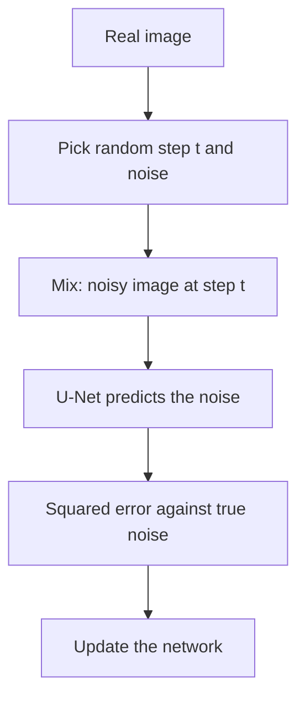

## The hook

Take a photo of a cat. Add a sprinkle of random static. Then a little more. Keep going for a thousand tiny steps, and eventually the cat is gone: you are left with pure television snow.

Now imagine running that film **backwards**. Start from snow, and at each step remove just a little noise, until a cat emerges. If a neural network could learn to take one tiny step backwards, you could chain a thousand of them and conjure a cat out of static.

That is a diffusion model. In 2020, Jonathan Ho, Ajay Jain and Pieter Abbeel at UC Berkeley showed that this oddly patient idea produced images rivalling the best GANs. Within two years, it powered DALL·E 2, Imagen and Stable Diffusion.

## Before you start

You should know what a generative model is and why smooth latent spaces matter, from [Teaching an Autoencoder to Dream](article:paper-vae). It also helps to know the competitor this paper challenged, from [The Counterfeiter and the Detective](article:paper-gan), and the U-shaped network from [U-Net](article:paper-unet), which does the actual denoising.

## The world before this paper

By 2020, image generation had two main camps. GANs produced sharp, impressive images but were unstable to train and prone to mode collapse. Likelihood-based models like VAEs and autoregressive models trained reliably but generally produced lower-quality samples or were very slow.

:::history
The core idea had been proposed in 2015 by Jascha Sohl-Dickstein and colleagues, who were inspired by non-equilibrium thermodynamics: the way a drop of ink slowly diffuses through water, and how, in principle, the process could be reversed. Their samples, though, lagged far behind other methods, and the idea stayed in the background. In 2019, Yang Song and Stefano Ermon showed promising results with a related approach based on estimating the "direction toward more realistic data" at different noise levels.
:::

Ho, Jain and Abbeel connected these threads, simplified the training objective, and paired it with a strong neural network. The combination worked far better than anyone expected.

## The big idea

Split the impossibly hard task "create a realistic image from nothing" into a thousand easy tasks: "make this slightly noisy image a bit less noisy."

:::analogy
Think of a sculptor who claims the statue was always inside the marble and they simply removed what was not the statue. A diffusion model is a sculptor who works on a block of pure noise. At each step, it looks at the rough shape and chips away a little of what does not belong. Early steps decide the big shapes, like where the head is. Late steps polish the whiskers. No single step is hard; the masterpiece comes from many small, careful ones.
:::

:::insight
Generating data is hard, but removing a small amount of noise is easy to learn. Chain enough easy denoising steps together and you get a powerful generator that trains as stably as ordinary supervised learning.
:::

## How it works

### The forward process: destroying images

The [[forward process]] is fixed; nothing is learned. Starting from a real image $x_0$, it adds a little [[Gaussian noise]] at each step $t = 1, 2, \dots, T$, with $T = 1000$ in the paper. A [[noise schedule]] controls how much: tiny amounts at first, growing larger later. By step 1,000 the image is indistinguishable from pure noise.

A convenient mathematical fact lets you jump straight to any step without simulating the ones before it:

$$x_t = \sqrt{\bar{\alpha}_t}\, x_0 + \sqrt{1 - \bar{\alpha}_t}\, \epsilon, \qquad \epsilon \sim \mathcal{N}(0, I)$$

- $x_t$ is the noisy image at step $t$.
- $\bar{\alpha}_t$ is a number between 0 and 1 set by the schedule. Near step 0 it is close to 1 (mostly image); near step 1,000 it is close to 0 (mostly noise).
- $\epsilon$ is a fresh sample of Gaussian noise, the same shape as the image.

### The reverse process: learning to clean

The [[reverse process]] is learned. A neural network $\epsilon_\theta(x_t, t)$ looks at a noisy image and the step number and predicts the noise $\epsilon$ that was mixed in.

Training is beautifully simple:

1. Take a real image $x_0$.
2. Pick a random step $t$ and random noise $\epsilon$.
3. Make the noisy image $x_t$ with the formula above.
4. Ask the network to predict $\epsilon$, and minimise the squared error between its prediction and the true noise.

That is just regression, no adversary and no balancing act. The paper showed that this simplified loss, while a slightly different weighting of the full probabilistic objective, gave the best sample quality.

### A worked example

Treat one pixel as a single number. Its clean value is $x_0 = 1.0$. At some step, the schedule gives $\bar{\alpha}_t = 0.64$, so $\sqrt{\bar{\alpha}_t} = 0.8$ and $\sqrt{1 - \bar{\alpha}_t} = 0.6$. The noise drawn is $\epsilon = -0.5$.

- Noisy value: $x_t = 0.8 \times 1.0 + 0.6 \times (-0.5) = 0.8 - 0.3 = 0.5$.
- The network sees $0.5$ and the step number, and should predict $\epsilon = -0.5$.
- If it predicts perfectly, we can recover the clean value: $(0.5 - 0.6 \times (-0.5)) / 0.8 = 0.8 / 0.8 = 1.0$.

In practice, the network's estimate is imperfect, especially at very noisy steps, which is why sampling takes many small steps instead of one giant leap.

:::try-this
Same pixel, but now at a much noisier step where $\bar{\alpha}_t = 0.04$ (so $\sqrt{\bar{\alpha}_t} = 0.2$ and $\sqrt{1 - \bar{\alpha}_t} \approx 0.98$), with noise $\epsilon = -0.5$. Compute $x_t$. How much of the original pixel survives? ($x_t = 0.2 - 0.49 = -0.29$. The image contributes only 0.2 of its value while the noise dominates. At this step, the network must mostly guess the broad shape, not details.)
:::

### Generating an image

To create something new, start with pure noise $x_{1000}$. At each step, use the network's noise prediction to compute a slightly cleaner $x_{t-1}$, adding back a little fresh randomness so the process stays diverse. After 1,000 steps, you have an image that never existed.

### The network inside

The denoiser was a [U-Net](article:paper-unet), the image-in, image-out shape that fits this job perfectly, with some self-attention layers and with the step number $t$ fed in as an embedding, using the same sinusoidal trick as the [Transformer's positional encoding](article:paper-attention-is-all-you-need).

## What they found

- On the CIFAR-10 dataset of small images, the model achieved an Inception Score of 9.46 and an [[FID]] of 3.17, at the time state-of-the-art results for unconditional image generation.
- On larger 256 by 256 images of bedrooms, churches and celebrity faces, samples were high quality, comparable to strong GAN models of the time.
- Training was stable, with none of the balancing problems of GANs, and the samples covered the variety of the data well.
- The authors also showed that diffusion models naturally do a kind of progressive generation: large-scale features like layout appear in early reverse steps, and fine details arrive at the end.

:::warning
Common misconception: "diffusion models generate by copying and blending training images with noise." The training images are never stored in the model. The network learns a general skill, removing noise, and starting from random noise it can produce new images. Like any large model, it can occasionally reproduce near-copies of heavily repeated training images, but that is a known failure mode.
:::

## What it got wrong (or left open)

The obvious cost was **speed**. Generating one image meant running the network about 1,000 times, versus once for a GAN. That made diffusion models slow and expensive to sample from.

The paper also noted that its models, despite excellent sample quality, did not achieve the best likelihood scores compared with some other model types, which raised questions about what exactly the models were trading off.

And everything ran on raw pixels. For large, high-resolution images, running a big U-Net on every pixel at every step is very expensive.

## What happened next

- Faster samplers arrived quickly. DDIM (late 2020) cut sampling to tens of steps, and later methods went further.
- In 2021, OpenAI researchers showed in a paper titled "Diffusion Models Beat GANs on Image Synthesis" that improved diffusion models surpassed the best GANs on ImageNet.
- Guiding the denoising with text descriptions led to DALL·E 2 and Google's Imagen in 2022.
- [Latent diffusion](article:paper-latent-diffusion) moved the whole process into a compressed space, making it cheap enough to run on consumer GPUs as Stable Diffusion.
- The diffusion idea spread to video, audio, 3D shapes and even protein design.

## Key takeaways

- A diffusion model learns to reverse a fixed process that gradually turns an image into pure Gaussian noise over many steps.
- Training is simple regression: add known noise to a real image at a random step and train a network to predict that noise.
- Generation starts from pure noise and applies the learned denoising step many times, creating new images that never existed.
- DDPM matched or beat GANs on image quality while training stably, though sampling originally needed about 1,000 network evaluations.
- With faster samplers, text guidance and latent spaces, diffusion became the foundation of modern image generators.
