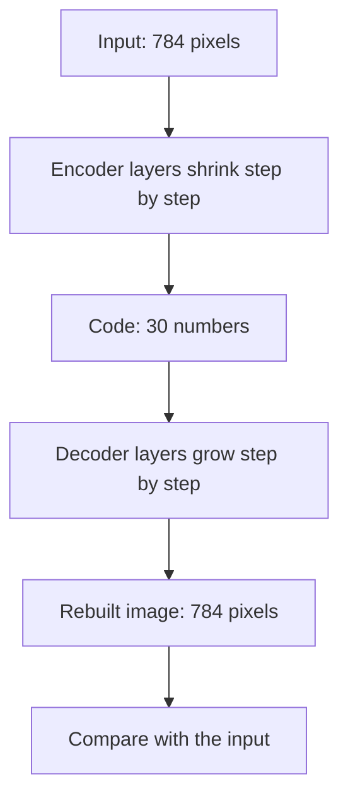

## The hook

In 2006, deep neural networks had a reputation problem. Everyone agreed that, in theory, networks with many layers should be powerful. In practice, they refused to learn. Researchers would set them up, press "train," and watch them settle into useless answers.

Then Geoffrey Hinton and his student Ruslan Salakhutdinov published a four-page paper in Science with a striking picture: handwritten digits squeezed down to just 30 numbers each, and then rebuilt so faithfully that the copies looked almost like the originals. The older, standard method made blurry smudges. The trick that made it possible started a revival that people soon began calling "deep learning."

## Before you start

You should understand how networks are trained with [backpropagation](article:paper-backpropagation), and the vanishing gradient problem from [Backpropagation Without the Scary Math](article:primer-backprop-intuition). This paper is about a clever workaround for that problem.

## The world before this paper

A lot of data is far bigger than it needs to be. A 28 by 28 image of a digit has 784 pixel values, but the "interesting" information, which digit it is, how slanted, how thick, fits in far fewer numbers. Finding a compact description is called dimensionality reduction, and it is useful for visualising, searching and compressing data.

The standard tool was [[principal component analysis]] (PCA). PCA finds the few straight-line directions along which the data varies most and describes each example by its position along them. It is fast and reliable, but it is linear: it can only capture straight-line structure. Handwritten digits curve and twist in ways straight lines cannot follow.

:::history
Neural networks offered a non-linear alternative. An [[autoencoder]] had been proposed back in the 1980s: train a network to copy its input to its output through a narrow bottleneck. With one hidden layer, autoencoders behaved a lot like PCA. With many layers, they should have been far more powerful. But deep autoencoders trained from random weights tended to get stuck, often learning to output something close to the average image no matter what went in.
:::

## The big idea

The problem was not the network's design but its **starting point**. Gradient descent is a walk downhill from wherever you begin, and from random weights, a deep network starts in a terrible place.

So Hinton and Salakhutdinov proposed giving it a head start. Train the layers **one at a time**, each learning to describe the layer below it. Then stack the trained layers and fine-tune the whole thing with backpropagation.

:::analogy
Think of building a tall tower of blocks blindfolded. If you throw all the blocks up at once and hope they land in a tower, they never do. If you place one block, check it is steady, place the next on top, check again, and only then adjust the whole tower slightly, you get something tall and stable. Layer-by-layer [[pretraining]] is building the tower one steady block at a time.
:::

:::insight
In deep networks, where you start matters as much as how you learn. Good initial weights turned an impossible training problem into an easy one.
:::

## How it works

### The autoencoder shape

The [[encoder]] squeezes the input down to a short [[code]]. The [[decoder]] rebuilds the input from the code. Training minimises the difference between the input and the rebuilt version. No labels are needed: the input is its own target.

Because the code is so small, the network cannot simply memorise pixels. It is forced to discover the most important structure in the data. For the digits, the paper's encoder shrank 784 pixels through layers of 1,000, 500 and 250 units, down to a code of 30.

### Step 1: pretrain layer by layer

Each pair of adjacent layers was first trained as a [[restricted Boltzmann machine]] (RBM). You can think of an RBM as a two-layer network that learns to model its input: given the input, it activates hidden units, and from those hidden units it tries to regenerate the input, adjusting its weights until the regenerated inputs look like real ones.

1. Train the first RBM on the raw pixels.
2. Use its hidden activities as the "data" for a second RBM, and train that.
3. Repeat up the stack until you reach the code layer.

Each layer learns features of the features below it, without ever seeing a label.

Why does this help so much? A randomly initialised deep network is like a long chain of scrambled translators: whatever goes in comes out as noise, so the error signal reaching the early layers is almost meaningless. After pretraining, every layer already passes on a sensible description of its input. The chain carries real information from the first layer to the last, so when backpropagation starts, its gradients point somewhere useful. Pretraining also uses only unlabeled data, which is far easier to collect than labeled data.

### Step 2: unroll and fine-tune

Next, the stack of trained layers is copied and mirrored to form the decoder, creating the full deep autoencoder. Finally, the whole network is fine-tuned with ordinary backpropagation to minimise reconstruction error. Because the weights already start in a sensible place, backpropagation now only needs to polish, not build from scratch.

:::try-this
Without any network, try being an autoencoder yourself. Describe a friend's face to someone using exactly five words, so that they could pick your friend out of a crowd. Which five words do you choose? (You will instinctively pick the most distinctive features, not "has two eyes." That is exactly what the narrow code forces the network to do.)
:::

## What they found

- On handwritten digits, the 30-number codes from the deep autoencoder produced reconstructions that were clearly better than those from 30-component PCA, which came out blurry.
- When the code was squeezed to just 2 numbers and plotted, the deep autoencoder separated the different digit classes into distinct clusters, while PCA's 2D plot left them heavily mixed. The network had never been told the labels.
- On collections of documents, codes learned the same way grouped articles by topic more cleanly than a popular linear method, and made it fast to find similar documents.
- Face images could be compressed and rebuilt far better than with PCA.

The broader claim was the important one: with pretraining, deep networks could be trained to work much better than shallow methods on these tasks.

:::warning
Common misconception: "this paper showed deep networks always need pretraining." It showed pretraining was a practical way to make them trainable in 2006. A few years later, other fixes, like ReLU activations, better weight initialization, and simply much more labeled data and GPU power, made layer-wise pretraining largely unnecessary for most tasks.
:::

## What it got wrong (or left open)

RBM pretraining was slow and fiddly, with its own settings to tune. The fact that it was later abandoned by most practitioners shows it was a bridge, not the destination.

Autoencoders also learn to compress, but compression is not the same as understanding. A good reconstruction does not guarantee the code captures the features you actually care about. And a plain autoencoder's code space has gaps: pick a random point in it and decode, and you usually get garbage, not a new realistic digit. Fixing that problem required a probabilistic twist, the [variational autoencoder](article:paper-vae).

## What happened next

- The same year, Hinton and collaborators published a related method for "deep belief nets," and these papers together sparked the deep learning revival around 2006 to 2009.
- Pretraining helped deep networks make big gains in speech recognition around 2009 to 2012.
- In 2012, [AlexNet](article:paper-alexnet) was trained from random weights, without pretraining, using ReLU, [dropout](article:paper-dropout) and GPUs, and the era of large supervised networks began.
- The core idea, learn a compact code without labels, never went away. It returned in [variational autoencoders](article:paper-vae), and in the compressed "latent space" used by [latent diffusion models](article:paper-latent-diffusion) such as Stable Diffusion.
- And "pretrain on unlabeled data, then fine-tune" became the central recipe of modern AI, now with huge Transformers, in [GPT](article:paper-gpt-1) and [BERT](article:paper-bert).

## Key takeaways

- An autoencoder learns to compress data by reproducing its input through a narrow code layer, without needing any labels.
- Deep autoencoders could capture curved, non-linear structure that PCA misses, but from random weights they were very hard to train.
- Hinton and Salakhutdinov's fix was to pretrain layers one at a time on unlabeled data, then fine-tune the whole network with backpropagation.
- The resulting codes beat PCA at reconstruction and separated classes of data that the network was never told about.
- RBM pretraining itself faded, but "pretrain on unlabeled data, then fine-tune" became one of the central ideas of modern AI.
