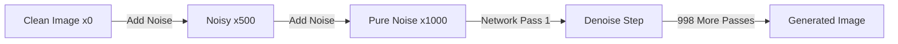
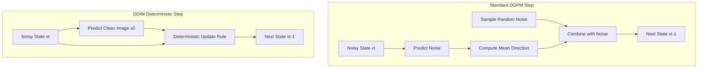
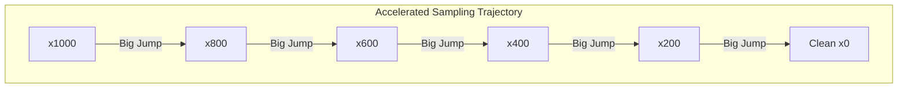

## The hook

Imagine generating a batch of images and having to wait 20 hours for your GPU to finish. In 2020, [[DDPM]] shocked the world by generating images with quality that rivaled [GANs](article:paper-gan), but it was cripplingly slow. To turn random static into a single crisp picture, DDPM forced you to run 1,000 sequential passes through a massive neural network. What if you could skip 95% of those steps, speed up generation by 50x, and keep the exact same neural network without retraining it for even a single second?

## Before you start

To get the most out of this paper, you should be familiar with the fundamentals of [DDPM](article:paper-ddpm) (how diffusion models add noise forward and learn to remove it backward). A basic intuition for latent spaces from [VAEs](article:paper-vae) and fast single-step generation from [GANs](article:paper-gan) will also help.

## The world before this paper

In late 2020, generative modeling faced a frustrating dilemma. 

On one side stood [GANs](article:paper-gan). A GAN can generate an image in a fraction of a second with a single forward pass through a generator network. But training GANs felt like balancing an egg on a needle: if the generator outsmarted the discriminator too quickly, training collapsed, modes vanished, and you had to start over.

On the other side stood [[DDPM]]. Instead of a precarious two-player game, DDPM framed image creation as steady denoising. You took an image, corrupted it with Gaussian noise over 1,000 tiny steps until it was pure static, and trained a neural network to predict and peel off the added noise one step at a time. Training was stable, mode coverage was superb, and the pictures looked gorgeous.

The catch was practical. Because DDPM modeled the reverse process as a Markov chain where each tiny step had to be a near-infinitesimal Gaussian jump, you could not simply skip steps. Generating 50,000 small $32 \times 32$ images on a high-end Nvidia 2080 Ti GPU took around 20 hours with DDPM. A GAN did the same job in under a minute. For larger images, DDPM would demand nearly 1,000 hours of continuous GPU crunching.

Diffusion had a speed problem that threatened to keep it trapped inside academic labs.

## The big idea

:::analogy
Imagine hiking down a foggy mountain. DDPM is like taking 1,000 tiny, cautious steps in the dense mist, tossing a coin at every single pace to make a random zigzag and avoid tumbling off the cliff. 

DDIM proves that you do not need the coin tosses. Once your map of the mountain slopes is drawn, there is a smooth, paved toboggan slide following the exact same average path. You can step into the toboggan and slide down with huge, confident leaps, descending the entire mountain in 20 steps instead of 1,000.
:::

The authors of [[DDIM]] (Denoising Diffusion Implicit Models) spotted a hidden mathematical loophole in the way diffusion models are trained.

When you train a [[DDPM]], what loss function do you actually compute? You pick an image $x_0$, pick a random timestep $t$, add noise according to a closed-form formula to get $x_t$, and ask your neural network to predict the noise:

$$L_1 = \mathbb{E}\left[ \|\epsilon_\theta(x_t) - \epsilon\|^2 \right]$$

Look closely at that expectation. The training loss depends *only* on the marginal distribution $q(x_t \mid x_0)$—the relationship between the clean image and the noisy state at timestep $t$. The loss never actually inspects the joint chain $x_t \to x_{t-1} \to x_{t-2}$. 

The Markov chain assumption—that step $t$ must depend strictly and solely on step $t-1$—was just one possible way to set up the problem. The authors realized that you could design an entirely different, [[Non-Markovian Process]] where $x_{t-1}$ depends on both $x_t$ *and* the clean image $x_0$. 

:::insight
As long as the marginal distribution of noise at every step matches, the training objective stays identical. You can replace the slow random walk with a fast, deterministic trajectory at test time without retraining your neural network.
:::

Because the underlying training objective does not change, you can take a standard DDPM model trained for weeks on a cluster, change the sampling math at inference time, and immediately reap a 10x to 50x speedup.

## How it works

Let's break down how DDIM constructs its reverse steps and turns diffusion into a fast, deterministic process.

### Step 1: Predicting the clean image

At any step $t$, the model holds a noisy latent state $x_t$. The neural network $\epsilon_\theta(x_t)$ looks at this noisy mess and estimates what noise was added. 

With that noise estimate in hand, your first move is to calculate an estimate of the original clean image $x_0$, denoted as $f_\theta^{(t)}(x_t)$:

$$f_\theta^{(t)}(x_t) = \frac{x_t - \sqrt{1 - \alpha_t}\,\epsilon_\theta(x_t)}{\sqrt{\alpha_t}}$$

Here:
- $x_t$ is your current noisy image at timestep $t$.
- $\epsilon_\theta(x_t)$ is the noise predicted by your network.
- $\alpha_t$ is a predefined number from the noise schedule between 0 and 1 that indicates how much of the original signal remains.

### Step 2: Taking the reverse step

Now that you have a guess of the clean image, how do you construct the slightly less noisy state $x_{t-1}$? DDIM defines the general step as:

$$x_{t-1} = \underbrace{\sqrt{\alpha_{t-1}}\,f_\theta^{(t)}(x_t)}_{\text{predicted clean image}} + \underbrace{\sqrt{1 - \alpha_{t-1} - \sigma_t^2}\;\epsilon_\theta(x_t)}_{\text{direction pointing to } x_t} + \underbrace{\sigma_t\,\epsilon_t}_{\text{random noise}}$$

Let's look at what each symbol does:
- $\sqrt{\alpha_{t-1}}\,f_\theta^{(t)}(x_t)$ points directly toward the clean image you just predicted.
- $\epsilon_\theta(x_t)$ represents the direction pointing back toward the current noisy state $x_t$, scaled so the overall variance stays consistent.
- $\sigma_t$ is a tunable knob that sets how much fresh random Gaussian noise $\epsilon_t \sim \mathcal{N}(0, I)$ you inject into the step.

:::warning
Setting $\sigma_t > 0$ gives you different kinds of stochastic processes. In fact, if you pick the exact right formula for $\sigma_t$, this equation collapses precisely into the original stochastic [[DDPM]]. DDPM is not a rival architecture; it is just a special case of this broader formula where randomness is cranked up.
:::

### Step 3: Turning off the noise ($\sigma_t = 0$)

Here is where the magic happens. What if you set $\sigma_t = 0$?

The random noise term $\sigma_t \epsilon_t$ vanishes completely:

$$x_{t-1} = \sqrt{\alpha_{t-1}}\left(\frac{x_t - \sqrt{1 - \alpha_t}\,\epsilon_\theta(x_t)}{\sqrt{\alpha_t}}\right) + \sqrt{1 - \alpha_{t-1}}\;\epsilon_\theta(x_t)$$

The reverse step is now completely deterministic. Once you choose the starting noise vector $x_T$, every single intermediate step down to $x_0$ is locked in stone. This makes the model an [[Implicit Probabilistic Model]]—hence the name DDIM.

### A tiny worked example

Let's see this in action with simple numbers. 

Suppose at step $t$ we have a single pixel with noisy value $x_t = 1.20$.
Our noise schedule values are $\alpha_t = 0.64$ (so $\sqrt{\alpha_t} = 0.80$ and $\sqrt{1 - \alpha_t} = 0.60$) and for the previous step $\alpha_{t-1} = 0.81$ (so $\sqrt{\alpha_{t-1}} = 0.90$ and $\sqrt{1 - \alpha_{t-1}} = \sqrt{0.19} \approx 0.436$).

1. The neural network inspects $x_t$ and predicts the noise: $\epsilon_\theta(x_t) = 0.50$.
2. Predict the clean pixel:
   $$f_\theta(x_t) = \frac{1.20 - (0.60 \times 0.50)}{0.80} = \frac{1.20 - 0.30}{0.80} = 1.125$$
3. Compute the next state $x_{t-1}$ with $\sigma_t = 0$:
   $$x_{t-1} = (0.90 \times 1.125) + (0.436 \times 0.50) = 1.0125 + 0.218 = 1.2305$$

Notice: no random number generators, no dice rolls. The result is strictly computable.

### Step 4: Skipping steps along a trajectory

Because the update is deterministic, you do not need to walk through all $T = 1,000$ steps. You can define a [[Sampling Trajectory]] $\tau = [\tau_1, \tau_2, \dots, \tau_S]$ that picks a sparse subset of steps. For example, instead of visiting every integer from 1,000 down to 1, you can step through:

$$\tau = [1, 21, 41, 61, \dots, 981]$$

This reduces your workload from 1,000 steps down to $S = 50$ steps. At each jump, the equation plugs in $\alpha_{\tau_i}$ and $\alpha_{\tau_{i-1}}$ instead of consecutive integers. The math holds together seamlessly.

### The ODE connection

When you rearrange the DDIM equation, something remarkable appears:

$$\frac{x_{t-\Delta t}}{\sqrt{\alpha_{t-\Delta t}}} = \frac{x_t}{\sqrt{\alpha_t}} + \left(\sqrt{\frac{1 - \alpha_{t-\Delta t}}{\alpha_{t-\Delta t}}} - \sqrt{\frac{1 - \alpha_t}{\alpha_t}}\right) \epsilon_\theta(x_t)$$

This has the exact mathematical form of Euler's method for solving an ordinary differential equation (ODE). DDIM reveals that sampling from a diffusion model is equivalent to simulating a continuous trajectory along a [[Probability Flow ODE]]. 

Because an ODE flows smoothly in both directions, you can run time backward to denoise an image, or run time forward to turn an existing photo back into its exact latent noise representation.

:::try-this
Think about what happens when you feed a model two different random seeds in standard DDPM versus DDIM. 
In DDPM, even if you freeze the initial seed $x_T$, the 1,000 subsequent random noise injections $\epsilon_t$ will cause the generated image to drift unpredictably. 
In DDIM, because $\sigma_t = 0$, what does freezing $x_T$ guarantee? 
*Answer:* It guarantees the exact same image every single time. The initial noise vector $x_T$ becomes a true latent code, just like in a GAN or VAE!
:::

## What they found

The authors tested DDIM across benchmark datasets including CIFAR-10 ($32 \times 32$) and CelebA ($64 \times 64$), measuring sample quality using Fréchet Inception Distance (FID, where lower is better). 

The empirical results confirmed their theoretical claims:

* **Massive speedups with low step counts:** When constrained to only $S = 10$ steps, standard DDPM produced garbled, unrecognizable noise with an atrocious FID of 41.07 on CIFAR-10 (and its default variance setting $\hat{\sigma}$ blew up to 367.43). In contrast, DDIM ($\eta = 0$) achieved an FID of 13.36 at the same 10 steps.
* **Near-optimal quality at 50 to 100 steps:** At $S = 100$ steps, DDIM reached an FID of 4.16 on CIFAR-10, comfortably beating DDPM's 5.78. On CelebA, DDIM with just 20 steps achieved sample quality comparable to DDPM running for 100 steps. In terms of wall-clock time, DDIM delivered a 10x to 50x speedup.
* **Sample consistency across trajectories:** When the authors fixed the initial noise $x_T$ and sampled images using 10 steps, 20 steps, 100 steps, and 1,000 steps, the images shared the exact same high-level composition, lighting, and semantic identity. Minor textures sharpened with more steps, but the subject never changed.

| CIFAR-10 FID by Steps ($S$) | 10 Steps | 20 Steps | 50 Steps | 100 Steps | 1,000 Steps |
| :--- | :--- | :--- | :--- | :--- | :--- |
| **DDPM** ($\eta = 1.0$) | 41.07 | 18.36 | 8.01 | 5.78 | 4.73 |
| **DDPM default** ($\hat{\sigma}$) | 367.43 | 133.37 | 32.72 | 9.99 | **3.17** |
| **DDIM** ($\eta = 0.0$) | **13.36** | **6.84** | **4.67** | **4.16** | 4.04 |

* **Latent space interpolation:** Because $x_T$ uniquely identifies the generated picture, the authors showed that taking two random noise vectors, $x_T^{(A)}$ and $x_T^{(B)}$, and interpolating linearly between them produced smooth semantic morphing between two different human faces. In DDPM, interpolating noise created blurry ghosting artifacts due to intermediate random jitter.
* **Deterministic image reconstruction:** The authors showed that you can take an actual test image $x_0$, integrate the ODE forward to find its unique latent code $x_T$, and then run the ODE backward to reconstruct the original image. On CIFAR-10, the per-dimension reconstruction mean-squared error dropped from 0.014 at 10 steps down to 0.0001 at 1,000 steps.

## What it got wrong (or left open)

While DDIM represented a watershed moment for diffusion models, it left several challenges unresolved:

* **Subtle quality loss at huge step counts:** When computational budget was unlimited ($S = 1,000$), standard stochastic DDPM still held a slight edge over deterministic DDIM (an FID of 3.17 vs 4.04 on CIFAR-10). The random noise injections in DDPM act as a stochastic crutch that helps the sampler correct minor accumulated errors if it has enough time.
* **Still slower than GANs:** Dropping from 1,000 steps to 20 or 50 steps was a colossal victory, but it still required 20 to 50 sequential forward passes through a heavy U-Net. Compared to a GAN that creates an image in a single forward pass, diffusion remained relatively slow for real-time mobile and edge applications.
* **Crude numerical integration:** DDIM used first-order Euler integration. When you push step counts down to very small budgets (under 10 steps), discretization errors compound rapidly, distorting the final generated image.

## What happened next

:::history
When DDIM was published in late 2020, diffusion models were still considered an interesting academic curiosity that was far too slow for production. By unlocking fast sampling and deterministic inversion without retraining, DDIM changed that narrative overnight.
:::

The realization that diffusion models trace a deterministic [[Probability Flow ODE]] ignited a flurry of breakthroughs:

1. **Advanced numerical solvers:** Researchers quickly realized that if diffusion is an ODE, computer science could borrow centuries of numerical mathematics. Methods like Pseudo Numerical Methods for Diffusion Models (PNDM) and DPM-Solver replaced simple Euler steps with high-order Runge-Kutta solvers, enabling photorealistic image generation in just 10 to 15 steps.
2. **The engine behind Stable Diffusion:** When Robin Rombach and Patrick Esser introduced [Latent Diffusion](article:paper-latent-diffusion) (which became Stable Diffusion), DDIM was the default inference engine that allowed everyday users to generate stunning images on home GPUs in seconds rather than minutes.
3. **DDIM Inversion and image editing:** Because DDIM can map real photos into latent codes, it unlocked modern diffusion-based image editing. Techniques like Prompt-to-Prompt and Null-text Inversion rely directly on running DDIM backward to turn an existing photograph into noise, modifying text prompts, and generating edited photos that preserve the original subject's pose and background.

## Key takeaways

- DDPM's training objective depends only on the marginal distribution of noise at each individual step, leaving the path between steps mathematically unconstrained.
- DDIM replaces DDPM's Markovian random walk with a non-Markovian process that makes reverse generation completely deterministic when setting $\sigma_t = 0$.
- Because both models share the exact same training loss, DDIM accelerates sampling by 10x to 50x using off-the-shelf pretrained DDPM weights without any retraining.
- Framing diffusion as an ordinary differential equation turned random noise into an invertible latent space, enabling semantic interpolation and image editing.
