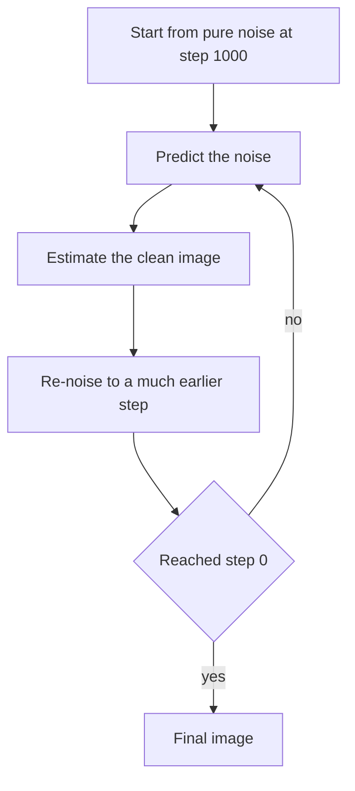

## The hook

In 2020, diffusion models produced some of the most convincing generated images anyone had seen. There was one embarrassing catch: to make a single picture, the model had to run a neural network about a thousand times in a row, each pass removing a sliver of noise. A GAN could produce an image in one pass.

A few months later, a team at Stanford showed you could take the very same trained model and walk from noise to image in fifty steps instead of a thousand, with images that still looked good. They did not change the training at all. They changed the path.

## Before you start

You should know how diffusion models add and remove noise from [Denoising Diffusion Probabilistic Models](article:paper-ddpm). It helps to remember that a model can be trained to predict the noise in an image, and that generation runs this prediction many times in a row.

## The world before this paper

A [[diffusion model]] is trained with a [[forward process]] that adds a little Gaussian noise to an image at each of T steps, often T = 1,000, until only noise remains. A [[noise predictor]] network learns to look at a noisy image at step t and estimate the noise.

To generate, DDPM runs the process backwards: start from pure noise and, at each of the 1,000 steps, remove a bit of predicted noise and add a little fresh randomness. Each step is a [[Markov chain]] step: it only looks at the current image.

:::history
Jiaming Song, Chenlin Meng and Stefano Ermon at Stanford asked a sharp question: does generation really have to follow the same 1,000 small steps the model was trained on? The paper appeared on arXiv in October 2020 and at ICLR 2021. At the time, slow sampling was widely seen as the price of diffusion models' quality.
:::

## The big idea

:::analogy
Picture driving down a mountain road with a thousand hairpin bends. The guidebook was written by someone who took every bend, so you assume you must too. But the guidebook only ever tells you where you should be at certain heights, not how to get between them. If you know where you need to be at each height, you can take a much straighter road down, skipping most of the bends, and still arrive at the same village.
:::

The key insight: the DDPM training objective only depends on how noisy the image should be at each step on its own, not on the step-by-step chain between them. DDIM defines a whole family of different forward processes, most of them non-Markovian, that share exactly those per-step noise levels. Because the per-step marginals match, a model trained for DDPM is already a valid model for all of them.

One member of the family has no randomness at all during generation. That [[deterministic sampler]] follows a smooth path from noise to image, and smooth paths can be followed with big steps. That is the straighter road down the mountain.

## How it works

At each step, DDIM uses the noise predictor in two moves:

1. **Guess the clean image.** From the current noisy image $x_t$ and the predicted noise $\epsilon_\theta(x_t)$:

$$\hat{x}_0 = \frac{x_t - \sqrt{1 - \bar\alpha_t}\,\epsilon_\theta(x_t)}{\sqrt{\bar\alpha_t}}$$

2. **Jump to a less noisy step** s (which can be far earlier than t − 1):

$$x_s = \sqrt{\bar\alpha_s}\,\hat{x}_0 + \sqrt{1 - \bar\alpha_s - \sigma^2}\,\epsilon_\theta(x_t) + \sigma\,z$$

- $\bar\alpha_t$ is the fraction of the original signal left at step t; it shrinks as t grows.
- $\hat{x}_0$ is the model's current best guess of the final clean image.
- $\epsilon_\theta(x_t)$ is the predicted noise, reused to point in the right direction.
- $\sigma$ controls fresh randomness and $z$ is new random noise. Setting $\sigma = 0$ gives the deterministic DDIM sampler; a particular non-zero choice recovers DDPM.

Because each step goes "estimate the clean image, then re-noise it to the target level", you can choose any shorter schedule, such as 50 evenly spaced steps out of 1,000.

### A tiny numeric picture

Think of one pixel. Say the true value is 0.8, and at step t the signal fraction is $\bar\alpha_t = 0.25$, so the pixel is $x_t = 0.5 \times 0.8 + \sqrt{0.75} \times \epsilon$. If the true noise was $\epsilon = 0.2$, then $x_t = 0.4 + 0.866 \times 0.2 \approx 0.573$.

If the network predicts the noise perfectly, step 1 gives $\hat{x}_0 = (0.573 - 0.866 \times 0.2) / 0.5 = (0.573 - 0.173) / 0.5 = 0.8$. Step 2, jumping to $\bar\alpha_s = 0.81$ with $\sigma = 0$: $x_s = 0.9 \times 0.8 + \sqrt{0.19} \times 0.2 \approx 0.72 + 0.087 = 0.807$. One jump moved the pixel almost all the way to its clean value, along the same direction the noise pointed.

:::try-this
Redo step 2 with a target of $\bar\alpha_s = 1$, meaning no noise left. What is $x_s$? (With $\bar\alpha_s = 1$, the second term vanishes and $x_s = \hat{x}_0 = 0.8$, the clean value.)
:::

:::insight
DDIM separates what the model learned, how to predict noise at any noise level, from how you use it to generate. Once those are separate, the thousand-step chain is just one choice of road among many, and shorter roads work.
:::

### Running the road uphill

Because the deterministic path has no randomness, it can also be run in reverse: start from a real photo and step towards noise using the same update. The result is a latent that DDIM maps back to almost exactly that photo. That makes editing possible: encode a photo, nudge its latent or the conditioning, and decode. The mountain road analogy holds here too: a road you can drive down without detours is also a road you can drive back up, arriving at the same spot you left from. The noisy DDPM sampler offers no such return trip, since each step adds fresh randomness.

## What they found

- **Much faster sampling.** On image datasets such as CIFAR-10 and CelebA, DDIM produced high-quality samples with 10 to 50 times fewer steps than DDPM, and with few steps its quality held up far better than DDPM run with the same number of steps.
- **Consistency.** Because generation is deterministic, the same starting [[latent]] produced images with the same high-level features even when the number of steps changed.
- **Meaningful interpolation.** Smoothly blending two starting noise images produced a smooth blend of the resulting pictures, something the noisy DDPM sampler could not do reliably.
- **Encoding real images.** Running the deterministic process forwards turns a real image into a latent that reconstructs it, which later made image editing possible.

:::warning
Common misconception: "DDIM is a new kind of model that needs its own training." It is a new sampler. Any model trained with the standard DDPM objective can be sampled with DDIM, which is exactly why it spread so quickly.
:::

The practical upshot was immediate: researchers could train one model and then choose, at generation time, how to trade speed against quality. Fewer steps for quick previews, more for final images.

## What it got wrong (or left open)

- **Very few steps still hurt.** Quality dropped noticeably with around 10 steps or fewer; one-step generation needed different ideas.
- **The step schedule was hand-picked**, such as evenly spaced or quadratic spacing, without a principled way to choose it.
- **Less randomness can mean less diversity** in some settings, a trade-off later samplers made tunable.

## What happened next

DDIM became one of the standard samplers for diffusion models, including the latent diffusion models behind Stable Diffusion, described in [High-Resolution Image Synthesis with Latent Diffusion Models](article:paper-latent-diffusion). Its deterministic path also made image editing and inversion practical.

Its view of sampling as following a smooth path inspired a line of faster solvers, such as DPM-Solver, and the unifying analysis in [Elucidating the Design Space of Diffusion-Based Generative Models](article:paper-elucidating-the-design-space-of-diffusion-based-generative-m). In parallel, [Improved Denoising Diffusion Probabilistic Models](article:paper-improved-denoising-diffusion-probabilistic-models) attacked the same slowness from the training side, by learning better noise variances.

## Key takeaways

- DDPM needed about a thousand network passes per image because it followed the same small steps used in training.
- DDIM defines a family of forward processes with the same per-step noise levels, so existing DDPM models can be reused without retraining.
- Its deterministic sampler estimates the clean image, then re-noises it to a much earlier step, allowing large jumps.
- This gave good images in roughly 10 to 50 times fewer steps, plus consistent latents, smooth interpolation and image inversion.
- DDIM became a standard sampler and inspired faster diffusion solvers that followed.
