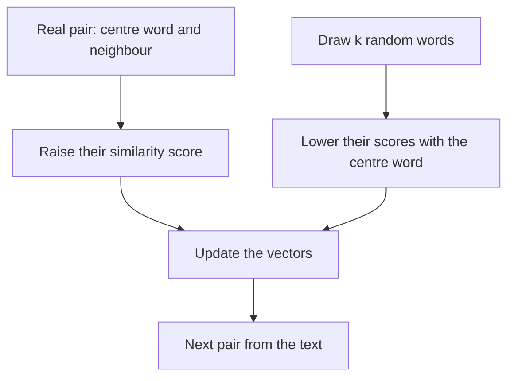

## The hook

In early 2013, a team at Google showed that simple models could learn word vectors with surprising structure: king minus man plus woman landed near queen. But the training still had an expensive step at its heart, and it treated "New York" as two unrelated words.

A few months later, the same group published a follow-up with three practical tricks. None is deep mathematics. Together they made training fast enough to run on billions of words, and the resulting tool, word2vec, became the default way to turn words into numbers for years.

## Before you start

You should know what an embedding is from [Embeddings: How Words Become Numbers With Meaning](article:primer-embeddings), and how skip-gram learns from context from [the original word2vec article](article:paper-word2vec). A little comfort with probabilities between 0 and 1 helps.

## The world before this paper

:::history
Tomas Mikolov, Ilya Sutskever, Kai Chen, Greg Corrado and Jeff Dean were at Google. Their earlier 2013 paper had introduced the skip-gram and CBOW models, which learn word vectors by predicting nearby words. The models were small and fast compared with the neural language models of the time, but one step still scaled with the size of the vocabulary, and phrases were ignored entirely.
:::

The [[skip-gram]] model takes a word, such as "chai", and tries to predict the words around it, such as "cup", "hot" or "milk". To turn its scores into probabilities, it used a [[softmax]] over the whole vocabulary.

That is the expensive part. With a vocabulary of hundreds of thousands of words, every single training example needs a score for every word, just to compute one probability. The earlier paper used a faster approximation called hierarchical softmax, but it was fiddly and still not ideal.

:::analogy
Imagine learning which spices go well together by cooking. The slow way: every time you taste a dish, you rate it against every spice in the world, one by one, to see how well each would fit. The fast way: taste the real pairing, then compare it with just a few random spices from the shelf and learn "this one belongs, those don't". You learn almost as much, in a tiny fraction of the time.
:::

## The big idea

The paper's big idea is that you do not need full probabilities to learn good vectors. You only need to tell real word pairs apart from random ones.

That turns an expensive "which of 300,000 words comes next?" question into a cheap yes-or-no question asked a few times: "is this a real neighbour, or a random word?" Two more tricks, skipping very common words and learning [[phrase]]s, make the vectors better and the training faster still.

## How it works

### Trick 1: negative sampling

For a real pair, centre word *w* and context word *c*, [[negative sampling]] trains the vectors so that:

$$\log \sigma(v_c \cdot v_w) + \sum_{i=1}^{k} \log \sigma(-v_{n_i} \cdot v_w)$$

is as large as possible.

- $v_w$ is the vector of the centre word, $v_c$ the vector of the real context word.
- $v_{n_i}$ are vectors of k "negative" words drawn at random.
- The dot product $v_c \cdot v_w$ is a similarity score.
- $\sigma$ is the [[sigmoid]], which turns a score into a probability between 0 and 1.

In words: push the real pair's score up, and push each random pair's score down. The paper suggests k from 5 to 20 for small datasets and 2 to 5 for large ones. Random words are drawn from the word frequencies raised to the power 3/4, which gives rare words a slightly better chance of being picked than their raw frequency.

Back to the spice kitchen: instead of rating every spice in the world, you compare the real pairing with a few random jars, and that is enough to learn which flavours belong together.

### Trick 2: subsampling frequent words

Words like "the", "of" and "a" appear constantly but say little about their neighbours. Seeing "the" next to "chai" teaches the model almost nothing. [[Subsampling]] randomly discards each occurrence of a word w with probability

$$P(\text{discard } w) = 1 - \sqrt{\frac{t}{f(w)}}$$

- $f(w)$ is the fraction of all words that are w.
- $t$ is a small threshold, around $10^{-5}$ in the paper.

Very frequent words are dropped most of the time; words rarer than t are never dropped.

### Worked example

Take t = 0.00001.

| Word | Frequency f | sqrt(t / f) | Chance of being dropped |
|---|---|---|---|
| "the" | 0.01 | sqrt(0.001) ≈ 0.032 | about 97% |
| "milk" | 0.0001 | sqrt(0.1) ≈ 0.32 | about 68% |
| "cardamom" | 0.000005 | above 1 | never dropped |

Most copies of "the" vanish from the training stream, so the model spends its time on pairs like "cardamom" and "chai".

:::try-this
Compute the drop probability for a word with frequency 0.001 and t = 0.00001. (sqrt(0.01) = 0.1, so it is dropped about 90% of the time.)
:::

### Trick 3: learning phrases

"New York Times" is not news about a new city called York. To find phrases, the paper scores each pair of adjacent words:

$$\text{score}(a, b) = \frac{\text{count}(a\,b) - \delta}{\text{count}(a) \times \text{count}(b)}$$

- count(a b) is how often the two words appear side by side.
- The denominators penalise pairs of common words that meet by chance.
- $\delta$ is a discount that stops very rare pairs from scoring high by accident.

Pairs above a threshold become single tokens like "New_York". Running this over the data two to four times, with decreasing thresholds, builds longer phrases like "New_York_Times".

:::insight
You do not need to predict the right word among hundreds of thousands to learn good vectors. Telling real neighbours from a handful of random words carries almost all the signal, at a cost that no longer depends on the vocabulary size.
:::

In practice, the three tricks combine into one training loop: read text with frequent words thinned out, merge detected phrases into single tokens, and update vectors with a few negative samples per real pair.

## What they found

The paper evaluated vectors on analogy questions such as "Germany is to Berlin as France is to ?", including a new set of analogies about phrases.

- **Negative sampling worked better than hierarchical softmax** on the analogy tasks, while being simpler to implement.
- **Subsampling made training substantially faster** and improved the vectors of less frequent words, because training time was no longer dominated by "the" and "of".
- **Phrase vectors worked**: with phrases detected and trained on a large news corpus, the model answered many phrase analogies, such as matching newspapers to cities, correctly.
- **Vectors could be added meaningfully.** The paper showed examples where adding two word vectors lands near a sensible related word, such as "Vietnam" plus "capital" lying near "Hanoi". They called this additive compositionality.

:::warning
Common misconception: "word2vec understands meaning." It learns from which words appear near which others. Vectors capture associations in the training text, including its biases, but they do not know facts or follow logic. Analogies work often, not always.
:::

## What it got wrong (or left open)

- **One vector per word.** "Bank" gets a single vector whether it is a river bank or a money bank. Context-dependent vectors arrived later with models like [BERT](article:paper-bert).
- **No subword information.** Rare or misspelled words get poor vectors, and unseen words get none at all.
- **Phrase detection is statistical**, so it misses rare phrases and occasionally merges words that just happen to co-occur.
- **Why it worked so well was unclear.** The paper was empirical; the theory came afterwards.

## What happened next

The open-source word2vec tool spread quickly through research and industry, and pre-trained vectors became a standard input to NLP systems for several years.

In 2014, Omer Levy and Yoav Goldberg showed that skip-gram with negative sampling is implicitly factorising a matrix of word co-occurrence statistics, connecting it to older counting methods. GloVe, also from 2014, built on that connection directly. In 2016, fastText added character pieces to handle rare and unseen words, covered in [Enriching Word Vectors with Subword Information](article:paper-enriching-word-vectors-with-subword-information).

The deeper legacy is the contrastive idea itself: learn by pulling real pairs together and pushing random pairs apart. The same principle trains [CLIP](article:paper-clip), which matches images with their captions, and many modern embedding models used for search and retrieval.

## Key takeaways

- Negative sampling trains word vectors by separating real neighbours from a few random words, avoiding a costly softmax over the whole vocabulary.
- Subsampling skips very frequent words most of the time, which speeds training and improves vectors for informative words.
- A simple co-occurrence score detects phrases like "New York" so they get vectors of their own.
- Word vectors trained this way show additive structure, but they reflect associations in text rather than true understanding.
- The idea of learning by contrasting real pairs with random ones outlived word2vec and powers many modern embedding models.
