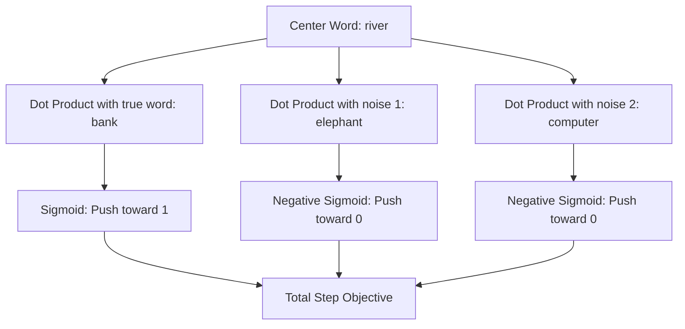
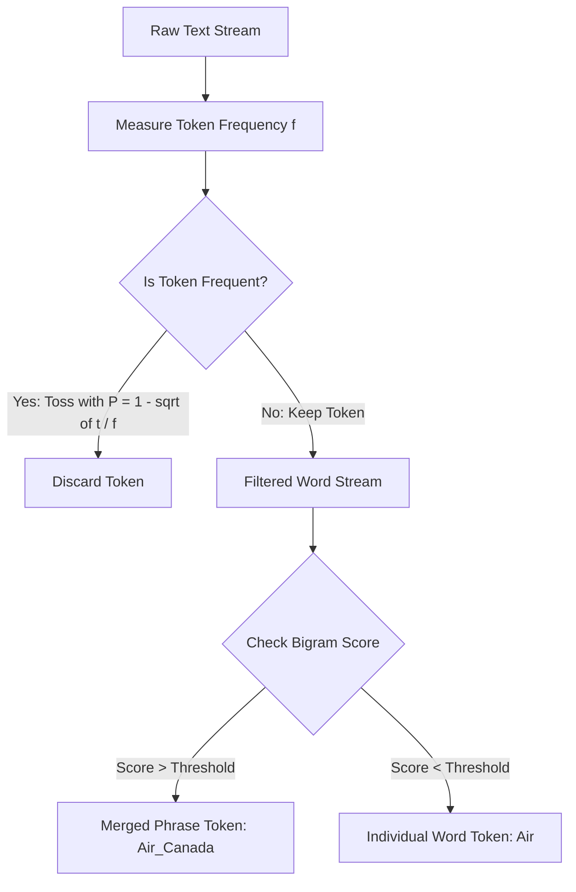

## The hook

What happens when you type `vec("Russia") + vec("river")` into a computer? If your word vectors only memorize isolated dictionary entries, you get numerical static. But in late 2013, researchers watched a neural model add those two lists of numbers together and land squarely on `vec("Volga River")`. Language was suddenly behaving like elementary school arithmetic, and it was running at blistering speeds on billions of words.

## Before you start

Before jumping in, make sure you understand the core mechanics of the Skip-gram architecture and how models learn continuous vector spaces from text. If you want a refresher on vector spaces or the first iteration of Word2Vec, check out [King Minus Man Plus Woman Equals Queen](article:paper-word2vec) and [How Words Become Numbers With Meaning](article:primer-embeddings).

## The world before this paper

In early 2013, neural language models were notoriously sluggish. The original Skip-gram model showed that a simple network could predict context words around a center word and yield stunning vector analogies like `king - man + woman = queen`. But actually training it at internet scale ran into an enormous wall: the softmax denominator.

To compute the probability of a context word $w_O$ given an input word $w_I$, the standard model computes:

$$p(w_O \mid w_I) = \frac{\exp({v'_{w_O}}^\top v_{w_I})}{\sum_{w=1}^{W} \exp({v'_w}^\top v_{w_I})}$$

Look closely at that bottom sum. If your vocabulary $W$ has 500,000 words, you must compute 500,000 dot products and exponentials just to update the network for a single word in a single sentence. If your vocabulary expands into millions of terms, training crawls to a complete standstill.

Researchers had devised clever workarounds. One popular approach was [[Hierarchical Softmax]], which organized the vocabulary into the leaves of a binary tree (such as a Huffman tree). Instead of checking all words, you traversed the tree from the root to the leaf word, turning a linear search into a logarithmic one. Another candidate was [[Noise Contrastive Estimation]], which framed training as telling real text apart from random noise. Yet hierarchical softmax depended heavily on tree structure, and full noise contrastive estimation required calculating exact probabilities under an artificial noise distribution.

Worse yet, all of these systems treated language as a bag of isolated words. If you showed the model the words "Air" and "Canada", it had no mechanism to grasp that "Air Canada" is a single airline, not an atmosphere floating above North America. Similarly, words like "the", "of", and "in" showed up millions of times, soaking up nearly all the gradient updates while teaching the vectors almost nothing useful.

:::history
Tomas Mikolov, Ilya Sutskever, Kai Chen, Greg Corrado, and Jeffrey Dean were working together at Google. They realized that Skip-gram's real magic was not probability estimation for its own sake, but the geometric structure of the learned vectors. If pure probability normalization was slowing them down, why not throw it away entirely?
:::

## The big idea

Instead of calculating a full probability distribution over the entire dictionary, frame the task as a quick game of spot-the-imposter.

:::analogy
Imagine trying to verify a suspect's identity. The standard softmax approach is like putting the suspect in a police lineup alongside every single citizen in the country—all millions of them—and measuring everyone's exact likeness score before deciding.

[[Negative Sampling]] takes a smarter shortcut. You put the suspect next to just five randomly chosen bystanders from the street. If your detective can tell the real suspect from those five random bystanders, your system learns nearly as well, but millions of times faster.
:::

Along with this fast training trick, the authors introduced two practical engineering ideas:
1. **[[Subsampling]]:** Intentionally toss out ultra-frequent words like "the" and "is" so the model spends its energy learning words with real meaning.
2. **Phrase detection:** Scan the text for words that cling together unusually often, glue them into single tokens (like `New_York_Times`), and let the model learn vectors for entire multi-word concepts.

Combined, these changes made Skip-gram fast enough to train on 33 billion words in a single day, unlocking rich geometric features like [[Additive Compositionality]].

## How it works

Let's break down the three moving parts that turned Word2Vec into an industrial powerhouse.

### 1. Negative Sampling: Trading Normalization for Logistic Regression

In standard Skip-gram, the network tries to make the true context word have the highest probability among all words in the vocabulary. [[Negative Sampling]] simplifies this drastically: it turns one massive multi-class classification problem into multiple tiny binary classification problems.

For every real pair of words $(w_I, w_O)$ in your text window, you pick $k$ random "noise" words $w_1, \dots, w_k$ from a noise distribution $P_n(w)$. Then, you maximize this objective:

$$\log \sigma({v'_{w_O}}^\top v_{w_I}) + \sum_{i=1}^{k} \mathbb{E}_{w_i \sim P_n(w)} \left[ \log \sigma(-{v'_{w_i}}^\top v_{w_I}) \right]$$

Here is what every symbol means:
- $v_{w_I}$ is the vector representing the center input word.
- $v'_{w_O}$ is the output vector for the true context word.
- $\sigma(x) = \frac{1}{1 + \exp(-x)}$ is the standard sigmoid function, which squashes any real number into a probability between $0$ and $1$.
- $w_i$ is a fake (negative) word sampled from the noise distribution $P_n(w)$.
- $k$ is the number of negative samples per real word (typically 5 to 20 for smaller datasets, or 2 to 5 for massive corpora).

Notice what happens inside the sigmoids. When the dot product between the center word and the real context word ${v'_{w_O}}^\top v_{w_I}$ is large and positive, $\sigma({v'_{w_O}}^\top v_{w_I})$ approaches $1$, making the first term close to $\log(1) = 0$ (the best possible score).

For each fake word $w_i$, we want the dot product ${v'_{w_i}}^\top v_{w_I}$ to be negative. Because $\sigma(-x) = 1 - \sigma(x)$, driving the negative dot product up means driving the probability that $w_i$ belongs with $w_I$ down to $0$.



#### A tiny worked example

Suppose our center word is `"river"`, the true context word is `"bank"`, and we draw $k=1$ negative word: `"pencil"`.
Assume the model computes these dot products:
- Real pair: $v'_{\text{bank}}^\top v_{\text{river}} = 2.0$
- Fake pair: $v'_{\text{pencil}}^\top v_{\text{river}} = 1.0$

Let's plug these into our formula:
1. For the real pair: $\sigma(2.0) = \frac{1}{1 + e^{-2.0}} \approx 0.8808$. The log score is $\log(0.8808) \approx -0.1269$.
2. For the fake pair: $\sigma(-1.0) = \frac{1}{1 + e^{1.0}} \approx 0.2689$. The log score is $\log(0.2689) \approx -1.3134$.
3. Total objective: $-0.1269 + (-1.3134) = -1.4403$.

The gradient will nudge $v_{\text{river}}$ closer to $v'_{\text{bank}}$ (increasing the first dot product) and push it away from $v'_{\text{pencil}}$ (decreasing the second dot product). We updated our vectors without touching the rest of the dictionary!

### 2. The 3/4 Noise Distribution

Where do the negative words come from? If you pick words purely at uniform random, almost every sample will be an obscure word you rarely encounter, offering zero training challenge. If you sample directly from word frequencies (the raw unigram distribution), common words like "the" and "a" will get picked almost every single time.

The authors discovered that raising word frequencies to the power of $3/4$ hits the empirical sweet spot:

$$P_n(w) = \frac{U(w)^{3/4}}{\sum_{w'} U(w')^{3/4}}$$

Here, $U(w)$ is the raw frequency of word $w$. Raising the probability to the $0.75$ power dampens the giant frequencies of top words while giving rare words a much better chance of being tested.

:::try-this
Imagine a vocabulary of two words: a common word with count $1{,}000{,}000$ and a rare word with count $1{,}000$. 
In raw probabilities, the common word is $1{,}000$ times more likely to be picked. 
Calculate their relative ratio after taking the $3/4$ power: 
$(1{,}000{,}000)^{0.75} = 31{,}622$, while $(1{,}000)^{0.75} \approx 177.8$. 
Now the common word is only about $178$ times more likely! The rare word just received a dramatic boost in visibility.
:::

### 3. Subsampling Frequent Words

Stopwords like "the", "in", and "a" occur hundreds of millions of times. Observing that "the" co-occurs with "apple" tells the model virtually nothing about "apple".

To fix this imbalance, the paper introduces [[Subsampling]]. Each word $w_i$ in the dataset is dropped with probability:

$$P(w_i) = 1 - \sqrt{\frac{t}{f(w_i)}}$$

Where $f(w_i)$ is the word's frequency across the corpus, and $t$ is a tiny threshold, typically set around $10^{-5}$. 

If a word accounts for $0.01\%$ of all words ($f(w_i) = 10^{-4}$), and $t = 10^{-5}$, the ratio is $0.1$. The square root of $0.1$ is roughly $0.316$. That word gets discarded roughly $68\%$ of the time! If a word appears rarely ($f(w_i) \le t$), it is kept every time.



### 4. Learning Phrases: Beyond Individual Words

To capture idioms, the authors built a simple data-driven pipeline. They swept through the raw text and calculated a score for every adjacent pair of words:

$$\text{score}(w_i, w_j) = \frac{\text{count}(w_i w_j) - \delta}{\text{count}(w_i) \times \text{count}(w_j)}$$

The parameter $\delta$ acts as a discount barrier: it prevents two very rare words that happen to appear together once from turning into a permanent phrase. Pairs exceeding a chosen threshold are glued into a single token with an underscore (like `New_York`). Running this pass 2 to 4 times lets longer phrases form, transforming `New` + `York` + `Times` into `New_York_Times`.

:::insight
Treating multi-word entities as single tokens during training prevents the model from mangling non-compositional phrases. "Boston Globe" is a newspaper, not a literal globe located in Massachusetts.
:::

## What they found

The experimental results confirmed that these tweaks yielded both massive speedups and sharper embeddings.

### Speed and Accuracy on 1 Billion Words

On an internal news dataset of one billion words, negative sampling combined with subsampling dominated earlier methods:

- **Speedup:** Adding subsampling accelerated training by roughly $2\times$ to $10\times$. Training Skip-gram with 5 negative samples (`NEG-5`) dropped from 38 minutes down to just 14 minutes.
- **Analogy Performance:** Despite the speedup, accuracy actually climbed. On the analogical reasoning benchmark, `NEG-5` improved from $59\%$ total accuracy to $60\%$. With 15 negative samples (`NEG-15`), it reached $61\%$.
- **Hierarchical Softmax:** When trained without subsampling, hierarchical softmax scored a modest $47\%$. But when subsampling was applied, it surged to $55\%$ on words and reached $47\%$ on phrases (up from $19\%$).

### Scaling to 33 Billion Words

When the team scaled up their corpus from 1 billion to roughly 33 billion words, accuracy on the phrase analogy benchmark climbed to $72\%$ (using 1000-dimensional vectors). When they artificially restricted that same setup to 6 billion words, accuracy fell to $66\%$, confirming that phrase representations are exceptionally hungry for data scale.

```
Phrase Analogy Accuracy by Dataset Size (1000-d vectors):
[ 6 Billion Words  ]  ████████████████████ 66%
[ 33 Billion Words ]  ██████████████████████ 72%
```

### The Mystery of Vector Addition

Perhaps the most delightful finding was [[Additive Compositionality]]. When you add two Skip-gram vectors together, the resulting vector points directly toward the real-world intersection of those concepts:

- `vec("Czech") + vec("currency")` $\approx$ `vec("koruna")`
- `vec("Vietnam") + vec("capital")` $\approx$ `vec("Hanoi")`
- `vec("German") + vec("airlines")` $\approx$ `vec("Lufthansa")`
- `vec("Russian") + vec("river")` $\approx$ `vec("Volga River")`

Why does simple addition do this? 

Because Skip-gram vectors are trained to predict context words using dot products, each vector effectively encodes the log-probability distribution of words that appear in its neighborhood. When you add two vectors in log-space, you are multiplying their probabilities in linear space. Vector addition acts like a smooth logical `AND`: words that frequently co-occur with *both* concepts receive the highest score.

:::warning
Vector addition works like an `AND` operator, not an ordered sentence builder. `vec("dog") + vec("bites") + vec("man")` produces the exact same vector as `vec("man") + vec("bites") + vec("dog")`. It has no grammar or syntax awareness.
:::

## What it got wrong (or left open)

While this paper set the standard for word representations for years, it left several key hurdles unresolved:

1. **Greedy, Heuristic Phrases:** The bigram scoring equation was entirely heuristic. Discovering multi-word phrases required manual tuning of the threshold and $\delta$, followed by several separate passes over the disk.
2. **One Meaning per Vector:** Every token receives exactly one vector in space. The word "bank" must find a compromise position between a river bank and a financial institution. Negative sampling accelerates the training, but it cannot untangle polysemy.
3. **Heuristic Noise Exponent:** The unigram exponent of $3/4$ ($0.75$) worked empirically across every dataset the authors tested, but the paper offered no theoretical derivation for why $0.75$ works better than $0.70$ or $0.80$.

## What happened next

The techniques in this paper became part of the standard toolkit for machine learning engineers. The Skip-gram with Negative Sampling (SGNS) algorithm was embedded into software libraries everywhere, and the $3/4$ power trick was adopted far outside NLP—it reappeared in graph algorithms like Node2Vec and across recommendation systems.

Soon after, researchers proved that Skip-gram with Negative Sampling was mathematically equivalent to implicitly factorizing a shifted pointwise mutual information (PMI) word co-occurrence matrix. 

Eventually, static word vectors hit their ceiling. In 2017, the Transformer architecture arrived in [The Paper That Taught Machines Where to Look](article:paper-attention-is-all-you-need), and by 2018, models like [Fill in the Blanks, Understand Everything](article:paper-bert) introduced dynamic, contextual embeddings where the vector for "bank" changes based on the sentence around it. But the lessons of contrastive learning, efficient negative sampling, and training at internet scale began right here.

## Key takeaways

- Full softmax calculation scales linearly with vocabulary size, making it impractical for massive vocabularies.
- Negative sampling replaces full softmax by training a binary classifier to distinguish the true target word from a small handful of noise words.
- Sampling negative words from the unigram distribution raised to the $3/4$ power dampens dominant words and gives rare words a meaningful training signal.
- Subsampling frequent words like "the" speeds up training by up to $10\times$ while simultaneously improving the vector quality of rarer terms.
- Vector addition in Skip-gram functions as a soft intersection operator, allowing simple vector sums to capture multi-word concepts.
