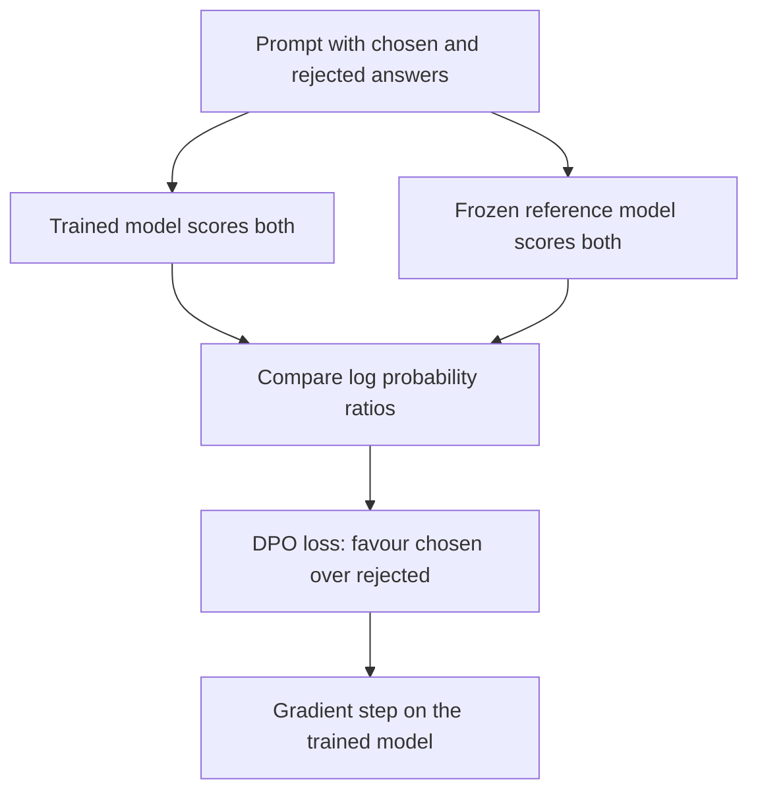

## The hook

The recipe that turned GPT-3 into ChatGPT is famously fiddly. Train a reward model on human preferences. Then run reinforcement learning with PPO, juggling four large models at once: the policy, a reference copy, the reward model and a value model. Tune a dozen settings, sample text constantly, and hope training stays stable.

In May 2023, a team at Stanford posted a paper with a provocative subtitle: "Your Language Model is Secretly a Reward Model." With a few lines of algebra, they showed that the whole reinforcement learning stage could be replaced by a single loss function, as simple to run as ordinary fine-tuning. It worked as well or better in their experiments. Within months, DPO was being used to align many open models.

## Before you start

You need the RLHF recipe from [How a Text Predictor Learned to Be Helpful](article:paper-instructgpt): demonstrations, a reward model trained on rankings, and PPO with a penalty for drifting too far. This article is more mathematical than most; each step is explained in words and with numbers.

## The world before this paper

RLHF worked, but it was hard to run:

- **Many models in memory.** PPO for language models typically needs the model being trained, a frozen reference copy, a reward model and a value network, often all large.
- **Sampling during training.** The model must generate fresh text throughout training to be scored, which is slow.
- **Instability.** Reinforcement learning with large models is sensitive to settings, and can collapse or exploit flaws in the reward model.

:::history
Rafael Rafailov, Archit Sharma and Eric Mitchell, PhD students at Stanford working with Stefano Ermon, Christopher Manning and Chelsea Finn, noticed that the RLHF objective, maximise reward while staying close to a reference model, is a well-studied problem with a known exact solution. That observation was the key to the whole paper.
:::

## The big idea

The RLHF objective has a [[closed-form solution]]: for any reward function, the best possible policy can be written down exactly in terms of that reward and the [[reference model]]. Flip that relationship around, and the reward can be written in terms of the policy. Substitute that into the reward model's training loss, and you get a loss that trains the **policy directly** on [[preference data]], with no separate reward model and no reinforcement learning.

:::analogy
Think of a cooking competition. The old way: first train a food critic to score dishes like the judges would, then have the chef cook thousands of dishes and adjust based on the critic's scores. DPO notices that a chef's own changes in habit already reveal what they think tastes better. So skip the critic: show the chef pairs of dishes the judges compared, and have the chef lean toward the winner and away from the loser, measured against how they cooked before. Same goal, one fewer person in the kitchen, and no endless test-cooking.
:::

:::insight
Preference alignment does not need reinforcement learning. Because the best policy and the implied reward are mathematically linked, you can train the language model directly on pairs of preferred and rejected answers.
:::

## How it works

### Step 1: what RLHF is really asking for

RLHF tries to find a policy $\pi$ that maximises reward $r(x, y)$ for prompts $x$ and responses $y$, while paying a penalty, controlled by [[beta]] ($\beta$), for drifting from the reference policy $\pi_{\text{ref}}$. The exact best policy for that objective is

$$\pi^*(y \mid x) \propto \pi_{\text{ref}}(y \mid x)\, \exp\!\big(r(x, y) / \beta\big)$$

In words: start from the reference model's probabilities, and boost each response in proportion to the exponential of its reward.

### Step 2: flip it around

Rearrange that formula to express the reward using the policy:

$$r(x, y) = \beta \log \frac{\pi^*(y \mid x)}{\pi_{\text{ref}}(y \mid x)} + \text{(a term that depends only on } x)$$

So any policy implicitly defines a reward: how much more likely it makes a response than the reference does, on a log scale. This is the "secret reward model" of the title.

### Step 3: plug into the preference model

Reward models are trained with the [[Bradley-Terry model]]: the probability that the chosen response $y_w$ beats the rejected $y_l$ is $\sigma(r(x, y_w) - r(x, y_l))$. Substitute the implied reward. The awkward term that depends only on $x$ appears in both rewards and **cancels**. What remains is the DPO loss:

$$\mathcal{L}_{\text{DPO}} = -\log \sigma\!\left(\beta \log \frac{\pi_\theta(y_w \mid x)}{\pi_{\text{ref}}(y_w \mid x)} - \beta \log \frac{\pi_\theta(y_l \mid x)}{\pi_{\text{ref}}(y_l \mid x)}\right)$$

- $\pi_\theta$ is the model being trained.
- Each ratio says how much more (or less) likely the trained model makes a response than the reference does.
- The loss is small when the model has raised the chosen response's [[log probability]] more than the rejected one's, relative to the reference.

That is a classification-style loss on pairs of texts, computed with two forward passes per model. No sampling, no reward model, no value network.

### A worked example

For one prompt, suppose the trained model, compared with the reference, makes the chosen answer more likely by a log ratio of $+0.5$ and the rejected answer less likely by $-0.3$. With $\beta = 0.1$:

- Inside the sigmoid: $0.1 \times 0.5 - 0.1 \times (-0.3) = 0.05 + 0.03 = 0.08$.
- $\sigma(0.08) \approx 0.52$, so the loss is $-\log 0.52 \approx 0.65$.

The model barely prefers the chosen answer yet, so the loss is high and the gradient pushes harder. If later the log ratios grow to $+8$ and $-12$, the inside becomes $0.8 + 1.2 = 2.0$, $\sigma(2.0) \approx 0.88$, and the loss falls to about $0.13$.

:::try-this
With $\beta = 0.1$, what happens if the trained model has mistakenly made the **rejected** answer more likely (log ratio $+1.0$) and left the chosen one unchanged (log ratio $0$)? Compute the value inside the sigmoid and the loss. ($0 - 0.1 = -0.1$, $\sigma(-0.1) \approx 0.48$, loss $\approx 0.74$. The gradient will push the rejected answer back down and the chosen one up.)
:::

### What the gradient does

The paper shows that DPO's gradient raises the probability of chosen responses and lowers that of rejected ones, weighted by how wrong the implied reward currently is. Pairs the model already gets right contribute little; pairs it gets badly wrong contribute a lot. This weighting turned out to be important: a naive version without it degraded the model.

## What they found

The authors compared DPO with PPO-based RLHF and other baselines on three tasks:

- **Controlled sentiment generation:** writing positive movie reviews. DPO achieved a better trade-off between reward and staying close to the reference model than PPO, even PPO given access to the true reward.
- **Summarisation:** on Reddit TL;DR posts, judged by GPT-4 as a proxy for human evaluators, DPO's summaries won more often against human-written reference summaries than PPO's did, and DPO was more robust to the sampling temperature.
- **Single-turn dialogue:** on Anthropic's helpful and harmless dialogue dataset, DPO was the only computationally efficient method tested that improved over the preferred responses in the dataset.

A human study confirmed that GPT-4's judgements broadly agreed with human preferences for these comparisons.

:::warning
Common misconception: "DPO means you no longer need human preference data." DPO removes the reward model and the reinforcement learning loop, not the preferences. It still needs pairs of chosen and rejected answers, collected from people or, increasingly, from other AI models.
:::

## What it got wrong (or left open)

DPO learns from a fixed dataset of comparisons. PPO, by generating new text during training, can explore and get feedback on responses the dataset never contained. Later comparisons found that well-tuned online RL methods can still beat DPO in some settings, especially on harder reasoning tasks.

DPO can also over-optimise: pushing the rejected answer's probability down can drag down related good text too, and the method can be sensitive to the choice of $\beta$ and to noisy preference labels. The experiments used models of up to a few billion parameters, leaving open how the comparison would play out at much larger scales.

## What happened next

- DPO spread rapidly through the open-source community; models such as Hugging Face's Zephyr used it, and it became a standard part of many post-training pipelines, including for later versions of [LLaMA](article:paper-llama).
- A family of variants followed, such as IPO, KTO, ORPO and SimPO, each tweaking the loss to fix specific weaknesses.
- The paper received an outstanding paper runner-up award at NeurIPS 2023.
- Preference optimisation and reinforcement learning continue to coexist: many labs use DPO-style offline training alongside online methods for reasoning.

## Key takeaways

- RLHF's objective, maximise reward while staying close to a reference model, has an exact solution linking the best policy to the reward.
- Rearranging that solution shows that any language model implies a reward: its log probability ratio against the reference.
- Substituting this into the standard preference model cancels the hard terms and yields the DPO loss, a simple classification loss on chosen and rejected pairs.
- DPO matched or beat PPO-based RLHF on sentiment, summarisation and dialogue tasks while being far simpler and cheaper to run.
- It became a standard alignment tool for open models, though online reinforcement learning remains valuable in some settings.
