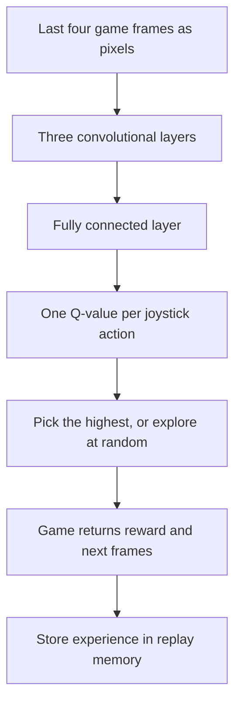

## The hook

Imagine handing someone a game controller for a console they have never seen, switched on to a game they have never heard of, with no instructions. They can see the screen and a score. That is all. Within a few hours, they are playing better than most people.

In 2015, a London startup that Google had bought the year before published a paper in Nature describing a program that did this, not for one game, but for 49 different Atari games, with the **same** program and the same settings for every one. In Breakout, it even discovered a strategy that many human players never find: dig a tunnel through the side of the wall and let the ball bounce around behind it.

## Before you start

You should know how convolutional networks see images, from [The Night Deep Learning Won](article:paper-alexnet), and how networks learn with [gradient descent](article:primer-gradient-descent). This paper introduces [[reinforcement learning]], which needs no labels at all, only rewards.

## The world before this paper

In supervised learning, every example comes with the right answer. In reinforcement learning, an [[agent]] acts in an environment and receives a [[reward]] now and then. Nobody says which action was right. A move that looks bad now might win the game a minute later.

:::history
Reinforcement learning had a long history, including Q-learning, introduced by Chris Watkins in 1989, and a famous early success: TD-Gammon, built by Gerald Tesauro at IBM in the early 1990s, which learned backgammon by playing against itself and reached a very strong level. But for two decades, attempts to combine reinforcement learning with powerful neural networks were known to be unstable; learning would oscillate or diverge. Most successful systems relied on hand-crafted features.
:::

DeepMind, co-founded by Demis Hassabis, Shane Legg and Mustafa Suleyman, had a bold goal: build general learning systems, not game-specific ones. Volodymyr Mnih and colleagues had published an early version of this work in 2013, playing 7 Atari games. The Nature paper scaled it up to 49 and added a crucial stabilizer.

## The big idea

Use a deep convolutional network to estimate how good each possible action is, directly from pixels, and train it with Q-learning. Then fix the two things that made this combination unstable: correlated training data and a constantly moving target.

:::analogy
Think of learning to cook by trial and error, with a food critic who only gives you a score at the end of each meal. To get better, you need a sense of how good each decision is **before** the final score arrives: "adding salt now usually leads to a better dish later." A [[Q-value]] is that sense. And instead of only learning from tonight's dinner, you keep a notebook of past meals and revise your instincts by flipping to random pages, so one burnt dish does not dominate your thinking.
:::

:::insight
A deep network can learn what an action is worth from raw experience, as long as you train it on a shuffled memory of past experience and give it a stable target to aim at.
:::

## How it works

### Q-values and the Bellman idea

A Q-value $Q(s, a)$ is the total future reward you expect if you take action $a$ in situation $s$, then keep playing well. The key relationship, from the Bellman equation, is:

$$Q(s, a) = r + \gamma \max_{a'} Q(s', a')$$

- $r$ is the reward you get right away.
- $s'$ is the next situation, and $\max_{a'} Q(s', a')$ is the value of the best action you could take there.
- $\gamma$ (gamma), around 0.99, is a discount: future rewards count a little less than immediate ones.

In words: an action's value is what you get now, plus the discounted value of the best you can do next.

### A worked Q-learning update

Your current estimate for "move right" in some position is $Q = 2.0$. You move right, get $r = 1$ point, and in the next position, your best estimated action is worth 5.0. With $\gamma = 0.9$:

- Target: $1 + 0.9 \times 5.0 = 5.5$.
- Your estimate was 2.0, so you were too pessimistic by 3.5.
- With a learning rate of 0.1, the new estimate becomes $2.0 + 0.1 \times 3.5 = 2.35$.

DQN does the same thing, but instead of a table of numbers, a neural network outputs a Q-value for every action, and gradient descent nudges it toward these targets.

:::try-this
Suppose instead that moving right loses a life: $r = -10$, and the next position's best action is worth only 1.0. With $\gamma = 0.9$ and learning rate 0.1, update the same estimate of 2.0. (Target: $-10 + 0.9 = -9.1$. Error: $-11.1$. New estimate: $2.0 - 1.11 = 0.89$. The network becomes much less keen on moving right in that situation.)
:::

### The network

The input was the last four frames, shrunk to 84 by 84 grayscale pixels, so the network could see motion. The output was one Q-value for each possible joystick action, up to 18. To keep exploring, the agent took a random action a fraction of the time, starting at 100% and decreasing to 10% over training, a simple form of [[exploration]].

### Stabilizer 1: experience replay

Consecutive game frames are nearly identical, and training a network on such a highly correlated stream makes it lurch from one recent situation to the next. DQN stores each experience, (state, action, reward, next state), in a memory of the last million steps, and trains on random mini-batches drawn from it. This [[experience replay]] breaks the correlations and lets each experience be learned from many times.

### Stabilizer 2: a target network

The training target uses the network's own estimate of the next state's value. But that estimate changes every time the network updates, so the target keeps moving, like chasing your own shadow. DQN keeps a separate [[target network]], a frozen copy used only to compute targets, and updates it to match the main network only every 10,000 steps.

## What they found

- Across 49 Atari 2600 games, with the same architecture, algorithm and settings, DQN outperformed the best previous reinforcement learning methods on 43 games.
- It reached a level comparable to a professional human games tester across the set, scoring above 75% of the human tester's score on 29 of the 49 games.
- Ablation experiments showed that both experience replay and the target network mattered; removing either one sharply hurt performance.
- In Breakout, the agent learned the tunnelling strategy; in other games it learned to anticipate enemy movements over long periods.
- Visualizations of the network's internal representations showed that game states with similar values were grouped together, even when they looked different on screen.

:::warning
Common misconception: "DQN mastered all Atari games." It struggled badly on games that need long-term planning and exploration with rare rewards. In Montezuma's Revenge, where you must navigate several rooms before getting any points, it scored essentially nothing.
:::

## What it got wrong (or left open)

DQN was extremely data-hungry: about 50 million frames of play per game, roughly 38 days of non-stop gameplay, far more than a human needs. Games with sparse rewards, where random exploration almost never finds points, remained unsolved by this approach.

Q-learning also tends to overestimate values, because taking the maximum over noisy estimates is biased upward. And the method only works when there is a small, fixed set of discrete actions, like joystick directions, not continuous controls like steering angles or robot joint torques.

## What happened next

- A wave of improvements followed: Double DQN fixed the overestimation, prioritized replay learned more from surprising experiences, and the "Rainbow" agent (2017) combined many of them.
- The deep reinforcement learning idea, a neural network judging positions learned through play, scaled to the ancient board game Go in [AlphaGo](article:paper-alphago).
- Policy-gradient methods, which learn actions directly and handle continuous control, matured into [PPO](article:paper-ppo), later used to fine-tune language models with human feedback.
- In 2020, DeepMind's Agent57 finally surpassed the human benchmark on all 57 Atari games in its test suite, including Montezuma's Revenge.

## Key takeaways

- DQN learned to play 49 Atari games from raw pixels and the score, using the same network and settings for every game.
- It uses a convolutional network to estimate Q-values, the expected future reward of each action, trained with Q-learning.
- Experience replay breaks correlations by training on random samples of stored past experiences.
- A target network, a slowly updated copy, keeps the training targets stable.
- It beat earlier methods on most games and reached roughly human tester level, but struggled where rewards are rare and long-term planning is needed.
