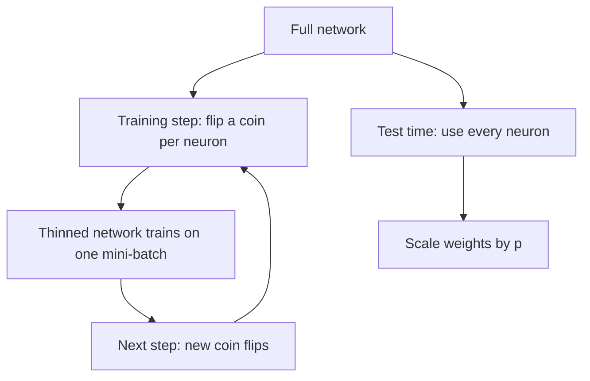

## The hook

Here is a strange way to train a team. Every day, before practice, you flip a coin for each player. Heads, they play. Tails, they sit out. Nobody knows in advance who will be on the field, so nobody can rely on a favourite teammate to cover for them.

It sounds like a recipe for chaos. Yet when Geoffrey Hinton's group applied exactly this idea to neural networks, randomly switching off half the neurons on every training step, the networks got markedly better at handling new data. The trick, called dropout, became one of the most widely used tools in deep learning, and it played a key part in [AlexNet](article:paper-alexnet)'s famous win.

## Before you start

You should be comfortable with the idea of overfitting from [Memorizing vs Learning](article:primer-overfitting) and with the scale of networks like [AlexNet](article:paper-alexnet), which had 60 million parameters. Dropout exists because big networks are very good at memorizing.

## The world before this paper

Large neural networks have a lot of parameters, which makes them powerful and also dangerously good at overfitting. The usual defences were limited:

- **Stopping training early,** before the network memorizes too much.
- **Weight penalties,** which add a cost for large weights to the loss.
- **Ensembles:** train many different networks and average their predictions. This works very well, but training and running ten big networks costs ten times as much.

:::history
The idea first appeared in a 2012 arXiv preprint by Hinton and colleagues titled "Improving neural networks by preventing co-adaptation of feature detectors." It was already part of the AlexNet recipe that year. The 2014 journal paper, led by Hinton's student Nitish Srivastava, gave the full method, the motivation and an extensive set of experiments across many kinds of data.
:::

The authors noticed a specific way that big networks overfit. Neurons form [[co-adaptation|co-adapted]] teams: one neuron learns to fix the mistakes of another, and together they fit the quirks of the training set. Each one is useless without its partners, and the team falls apart on new data.

## The big idea

Break up the cliques. On every training step, remove each neuron at random with some probability. This is [[dropout]].

:::analogy
Go back to the coin-flip team. Because any teammate might be missing, every player has to be useful on their own and work with whoever happens to be on the field. No two players can develop a private routine that only works when both are present. On match day, everyone plays, and the team is robust because every player learned to contribute independently.
:::

The paper also offered a striking biological motivation. In sexual reproduction, an offspring gets a random half of its genes from each parent, so genes cannot rely on a large, specific set of partner genes always being present. Each gene must be useful in many combinations. Dropout imposes the same pressure on neurons.

:::insight
Dropout makes every neuron learn features that are useful on their own, in many different company. Fragile, memorized teamwork cannot survive constant random reshuffling.
:::

## How it works

### Training: a different network every step

On each training step, for each neuron in a layer, keep it with [[retention probability]] $p$ and drop it otherwise. A dropped neuron outputs zero for that step: it does not contribute to the forward pass and receives no update in the backward pass. The result is a [[thinned network]].

The paper typically used $p = 0.5$ for hidden layers and a higher value, such as $0.8$, for input units, so that only a little of the raw input is hidden.

Where to apply it is a judgment call. Dropout helps most in the layers with the most parameters, such as the large fully connected layers of [AlexNet](article:paper-alexnet), because that is where memorization happens. Dropping too much of the input is harmful, because the network then cannot see enough of each example to learn anything. The paper also found that networks using dropout benefit from being made larger, since each step only uses part of the network.

### A crowd hiding inside one network

A layer with $n$ neurons can be thinned in $2^n$ different ways. A network with just a few hundred neurons therefore contains more possible thinned networks than there are atoms in the universe. Dropout trains a random selection of them, and they all **share the same weights**.

That is why dropout behaves like an [[ensemble]]. You get much of the benefit of averaging an astronomical number of networks, while training and storing only one.

### Testing: the scaling trick

At test time you want a single, deterministic answer, so you use the full network with no dropout. But there is a catch. During training, each neuron in the next layer saw only about a fraction $p$ of its inputs on average. With everything switched on, it would suddenly receive about $1/p$ times more input than it was used to.

The fix is simple: multiply the outgoing weights by $p$ at test time. With $p = 0.5$, every weight is halved. The paper argues this approximates the average prediction of all the thinned networks.

### A tiny worked example

A neuron receives inputs from four neurons, each outputting 1, through weights of 1. With $p = 0.5$, on a typical training step about two of the four are active, so it receives about $2$.

At test time, all four are active. Without scaling, it receives $4$, twice what it learned to expect. Scale each weight by $0.5$ and it receives $4 \times 0.5 = 2$, matching training.

:::try-this
Suppose a layer uses retention probability $p = 0.8$, and at test time a neuron's four inputs each output 1 through weights of 1. What total input should it receive after scaling, and why is that the right target? (It should receive $4 \times 0.8 = 3.2$, because during training an average of 80% of the inputs, about 3.2 of them, were active.)
:::

:::warning
Common misconception: "dropout deletes neurons permanently." The neurons are only switched off for one training step, and every neuron comes back for the next step and at test time. Nothing is removed from the final network.
:::

Many modern libraries use an equivalent version called inverted dropout: they scale the surviving activations **up** by $1/p$ during training, so nothing needs to change at test time.

## What they found

The paper tested dropout across a wide range of domains, and it improved results on nearly all of them:

- Image classification on MNIST, street-view house numbers, CIFAR and ImageNet.
- Speech recognition on the TIMIT benchmark.
- Document classification on a Reuters news collection.
- A biology task, predicting alternative splicing of genes.

They also found that dropout worked especially well combined with a "max-norm" constraint that caps the size of each neuron's incoming weights, and that the features learned with dropout were cleaner and more distinct, each neuron detecting something meaningful on its own. A side effect: activations became sparse, with fewer neurons strongly active for any given input.

## What it got wrong (or left open)

Dropout slows training down. Because each step trains a random subnetwork, the gradients are noisy, and the paper noted that a dropout network typically takes two to three times longer to train than a standard one.

The test-time scaling is an approximation of true ensemble averaging, exact only in simple cases. And dropout needed new rules of thumb: it worked best with bigger networks and higher learning rates, which shifted how practitioners tuned their models.

Its importance also changed over time. Once [Batch Normalization](article:paper-batch-normalization) arrived in 2015, many convolutional networks needed less dropout, and some dropped it entirely.

## What happened next

- Dropout became a standard layer in deep learning libraries and is still widely used in the fully connected parts of networks and in [Transformers](article:paper-attention-is-all-you-need), which apply dropout in several places.
- It inspired variants, such as dropping whole channels in convolutional networks or dropping entire layers in very deep networks.
- Researchers later reinterpreted dropout in Bayesian terms, using it at test time to estimate how uncertain a network is.
- The broader lesson, that adding noise during training is a powerful regularizer, runs through modern deep learning, from data augmentation to the noise schedules of [diffusion models](article:paper-ddpm).

## Key takeaways

- Dropout randomly switches off neurons during training so the network cannot rely on fragile, co-adapted teams of neurons.
- Each training step trains a different thinned network, and all of them share weights, which makes dropout behave like a huge ensemble.
- At test time every neuron is used and weights are scaled by the retention probability to match what the network saw during training.
- Dropout improved results across vision, speech, text and biology, at the cost of slower training.
- It became one of deep learning's standard regularization tools and helped AlexNet's large network avoid overfitting.
