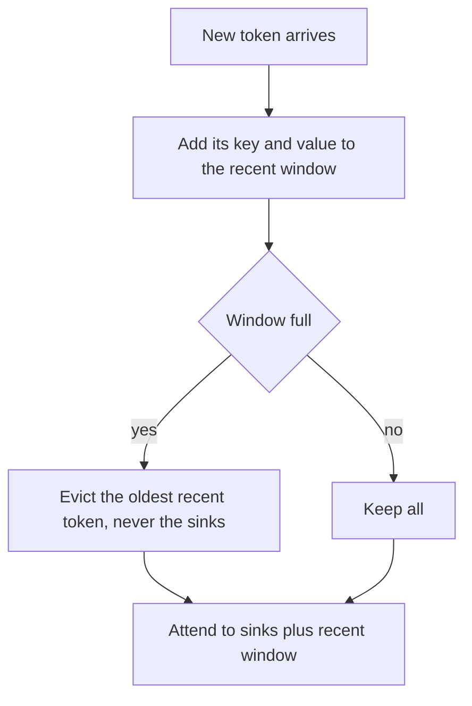

## The hook

Imagine a chatbot that runs all day: a customer service assistant, or a game character that never stops talking. Its memory of the conversation grows with every token until it no longer fits. The obvious fix is to forget the oldest words and keep only the recent ones.

When researchers tried exactly that, the model did not get slightly worse. It fell apart, producing nonsense almost immediately. The culprit turned out to be a handful of tokens at the very start of the text, often words with no meaning at all, that the model had quietly come to depend on.

## Before you start

You should know how attention lets each token look at earlier tokens, from [The Paper That Taught Machines Where to Look](article:paper-attention-is-all-you-need). It helps to know that models store earlier keys and values in a cache while generating, which [the vLLM article](article:paper-vllm) explains.

## The world before this paper

When a language model generates text, every new token attends to all earlier tokens. To avoid recomputing them, it stores their keys and values in the [[KV cache]]. That cache grows with every token, and the model was only trained on texts up to some length, its [[context window]].

So long-running generation had two bad options:

- **Keep everything.** Memory and time grow without limit, and once the text is longer than the training length, quality drops anyway.
- **[[Sliding window attention]].** Keep only the most recent tokens. Memory stays fixed, but as the paper showed, quality collapses as soon as the very first tokens are evicted.

A third option, recomputing the window from scratch for every token, kept quality but was far too slow.

:::history
Guangxuan Xiao, working with Yuandong Tian, Beidi Chen, Song Han and Mike Lewis, studied why the sliding window fails. Their paper appeared on arXiv in late 2023 and at ICLR 2024. They looked at where attention actually goes inside models such as Llama 2, MPT, Falcon and Pythia, and found something odd: a large share of attention, in many layers and heads, landed on the first few tokens, whatever those tokens happened to be.
:::

## The big idea

:::analogy
Think of a classroom where every student must spend exactly ten minutes of each lesson talking to someone. On days with nothing useful to discuss, everyone wanders over to the same seat by the door, where the class monitor always sits, and chats about nothing. The monitor is not important; that seat is just the habitual place to spend leftover time. Move the monitor out, and the whole room is thrown into confusion.
:::

The paper's big idea is that the first tokens act as [[attention sink]]s, like that seat by the door. Attention weights come from a [[softmax]], so they must add up to exactly 1. When a head finds nothing relevant to attend to, it still has to put that weight somewhere. During training, the first token is visible to every later token, so models learn to park unneeded attention there.

Evict those tokens and the parked attention has nowhere to go. It spreads onto other tokens, distorting every layer's output. The fix is almost embarrassingly simple: never evict the sinks.

## How it works

StreamingLLM keeps a KV cache made of two parts:

1. **A few attention sink tokens**: the first tokens of the stream. The paper found that keeping 4 is enough.
2. **A rolling window of recent tokens**: everything else, evicting the oldest as new tokens arrive.

One detail matters: positions are assigned within the cache, not in the original text. If the cache holds 4 sink tokens and a window of recent ones, the positions run continuously from the sinks through the window, so the model never sees position numbers larger than it was trained on.

### A small example

Suppose the cache has room for 8 tokens: 4 sinks plus 4 recent.

| Tokens generated | Cache contents |
|---|---|
| 1 to 8 | t1 t2 t3 t4 t5 t6 t7 t8 |
| 9 | t1 t2 t3 t4 · t6 t7 t8 t9 |
| 10 | t1 t2 t3 t4 · t7 t8 t9 t10 |
| 100 | t1 t2 t3 t4 · t97 t98 t99 t100 |

Plain sliding window would hold t93 to t100 at step 100, losing t1 to t4, and the model's attention would lose its resting place.

In the classroom picture: the window keeps changing which students are present, but the monitor's seat by the door is never emptied, so everyone still knows where to go when they have nothing to say.

:::try-this
With 4 sinks and a window of 1,000 recent tokens, how many tokens does the cache hold after generating one million tokens? Which ones? (Always 1,004: tokens 1 to 4, plus the latest 1,000. Memory stays fixed no matter how long the stream runs.)
:::

### Why four sinks and not one?

Existing models were not trained with a consistent "start" token at the beginning of every sequence, so the sink role gets spread over the first few positions rather than one. The paper found that keeping just one initial token was not quite enough for some models, while four restored stable behaviour. In the classroom picture, the habit is not one seat by the door but the first few seats nearest it, and you need to keep all of them free.

### Training a dedicated sink

The paper also tried pre-training a small model with an extra learnable placeholder token at the start of every training sequence. That token became a clean, dedicated sink, so a single sink token was enough, instead of relying on whichever words happened to come first.

:::insight
Sometimes a model's strange behaviour is not noise but a learned workaround. Softmax forces attention to go somewhere, so models invent a parking spot. Understanding that habit, instead of fighting it, turned an impossible problem into a four-token fix.
:::

## What they found

- **Stable language modelling on extremely long streams.** With sinks plus a recent window, models such as Llama 2, MPT, Falcon and Pythia kept steady [[perplexity]] on streams of up to 4 million tokens, while plain sliding windows collapsed once the first tokens were evicted.
- **Large speedups over the safe alternative.** Compared with recomputing the sliding window for every token, StreamingLLM was reported to be up to 22.2 times faster, because it reuses its cache.
- **Four sinks were enough** for existing models; a single dedicated sink token worked for models pre-trained with one.
- **The pattern was widespread**: many layers and heads across different model families showed heavy attention on initial tokens.

:::warning
Common misconception: "StreamingLLM gives a model infinite memory." It gives stable fluency, not recall. Anything that has left the recent window is gone. If a user mentioned their name 50,000 tokens ago, a streaming model with a 4,000-token window cannot remember it.
:::

## What it got wrong (or left open)

- **No long-term memory.** The method keeps the model working, but information outside the window is simply lost. Tasks that need old facts still need retrieval or longer context.
- **The window is still bounded by training length.** The useful working memory is no larger than the context the model was trained on.
- **Why sinks form, precisely, was described rather than fully explained.** Later work studied the phenomenon in more depth and proposed alternatives, such as changing the attention softmax so heads can attend to "nothing".

## What happened next

The idea spread quickly into practice. Inference libraries added support for keeping sink tokens in the cache, so chat systems could run long sessions with fixed memory.

Attention sinks also became a research topic of their own. Researchers studied why they appear, how they relate to the large "outlier" activations that make models hard to quantise, and whether models should be trained with explicit sink tokens or modified softmax functions from the start. That connects this paper to the efficiency work in [FlashAttention](article:paper-flashattention) and the memory management in [vLLM](article:paper-vllm): all three treat attention and its cache as an engineering problem, not just a formula.

## Key takeaways

- Keeping only recent tokens in the KV cache seems natural for endless streams, but it collapses models once the first tokens are evicted.
- Models learn to dump unneeded attention on the first tokens, because softmax weights must add up to 1 and those tokens are always visible.
- StreamingLLM keeps a few initial sink tokens plus a rolling window of recent ones, giving fixed memory and stable generation over millions of tokens.
- Positions are assigned within the cache so the model never sees positions beyond its training length.
- The method keeps generation fluent but does not let a model remember information that has left the window.
