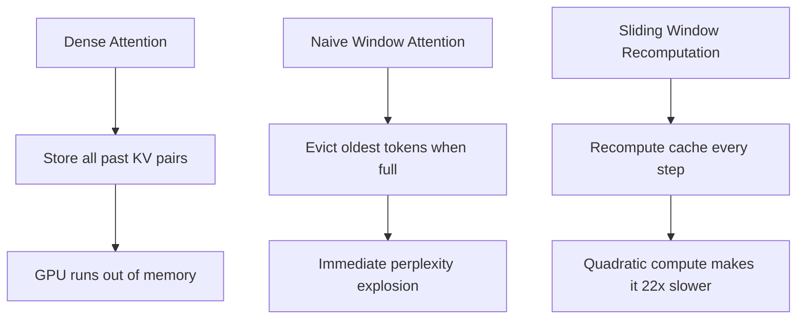
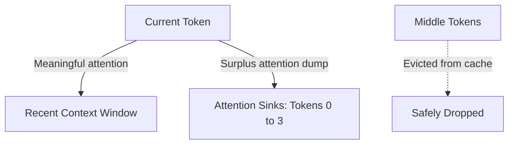
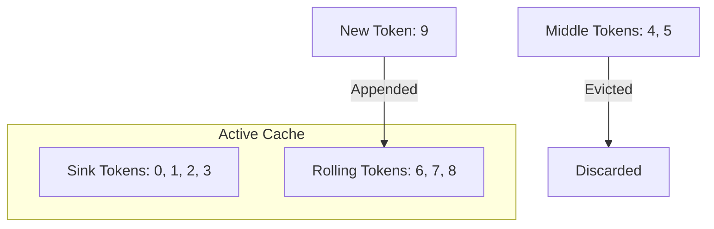

## The hook

Imagine you are having an all-day conversation with an AI assistant. After a few hours of steady chatting, you ask a simple question, and the model suddenly begins emitting random punctuation and gibberish. 

Under the hood, the server ran out of memory, tried to drop the very first sentence you spoke hours ago to make room, and instantly lost its mind. Why would deleting a forgotten greeting from token zero ruin a model's ability to finish a sentence at token five thousand?

In late 2023, a team of researchers uncovered an astonishing quirk hidden inside virtually every modern transformer: language models rely on their very first words not for their meaning, but as a psychic dump bucket.

:::analogy
Imagine a conversation where social etiquette forces you to spend 100% of your attention at all times, even when the speaker pauses or clears their throat. 

You quickly learn to rest your eyes on the coat rack near the front door whenever you do not need to look at anything specific. If someone suddenly removes the coat rack, you panic and lose your focus entirely. But as long as that coat rack stays anchored by the door, you can happily focus your active attention on just the last few things the speaker said.
:::

## Before you start

To get the most out of this paper, you should be familiar with the core mechanics of transformer attention from [Attention Is All You Need](article:paper-attention-is-all-you-need). You should also know what a [[KV Cache]] is and why caching keys and values speeds up generation, as discussed in [vLLM](article:paper-vllm) and [Llama](article:paper-llama).

## The world before this paper

Deploying autoregressive language models in long-running settings—like an ongoing chat session or a system monitoring a live code feed—hits two stubborn walls.

First, memory grows without bound. Every new generated token produces Key and Value vectors that must be preserved in the [[KV Cache]] so future tokens can attend to them. If you let a model generate indefinitely, GPU memory fills up, leading to Out-of-Memory crashes.

Second, transformers do not extrapolate past their training window. If a model was pre-trained on sequences of 4,096 tokens, feeding it token 4,097 causes its internal distance trackers to encounter positions they never saw during training. The attention distributions warp, and output quality plummets.

Engineers tried two obvious workarounds, and both were deeply flawed:

1. **[[Window Attention]]:** Keep only the last $L$ tokens in memory (say, the most recent 1,024 tokens) and throw older tokens away. This caps memory, but the moment the text stream crosses token 1,025 and drops token 0, the model collapses into gibberish. Perplexity explodes from single digits to over 5,000.
2. **Sliding window with recomputation:** For every single new token, discard the cache, grab the last $L$ words, and run a fresh forward pass over all of them. This keeps the model sane, but recomputing attention over a thousand tokens at every single step turns inference into a crawl, running up to 22 times slower than standard caching.

The field assumed that window attention failed because the model missed long-range context. As it turned out, that assumption was completely wrong.

:::history
Guang-Xuan Xiao, a PhD student at MIT working with Song Han, teamed up with researchers at Meta AI including Mike Lewis and Yuandong Tian. They were trying to get open-source models like Llama-2 to run continuously in streaming dialogues. When inspecting attention heatmaps across layers, they noticed an absurd pattern: almost every attention head in the deeper layers was shooting massive attention weights straight back to the very first token in the document, even when that token was an arbitrary punctuation mark.
:::

## The big idea

Language models do not fixate on the start of a prompt because the first words are profoundly meaningful. They fixate on them because of how the attention math is built.

In standard self-attention, raw relevance scores are transformed into probabilities using the softmax function:

$$\text{SoftMax}(x)_i = \frac{e^{x_i}}{\sum_{j=1}^N e^{x_j}}$$

Softmax has a strict mathematical property: every row must sum to exactly 1.0. 

Now think about what happens during generation. A token like "the" or a closing parenthesis often needs no extra context from previous tokens to do its job; its own embedding has all the information required. But softmax does not allow an attention head to assign 0.0 attention across the board. The model *must* spend that 100% attention budget somewhere.

Where can it dump this surplus attention? 

In autoregressive models, tokens can only see tokens that came before them. Token 100 can see tokens 0 through 99. Token 500 can see tokens 0 through 499. The tokens at indices 0, 1, 2, and 3 are visible to *every single token* generated in the entire sequence. 

Because initial tokens are universally visible, the model's optimization naturally turns them into an [[Attention Sink]]—a universal coat rack where every layer can safely park unneeded attention scores.

When naive window attention evicts the first few tokens, it rips the coat rack out of the room. The softmax denominator loses its dominant term ($e^{x_1}$), the remaining attention scores warp wildly, and the network suffers an immediate mathematical seizure.

The researchers realised something powerful: **if you permanently pin just four initial tokens in the cache and let the rest slide in a rolling window, the model can stream text forever without retraining.**

:::insight
Initial tokens do not anchor meaning; they anchor the softmax denominator. Keep four sink tokens in memory, and the model stays stable across millions of tokens.
:::

## How it works

The resulting system, called StreamingLLM, modifies the inference [[KV Cache]] without changing a single model weight.

### 1. Partitioning the cache

Instead of maintaining a continuous history of past Key-Value states, StreamingLLM divides the active cache into two distinct buckets:
- **Attention Sink Tokens:** The first $K$ tokens of the sequence (in practice, $K = 4$ is plenty). These tokens never leave the cache.
- **Rolling [[KV Cache]]:** A sliding window of the most recent $V$ tokens (for example, the last 1,020 tokens).

When a new token arrives:
1. The model computes the new token's Key and Value vectors.
2. The oldest token in the rolling window is evicted.
3. The four sink tokens stay untouched.
4. The active cache size remains strictly constant at $4 + 1020 = 1024$ tokens.

### 2. Cache-relative positional encodings

Modern models rely on relative positional encodings like RoPE (Rotary Position Embeddings) or ALiBi. These methods encode the distance between tokens rather than their absolute index in a book.

If you are decoding token 5,000, and your cache contains tokens `[0, 1, 2, 3]` followed by `[4996, 4997, 4998, 4999]`, what positions should the attention mechanism see?

If you use the original document positions, the model sees a massive gap between index 3 and index 4,996. The distance values blow past the maximum window seen during pre-training, causing RoPE to destabilize.

StreamingLLM solves this by assigning positions based on **order inside the cache**, not order in the raw text. 

The sink tokens get positions `[0, 1, 2, 3]`. The rolling tokens directly follow them as `[4, 5, 6, 7]`. As far as the rotary embeddings are concerned, the model is always operating on a tidy, continuous sequence of 8 tokens within its comfort zone.

### 3. A tiny numerical example

Let us see how the attention sink protects the softmax denominator.

Suppose a layer has calculated raw attention logits $x$ for an incoming token against 4 cached tokens. Token 0 is the sink, and tokens 1, 2, 3 are context:

$$x = [8.0, 1.0, 0.5, 1.2]$$

Let us compute the exponentials:
- $e^{8.0} \approx 2981.0$
- $e^{1.0} \approx 2.72$
- $e^{0.5} \approx 1.65$
- $e^{1.2} \approx 3.32$

The denominator sum is $2981.0 + 2.72 + 1.65 + 3.32 = 2988.69$.

The resulting attention probabilities are:
- Token 0 (sink): $\frac{2981.0}{2988.69} \approx 0.9974$
- Token 1: $\frac{2.72}{2988.69} \approx 0.00091$
- Token 2: $\frac{1.65}{2988.69} \approx 0.00055$
- Token 3: $\frac{3.32}{2988.69} \approx 0.00111$

Now, watch what happens if you apply naive window attention and drop the sink token (Token 0):

The remaining exponentials are just $[2.72, 1.65, 3.32]$. 
The new denominator shrinks drastically to $2.72 + 1.65 + 3.32 = 7.69$.

Look at the new attention weights for the context tokens:
- Token 1: $\frac{2.72}{7.69} \approx 0.354$ (a **389-fold** artificial jump!)
- Token 2: $\frac{1.65}{7.69} \approx 0.215$
- Token 3: $\frac{3.32}{7.69} \approx 0.432$

The network did not actually find tokens 1, 2, and 3 relevant. But because the sink was deleted, the math forced 100% of the attention to distribute across tokens that were never meant to absorb it. The resulting Value representation is flooded with noise, and output tokens disintegrate into chaos.

:::try-this
Pick a piece of text you wrote recently. Delete the first sentence, and imagine reading the rest of the document. You can easily follow the plot. 

Why could you do this while the LLM couldn't? Humans do not use an all-or-nothing probability distribution that forces our attention to total 100% at every microsecond. We can simply pay near-zero attention when nothing interesting is happening.
:::

## What they found

The authors tested StreamingLLM on diverse open-source model families: Llama-2 (7B, 13B, 70B), MPT (7B, 30B), Falcon (7B, 40B), and Pythia (2.8B to 12B).

### 1. Stable streaming past 4 million tokens
Using the concatenated PG-19 benchmark (a test set made of 100 continuous books), StreamingLLM ran smoothly past **4,000,000 tokens**. The perplexity trace remained rock-solid the entire time, fluctuating only when a new book began.

### 2. The 22.2× speedup
Compared to sliding window with recomputation—the only prior technique that did not collapse—StreamingLLM achieved up to a **22.2× per-token speedup** while maintaining an identical constant memory footprint.

| Method | Cache Config | PG-19 Perplexity (Llama-2-13B) | Latency Scaling |
| :--- | :--- | :--- | :--- |
| Window Attention | 0 sink + 1024 window | **5158.07** (collapsed) | Fast, constant |
| Recomputation | 1024 sliding window | **5.43** (healthy) | Slow ($O(T \cdot L^2)$) |
| StreamingLLM | 4 sinks + 1020 window | **5.40** (healthy) | Fast ($O(T \cdot L)$) |

### 3. The newline experiment
To confirm whether sink tokens were retained for meaning or purely for geometry, the authors replaced the original first four tokens with four arbitrary newline characters (`\n`). 

The result? Perplexity was **5.60**, virtually identical to using the real original text (5.40). The words themselves did not matter at all. The network just needed a designated coat rack at index zero.

:::warning
Do not confuse StreamingLLM with long-context expansion! StreamingLLM does *not* let a model remember what you said 20,000 tokens ago. It gives the model a fixed rolling memory window that can cruise through an infinite river of text without crashing.
:::

### 4. Pre-training with dedicated sinks
Why did off-the-shelf models need four tokens instead of one? 

Because pre-training datasets slice long text randomly into chunks. If a model does not consistently see a uniform token at index 0, it learns to distribute its surplus attention across the first few tokens.

The authors pre-trained a 160-million parameter model from scratch for 143,000 steps with an explicit, learnable placeholder token prepended to every training sample. With this single sink token in place, streaming worked flawlessly with just **1 sink token** instead of 4, keeping perplexity at 18.01 (matching normal full context).

They also explored [[SoftMax-off-by-One]], defined as:

$$\text{SoftMax1}(x)_i = \frac{e^{x_i}}{1 + \sum_{j=1}^N e^{x_j}}$$

By adding a constant $1$ to the denominator, the attention scores over real tokens can sum to less than 1.0 when nothing is relevant, mathematically removing the need to dump attention into a sink token.

## What it got wrong (or left open)

StreamingLLM was a massive systems win, but it left several fundamental challenges unsolved:

1. **Information eviction is permanent:** If a user mentions their name on turn 1 of a chat, and that turn rolls out of the 1,020-token window, the model cannot retrieve it. StreamingLLM guarantees operational stability, not long-term recall.
2. **Context utilization remains imperfect:** You might assume that doubling the rolling window size from 1,024 to 4,096 would drastically lower perplexity. The authors observed that increasing cache size often yielded diminishing or inconsistent returns. Models struggle to utilize large windows effectively even when the context is physically present.
3. **Dependency on relative positional encodings:** StreamingLLM relies on manipulating cache-relative position IDs. Models with older, rigid absolute positional embeddings cannot use this method out of the box without special adaptation.

## What happened next

The paper sent ripples through the AI systems community. Within months of its release in late 2023, StreamingLLM's cache eviction logic was integrated into major production serving libraries, including NVIDIA TensorRT-LLM, Hugging Face Transformers, Intel Extension for Transformers, and MLC LLM.

It also changed how researchers think about model pre-training. Modern architectures increasingly evaluate dedicated sink tokens or modified softmax variants to ensure attention weights do not form erratic outliers. 

Furthermore, the insight sparked a wave of research into smarter [[KV Cache]] pruning techniques. Instead of keeping a naive contiguous window, later algorithms selectively compress middle tokens while permanently preserving attention sinks at the front.

## Key takeaways

- Autoregressive transformers dump surplus attention into initial tokens because softmax requires attention weights to sum to 1.0, and early tokens are visible to every subsequent token.
- Evicting initial tokens in standard window attention removes the softmax denominator's largest component, causing catastrophic perplexity collapse.
- StreamingLLM keeps just four initial sink tokens alongside a rolling window of recent tokens, enabling models like Llama-2 to stream millions of tokens stably.
- Sink tokens are semantically neutral; replacing the first four tokens with simple newline characters achieves virtually the exact same stability.
- Re-indexing positional encodings relative to the cache prevents relative position schemes from breaking outside their pre-training sequence limits.
