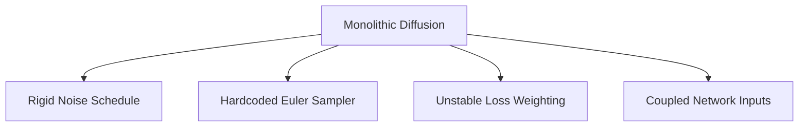
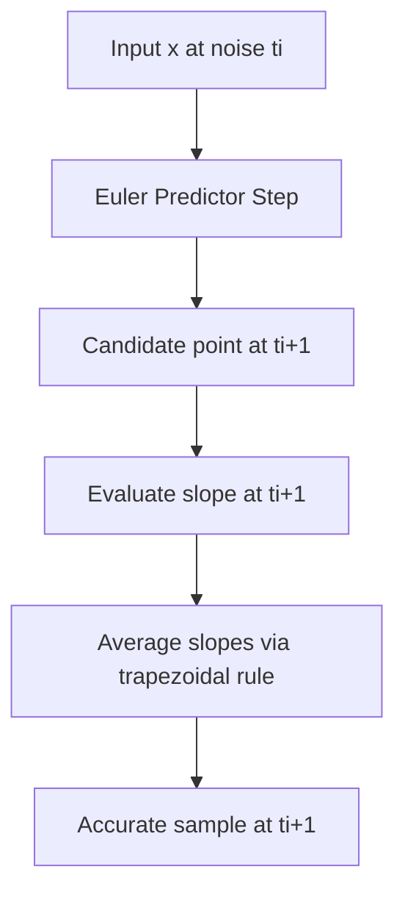
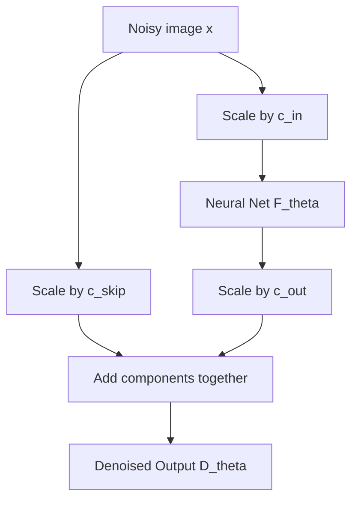

## The hook

In 2022, diffusion models were generating gorgeous images, but their mathematics felt like a tangled thicket. Every research lab seemed to ship its own bespoke mathematical dialect: variance preserving equations, variance exploding formulations, score functions, and discrete Markov steps. If you wanted to swap out the step schedule, you had to re-derive the whole stochastic calculus, or watch your generated faces melt into static.

:::analogy
Imagine tuning a high-performance sports car, but earlier mechanics welded the engine, transmission, suspension, and tires into one rigid steel block. If you wanted to test better tires, you had to rebuild the engine from scratch. 

This paper unbolts the chassis. By separating the tires (the differential equation solver), the steering geometry (the noise schedule), and the fuel injection (network preconditioning), it lets you upgrade each piece independently.
:::

A team from NVIDIA took a pair of wrenches to the whole edifice. They showed that nearly all existing diffusion approaches were trying to solve the exact same ordinary differential equation, obscured by layers of historical baggage. When they cleaned up the design space and tuned each part in isolation, they cut the sampling evaluations by hundreds of times and set new image quality records.

:::history
By 2022, Tero Karras and his NVIDIA colleagues were legendary in the generative modeling world for StyleGAN. When they turned their focus to diffusion models, they noticed a field dominated by formal mathematical proofs that often hid basic engineering flaws. Codebases were tied to rigid formulas where sampling rates, loss curves, and network weights were hopelessly intertwined. The team decided to treat diffusion not as sacred theory, but as an applied numerical engineering problem.
:::

## Before you start

To get the most out of this breakdown, you should be comfortable with:
- The forward and reverse noise processes introduced in [DDPM](article:paper-ddpm).
- How [DDIM](article:paper-denoising-diffusion-implicit-models) turned the stochastic sampling walk into a deterministic path.
- The concept of noise schedules and learning variance from [Improved DDPM](article:paper-improved-denoising-diffusion-probabilistic-models).

## The world before this paper

Early diffusion models arrived through two completely distinct mathematical traditions.

One group arrived through stochastic physics: you corrupt an image with discrete Gaussian noise steps and train a neural network to peel that noise away step by step. This line gave us DDPM and Variance Preserving (VP) differential equations. 

Another group arrived through score-based modeling: you perturb data with increasing levels of noise and estimate the score function (the gradient of the data's log density) using [[Denoising Score Matching]]. This line gave us Score Matching with Langevin Dynamics (SMLD) and Variance Exploding (VE) formulations.

Each paper shipped as a monolithic package:
- If you used VP, you were stuck with the cosine or linear $\beta$-schedule baked into its training loss.
- If you used VE, you dealt with unbounded variance and tricky numerical instability.
- Both families relied heavily on basic first-order Euler solvers. Taking big leaps through time introduced massive truncation errors, forcing you to run 1,000 or more [[NFE (Number of Function Evaluations)|function evaluations]] per single generated image.

Because the math coupled the network's internal scaling, the noise schedule, and the step solver into a single knot, nobody could tell which design choice was actually driving performance. Was a model better because of its neural architecture, or simply because someone chose a slightly better time step?

## The big idea

The authors noticed that under the hood, every single one of these methods solves a deterministic [[Probability Flow ODE]]. 

Regardless of whether you derived your model from stochastic calculus or score matching, the ODE describing how an image transforms from pure Gaussian noise into clean data can be expressed in terms of a single, clean object: an ideal denoiser function $D(x; \sigma)$.

Instead of letting variance schedules warp the trajectory, the paper sets the noise scale directly to time:

$$\sigma(t) = t$$

and locks the signal scale to a constant:

$$s(t) = 1$$

Under this parametrization, the velocity of an image moving along the ODE simplifies to:

$$\frac{dx}{dt} = \frac{x - D(x; t)}{t}$$

Here, $x$ is your current noisy image, $t$ is the current noise level $\sigma$, and $D(x; t)$ is the model's estimate of the clean, noise-free image. 

:::insight
When you set $\sigma(t) = t$, the derivative of the ODE points directly at the denoised estimate $D(x; t)$. Because the denoiser target changes slowly across noise levels, the trajectories through image space become almost perfectly straight lines.
:::

Straight lines are easy to follow. If an ODE trajectory is curved like a roller coaster, numerical solvers stumble unless they take thousands of tiny steps. If the trajectory is nearly straight, you can take gigantic leaps without going off the rails.

## How it works

The paper breaks down the diffusion pipeline into three independent modules: the sampling solver, the network preconditioning, and the training distribution.

### 1. The ODE Sampler and the Rho Schedule

Instead of a basic Euler step, the authors turn to [[Heun's 2nd-Order Method]] (also known as the improved Euler or explicit trapezoidal rule). 

A standard Euler step looks at the slope at time $t_i$ and steps blindly forward to $t_{i+1}$. If the path curves, the error scales as $\mathcal{O}(h^2)$. Heun's method takes that initial Euler step as a trial, evaluates the slope at the predicted destination, and averages the two slopes together. This cancels out first-order drift and drops the local error down to $\mathcal{O}(h^3)$.

Where should you place your time steps? Earlier works distributed time evenly or by linear spacing. But noise doesn't affect an image equally across all scales. At high noise levels ($\sigma = 80$), an image is pure static; small errors barely alter the coarse shapes being formed. Near zero noise ($\sigma = 0.002$), tiny errors ruin fine textures, eyelashes, and skin pores.

The paper introduces a polynomial time schedule controlled by an exponent $\rho$:

$$\sigma_i = \left( \sigma_{\max}^{\frac{1}{\rho}} + \frac{i}{N-1} \left( \sigma_{\min}^{\frac{1}{\rho}} - \sigma_{\max}^{\frac{1}{\rho}} \right) \right)^\rho$$

By setting $\rho = 7$, the schedule packs steps tightly near $\sigma_{\min}$, spending sampling budget where human perception is most sensitive to mistakes.

### 2. Network Preconditioning

Training a raw neural network $F_\theta$ to denoise images directly is a numerical nightmare. When noise $\sigma$ is huge, the input variance explodes. When noise is tiny, the signal dominates completely.

Earlier methods forced the network to predict pure noise $n$ and reconstructed the clean image via subtraction:

$$D_\theta(x; \sigma) = x - \sigma F_\theta(x; \sigma)$$

Look closely at that formula: whatever error the neural network makes is multiplied by $\sigma$. When $\sigma = 80$, a tiny misprediction by the network is amplified by 80 times!

The authors introduce [[Network Preconditioning]] with dynamic skip connections:

$$D_\theta(x; \sigma) = c_{\text{skip}}(\sigma) x + c_{\text{out}}(\sigma) F_\theta(c_{\text{in}}(\sigma) x; c_{\text{noise}}(\sigma))$$

Let's break down the role of each scaling term:
- $c_{\text{in}}(\sigma) = \frac{1}{\sqrt{\sigma^2 + \sigma_{\text{data}}^2}}$ scales the noisy input so the network always sees inputs with unit standard deviation.
- $c_{\text{skip}}(\sigma) = \frac{\sigma_{\text{data}}^2}{\sigma^2 + \sigma_{\text{data}}^2}$ acts as a soft crossfade. When noise is near zero, $c_{\text{skip}} \approx 1$, letting the input pass straight through. When noise is huge, $c_{\text{skip}} \approx 0$, cutting off the input noise.
- $c_{\text{out}}(\sigma) = \frac{\sigma \cdot \sigma_{\text{data}}}{\sqrt{\sigma_{\text{data}}^2 + \sigma^2}}$ ensures the effective training target for $F_\theta$ maintains constant unit variance across all noise levels.

:::try-this
Work through the edge cases in your head:
1. When noise is tiny ($\sigma \to 0$): $c_{\text{skip}} \to 1$ and $c_{\text{out}} \to 0$. The clean input flows right through the skip connection. The network doesn't have to do anything.
2. When noise is massive ($\sigma \to \infty$): $c_{\text{skip}} \to 0$ and $c_{\text{out}} \to \sigma_{\text{data}}$. The skip connection shuts off completely, and the network directly estimates the dataset average.
:::

### 3. Loss Weighting and Training Distribution

With the network preconditioned, the training objective becomes a balanced L2 loss:

$$\mathcal{L} = \mathbb{E}_{\sigma, y, n} \left[ \lambda(\sigma) \| D_\theta(y + n; \sigma) - y \|_2^2 \right]$$

Setting $\lambda(\sigma) = \frac{1}{c_{\text{out}}(\sigma)^2}$ ensures that the gradient magnitude remains uniform across all noise levels. 

Finally, how should you sample $\sigma$ during training? Instead of uniform time steps, the authors pick $\ln(\sigma)$ from a Gaussian distribution:

$$\ln(\sigma) \sim \mathcal{N}(P_{\text{mean}}, P_{\text{std}}^2)$$

with $P_{\text{mean}} = -1.2$ and $P_{\text{std}} = 1.2$. This concentrates training effort right on the intermediate noise levels where learning is most productive.

### 4. Controlled Stochastic Churn

While deterministic ODE sampling is fast and reversible, practical score networks are imperfect estimators trained with an L2 objective. They tend to regress toward blurry means.

To fix this, the paper reintroduces controlled [[Stochastic Churn]]. At each step, the sampler injects a controlled dose of fresh Gaussian noise to nudge the sample up to an intermediate noise level $\hat{t}_i = t_i + \gamma_i t_i$, and then solves the ODE step back down to $t_{i+1}$.

:::warning
You cannot inject noise indiscriminately. If you churn noise at very low or very high noise levels, the non-conservative errors in the neural network accumulate, washing out details and blowing up color saturation. Churn must be strictly restricted to an intermediate window $[S_{\text{tmin}}, S_{\text{tmax}}]$.
:::

## What they found

The modular separation produced massive performance leaps across datasets and architectures:

1. **Massive efficiency gains on pre-trained models:** Without retraining a single weight, taking existing pre-trained VP and VE checkpoints and running them through the paper's 2nd-order Heun solver and $\rho = 7$ schedule slashed the required evaluations dramatically. Sampling steps dropped by $7.3\times$ for VP models, $3.2\times$ for DDIM, and a staggering $300\times$ for VE models.
2. **State-of-the-art image quality:** On CIFAR-10 ($32\times 32$), the full EDM framework achieved an FID of 1.79 in the class-conditional setting and 1.97 unconditionally, using only 35 network evaluations per image.
3. **Rescuing ImageNet-64:** Taking a pre-trained ImageNet-64 model with an FID of 2.07 and simply swapping its sampler brought the score down to 1.55. Retraining the network with the full EDM preconditioning and loss distribution pushed it to a new state-of-the-art of 1.36.
4. **Stochasticity becomes optional on clean models:** When training was properly regularized on CIFAR-10, adding stochastic churn actually worsened the results. The deterministic ODE alone was good enough to hit record scores.

## What it got wrong (or left open)

While the paper brought clarity to diffusion math, it left several practical problems unresolved:

- **Empirical hyperparameter tuning:** The stochastic sampler parameters ($S_{\text{churn}}$, $S_{\text{tmin}}$, $S_{\text{tmax}}$, and $S_{\text{noise}}$) could not be derived from first principles. Finding their optimal values required exhaustive, expensive grid searches for each dataset.
- **Resolution limits:** The experiments in the paper focused entirely on small images ($32\times 32$ and $64\times 64$). Scaling these principles to megapixel resolutions introduced new training dynamics that required further tuning.
- **Extreme compute appetite:** The extensive systematic ablations, grid searches, and retrainings burned approximately 250 MWh of electricity on NVIDIA V100 clusters—a compute budget far beyond the reach of standard academic labs.

## What happened next

The framework presented in this paper—widely referred to as **EDM** (Explicit Denoiser Formulation)—became the universal blueprint for modern continuous diffusion.

Popular open-source tools like Stable Diffusion WebUI, ComfyUI, and Hugging Face `diffusers` adopted the Karras schedule ($\rho = 7$) and Heun/Euler samplers as standard defaults. Later generative powerhouses, from [Latent Diffusion](article:paper-latent-diffusion) variants to Flux, rely directly on the preconditioning rules laid down here.

The authors later built upon this foundation with EDM2, which tackled network weight scaling and training dynamics at even larger scales, proving that treating diffusion as applied numerical analysis remains one of the field's most fruitful perspectives.

## Key takeaways

- Monolithic diffusion frameworks wrapped straightforward ordinary differential equations in unnecessary, tangled theoretical constraints.
- Choosing a linear noise schedule $\sigma(t) = t$ straightens the ODE trajectories, allowing higher-order numerical solvers to take large, accurate strides.
- Heun's 2nd-order predictor-corrector solver combined with a non-uniform polynomial schedule ($\rho = 7$) slashes inference evaluations by multiples of ten.
- Preconditioning the network with input normalization, output scaling, and skip connections keeps training targets at unit variance and stops errors from exploding at high noise.
- Training loss should focus on intermediate noise levels via a log-normal distribution, because extreme noise levels offer little useful gradient signal.
