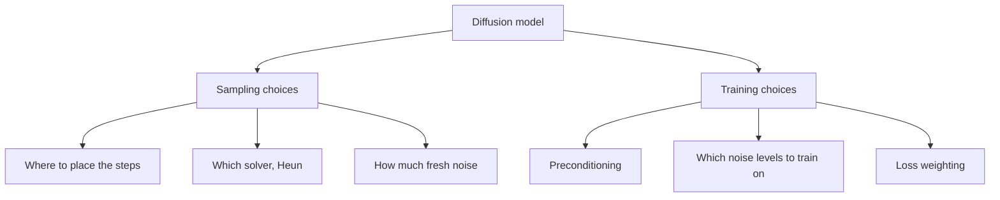

## The hook

By 2022, diffusion models made stunning images, but every paper described them in its own language. One spoke of discrete Markov chains, another of stochastic differential equations, another of score functions. Changing one detail, such as the step sizes, often meant re-deriving the whole method.

A team at NVIDIA, known for the StyleGAN image generators, asked an engineer's question. If you strip away the notation, which choices actually matter, and what happens if you tune each one on its own?

## Before you start

You should know how [DDPM](article:paper-ddpm) adds noise and learns to remove it, and how [DDIM](article:paper-denoising-diffusion-implicit-models) turned sampling into a deterministic path that can take bigger steps. [Improved DDPM](article:paper-improved-denoising-diffusion-probabilistic-models) shows how noise schedules affect quality. Comfort with the idea of following a slope step by step is enough calculus.

## The world before this paper

Diffusion had grown from two traditions. DDPM-style models corrupted images in many small noise steps and learned to undo each one. Score-based models perturbed data at many [[noise level]]s and learned the direction toward more likely data. Later work showed both could be written as differential equations, but each paper still came as one bundle: its own noise schedule, its own network scaling, its own loss weights and its own sampler.

That bundling had a cost. If one model beat another, was it the network, the schedule or the sampler? Nobody could say, and sampling often took hundreds of network calls per image.

:::history
Tero Karras, Miika Aittala, Timo Aila and Samuli Laine posted the paper in June 2022, and it appeared at NeurIPS 2022. Their abstract argues that the theory and practice of diffusion models were "unnecessarily convoluted", and sets out to present a design space "that clearly separates the concrete design choices".
:::

## The big idea

:::analogy
Picture a guided descent from a foggy mountain peak to a village in the valley. The peak is pure noise; the village is a clean image. A trained guide, the network, can always point downhill from wherever you stand. How well the trip goes depends on separate choices: **where you plan your stops** (more of them where the path gets tricky), **how you take each step** (stride blindly, or check the slope where you land and adjust), **how the guide reads the map** (always at a comfortable scale), and **which altitudes the guide practised on**. Earlier expeditions bundled all four into one fixed plan. This paper unbundles them and tunes each.
:::

The paper writes every diffusion model as one simple equation built around a [[denoiser]] $D(x; \sigma)$, a network that takes a noisy image $x$ at noise level $\sigma$ and predicts the clean image. Choosing the noise level itself as the "time" variable, the path from noise to image is:

$$\frac{dx}{d\sigma} = \frac{x - D(x; \sigma)}{\sigma}$$

In words: $x - D(x;\sigma)$ is the noise the denoiser thinks is in the image. Dividing by $\sigma$ gives the slope, how fast $x$ should change as the noise level drops. Sampling means starting from noise at a large $\sigma$ and following this slope down to a $\sigma$ near zero, using an [[ODE solver]].

With that equation in place, the design choices separate cleanly into sampling choices and training choices.

## How it works

### Choice 1: where to place the stops

The paper spaces the noise levels so that steps are large when the image is mostly noise and small near the end, where fine details are decided. The schedule uses $\sigma_{max} = 80$, $\sigma_{min} = 0.002$ and a shape parameter $\rho = 7$. With 5 stops, it gives:

| Stop | 1 | 2 | 3 | 4 | 5 |
|---|---|---|---|---|---|
| EDM schedule | 80 | 17.53 | 2.515 | 0.1698 | 0.002 |
| Evenly spaced | 80 | 60.00 | 40.00 | 20.00 | 0.002 |

Evenly spaced stops would waste three of them on high noise, then jump from 20 straight to almost zero. The paper's schedule puts its stops where the path to the village bends.

### Choice 2: how to take each step

Euler's method takes one slope reading and strides along it. [[Heun's method]] takes a trial step, reads the slope where it landed, and then redoes the step with the average of the two slopes. That costs two [[network evaluation]]s instead of one, but its error shrinks much faster as steps get smaller, so far fewer steps are needed.

### A worked example: Euler versus Heun

Use toy data: one number drawn from a bell curve with spread $\sigma_{data} = 0.5$. For this data, the perfect denoiser is known: $D(x;\sigma) = x \cdot \frac{0.25}{\sigma^2 + 0.25}$. Start at $x = 1$ with $\sigma = 1$, and step to $\sigma = 0.5$.

- **Slope at the start:** $D = 1 \times 0.25 / 1.25 = 0.2$, so the slope is $(1 - 0.2)/1 = 0.8$.
- **Euler:** $x = 1 - 0.5 \times 0.8 = 0.6$.
- **Slope at the trial point** ($x = 0.6$, $\sigma = 0.5$): $D = 0.6 \times 0.25 / 0.5 = 0.3$, so the slope is $(0.6 - 0.3)/0.5 = 0.6$.
- **Heun:** average slope $0.7$, so $x = 1 - 0.5 \times 0.7 = 0.65$.

The exact answer for this toy is $\sqrt{0.5}/\sqrt{1.25} \approx 0.6325$. Euler is off by 0.0325; Heun by 0.0175, about half, after checking the ground where it landed. On the mountain, that is the difference between striding blindly and glancing down before committing.

:::try-this
The paper's CIFAR-10 sampler uses Heun with 18 noise levels, but skips the correction on the final step to zero noise, where there is no slope left to measure. How many network evaluations is that? (17 steps of two evaluations plus one final Euler step: $2 \times 18 - 1 = 35$, the number in the abstract.)
:::

### Choice 3: how much fresh noise

The paper also studies a stochastic sampler that adds a little fresh noise and then removes it during sampling, which can correct errors made earlier. It found this helps some models but not others, and the right amount must be tuned. The deterministic Heun sampler is the default.

### Choice 4: preconditioning

A noisy input can have values anywhere from tiny to huge, since $\sigma$ ranges from 0.002 to 80. Networks prefer inputs and outputs of a steady size. [[Preconditioning]] writes the denoiser as

$$D(x;\sigma) = c_{skip}(\sigma)\, x + c_{out}(\sigma)\, F(c_{in}(\sigma)\, x;\ \sigma)$$

where $F$ is the raw network, $c_{in}$ rescales the input to a steady size, $c_{skip}$ decides how much of the noisy input passes straight through, and $c_{out}$ scales the network's correction. With $\sigma_{data} = 0.5$:

| $\sigma$ | $c_{skip}$ | $c_{out}$ | $c_{in}$ |
|---|---|---|---|
| 0.1 | 0.9615 | 0.0981 | 1.9612 |
| 0.5 | 0.5000 | 0.3536 | 1.4142 |
| 5 | 0.0099 | 0.4975 | 0.1990 |

At low noise the input is nearly clean, so almost all of it passes through and the network only adds a small fix. At high noise the input is mostly useless, so the network predicts the image almost from scratch. This is the guide always reading the map at a comfortable scale.

### Choices 5 and 6: what to practise on

During training, the paper samples noise levels from a log-normal distribution centred on middle values, because very low noise is trivial and very high noise is nearly impossible; the useful learning happens in between. It also weights the loss so every noise level contributes a similar amount. The guide practises mostly at the altitudes where decisions matter.

:::insight
Once you write diffusion around a denoiser and a noise level, the sampler, the schedule, the network scaling and the training noise become independent knobs. Tuning each knob on its own beat bundles of choices that had never been separated.
:::

:::warning
Common misconception: "the improvements need a new kind of network." Much of the gain came from sampling and scaling choices around the network. The paper showed its sampler alone substantially improved a model someone else had already trained. The trip improved because the stops and stride improved, not only because the guide did.
:::

## What they found

The abstract reports:

- **CIFAR-10 records.** A new state-of-the-art [[FID]] of 1.79 class-conditional and 1.97 unconditional.
- **Much faster sampling.** Those results needed only 35 network evaluations per image, far fewer than prior designs.
- **Upgrades for existing models.** Applying the design changes to a previously trained ImageNet-64 model improved its FID from 2.07 to 1.55, near the state of the art, without retraining.
- **Retraining helps further.** After retraining with all the improvements, ImageNet-64 reached a new state-of-the-art FID of 1.36.

## What it got wrong (or left open)

- **Still many network calls.** 35 evaluations is far better than hundreds, but still much slower than a one-shot generator such as a GAN.
- **Tuned on small images.** The detailed experiments were on CIFAR-10, FFHQ, AFHQ and ImageNet-64. Choices tuned there needed re-checking for large text-to-image systems.
- **Stochastic sampling needs hand tuning.** How much fresh noise to add depended on the dataset and model, with no automatic rule.
- **FID is not the whole story.** Better FID does not guarantee better diversity or prompt following.

## What happened next

The paper's formulation, often just called EDM, became a common reference for training and sampling diffusion models. Its schedule and Heun sampler appear as standard options in popular diffusion libraries, and later work, including a 2024 follow-up by the same group, built on its preconditioning. Methods that distil a diffusion model into one or a few steps, such as consistency models, also start from this framework.

The same mountain-descent view links back to [DDIM](article:paper-denoising-diffusion-implicit-models), which first treated sampling as a deterministic path, and forward to large systems like [latent diffusion](article:paper-latent-diffusion), which run the same descent in a compressed image space.

## Key takeaways

- The paper rewrote many diffusion models as one equation built around a denoiser D(x; sigma), which separates the design choices.
- Spacing the noise levels with small steps near the end, and using Heun's second-order solver, cuts the number of network evaluations sharply.
- Preconditioning scales the network's input, output and skip connection with the noise level, so the network always works on numbers of a comfortable size.
- Training on mostly middle noise levels with balanced loss weights focuses learning where it matters.
- The abstract reports FIDs of 1.79 and 1.97 on CIFAR-10 at 35 evaluations, and ImageNet-64 improving from 2.07 to 1.55 without retraining and to 1.36 with it.
