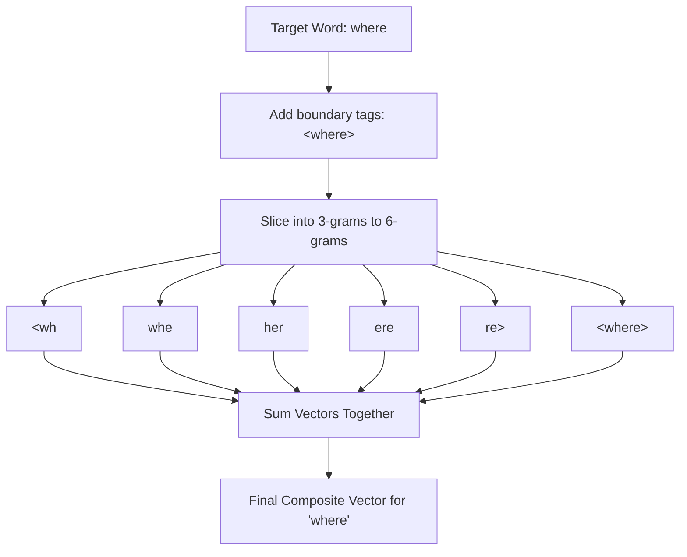
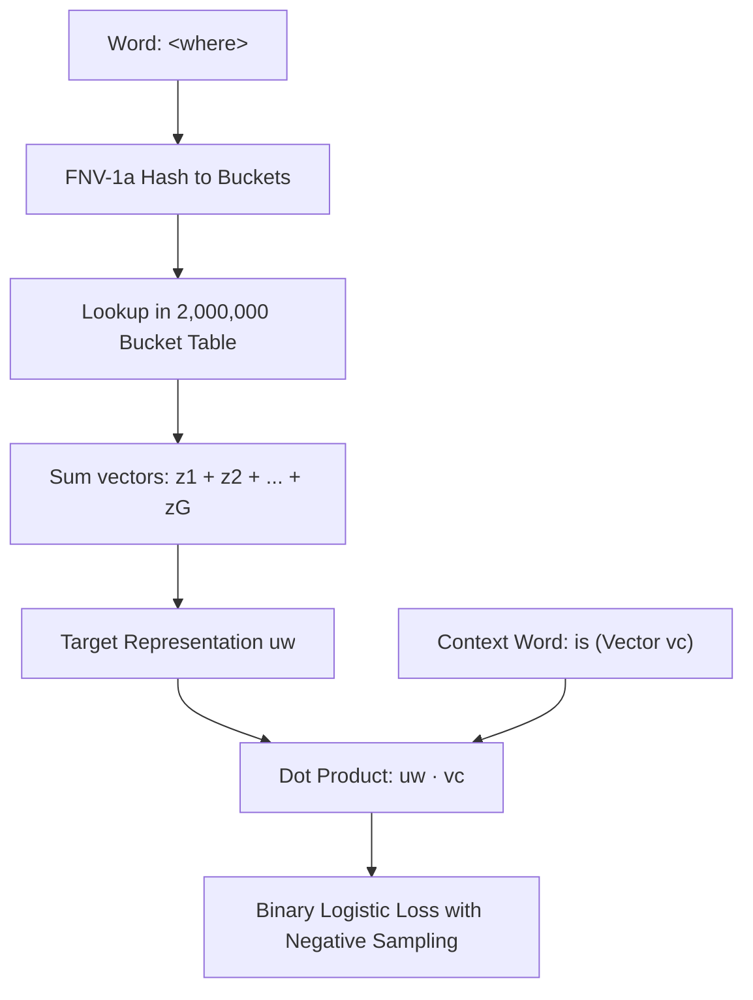

## The hook

If you teach a standard word embedding model the word "teach", "teacher", and "teaching", it treats them as three completely unrelated symbols. To the algorithm, the connection between "teach" and "teacher" is just as opaque as the connection between "teach" and "submarine". If the model then runs into the word "unteachable" during testing, it throws up its hands, completely blind to a word it has never seen before.

How can an algorithm understand human language if changing a single prefix turns a familiar concept into complete gibberish?

In 2016, a research team at Facebook AI Research fixed this blind spot by cracking words open. Instead of treating each word as an indivisible stone, they built representations out of the tiny building blocks inside them.

## Before you start

Before jumping in, make sure you understand how word vectors work. You should be familiar with the original [Word2Vec](article:paper-word2vec) framework, how vectors capture relationships in our [embeddings primer](article:primer-embeddings), and how [negative sampling](article:paper-distributed-representations-of-words-and-phrases-and-their-c) speeds up training.

## The world before this paper

By 2016, Word2Vec had swept through the natural language processing community. Models like Skip-gram could scan gigabytes of text and learn that `King - Man + Woman = Queen`.

Yet Word2Vec had a glaring weakness: it relied on an atomic vocabulary. Every unique word string received its own slot in a lookup table. If a word was in the dictionary, it got an independent vector. If it was not in the dictionary, it was [[Out-of-Vocabulary (OOV)|out-of-vocabulary (OOV)]] and effectively did not exist.

This design caused two painful problems.

First, rare words received awful vectors. A model needs to observe a word in dozens of different contexts to pull its vector into the right neighborhood. If a word appeared only twice across an entire corpus, its embedding remained noisy and unreliable.

Second, the system stumbled on languages with complex [[Morphology]]. In English, a verb might take four or five forms (`walk`, `walks`, `walking`, `walked`). But in Spanish or French, a single verb can take over forty conjugated shapes. In Finnish, nouns inflect into fifteen distinct cases. In German, speakers freely invent compound nouns by welding existing words together—turning "table tennis" into the single compound word `Tischtennis`. 

Standard word-level models treated every single form as a brand-new stranger. Training a model on Russian or German required massive amounts of data just to learn the basic conjugations of ordinary words.

```
Word2Vec view:
[walk]    --> Vector A (Slot 102)
[walks]   --> Vector B (Slot 941)
[walking] --> Vector C (Slot 8832)
Zero shared parameters, zero understanding that they share a root.
```

Researchers had tried fixing this by running specialized linguistic parsers to slice words into morphemes before training. But these tools were brittle, language-dependent, slow, and broke down completely on slang, typos, and compound words.

:::history
Tomas Mikolov had already revolutionized language modeling at Google by co-creating Word2Vec. After joining Facebook AI Research (FAIR), he teamed up with Piotr Bojanowski, Edouard Grave, and Armand Joulin. They realized that trying to engineer intricate grammatical segmenters was a dead end. Instead, they asked a simple question: what happens if you bypass formal grammar rules entirely and just let the model chop every word into raw character chunks?
:::

## The big idea

Instead of giving each word a single isolated vector, represent each word as the sum of its constituent [[Character n-gram|character n-grams]] plus the full word itself.

:::analogy
Treating words as single indivisible tokens is like casting every LEGO building out of a solid block of plastic. If a new castle has one red brick swapped for a blue one, you must cast an entirely new mold from scratch. Worse, if someone brings you a castle you have never seen before, your mold machine is totally helpless.

Using subword n-grams is like building with individual LEGO bricks. When you see a brand-new castle, you do not panic: you already recognize the bricks it is made of, and you can piece together what it is immediately.
:::

By breaking words into sliding windows of characters, words that share stems, prefixes, or suffixes naturally share the exact same parameter vectors. 

Even better: if the model encounters an unseen word at test time, it does not need a dedicated vocabulary entry. It simply collects the n-grams inside that mystery word, looks up their vectors, and adds them up.



## How it works

The architecture builds directly upon the Skip-gram model with negative sampling, but swaps out how words are turned into vectors.

### 1. Adding boundary markers
Before extracting pieces, the model wraps each word in special angle brackets `<` and `>`. 

Why bother? Because context matters. The character trigram `her` inside the word `<where>` should not be confused with the standalone word `<her>`. The bracket markers ensure that word-initial and word-final character sequences remain distinct from interior sequences.

### 2. Slicing into character n-grams
For every word, the model extracts all [[Character n-gram|character n-grams]] between length 3 and length 6. It also keeps the complete bracketed word as a special sequence so it can still learn word-level nuances.

For example, taking $n = 3$ for the word `where`:
- Subword trigrams: `<wh`, `whe`, `her`, `ere`, `re>`
- Whole-word token: `<where>`

In practice, the system collects all trigrams ($n=3$), 4-grams ($n=4$), 5-grams ($n=5$), and 6-grams ($n=6$).

### 3. The hashing trick
If you generate all character n-grams from length 3 to 6 across a vocabulary of hundreds of thousands of words, you end up with millions of unique subword strings. Storing an independent lookup row for every possible character combination would consume gigabytes of memory.

To keep the memory footprint strictly bounded, the authors used [[FNV-1a Hashing]]. 

Instead of maintaining an open-ended dictionary, they mapped every subword string to an integer bucket between $1$ and $K$, where $K = 2,000,000$. If two rare n-grams land in the same hash bucket, they share a vector. With 2 million slots, hash collisions are infrequent enough that they do not harm the model.

:::try-this
Pick the word `<cat>`. What are all the 3-grams?
1. `<ca`
2. `cat`
3. `at>`
Notice how `<ca` marks the start of the word, `at>` marks the end, and the entire token `<cat>` is also preserved. If the model later meets the unseen word `<cats>`, it already knows `<ca` and `cat`!
:::

### 4. Vector composition and scoring
In standard Skip-gram, the score between target word $w$ and context word $c$ is a simple dot product: $s(w, c) = \mathbf{u}_w^\top \mathbf{v}_c$.

In this subword model, let $\mathcal{G}_w \subset \{1, \dots, K\}$ represent the set of hashed n-gram indices belonging to word $w$. Each n-gram bucket $g$ has an embedding vector $\mathbf{z}_g$. The final representation of the target word is the sum of those n-gram vectors.

The scoring function becomes:

$$s(w, c) = \sum_{g \in \mathcal{G}_w} \mathbf{z}_g^\top \mathbf{v}_c$$

Here is what each symbol means:
- $w$: the target word being read.
- $c$: a candidate context word appearing in the surrounding window.
- $\mathcal{G}_w$: the set of all character n-grams extracted from $w$ (including the full word token).
- $\mathbf{z}_g$: the $d$-dimensional vector for subword n-gram $g$.
- $\mathbf{v}_c$: the standard output vector for context word $c$.

Let us walk through a tiny numerical example. Imagine our vectors have only 2 dimensions ($d=2$). Suppose the word `cat` breaks down into just two subword pieces: $g_1$ and $g_2$.

$$\mathbf{z}_{g_1} = \begin{bmatrix} 0.5 \\ 1.0 \end{bmatrix}, \quad \mathbf{z}_{g_2} = \begin{bmatrix} 0.5 \\ 0.0 \end{bmatrix}$$

First, sum the subword vectors to get the composite representation of `cat`:

$$\mathbf{u}_{\text{cat}} = \mathbf{z}_{g_1} + \mathbf{z}_{g_2} = \begin{bmatrix} 0.5 + 0.5 \\ 1.0 + 0.0 \end{bmatrix} = \begin{bmatrix} 1.0 \\ 1.0 \end{bmatrix}$$

Now, suppose the context word $c$ is `purr`, with context vector:

$$\mathbf{v}_{\text{purr}} = \begin{bmatrix} 2.0 \\ 0.5 \end{bmatrix}$$

We calculate the compatibility score using their dot product:

$$s(\text{cat}, \text{purr}) = (1.0 \times 2.0) + (1.0 \times 0.5) = 2.0 + 0.5 = 2.5$$

The network trains using binary logistic loss with negative sampling. It nudges subword vectors so their sum has a high dot product with real context words and a low dot product with randomly sampled negative words.

:::insight
A word vector is no longer a static entry in a table. It is a composite calculation. Because words are formed by adding their pieces together, unseen words inherit the semantic coordinates of their prefixes, roots, and suffixes automatically.
:::



## What they found

The authors trained these vectors on full Wikipedia dumps across nine languages: English, German, Czech, Russian, French, Spanish, Italian, Arabic, and Romanian.

The results showed decisive advantages across every evaluation where morphology mattered.

### 1. Rare words and human similarity judgements
On the English Rare Words (RW) dataset, baseline Skip-gram scored a Spearman rank correlation of 43 against human ratings. The subword model jumped to 47. 

The improvement was even sharper in languages with rich noun compounds. On the German GUR350 benchmark, baseline Skip-gram scored 61, while the subword model scored 70. Why? Because when German glues two words together, the subword model recognizes the pieces immediately.

### 2. Syntactic analogies in inflected languages
When tested on syntactic analogies (like predicting conjugations and declensions), the subword representations crushed word-level baselines:

| Language | Task | Skip-gram | CBOW | Subword Skip-gram |
| :--- | :--- | :--- | :--- | :--- |
| **Czech** | Syntactic Analogy | 52.8% | 55.0% | **77.8%** |
| **German** | Syntactic Analogy | 44.5% | 45.0% | **56.4%** |
| **Italian** | Syntactic Analogy | 51.5% | 51.8% | **62.7%** |
| **English** | Syntactic Analogy | 70.1% | 69.9% | **74.9%** |

In Czech, where nouns and verbs morph through extensive grammatical endings, accuracy surged by 25 percentage points.

### 3. Lower perplexity in language models
When feeding these pre-trained vectors into an [LSTM](article:paper-lstm) language model, test perplexity dropped significantly. On Russian, perplexity fell from 237 (with standard Skip-gram) down to 206—a 13% reduction in error. 

### 4. Extreme data efficiency
The authors tested what happened when they artificially choked the training data down to small slices of Wikipedia. 

On the German benchmark, the subword model trained on only 5% of Wikipedia outperformed a standard CBOW model trained on 100% of the data (66 vs 62). On English Rare Words, the subword model trained on just 1% of the corpus beat standard CBOW trained on the whole thing (45 vs 43).

### 5. Blazing speed
Despite processing multiple n-grams for every single word token, the C++ implementation processed 105,000 words per second per thread (compared to 145,000 for standard Skip-gram). It was only about 1.5 times slower to train than baseline Word2Vec, while running asynchronously across multiple CPU threads using Hogwild.

## What it got wrong (or left open)

While the subword method proved wildly effective for grammar and compounding, it introduced subtle trade-offs that the authors acknowledged.

:::warning
More subwords do not always mean better semantics. In fact, subword representations slightly degraded performance on semantic analogy tasks for German (dropping from 66.5% to 62.3%) and Italian.
:::

Why did semantic scores drop? Because spelling does not always reflect meaning. The word `rat` shares characters with `rational`, but sharing those character n-grams pollutes the meaning of `rational` with rodent semantics. When two unrelated words share character strings by historical accident, character n-grams can push their vectors closer together than they should be.

The paper also relied on rigid, arbitrary n-gram bounds (lengths 3 through 6). These bounds were not tuned to the underlying language. While 3-to-6 works well for Indo-European languages, it is less suited for languages with radically different morphology, such as Semitic root-and-pattern systems or agglutinative languages with long chains of tiny morphemes.

Finally, while the 2,000,000 bucket hash table avoided memory bloat, hash collisions meant that completely unrelated character strings inevitably shared identical weight parameters.

## What happened next

This paper laid the algorithmic foundation for **fastText**, which Facebook released as a legendary open-source library. FastText became a default choice for developers worldwide because it could train high-quality word vectors and lightning-fast text classifiers on a basic laptop CPU in a matter of minutes.

More importantly, this paper changed how the entire field thought about tokens.

Prior to this work, researchers debated whether models should process whole words or single characters. This paper showed that the sweet spot sits in the middle: [[Subword Information|subword units]] capture morphological regularities while keeping the sequence length manageable.

That core insight directly catalyzed modern subword tokenizers. When [GPT-1](article:paper-gpt-1), [BERT](article:paper-bert), and modern giants like [LLaMA](article:paper-llama) build vocabularies, they do not treat words as atomic stones. They break text into subwords using algorithms like Byte-Pair Encoding (BPE) and WordPiece. 

Every time a modern large language model reads an unfamiliar username, an odd programming variable, or a rare medical term without crashing, it is leaning on the principle proven right here: the secret to understanding language is learning to read between the letters.

## Key takeaways

- Standard word vectors treat words as isolated, indivisible symbols, which ruins performance on rare words and morphologically rich languages.
- Slicing words into character n-grams (from lengths 3 to 6) allows models to share parameters across prefixes, roots, and suffixes.
- Unseen out-of-vocabulary words can be represented on the fly simply by summing the vectors of their constituent character pieces.
- Using a fixed hash table of 2 million buckets bounds memory usage while preserving subword signals with minimal collision impact.
- Subword embeddings dramatically boost syntactic analogy accuracy and allow models trained on tiny datasets to outperform word-level baselines trained on entire corpora.
