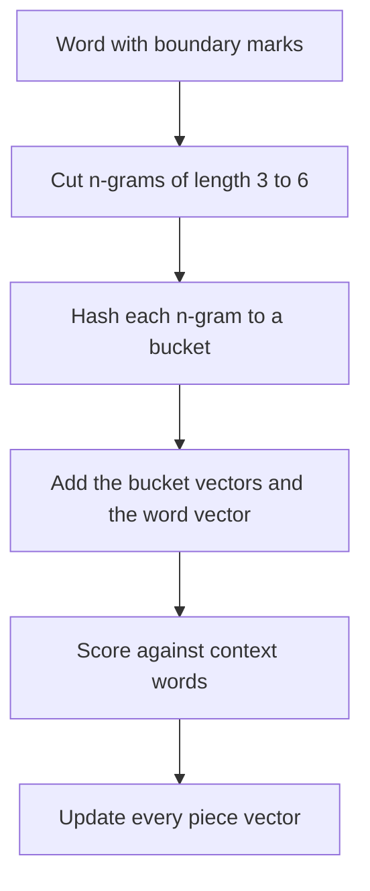

## The hook

A word2vec model trained on millions of sentences knows "play" and "played" well. Then it meets "replayed", which happened to appear nowhere in its training text. It has no vector for it at all, even though any child can see the word is "re" plus "played".

The problem gets much worse in languages like Czech, Finnish or Turkish, where one word can take dozens of forms. Most of those forms are rare, so most of them get poor vectors or none. What if a model could read the pieces inside a word, the way you do?

## Before you start

You should know how [word2vec](article:paper-word2vec) learns vectors by predicting nearby words, the speed-ups in [Three Tricks That Made Word Vectors Cheap](article:paper-distributed-representations-of-words-and-phrases-and-their-c), especially negative sampling, and what an embedding is from [How Words Become Numbers With Meaning](article:primer-embeddings).

## The world before this paper

Word2vec gave each word in the vocabulary its own vector. That works well for common words. It fails in two ways.

First, rare words get noisy vectors, because a vector is only as good as the number of contexts it was trained on. Second, an [[out-of-vocabulary word]] gets nothing. And "walk", "walks", "walked" and "walking" were four unrelated rows in a table, sharing no parameters, even though they clearly share a root.

In languages with rich [[morphology]], this is crippling. A single verb or noun can have many inflected forms, and most of them are rare in any corpus. Earlier fixes split words into morphemes using language-specific analysers, which needed hand-built tools for each language.

:::history
Piotr Bojanowski, Edouard Grave, Armand Joulin and Tomas Mikolov at Facebook AI Research posted the paper in July 2016, and it was published in the Transactions of the ACL in 2017. Mikolov had co-created word2vec. The method was released as part of the open-source fastText library, which also includes a fast text classifier from a companion paper.
:::

## The big idea

:::analogy
Think of a LEGO set. A solid plastic model of a castle is one piece: if you have never seen this castle, you have no idea what it is made of. A castle built from bricks is different. Even a castle you have never seen is made of bricks you already know, and two castles that share many bricks look alike.
:::

Word2vec treats every word as a solid model. This paper treats every word as a build from bricks. The bricks are [[character n-gram|character n-grams]]: short runs of characters inside the word. Each brick has its own vector. A word's vector is the sum of its bricks' vectors, plus a vector for the whole word when it is in the vocabulary.

Words that share pieces now share parameters. "played" and "replayed" share many bricks, so their vectors start out related. An unseen word is just a new build from familiar bricks.

## How it works

### Step 1: mark the edges of the word

Wrap each word in boundary symbols: "play" becomes `<play>`. This matters because the same letters mean different things at different positions. `ing>` says "this word ends in ing". `<re` says "this word starts with re". Without the brackets, the piece "her" from "where" would be confused with the word "her".

### Step 2: cut out all n-grams of length 3 to 6

Slide a window over `<play>` for each length n from 3 to 6. The paper uses exactly this range for its main results.

| n | n-grams of `<play>` | Count |
|---|---|---|
| 3 | `<pl`, `pla`, `lay`, `ay>` | 4 |
| 4 | `<pla`, `play`, `lay>` | 3 |
| 5 | `<play`, `play>` | 2 |
| 6 | `<play>` | 1 |

That is 10 pieces for a four-letter word. Longer words have more: `<playing>` gives 22 and `<replayed>` gives 26. The whole word gets one more vector of its own if it is in the vocabulary.

### Step 3: add up the bricks and train as in skip-gram

Training is [[skip-gram]] with negative sampling, as in word2vec, with one change. The score between a centre word $w$ and a context word $c$ is no longer one dot product of two word vectors. It sums over the word's pieces:

$$s(w, c) = \sum_{g \in \mathcal{G}_w} \mathbf{z}_g^\top \mathbf{v}_c$$

In plain words: $\mathcal{G}_w$ is the set of pieces of word $w$, including the whole word. $\mathbf{z}_g$ is the vector for piece $g$. $\mathbf{v}_c$ is the vector for the context word. Each piece votes on how well $w$ fits next to $c$, and the votes are added.

Here is a tiny example in two dimensions. Suppose a word has three pieces with vectors (0.2, 0.5), (0.4, −0.1) and (0.1, 0.3). Their sum is (0.7, 0.7). If a context word has vector (1.0, 0.5), the score is 0.7 × 1.0 + 0.7 × 0.5 = 1.05. A sigmoid turns that into a probability of about 0.74 that the two words really appear together.

Training raises this for real neighbours and lowers it for randomly sampled negatives, and every piece's vector gets nudged.

### Step 4: keep memory bounded with hashing

There are millions of distinct n-grams across a large vocabulary. Instead of a dictionary entry for each, the [[hashing trick]] maps every n-gram to one of a fixed number of buckets. The paper uses the FNV-1a hash function and 2 million buckets. Memory no longer grows with the number of distinct pieces. The cost is that a [[hash collision]] makes two unrelated pieces share a vector, like two different bricks accidentally given the same colour.

### A worked example: an unseen word

Back to "replayed", which our model never saw. Its 26 pieces include `<re`, `<rep`, `pla`, `play`, `played`, `layed>` and `ed>`. Compare them with the pieces of "played":

| Word | Pieces | Shared with "played" |
|---|---|---|
| played | 18 | 18 |
| replayed | 26 | 14 |
| playing | 22 | 6 |

Fourteen of the 26 bricks in "replayed" are also bricks of "played", including the endings `ed>` and `yed>`. So the summed vector for "replayed" lands near "played" with no training on "replayed" at all. "playing" shares the start `<pl`, `<pla`, `<play` but not the past-tense ending, so it is related in a different way.

:::insight
A word's vector is built, not looked up. Because the bricks are shared, what the model learns about "played" and "replay" automatically helps "replayed", and any unseen word still gets a sensible vector from its pieces.
:::

:::try-this
List the 3-grams of `<cat>` and of `<cats>`. How many 3-grams do they share? (`<cat>` gives `<ca`, `cat`, `at>`. `<cats>` gives `<ca`, `cat`, `ats`, `ts>`. They share two: `<ca` and `cat`. The ending `at>` is not shared, because "cats" does not end in "at".)
:::

## What they found

The authors trained vectors on Wikipedia in nine languages and compared them with word2vec's skip-gram and CBOW models. The main results, described qualitatively:

- **Word similarity improved,** especially for rare words and for languages with many word forms, such as German, Czech and Russian.
- **Syntactic analogies improved strongly.** Questions like "walk is to walked as swim is to ?" depend on endings, which the bricks capture directly.
- **Semantic analogies did not always improve.** On questions about meaning, such as capitals and countries, gains were small and in some languages results got slightly worse.
- **Less data was needed.** Trained on only a fraction of the corpus, the subword model held up much better than word-level baselines, because rare words borrow strength from their pieces.
- **Unseen words worked.** Building vectors for out-of-vocabulary words from their n-grams beat giving them an empty vector.
- **Training stayed fast.** The paper reports it was roughly 1.5 times slower than the skip-gram baseline, a modest price for the gains.

:::warning
Common misconception: "Sharing characters means sharing meaning." Spelling is a hint, not a guarantee. In the LEGO analogy, two builds can share many bricks and still be different things. Words that look alike by accident can be pulled together, which is one reason semantic analogies did not always improve.
:::

## What it got wrong (or left open)

- **Spelling is not meaning.** The model assumes pieces carry meaning. That fits endings and roots but misleads on lookalike words and on irregular forms that share few letters with their base.
- **A fixed window of 3 to 6.** The range was chosen for the experiments, not learned. Languages whose meaningful parts are shorter or longer may suit other ranges.
- **Collisions.** With a fixed number of buckets, unrelated pieces sometimes share a vector. More buckets reduce this but use more memory.
- **Still one vector per word.** Like word2vec, each word gets one vector regardless of context, so "bank" by a river and "bank" with money are the same point.

## What happened next

fastText became one of the most widely used embedding tools, with pre-trained vectors released for many languages. Its practical appeal was speed on ordinary CPUs and sensible vectors for typos and rare words.

The wider lesson shaped how later models read text. Instead of whole words or single characters, modern models use subword units. Models like [GPT-1](article:paper-gpt-1) and [BERT](article:paper-bert) build their vocabularies from subword pieces with methods such as byte-pair encoding and WordPiece. Those methods pick pieces differently, but the idea is the same LEGO idea: a rare word is a new build from known bricks.

Context-dependent vectors arrived with those models too, fixing the one-vector-per-word limit that fastText kept.

## Key takeaways

- Plain word vectors give each word its own row, so rare words get poor vectors and unseen words get none.
- fastText represents a word as the sum of vectors for its character n-grams of length 3 to 6, plus the whole word, with boundary symbols marking the start and end.
- Because n-grams are shared, related forms such as "played" and "replayed" share parameters, and any unseen word can be given a vector from its pieces.
- A hashing trick with a fixed number of buckets keeps memory bounded, at the cost of occasional collisions.
- The gains were largest on syntactic tasks, rare words and morphologically rich languages, while purely semantic tasks benefited less.
