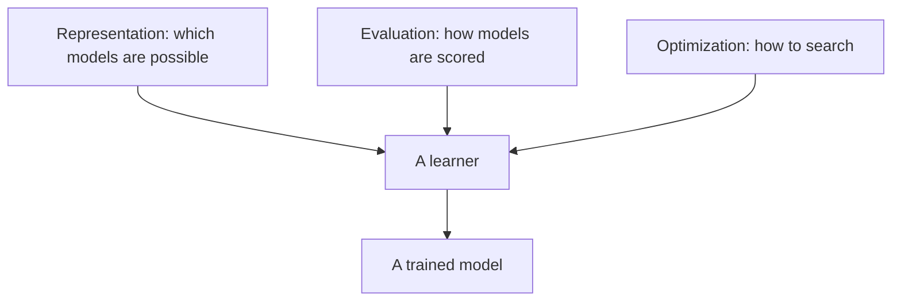

## The hook

Every craft has two kinds of knowledge. There is what the textbook says, and there is what the old hands know: the tricks, the traps, the "never do this on a Friday" rules that nobody writes down because everybody learned them the hard way.

In 2012, Pedro Domingos wrote down machine learning's version of that second kind. His article appeared not in a specialist journal but in the main magazine of the computing profession, aimed at any programmer who wanted to use machine learning. It became one of the most widely read and recommended papers in the field, and it is still the best single "lessons from the trenches" read for a beginner.

## Before you start

You need the vocabulary of [What Machines Actually Learn From](article:primer-data-features-labels) and the generalization idea from [Memorizing vs Learning](article:primer-overfitting). This paper has almost no equations; it is a guided tour of hard-earned intuition.

## The world before this paper

:::history
By 2012, machine learning was everywhere: spam filters, search ranking, recommendations, credit scoring. Textbooks taught algorithms in detail, but practitioners kept discovering the same painful truths on their own. Domingos, a professor at the University of Washington, called this missing knowledge "folk wisdom" and set out to collect it. Deep learning's big breakthrough, [AlexNet](article:paper-alexnet), arrived that same autumn.
:::

The common belief was that success came from picking the cleverest algorithm. Domingos argued the opposite: most of the action is elsewhere.

## The big idea

The article is a list of twelve lessons. Together they make one point: machine learning is not magic applied to data. It is a careful craft where generalization, features and data quality matter far more than the choice of algorithm.

:::analogy
Think of machine learning as cooking rather than chemistry. A recipe (the algorithm) matters, but a great cook knows that the ingredients (the data and features) matter more, that tasting as you go (validating on unseen data) is essential, and that a dish that wowed the cook's own family (the training set) may not please strangers. Domingos wrote down the kitchen wisdom.
:::

:::insight
Learning is not about fitting the data you have. It is about making a good bet on the data you have not seen, and every choice you make, from features to model to evaluation, should serve that bet.
:::

## How it works

Here are the twelve lessons, grouped into the questions they answer.

### What is a learner, really?

**1. Learning = representation + evaluation + optimization.** Every learner combines three choices: a [[representation]] (what kinds of models it can express), an evaluation function (how it scores candidate models, such as accuracy or a loss), and an optimizer (how it searches for a good one, such as gradient descent). Seeing any algorithm this way makes them much easier to compare.

### Why is it hard?

**2. It's generalization that counts.** Doing well on training data is easy and nearly meaningless. Keep test data separate, and do not let it leak into your decisions.

**3. Data alone is not enough.** The [[no free lunch theorem]] shows that, averaged over all possible problems, no learner beats random guessing. Learning only works because real problems have structure, and every learner bakes in assumptions about it. Domingos compares this to farming: farmers combine seeds with nutrients to grow crops, and learners combine knowledge with data to grow programs. You need both.

**4. Overfitting has many faces.** He breaks generalization error into [[bias]] (consistently learning the wrong thing) and [[variance]] (learning random things that depend on the particular sample). His memorable picture is a dartboard: high bias means darts clustered in the wrong spot; high variance means darts scattered all over.

**5. Intuition fails in high dimensions.** This is the [[curse of dimensionality]]. With many features, even a huge dataset covers a vanishingly small fraction of the possible inputs, and "nearest neighbours" stop being near. Strange things happen: in high dimensions, most of the volume of an orange is in the peel.

**6. Theoretical guarantees are not what they seem.** Learning theory gives bounds, but they are usually very loose and are best read as guides to design, not as promises about a particular project.

### What actually makes projects succeed?

**7. Feature engineering is the key.** In his words, some projects succeed and some fail, and the biggest factor is the features used. Raw data is rarely in a form a learner can use; turning it into informative features takes domain knowledge, creativity and lots of iteration.

**8. More data beats a cleverer algorithm.** A dumb algorithm with lots of data often beats a clever one with modest data. The catch is scalability: more data takes more time to process, and time becomes the bottleneck.

:::history
Lesson 8 had famous evidence behind it. In 2001, Michele Banko and Eric Brill at Microsoft compared several learning algorithms on a word-choice task (picking between commonly confused words like "their" and "there") while growing the training data a thousandfold. The ranking of algorithms changed as data grew, and the gains from more data dwarfed the differences between algorithms. Google researchers later summed up the mood in a 2009 essay titled "The Unreasonable Effectiveness of Data."
:::

**9. Learn many models, not just one.** Combining models, as in bagging, boosting or [random forests](article:paper-random-forests), usually beats the best single model.

### What should you not believe?

**10. Simplicity does not imply accuracy.** Simpler models are preferred for good reasons, but a simpler model is not automatically more accurate.

**11. Representable does not imply learnable.** Just because a model family *could* express the right answer does not mean your algorithm can *find* it with the data you have.

**12. Correlation does not imply causation.** Learners find correlations. If you act on a prediction, for example by changing what is on a shop shelf, the correlation may not hold, because the model never learned what causes what.

:::try-this
Pick one AI product you use daily, maybe a music app or a map's arrival-time estimate. For three of the twelve lessons, write one sentence on how it probably applies. For example, lesson 12: does the app know that you skipped a song because you disliked it, or just because you were busy? (There is no single right answer. The goal is to practise seeing these lessons in real systems.)
:::

## What they found

This is a perspective article, so its "results" are distilled experience rather than experiments. Its lasting findings:

- Most of the difficulty in machine learning lies in generalization, data and features, not in choosing among algorithms.
- Errors can be understood through bias and variance, which explains why both too-simple and too-flexible models fail.
- High-dimensional spaces behave counter-intuitively, so methods that work on small toy examples may fail on real data.
- Ensembles and more data are among the most reliable ways to improve results.

:::warning
Common misconception: "this paper says algorithms do not matter." It says they matter less than people think, relative to data and features. Choosing a sensible algorithm still matters, and later breakthroughs like [deep learning](article:paper-alexnet) were very much about algorithms that could exploit huge data.
:::

## What it got wrong (or left open)

The biggest lesson to age was number 7. Domingos wrote that feature engineering is where most of the effort goes, and that was true in 2012. Within a few years, deep learning made learning features directly from raw pixels, audio and text the norm, and much hand-crafted feature engineering for images and language disappeared.

The article also says little about computation as a resource in its own right. The next decade showed that, with enough compute, scaling up a fairly simple model on huge data can produce surprising new abilities, a story told in [Scaling Laws](article:paper-scaling-laws). That is lesson 8 taken further than almost anyone expected.

## What happened next

- The deep learning wave, starting with [AlexNet](article:paper-alexnet), automated feature learning for perception and language, partly overturning lesson 7 while strongly confirming lesson 8.
- Domingos expanded these ideas into a popular 2015 book, *The Master Algorithm*, about the different "tribes" of machine learning.
- The overfitting, leakage and causation warnings remain as relevant as ever, especially for large language models evaluated on benchmarks that may have leaked into their training data.

## Key takeaways

- Every learner combines a representation, an evaluation function and an optimizer, which makes algorithms easier to compare.
- Generalization to unseen data is the only goal that matters, and errors can be understood as bias, variance or both.
- High-dimensional spaces defy intuition, and theoretical guarantees are looser than they look.
- Features, data quantity and ensembles often matter more than the choice of algorithm.
- Some lessons aged differently: deep learning automated much feature engineering, while "more data wins" turned out to be truer than ever.
