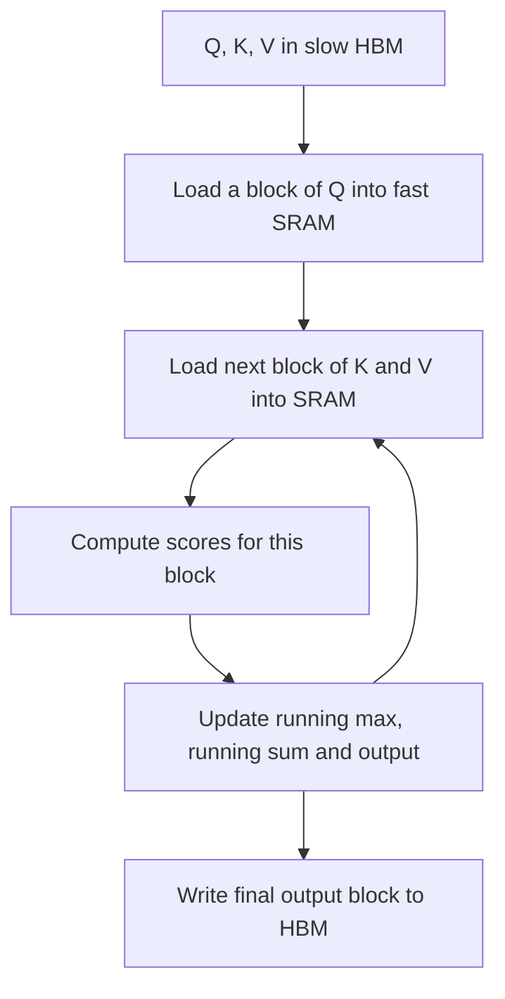

## The hook

For five years after the Transformer arrived, a small army of researchers tried to make attention faster. Most of their ideas approximated it: only attend to nearby words, or to a random sample, or to a compressed summary. Many of these methods cut the number of calculations dramatically. Strangely, in practice, many of them did not run much faster on real hardware.

In 2022, Tri Dao, a PhD student at Stanford, and his colleagues pointed out why. The GPU was not short of arithmetic. It was stuck waiting for memory. Their method, FlashAttention, computes attention **exactly**, even does some calculations twice, and still runs several times faster. It is now built into nearly every major AI framework.

## Before you start

You need to know how attention works, including the softmax over query-key scores, from [The Paper That Taught Machines Where to Look](article:paper-attention-is-all-you-need). The online softmax trick below uses a little algebra with exponentials.

## The world before this paper

Standard attention for a sequence of $N$ tokens computes an $N \times N$ matrix of scores $S = QK^\top$, applies a softmax to each row to get $P$, and multiplies by the values: $O = PV$. A typical implementation does this in separate steps, writing $S$ and then $P$ out to the GPU's main memory and reading them back in.

The cost grows with the square of the sequence length. Doubling the context from 2,000 to 4,000 tokens quadruples the size of $S$. Memory use for long sequences became a hard limit on context length.

:::history
Many "efficient Transformer" papers proposed sparse or low-rank approximations of attention that reduced the number of floating point operations. But practitioners kept finding that these rarely delivered matching wall-clock speedups, and they changed the model's behaviour, so most production systems stuck with standard attention. Tri Dao, working in Christopher Ré's group with Daniel Fu, Stefano Ermon and Atri Rudra, approached the problem as a systems researcher would: profile where the time actually goes.
:::

## The big idea

Count memory traffic, not just arithmetic. A GPU has two very different kinds of memory:

- **[[HBM]]**, the main memory: tens of gigabytes, with bandwidth around 1.5 to 2 terabytes per second on an A100.
- **[[SRAM]]**, on-chip memory: only about 20 megabytes in total across the whole chip, but with an order of magnitude more bandwidth.

Standard attention shuttles the giant $N \times N$ matrix back and forth through slow HBM. FlashAttention is [[IO-aware]]: it splits the computation into tiles that fit in SRAM, does all the steps for a tile there, and never writes the full attention matrix to HBM at all.

:::analogy
Think of a chef working at a small counter next to a big storeroom down the hall. The slow way: chop all the onions and carry them to the storeroom, bring them back to fry, carry them back again, then bring them out to plate. The fast way: bring a small batch of ingredients to the counter, chop, fry and plate that batch right there, and only walk to the storeroom for the next batch. The cooking is the same; the walking is what was killing you.
:::

:::insight
On modern GPUs, moving data is often far more expensive than computing with it. Reorganising an algorithm to keep data in fast memory can beat reducing the number of calculations.
:::

## How it works

### Tiling

FlashAttention splits $Q$, $K$ and $V$ into blocks. For a block of queries, it loads blocks of keys and values into SRAM one at a time, computes the scores for that pair of blocks, and updates the output for those queries, all inside one fused GPU [[kernel]]. This is [[tiling]].

### The online softmax trick

There is a catch. Softmax needs the whole row: each score is divided by the sum of exponentials of **all** the scores in that row. How can you process the row in blocks?

The answer is the [[online softmax]]. Keep two running numbers per row: the maximum score seen so far, $m$, and the sum of exponentials relative to that maximum, $\ell$. When a new block arrives with a bigger maximum, rescale the old sum (and the partial output) by $e^{m_{\text{old}} - m_{\text{new}}}$ and add the new block's contributions.

### A worked example of the online softmax

A row has scores $[2, 1, 3]$, arriving in two blocks: $[2, 1]$, then $[3]$.

- After block 1: maximum $m = 2$. Sum $\ell = e^{2-2} + e^{1-2} = 1 + 0.368 = 1.368$.
- Block 2 brings a 3, a new maximum. Rescale the old sum: $1.368 \times e^{2-3} = 1.368 \times 0.368 \approx 0.503$. Add the new term $e^{3-3} = 1$. Now $\ell \approx 1.503$ with $m = 3$.
- Check against doing it all at once: $e^{2-3} + e^{1-3} + e^{3-3} = 0.368 + 0.135 + 1 = 1.503$. Identical.

The partial output is rescaled the same way, so the final result is exactly the standard attention output. Subtracting the maximum also keeps the exponentials from overflowing, which is why standard softmax implementations do it too.

:::try-this
Continue the example: a third block arrives with score $[0]$. The running maximum stays 3. What is the new sum? ($1.503 + e^{0-3} = 1.503 + 0.050 = 1.553$. No rescaling is needed because the maximum did not change.)
:::

### The backward pass: recompute instead of store

Training needs gradients, and standard attention stores the $N \times N$ probability matrix $P$ from the forward pass to use in the backward pass. FlashAttention stores only the small per-row statistics ($m$ and $\ell$) and the output, then uses [[recomputation]]: in the backward pass, it recomputes the attention blocks on the fly in SRAM. This performs **more** arithmetic, but because it avoids reading a huge matrix from HBM, it is still faster, and memory use grows only linearly with sequence length instead of quadratically.

## What they found

- **Faster training.** FlashAttention trained BERT-large 15% faster end to end than the record set in the MLPerf 1.1 training benchmark, sped up GPT-2 training by up to 3 times compared with popular implementations, and gave about a 2.4 times speedup on the Long Range Arena benchmark of long sequences.
- **Fewer memory accesses, despite more maths.** The paper showed the method performs more floating point operations than standard attention but far fewer HBM reads and writes, and is faster as a result.
- **Longer context, better models.** Because memory use is linear in sequence length, models could be trained with much longer contexts. Longer context gave better language models, and FlashAttention enabled the first Transformers to do better than chance on the Path-X challenge, with sequences of 16,000 elements.
- **A faster approximate version too.** Applying the same IO-aware idea to block-sparse attention produced an approximate method faster than existing ones.

:::warning
Common misconception: "FlashAttention removes the quadratic cost of attention." The amount of arithmetic is still quadratic in sequence length. What changes is memory: the $N \times N$ matrix is never stored, so memory use becomes linear, and far less time is wasted moving data. Very long contexts still cost a lot of computation.
:::

## What it got wrong (or left open)

Writing a custom fused kernel in CUDA is hard work and tied to specific hardware. The first version did not fully use the newest GPU features, and its parallelism was not ideal for all problem shapes, leaving performance on the table.

It also optimised attention only; for many models, other parts, such as the feed-forward layers or the memory used by the cache during generation, become the next bottleneck.

## What happened next

- FlashAttention-2 (2023) reorganised the work across GPU threads for roughly twice the speed, and FlashAttention-3 (2024) exploited features of NVIDIA's Hopper GPUs.
- It was integrated into PyTorch and most major training and inference libraries, and is used to train nearly all large language models today.
- Context windows grew from about 2,000 tokens in [GPT-3](article:paper-gpt-3) to hundreds of thousands, with FlashAttention-style kernels as one of the key enablers.
- The IO-aware mindset spread: serving systems like [vLLM](article:paper-vllm) applied similar thinking to how the attention cache is stored during generation.
- Tri Dao went on to become a professor at Princeton and chief scientist at Together AI.

## Key takeaways

- Standard attention is slowed down mainly by reading and writing its large N by N matrix to the GPU's slow main memory, not by arithmetic.
- FlashAttention tiles the computation so each block of queries, keys and values is processed entirely in fast on-chip SRAM.
- The online softmax trick, a running maximum and running sum with rescaling, lets the softmax be computed exactly, block by block.
- In the backward pass it recomputes attention instead of storing it, doing more arithmetic but fewer memory accesses, and memory use becomes linear in sequence length.
- The result is exact attention that runs several times faster and enables much longer contexts, now standard across AI.
