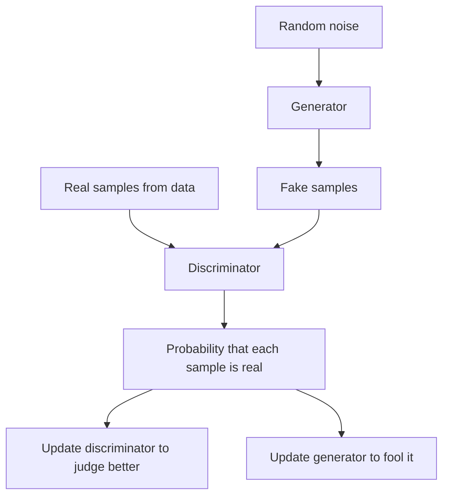

## The hook

One evening in 2014, a PhD student named Ian Goodfellow was at a bar in Montreal, celebrating a friend's graduation. His friends were describing a plan to build a computer program that could generate realistic photos. Goodfellow thought their approach was too complicated. Then, as he has told the story many times, an idea struck: what if you pitted two neural networks against each other?

He went home, coded it that night, and, by his account, it worked on the first try. Within a few years, descendants of that idea were producing photos of people who do not exist, so realistic that most viewers could not tell. Yann LeCun called adversarial training the most interesting idea in machine learning in a decade.

## Before you start

You need to know what neural networks are and how they train with gradient descent, from [Neural Networks from One Neuron Up](article:primer-neural-networks) and [Gradient Descent](article:primer-gradient-descent). Familiarity with cross-entropy loss from [How Wrong Is the Model?](article:primer-loss-functions) helps with the maths.

## The world before this paper

Deep learning was excellent at **recognising** images, but generating them was another matter. To generate, a model needs to capture the whole messy probability distribution of real photos: all the ways a face can look.

Existing approaches, such as Boltzmann machines and other probabilistic models, needed approximations that were slow or awkward to scale. The [variational autoencoder](article:paper-vae), published months earlier, offered one elegant route, but its samples tended to be blurry. Most methods required computing or approximating how probable each image was, and for images, that is extremely hard.

:::history
Goodfellow was a student of Yoshua Bengio at the Université de Montréal, one of the world's centres of deep learning. The paper's authors were almost all from that lab. Goodfellow later worked at Google Brain and OpenAI, and the paper became one of the most influential of the decade.
:::

## The big idea

Skip the probability calculations entirely. Train two networks in a game:

- A [[generator]] takes random noise and tries to produce fake samples that look real.
- A [[discriminator]] looks at samples, some real and some fake, and tries to tell them apart.

The generator never sees real data directly. It learns only from the discriminator's verdicts. As the discriminator gets sharper, the generator is forced to produce better fakes, and as the fakes improve, the discriminator must sharpen further.

:::analogy
The paper itself offers the classic picture: the generator is a team of counterfeiters trying to print fake banknotes, and the discriminator is the police trying to spot them. Every time the police learn a new tell, the counterfeiters fix it. Competition drives both to improve until the counterfeit notes are indistinguishable from real money.
:::

:::insight
You do not need to write down what makes an image realistic. You can train a second network to judge realism, and use its judgement as the generator's teacher.
:::

## How it works

### The game

Each training step does two updates. First, the discriminator gets a batch of real samples labeled "real" and a batch of the generator's samples labeled "fake," and takes a gradient step to classify them better. Then the generator takes a gradient step to make the discriminator call its fakes "real." Gradients flow from the discriminator's output, back through the discriminator, and into the generator.

### The objective

The paper writes the whole game as one [[minimax game]]:

$$\min_G \max_D \; \mathbb{E}_{x \sim \text{data}}\big[\log D(x)\big] + \mathbb{E}_{z \sim \text{noise}}\big[\log(1 - D(G(z)))\big]$$

In plain words:

- $D(x)$ is the discriminator's probability that $x$ is real, a number between 0 and 1.
- $z$ is a random [[noise vector]] and $G(z)$ is the fake sample made from it.
- The discriminator wants $D(x)$ near 1 for real data, making $\log D(x)$ near 0, and $D(G(z))$ near 0 for fakes, making $\log(1 - D(G(z)))$ near 0 too. It maximizes the expression.
- The generator wants the opposite for its fakes, so it minimizes the expression.

### A worked example

Suppose, on one step, the discriminator says $D(x) = 0.9$ for a real image and $D(G(z)) = 0.2$ for a fake.

- Discriminator's score: $\log 0.9 + \log(1 - 0.2) = -0.105 + (-0.223) = -0.328$. It wants this as close to 0 as possible, so it is doing well.
- Generator's view: its fake was given only a 20% chance of being real. Its update will push the fake to look more like whatever the discriminator associates with "real."

### A practical fix

Early in training, the generator is terrible and the discriminator easily rejects its fakes with $D(G(z))$ near 0. In that region, $\log(1 - D(G(z)))$ is almost flat, so the generator gets almost no gradient. The paper's solution: train the generator to **maximize** $\log D(G(z))$ instead, which has strong gradients exactly when the generator is losing badly. Same goal, much better learning signal.

:::try-this
Compare the two generator objectives when the discriminator confidently rejects a fake with $D(G(z)) = 0.01$. Compute $\log(1 - 0.01)$ and $\log(0.01)$. Which one changes more if $D(G(z))$ rises to 0.05? ($\log 0.99 \approx -0.010$ becomes $\log 0.95 \approx -0.051$: a tiny change. $\log 0.01 \approx -4.6$ becomes $\log 0.05 \approx -3.0$: a big change. The second objective gives the struggling generator a much louder signal.)
:::

### What the theory says

The paper proves that if both networks had unlimited capacity and the discriminator were trained to its best response at each step, the game has a unique ideal outcome: the generator's samples follow exactly the same distribution as the real data. At that point the discriminator cannot do better than guessing, and outputs $\frac{1}{2}$ for everything.

## What they found

The authors trained GANs on handwritten digits (MNIST), a dataset of faces, and small natural images (CIFAR-10). The generated digits and faces were recognisable and varied, and the authors showed that the samples were not simply copies of training images by displaying each one next to its nearest training example.

They estimated how well the models fit the data with a rough density estimate and found GANs competitive with other generative models. They were careful not to over-claim: the paper stated that the samples were not better than existing methods, only that they were at least competitive, and that the framework was promising.

:::warning
Common misconception: "the GAN generator memorizes and blends training images." The generator never sees a training image. It only receives gradients from the discriminator, and it produces new samples from random noise. Large GANs can still reproduce near-copies in some cases, but that is a failure mode, not how the method works.
:::

## What it got wrong (or left open)

GANs are notoriously **hard to train**. The two networks must stay in balance. If the discriminator becomes too strong, the generator's gradients vanish; if the generator gets ahead, the discriminator's feedback becomes useless. Training could oscillate wildly instead of settling.

The paper also flagged what became known as [[mode collapse]]: the generator can discover a few outputs that fool the discriminator and produce only those, ignoring the full variety of the data. The authors nicknamed one version the "Helvetica scenario."

And GANs do not give a probability for each sample, which makes them hard to evaluate and compare. Researchers later developed measures like the Inception Score and FID to judge sample quality.

## What happened next

- DCGAN (2015) found stable convolutional designs, and GANs began producing convincing images.
- Conditional GANs and image-to-image translation methods like pix2pix and CycleGAN (2017) turned sketches into photos and horses into zebras.
- NVIDIA's StyleGAN (2018 to 2019) generated strikingly realistic faces, made famous by the website "This Person Does Not Exist." The same power fuelled "deepfakes" and an ongoing debate about synthetic media.
- Around 2021, [diffusion models](article:paper-ddpm) began beating GANs on image quality and diversity while being far more stable to train, and became the dominant approach, as in [latent diffusion](article:paper-latent-diffusion).
- The adversarial idea lives on: a discriminator-style loss is still used inside many generators to sharpen details.

## Key takeaways

- A GAN trains two networks against each other: a generator that turns noise into fake samples, and a discriminator that tries to tell fakes from real data.
- The generator learns only from the discriminator's gradients, so it never needs an explicit formula for what makes data realistic.
- In theory, the game's ideal outcome is a generator whose samples match the real data, with the discriminator reduced to guessing.
- In practice, GANs are hard to balance and prone to mode collapse, where they produce only a narrow range of outputs.
- GANs led image generation for years, from realistic faces to deepfakes, before diffusion models overtook them.
