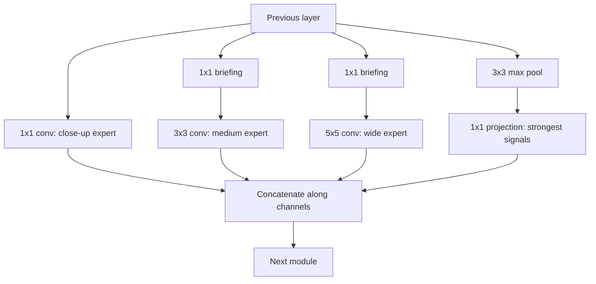

## The hook

In 2014, the recipe for a better image classifier was blunt: add more layers and more filters. It worked, but the bill grew fast. Every doubling of filters in two consecutive layers roughly quadrupled the arithmetic, and the models were filling GPU memory and taking weeks to train.

A team at Google entered that year's ImageNet challenge with a network 22 layers deep, nearly three times deeper than the 2012 winner, AlexNet. It used about 12 times fewer parameters than AlexNet, fitted a budget of about 1.5 billion multiply-adds per image, and won the classification task. The trick was to look at every scale at once, and to brief each expert before asking it to work.

## Before you start

You should know how a convolution slides a small filter over an image, as in [LeNet](article:paper-lenet) and [AlexNet](article:paper-alexnet), and that deep networks overfit without tricks like [Dropout](article:paper-dropout). It helps to know that a layer's cost depends on its input [[channel]]s, its output channels and its filter size.

## The world before this paper

AlexNet won ImageNet in 2012 with eight layers. Its successors went bigger, and two problems grew with them.

1. **Cost.** A convolution's [[multiply-add]] count is height × width × output channels × (filter area × input channels). Widen both the input and output by 2 and the cost goes up by 4.
2. **Overfitting.** More parameters meant more ability to memorise quirks of the training set, especially for fine-grained classes like similar dog breeds.

There was also a design question with no good answer: at each layer, should the filter be 1x1, 3x3 or 5x5? Small filters see fine detail; large ones see wider context. Picking one size per layer meant guessing.

Theory hinted at a direction. Work by Sanjeev Arora and colleagues suggested that good deep networks could be sparse, with groups of strongly correlated units wired together. But sparse arithmetic runs badly on GPUs, which are built for dense blocks of numbers.

:::history
Christian Szegedy and colleagues at Google, with co-authors from the University of North Carolina and the University of Michigan, posted the paper on arXiv in September 2014, and it appeared at CVPR 2015. The codename Inception came from the "we need to go deeper" internet meme, which the paper cites. The competition entry was named GoogLeNet as a nod to Yann LeCun's LeNet.
:::

## The big idea

:::analogy
Think of a newsroom covering a breaking story with a panel of four experts: one looks at close-up details, one at the medium picture, one at the wide context, and one simply highlights the strongest signals. Handing each expert the full 500-page dossier would bury them. So an assistant first writes each of them a short briefing, a few pages that keep only what matters. Every expert works from their briefing in parallel, and their reports are stapled together into one file for the next desk.
:::

That panel is an [[Inception module]]. Instead of choosing one filter size, each module runs 1x1, 3x3 and 5x5 convolutions plus a pooling branch side by side and concatenates the results. The briefing is a [[1x1 convolution]]: it shrinks the number of channels before the expensive 3x3 and 5x5 filters run, so the panel costs only a little more than a single expert.

:::insight
A 1x1 convolution cannot see shapes, because it looks at one pixel position at a time. What it can do is combine all the channels at that position into fewer, more useful ones. That makes it a cheap, learnable compressor, the briefing that lets big filters work on small inputs.
:::

## How it works

### The briefing, in numbers

Take the first Inception module of GoogLeNet. Its input is a 28 × 28 grid with 192 channels, and its 5x5 branch produces 32 channels.

**Without a briefing**, every one of the 28 × 28 × 32 outputs reads a 5 × 5 patch across all 192 channels:

28 × 28 × 32 × (5 × 5 × 192) = **120,422,400** multiply-adds.

**With a briefing**, a 1x1 convolution first reduces 192 channels to 16:

| Step | Calculation | Multiply-adds |
|---|---|---|
| 1x1 briefing, 192 → 16 | 28 × 28 × 16 × 192 | 2,408,448 |
| 5x5 on the briefing, 16 → 32 | 28 × 28 × 32 × (25 × 16) | 10,035,200 |
| **Total** | | **12,443,648** |

The output shape is the same, 28 × 28 × 32, but the cost is about 9.7 times lower. Each 1x1 layer is also followed by a ReLU, so the briefing adds a little extra non-linearity for free.

:::try-this
A layer has 100 input channels and you want 64 outputs from a 3x3 filter. Per output position, a direct 3x3 costs 100 × 9 × 64 = 57,600 multiply-adds. What if you first brief down to 20 channels? (1x1: 100 × 20 = 2,000. Then 3x3: 20 × 9 × 64 = 11,520. Total 13,520, about 4 times cheaper.)
:::

### The four-expert panel

All four branches keep the same height and width, so their outputs can be stacked channel-wise. The next module therefore sees fine detail, medium shapes and wide context together, and training decides how much to rely on each. The pooling branch gets its own 1x1 projection so it does not flood the output with channels.

### Dropping the giant classifier

In AlexNet, the final fully connected layers held most of the parameters. GoogLeNet ends with [[global average pooling]]: each of the final 1,024 feature maps, 7 × 7 in size, is averaged into a single number, and one linear layer maps those 1,024 numbers to the 1,000 classes. Flattening the 7 × 7 × 1,024 grid instead would give 50,176 inputs, so a full layer to 1,000 classes would need about 50 million weights; the pooled version needs about 1 million. The paper reports that this switch also improved top-1 accuracy by about 0.6%.

### Helping gradients reach the middle

Twenty-two layers was very deep for 2014, and gradients from the final loss weakened on the way back. The authors attached two [[auxiliary classifier]]s to intermediate modules. Their losses were multiplied by 0.3 and added to the main loss during training, giving the middle of the network a direct signal. In the newsroom picture, it is like an editor checking two experts' drafts halfway through, instead of only reading the final file.

:::warning
Common misconception: "the auxiliary heads improve the final predictions by voting." They are used only in training and are discarded at test time. Their job is to strengthen the learning signal in the middle layers, and the paper itself found their effect on final accuracy to be relatively minor.
:::

## What they found

- **First place in ILSVRC 2014 classification**, with a top-5 error of 6.67% from an ensemble of 7 models, each evaluated on many crops per image.
- **First place in the detection task** of the same challenge.
- **Much smaller and cheaper.** The paper states GoogLeNet uses 12 times fewer parameters than AlexNet while being significantly more accurate, and the design kept inference at about 1.5 billion multiply-adds, so it could be practical beyond research clusters.
- **Global average pooling helped.** Replacing fully connected layers with averaging raised top-1 accuracy by about 0.6%.

The deeper finding was that accuracy did not have to be bought with brute force. A carefully shaped network, briefing its experts before they work, matched or beat much heavier designs.

## What it got wrong (or left open)

- **Hand-tuned design.** The number of filters in every branch of every module was chosen by hand, and the paper admits the design required careful manual work. It was hard to adapt to new tasks.
- **Inception modules only from the middle.** Early layers, with large feature maps, used plain convolutions; branching there would have been too expensive in memory.
- **Heavy test-time tricks for the headline number.** The winning error came from an ensemble with aggressive multi-crop testing, which is far more costly than a single model on a single crop.
- **Auxiliary classifiers were a patch.** They hinted at a training problem with depth that a cleaner fix would soon address.

## What happened next

Within a year, [Batch Normalization](article:paper-batch-normalization) made deep networks much easier to train, and Inception-v2 and v3 adopted it, along with factorising 5x5 filters into two 3x3 filters. Microsoft's [ResNet](article:paper-resnet) solved depth more directly with shortcut connections, and its bottleneck blocks reuse the 1x1 briefing idea: shrink channels, apply a 3x3, expand again. Google later merged both ideas in Inception-ResNet.

Global average pooling became standard in almost every later convolutional network, and the 1x1 briefing became one of the most reused tricks in deep learning, from ResNet bottlenecks to [ResNeXt](article:paper-aggregated-residual-transformations-for-deep-neural-networks) and mobile networks.

## Key takeaways

- GoogLeNet showed that a network can be much deeper without becoming much more expensive, by shaping its computation carefully.
- An Inception module runs 1x1, 3x3 and 5x5 convolutions and a pooling branch in parallel and concatenates their outputs, so each layer sees several scales at once.
- 1x1 convolutions act as cheap briefings that reduce channels before costly filters, cutting the example 5x5 branch's cost by almost 10 times.
- Global average pooling replaced huge fully connected layers, removing tens of millions of weights while slightly improving accuracy.
- Auxiliary classifiers added training signal to middle layers and were discarded at test time, a patch later made unnecessary by batch normalization and residual connections.
