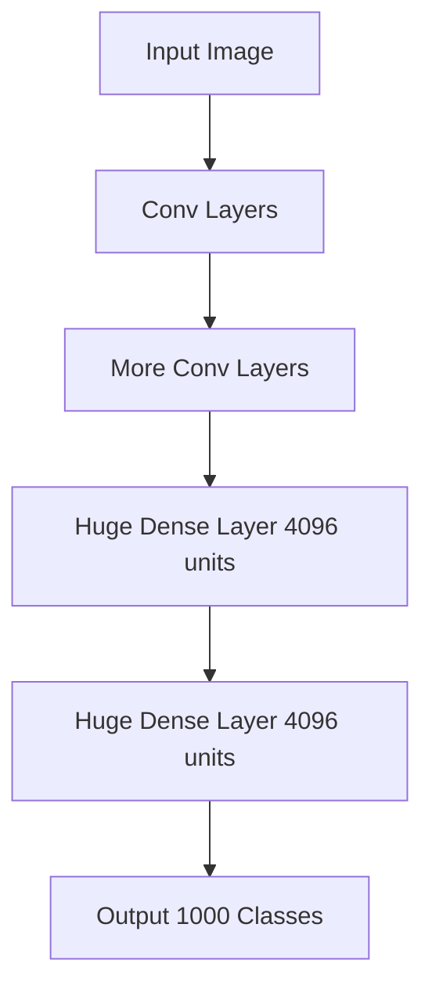
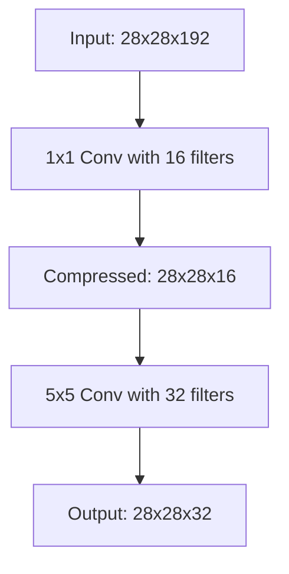
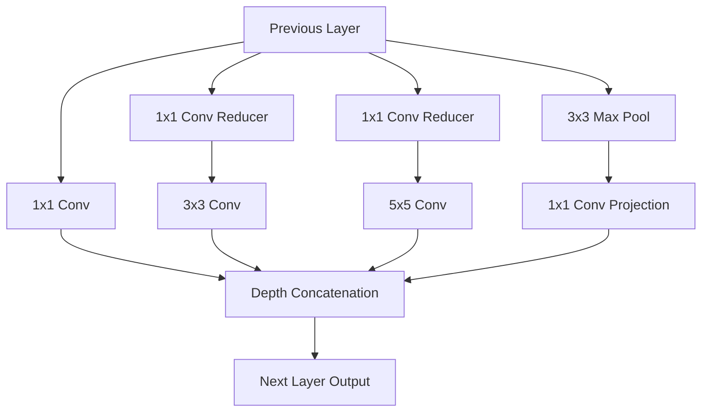
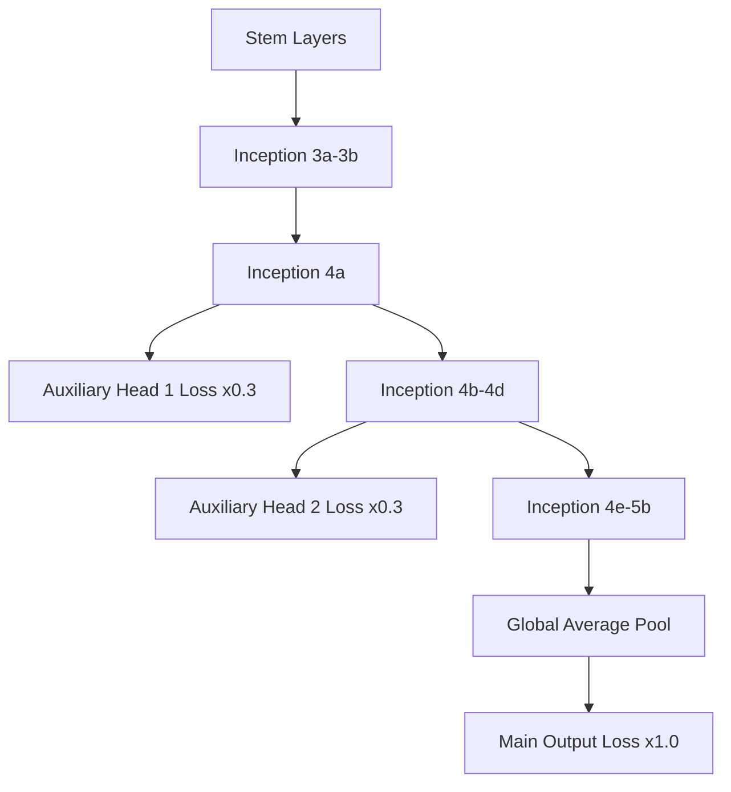

## The hook

In 2014, computer vision researchers faced a wall. If you wanted a neural network to recognize images more accurately, the recipe seemed simple: stack more convolutional layers and make each layer wider. 

There was just one catch. Stacking layers caused models to balloon to tens of millions of parameters, burning through memory and grinding training to a halt. When Google entered the prestigious ImageNet challenge that year, they entered a model with 22 parameterized layers—nearly three times deeper than [AlexNet](article:paper-alexnet). 

Yet Google's network used twelve times fewer parameters, ran within a modest smartphone-friendly compute budget, and crushed the competition. Its secret was an architectural trick borrowed from an internet meme: the Inception module.

:::analogy
Imagine an inspection team checking manufactured car parts on an assembly line. 

Instead of forcing one person to inspect everything sequentially, you assemble four specialists side by side. One examines microscopic surface scratches ($1 \times 1$). Another inspects mid-sized screws ($3 \times 3$). A third scans broad structural panels ($5 \times 5$). The fourth summarizes overall surface contours (pooling). 

To stop the specialists from drowning in paperwork, an assistant first condenses the incoming documentation into a concise summary dossier ($1 \times 1$ compression). All four specialists finish their work in parallel, paste their findings together into one folder, and pass it down the line. That inspection team is an [[Inception Module]].
:::

## Before you start

Before reading this article, make sure you understand:
- How classic convolutional networks like [LeNet](article:paper-lenet) and [AlexNet](article:paper-alexnet) slide filters over images to extract local features.
- How fully connected layers connect every input neuron to every output neuron, creating large weight matrices.
- The concept of dropout from [Dropout: Make Your Network Forget, On Purpose](article:paper-dropout) as a defense against overfitting.

## The world before this paper

In 2012, AlexNet ignited the modern deep learning revolution by winning the ImageNet competition with an 8-layer network. Over the next two years, the roadmap to higher accuracy seemed obvious: build bigger networks.

However, simply adding more filters caused two serious headaches:

1. **Overfitting on limited data:** High-capacity vision networks with millions of parameters easily memorized subtle quirks in the training images. Differentiating between fine-grained categories—such as an Alaskan Malamute versus an Eskimo dog—became fragile when the model overfit.
2. **Quadratic compute explosions:** If you chain two convolutional layers together and double the number of filters in both, your computational work does not double. It quadruples. The number of multiply-add operations scales quadratically with channel depth.

Theoretical machine learning offered an elegant answer. A landmark paper by Sanjeev Arora and colleagues suggested that the mathematically optimal neural network should be *sparse*—most connections between neurons should be zero. This matched the famous [[Hebbian Principle]]: neurons that fire together should wire together.

:::history
The paper took its codename, Inception, from a popular pop-culture meme based on the 2010 Christopher Nolan film: *"We need to go deeper."* Christian Szegedy and his team at Google set out to test whether theoretical sparse connections could actually run on real hardware. They named their specific competition entry **GoogLeNet** as an homage to Yann LeCun's pioneering [LeNet](article:paper-lenet).
:::

The catch with sparse networks was hardware. Modern CPUs and GPUs are terrible at irregular, scattered matrix math. Looking up scattered non-zero values in memory introduces massive cache misses and latency. Dense matrix math on contiguous memory runs dozens of times faster, even if you perform far more arithmetic operations.

Google's team faced a puzzle: could they mimic the mathematical benefits of sparse connectivity while keeping all computations packaged in dense, hardware-friendly blocks?

## The big idea

Instead of choosing between a fine-grained $1 \times 1$ filter, a medium $3 \times 3$ filter, or a large $5 \times 5$ filter at each stage, GoogLeNet chose all of them at once.

In an Inception network, a single stage does not pick one filter size. It splits the incoming signal into parallel streams, processes the image at multiple spatial resolutions simultaneously, and stitches the resulting feature maps back together.

To keep this multi-scale branching from triggering a computational disaster, the authors deployed an unassuming hero: the **[[1x1 Convolution]]**.

:::insight
A $1 \times 1$ convolution looks at a single pixel at a time, so it cannot detect spatial shapes. But it looks across all color channels at that single spot. It acts as an adjustable channel compressor, slicing feature depth down before expensive spatial filters ever touch the data.
:::

## How it works

Let's unpack the machinery behind GoogLeNet: the bottleneck trick, the multi-branch Inception module, and the macro-architecture that enabled 22 layers without gradient collapse.

### 1. Dimension reduction with 1x1 convolutions

Suppose an intermediate layer produces an activation tensor with dimensions $28 \times 28$ across $192$ channels. 

If you want to apply thirty-two $5 \times 5$ filters directly to this tensor (preserving spatial resolution with padding), how many operations must your computer perform?

$$\text{Operations} = 28 \times 28 \times 32 \times (5 \times 5 \times 192) \approx 120{,}422{,}400 \text{ multiply-adds}$$

Over 120 million operations for just one layer! Stacking several such layers quickly overwhelms any device.

Now look at what happens when you slip a $1 \times 1$ convolution with only $16$ filters in front of the $5 \times 5$ filter:

Let's calculate the cost of this two-step path:

1. **Step 1 ($1 \times 1$ reduction):**
   $$28 \times 28 \times 16 \times (1 \times 1 \times 192) \approx 2{,}408{,}448 \text{ operations}$$
2. **Step 2 ($5 \times 5$ spatial filter on compressed channels):**
   $$28 \times 28 \times 32 \times (5 \times 5 \times 16) \approx 10{,}035{,}200 \text{ operations}$$
3. **Total operations:**
   $$2{,}408{,}448 + 10{,}035{,}200 \approx 12{,}443{,}648 \text{ operations}$$

By inserting that tiny $1 \times 1$ filter, we cut the arithmetic operations from ~120 million down to ~12.4 million—nearly a **10x speedup**—while keeping the output shape identical ($28 \times 28 \times 32$). Even better, each $1 \times 1$ layer includes a non-linear ReLU activation, allowing the network to learn richer combinations of features.

:::try-this
Suppose your feature map has $100$ channels and you need to feed it into a layer with sixty-four $3 \times 3$ filters. 
- Without reduction, each output pixel requires $100 \times 3 \times 3 \times 64 = 57{,}600$ operations.
- If you first reduce the $100$ channels to $20$ channels using a $1 \times 1$ convolution, what is the new cost per pixel?
*(Hint: calculate the $1 \times 1$ cost: $100 \times 1 \times 1 \times 20 = 2{,}000$. Then calculate the $3 \times 3$ cost on 20 channels: $20 \times 3 \times 3 \times 64 = 11{,}520$. The total is $13{,}520$ operations—over 4x fewer!)*
:::

### 2. The Inception module

Inside every Inception module, four paths run in parallel:

1. A direct $1 \times 1$ convolution branch to capture pinpoint details.
2. A $1 \times 1$ bottleneck followed by a $3 \times 3$ convolution for medium-scale features.
3. A $1 \times 1$ bottleneck followed by a $5 \times 5$ convolution for broad context.
4. A $3 \times 3$ max-pooling operation followed by a $1 \times 1$ projection to retain strong spatial signals without inflating channel counts.

At the end of the module, all four branches output feature maps of identical height and width. The network stacks these outputs side-by-side along the channel dimension. The subsequent layer gets to look at local textures, intermediate shapes, and large objects all at the same time.

### 3. Killing the fully connected bottleneck

In AlexNet and VGG, the final fully connected layers accounted for nearly 90% of all parameters in the entire network. Connecting thousands of flattened spatial features to 4,096 hidden units required tens of millions of weights.

GoogLeNet replaced those monstrous layers with **[[Global Average Pooling]]**. 

Instead of flattening a $7 \times 7 \times 1024$ volume into a 50,176-dimensional vector, the network takes the average value of each $7 \times 7$ feature slice. The tensor instantly shrinks to a single $1 \times 1 \times 1024$ vector. A single small linear layer maps those 1,024 values to the 1,000 ImageNet categories.

This change alone wiped out tens of millions of redundant parameters and reduced overfitting, boosting top-1 accuracy by roughly 0.6%.

### 4. Auxiliary classifiers for deep gradient flow

Training a 22-layer network with backpropagation was treacherous in 2014. As error gradients flowed backwards from the output to the input, they shrank at every layer. By the time they reached the earliest convolutional layers, the gradient signal often vanished entirely.

To solve this, Google engineers attached two **[[Auxiliary Classifier|auxiliary classifiers]]** to intermediate layers (stages 4a and 4d). 

During training, these side branches took intermediate features, ran them through average pooling and small classifiers, and computed predictions. Their loss was multiplied by 0.3 and added to the total training loss. This pumped fresh, strong gradient signals directly into the middle of the network.

:::warning
Auxiliary classifiers are purely a training stabilizer. Once training is complete, both auxiliary heads are cut off and discarded. During test-time inference, only the main classification head runs.
:::

## What they found

GoogLeNet delivered a masterclass in computational efficiency at the ImageNet Large-Scale Visual Recognition Challenge 2014 (ILSVRC14).

### State-of-the-art accuracy

GoogLeNet won first place in both the classification and detection tracks:

- **Classification:** An ensemble of seven GoogLeNet models achieved a **6.67% top-5 error rate** on the ImageNet test set, beating VGG (7.32%) and dramatically cutting the 16.4% error rate set by AlexNet two years earlier.
- **Detection:** GoogLeNet paired with region proposals scored **43.9% mean Average Precision (mAP)**, beating the runner-up's 40.7% despite using no bounding-box regression.

### Featherweight efficiency

The standout achievement was not just accuracy—it was cost:

| Model | Layers | Parameters | Multiply-Add Ops | Top-5 Error |
| :--- | :--- | :--- | :--- | :--- |
| **AlexNet (2012)** | 8 | ~60 Million | ~720 Million | 16.4% |
| **VGG-16 (2014)** | 16 | ~138 Million | ~15.3 Billion | 7.3% |
| **GoogLeNet (2014)** | 22 | **~6.8 Million** | **~1.5 Billion** | **6.7%** |

GoogLeNet was nearly three times deeper than AlexNet, yet it contained **twelve times fewer parameters**. Compared to its primary 2014 rival, VGG-16, GoogLeNet used roughly twenty times fewer weights and ten times fewer floating-point operations.

The authors deliberately capped their inference computational budget at 1.5 billion multiply-adds so the network could run on low-power mobile chips and embedded systems.

## What it got wrong (or left open)

While GoogLeNet changed computer vision architecture forever, it left several friction points:

1. **Extreme hyperparameter fragility:** Designing an Inception network was more art than science. Deciding how many $1 \times 1$, $3 \times 3$, and $5 \times 5$ filters belonged in each branch required painstaking manual tuning. The paper admitted that the architecture *"requires careful manual design at this point."*
2. **Infrastructure bottlenecks at low layers:** The authors could not run Inception modules right from the start of the network. Early layers process high-resolution images, where branching consumed too much GPU memory. As a result, GoogLeNet had to rely on standard sequential convolutional layers (the stem) for its first several stages.
3. **Overly complicated test-time tricks:** To hit the winning 6.67% error rate, the team used an ensemble of 7 models and evaluated an astonishing 144 crops per image across four different scales. A single model with a single standard crop achieved a 10.07% error rate—impressive, but noticeably further from the headline score.
4. **Band-aid fixes for depth:** The auxiliary classifiers proved that backpropagating through 22 layers was unstable. While auxiliary heads patched the problem, they made the architecture messier to train. Within two years, a cleaner mathematical solution would make auxiliary heads obsolete.

## What happened next

The ideas introduced in GoogLeNet rippled across machine learning:

- **The death of giant fully connected layers:** Following Google's lead, almost every modern convolutional architecture abandoned multi-thousand-unit dense layers, adopting global average pooling as standard practice.
- **Universal bottleneck blocks:** The $1 \times 1$ dimension reduction trick became an industry standard. When Kaiming He and team developed [ResNet](article:paper-resnet) in 2015, their deepest models relied on three-layer "bottleneck blocks" ($1 \times 1 \to 3 \times 3 \to 1 \times 1$) directly inspired by Inception.
- **Automating gradient flow:** Just one year later, [Batch Normalization](article:paper-batch-normalization) solved the vanishing gradient problem cleanly at every layer. With batch normalization added in Inception-v2 and Inception-v3, researchers found they could train deep networks reliably without needing auxiliary classifiers at all.
- **The Inception Dynasty:** The Google team iterated on these concepts for years, releasing Inception-v2 (factorizing $5 \times 5$ convolutions into two consecutive $3 \times 3$ filters), Inception-v3, and Inception-ResNet, which married multi-scale Inception branches with residual shortcut connections.

## Key takeaways

- GoogLeNet proved that making neural networks deeper does not require ballooning parameter counts or compute costs.
- The Inception module processes images at multiple spatial scales ($1 \times 1$, $3 \times 3$, $5 \times 5$, and pooling) in parallel and concatenates the results.
- $1 \times 1$ convolutions act as critical computational bottlenecks, compressing channel dimensions before expensive spatial convolutions run.
- Global average pooling replaced massive, parameter-heavy fully connected layers, cutting out tens of millions of weights while preventing overfitting.
- Auxiliary classification heads injected training gradients directly into intermediate layers, enabling the successful training of a 22-layer network before residual connections existed.
