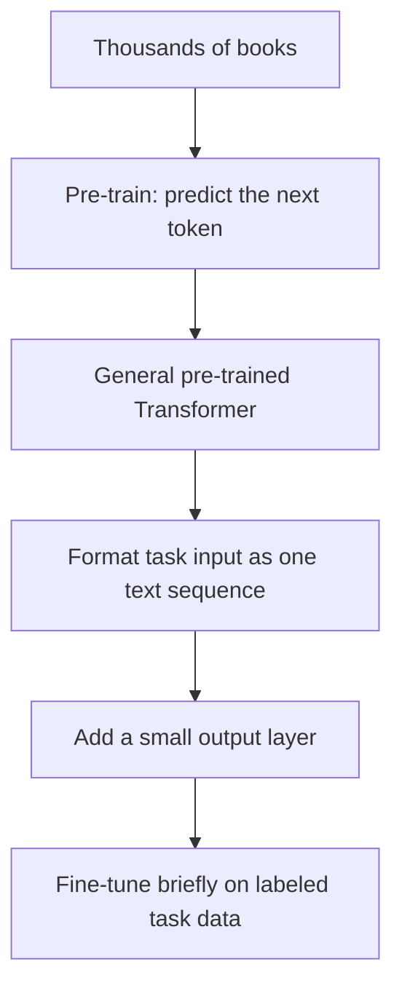

## The hook

In June 2018, OpenAI posted a blog post and a short technical report. It did not appear at a big conference. It had no flashy demo. Its main claim was modest-sounding: a model pre-trained on a pile of books did better on a collection of language understanding tests.

But hidden in that report was the recipe that would, four years later, produce ChatGPT: take a Transformer, train it to predict the next word on lots of text, and then adapt it to whatever you need. The name for that first model, GPT, stands for "Generative Pre-Training." Every GPT since is a direct descendant.

## Before you start

You need the Transformer and self-attention from [The Paper That Taught Machines Where to Look](article:paper-attention-is-all-you-need). It also helps to remember from [word2vec](article:paper-word2vec) that useful knowledge about words can be learned from unlabeled text alone.

## The world before this paper

In 2018, most language systems were trained for one task at a time, on labeled data: thousands of sentence pairs marked "entails" or "contradicts," thousands of reviews marked positive or negative. Labels are expensive, so these datasets were small, and models trained from scratch on them learned only shallow patterns.

Word vectors helped, since they carried knowledge from large unlabeled text into each task. But they only transferred knowledge about individual words, not about how words combine into sentences, arguments and stories.

:::history
Early 2018 was full of attempts to transfer more. Jeremy Howard and Sebastian Ruder's ULMFiT showed that a pre-trained LSTM language model could be fine-tuned for text classification with excellent results. ELMo, from the Allen Institute for AI, produced word representations that depended on the surrounding sentence. In computer vision, starting from a network pre-trained on [ImageNet](article:paper-alexnet) had long been standard practice. Language was catching up.
:::

Alec Radford at OpenAI, together with Karthik Narasimhan, Tim Salimans and Ilya Sutskever, asked: what if you used the new Transformer instead of an LSTM, pre-trained it on a lot of long, coherent text, and then fine-tuned it for every kind of task?

## The big idea

Two stages:

1. **Unsupervised [[pre-training]].** Train a large Transformer as a [[language model]]: given the text so far, predict the next [[token]]. No labels needed, so you can use as much text as you can find.
2. **Supervised [[fine-tuning]].** Take the pre-trained model, add a tiny output layer, and train briefly on a labeled dataset for each specific task.

:::analogy
Think of a student who spends a year reading thousands of novels before ever seeing an exam. They never study for any particular test, but they absorb grammar, vocabulary, how arguments flow and how people think. When an exam finally arrives, whether comprehension, logic puzzles or spotting contradictions, a short practice session is enough, because the heavy lifting already happened while reading. That is [[transfer learning]].
:::

:::insight
Predicting the next word, at scale, forces a model to learn grammar, facts and some reasoning, because all of those help prediction. That general knowledge can then be cheaply adapted to almost any language task.
:::

## How it works

### The model

GPT used a [[decoder-only Transformer]]: 12 layers, each with masked self-attention and a feed-forward network, with 768-dimensional states and 12 attention heads, about 117 million parameters in total. "Masked" means each position can attend only to earlier positions, so the model cannot cheat by peeking at the word it is supposed to predict.

### Pre-training on books

The pre-training data was BooksCorpus, a collection of about 7,000 unpublished books spanning genres like adventure, fantasy and romance. Books were chosen deliberately: they contain long stretches of continuous text, so the model could learn dependencies across many sentences, using a context of 512 tokens.

The training objective is simple. For every position in the text, maximize the probability of the actual next token:

$$L = \sum_i \log P(u_i \mid u_{i-k}, \dots, u_{i-1})$$

- $u_i$ is the token at position $i$.
- $u_{i-k}, \dots, u_{i-1}$ are the $k$ tokens before it, the context window.
- Summing the log-probabilities over all positions and making the total large means "predict each next token well."

### A worked example of next-token prediction

For the context "The chef tasted the soup and added more," suppose the model's probabilities for the next token are: "salt" 0.40, "pepper" 0.20, "water" 0.10, and the rest spread across thousands of other tokens. If the book actually says "salt," the loss for this position is $-\log 0.40 \approx 0.92$. Training nudges the weights so "salt" gets a bit more probability next time in contexts like this. Repeat this billions of times and the model absorbs a great deal about cooking, grammar and the world.

### Why next-word prediction teaches so much

It is worth asking why such a simple task works. To predict the next word in "She put the ice cream in the freezer because it was," a model benefits from knowing grammar ("it" refers to something singular), physics (ice cream melts) and even a bit of common sense about why people use freezers. Every one of those skills lowers the loss a little, across billions of predictions. Nobody teaches them directly; they are side effects of getting good at guessing what comes next. That is why the authors called the pre-training "generative" and expected it to help on tasks that look nothing like next-word prediction.

### One model, many tasks

Fine-tuning needed each task to look like a sequence of text. The authors used simple input transformations with special delimiter tokens:

| Task | How the input is formatted |
|---|---|
| Classification | Start, text, extract |
| Entailment | Start, premise, delimiter, hypothesis, extract |
| Similarity | Both orders of the two sentences, processed separately and combined |
| Multiple choice | One sequence per answer: context, delimiter, answer; scores compared |

During fine-tuning, they also kept the language modelling objective as an extra loss, which helped the model generalize and learn faster.

:::try-this
How would you format a sentiment task, "Is this review positive or negative?", for GPT using the table above? And how would you format a question with three possible answers? (Sentiment is classification: start token, the review text, extract token, then a small layer predicts positive or negative. For three answers, build three sequences, one per answer, score each, and pick the highest.)
:::

## What they found

The model was tested on 12 natural language understanding datasets covering entailment, question answering, semantic similarity and classification.

- It improved the state of the art on 9 of the 12 datasets, even though each competitor was usually designed specifically for its task.
- The paper highlighted absolute improvements of 8.9% on commonsense reasoning (the Story Cloze Test), 5.7% on question answering (RACE) and 1.5% on textual entailment (MultiNLI).
- Transferring more pre-trained layers helped steadily; each additional layer carried useful knowledge.
- Without any fine-tuning, the pre-trained model's ability on several tasks, measured with simple heuristics, grew steadily during pre-training, an early hint of [[zero-shot]] abilities that would become the focus of later GPTs.

:::warning
Common misconception: "GPT-1 was a chatbot." It was not built for conversation at all. It was a language model used as a starting point, then fine-tuned separately for each classification-style task. The chat abilities came years later, with much larger models and training on human feedback.
:::

## What it got wrong (or left open)

GPT read text in one direction only, left to right. For understanding tasks, seeing the words on both sides of a position can help, a point Google's [BERT](article:paper-bert) made forcefully a few months later, beating GPT on many of the same benchmarks.

The model still needed labeled data and fine-tuning for each task. And at 117 million parameters trained on books, it was small; the authors could not yet know how much better the recipe would get with scale.

## What happened next

- In 2019, GPT-2 scaled the recipe up to 1.5 billion parameters and a much larger web dataset, and showed striking zero-shot abilities, such as summarising or translating when prompted. OpenAI initially withheld the full model over misuse concerns, sparking a public debate.
- [BERT](article:paper-bert) adopted the pre-train then fine-tune recipe with a bidirectional encoder, and the approach swept natural language processing.
- [GPT-3](article:paper-gpt-3) in 2020 scaled to 175 billion parameters and showed that, at enough scale, a model could perform new tasks from a few examples in its prompt, with no fine-tuning at all.
- [InstructGPT](article:paper-instructgpt) fine-tuned GPT models with human feedback, leading to ChatGPT in late 2022.

## Key takeaways

- GPT introduced generative pre-training: train a Transformer to predict the next token on lots of unlabeled text, then fine-tune it for specific tasks.
- It used a 12-layer decoder-only Transformer with masked self-attention, pre-trained on about 7,000 unpublished books.
- Task inputs were reformatted as single text sequences with delimiter tokens, so one model could handle many different tasks.
- It set new state-of-the-art results on 9 of 12 language understanding benchmarks and hinted at zero-shot abilities.
- Its recipe, scaled up and combined with human feedback, became the foundation of GPT-2, GPT-3 and ChatGPT.
