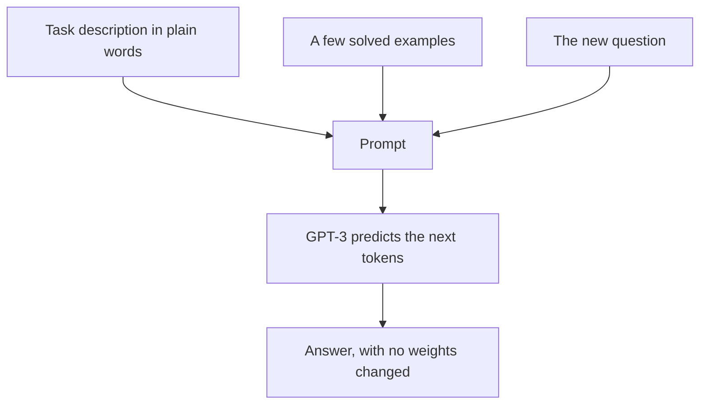

## The hook

Type this into a text box:

*English: cheese → French: fromage*
*English: house → French: maison*
*English: book → French:*

A model completes it with "livre." Nobody trained it to translate. Nobody changed a single one of its weights. It looked at two examples, spotted the pattern, and continued it.

In May 2020, OpenAI described a model that could do this kind of thing for translation, arithmetic, unscrambling words, writing news articles and dozens of other tasks, purely from examples typed into the prompt. It had 175 billion parameters, more than ten times larger than any non-sparse language model before it. Its name was GPT-3, and within weeks of its release through an API, developers were sharing demos that made the whole tech world pay attention.

## Before you start

You need the generative pre-training recipe from [Read Seven Thousand Books, Then Take Any Test](article:paper-gpt-1), and the decoder-only Transformer from [Attention Is All You Need](article:paper-attention-is-all-you-need).

## The world before this paper

By 2020, the dominant approach in natural language processing was pre-train then fine-tune. Pre-train a large model on unlabeled text, like [GPT-1](article:paper-gpt-1) or [BERT](article:paper-bert), then fine-tune it on thousands of labeled examples for each new task.

That worked well, but it had costs. Every new task needed a labeled dataset and a separately fine-tuned copy of the model. And fine-tuned models could exploit quirks in narrow datasets, scoring well on a benchmark without really generalizing.

:::history
OpenAI's GPT-2 (2019), with 1.5 billion parameters, had hinted at something stranger: with no fine-tuning at all, it could do a passable job of summarising or answering questions if the prompt was phrased cleverly. Meanwhile, Jared Kaplan and colleagues at OpenAI had found that language model performance improved smoothly and predictably with scale, as you will see in [Scaling Laws](article:paper-scaling-laws). The natural experiment was to go much bigger and see how far prompting alone could go.
:::

Humans, the paper points out, do not need thousands of examples to learn a new language task. Usually a brief instruction or a couple of examples is enough. Could a language model do the same?

## The big idea

Train a very large language model, then do no fine-tuning at all. Instead, describe the task, and optionally give a few examples, inside the [[prompt]]. Let the model pick up the task from context. The paper calls this [[in-context learning]].

:::analogy
Think of a well-read friend who has never worked as a translator. You show them two lines of a menu translated from English to Hindi and point at the third. They do not go back to school; they just look at the pattern and write the answer. GPT-3 is that friend: it has read so much that a couple of examples are enough to tell it what game you want to play.
:::

The paper evaluated three settings, all without any weight updates:

- **[[Zero-shot]]:** an instruction only, like "Translate English to French: cheese →".
- **One-shot:** the instruction plus one example.
- **[[Few-shot]]:** the instruction plus as many examples as fit in the context window, typically 10 to 100.

:::insight
At large enough scale, a language model can learn a new task from its prompt alone. The prompt becomes a kind of programming, and the examples become the training data.
:::

## How it works

### The model

GPT-3 is architecturally very similar to GPT-2: a decoder-only Transformer predicting the next token. What changed was scale:

| Property | GPT-3 175B |
|---|---|
| Parameters | about 175 billion |
| Layers | 96 |
| Hidden size | 12,288 |
| Attention heads | 96 |
| Context window | 2,048 tokens |

To study the effect of scale, the authors trained eight models, from 125 million to 175 billion [[parameter|parameters]], on the same data.

### The data

Training used about 300 billion tokens drawn from a filtered version of Common Crawl (a huge scrape of the web), plus higher-quality sources: an expanded web-text dataset, two book collections and English Wikipedia. Higher-quality sources were sampled more often than their size alone would suggest.

### How in-context learning looks

From the model's point of view, nothing special is happening: it is just predicting what text comes next, as always. The surprise is that, at this scale, "what comes next" after a list of solved examples is very often the correct solution to the new one.

### A worked example: arithmetic

A few-shot prompt for addition might look like:

*Q: What is 48 plus 76? A: 124*
*Q: What is 97 plus 25? A: 122*
*Q: What is 34 plus 59? A:*

The paper found that the largest model handled two-digit addition almost perfectly in this format, and three-digit addition about 80% of the time, while smaller models did far worse. Since many specific sums are unlikely to appear verbatim in the training data, this suggested the model had learned something like the procedure, at least for small numbers.

:::try-this
Design a few-shot prompt that teaches a made-up task: reversing the letters of a word. Write two examples and a test. For instance: "cat → tac", "milk → klim", "chai →". Would a model need to have seen this exact task before? (No. The point of in-context learning is that the pattern is specified by the examples. Interestingly, the paper found character-level tasks hard for GPT-3, partly because it sees text as multi-letter tokens, not individual letters.)
:::

## What they found

- **Scale unlocks in-context learning.** Across many tasks, few-shot performance improved steeply with model size, and the gap between zero-shot and few-shot widened. Bigger models were much better at using examples.
- **Strong results without fine-tuning.** On some benchmarks, few-shot GPT-3 matched or approached fine-tuned state-of-the-art systems. For example, it set a new state of the art on the TriviaQA question answering task in a closed-book setting, answering from its own knowledge with no documents provided.
- **New capabilities.** It could unscramble words, use a newly defined word in a sentence after seeing its definition once, and do simple arithmetic.
- **Convincing articles.** When people were shown short news articles and asked whether a human or the model wrote them, their accuracy at spotting the largest model's articles was barely above chance, about 52%.
- **Clear weak spots.** On some reading comprehension and natural language inference tasks, few-shot GPT-3 was much weaker than fine-tuned models.

:::warning
Common misconception: "GPT-3 learned the task from the examples the way a student does." Its weights do not change during in-context learning, and nothing is remembered after the prompt ends. Researchers still debate exactly what happens inside: it may be recognizing which of many skills learned in pre-training the examples point to, rather than learning something genuinely new.
:::

## What it got wrong (or left open)

The paper's limitations section is unusually frank. GPT-3's text could repeat itself, lose coherence over long passages, and contradict itself. It struggled with common-sense physics questions like "If I put cheese in the fridge, will it melt?"

[[Data contamination]] was a real concern: with so much web data, some benchmark questions inevitably appeared in training. The authors searched for overlaps and analysed their effect, finding it modest for most tasks, but they could not fully rule it out.

The authors also devoted a section to broader impacts: the model reflected social biases around gender, race and religion found in its training text, could be misused to generate misinformation or spam, and cost an enormous amount of energy to train. And GPT-3 was not designed to follow instructions or be truthful; it simply continued text, which could mean confidently making things up.

## What happened next

- OpenAI offered GPT-3 through a commercial API in mid-2020, kicking off the wave of AI writing tools and startups. The paper won a NeurIPS 2020 best paper award.
- [Chain-of-thought prompting](article:paper-chain-of-thought) showed that adding worked reasoning steps to few-shot examples greatly improved large models on maths and logic.
- [InstructGPT](article:paper-instructgpt) fine-tuned GPT-3 with human feedback to follow instructions helpfully, leading directly to ChatGPT in November 2022.
- [Chinchilla](article:paper-chinchilla) argued that GPT-3-era models were too big for the amount of data they were trained on, reshaping how later models like [LLaMA](article:paper-llama) were built.

## Key takeaways

- GPT-3 is a 175-billion-parameter decoder-only Transformer trained on about 300 billion tokens of web, book and Wikipedia text.
- Instead of fine-tuning, it was evaluated with zero-shot, one-shot and few-shot prompts, learning tasks from the context alone.
- In-context learning improved dramatically with model size, letting the largest model rival fine-tuned systems on some benchmarks.
- It showed new abilities, such as simple arithmetic and generating news articles people struggled to tell from human writing.
- Its frank limitations, including incoherence, bias, contamination risks and lack of instruction following, set the agenda for the work that produced ChatGPT.
