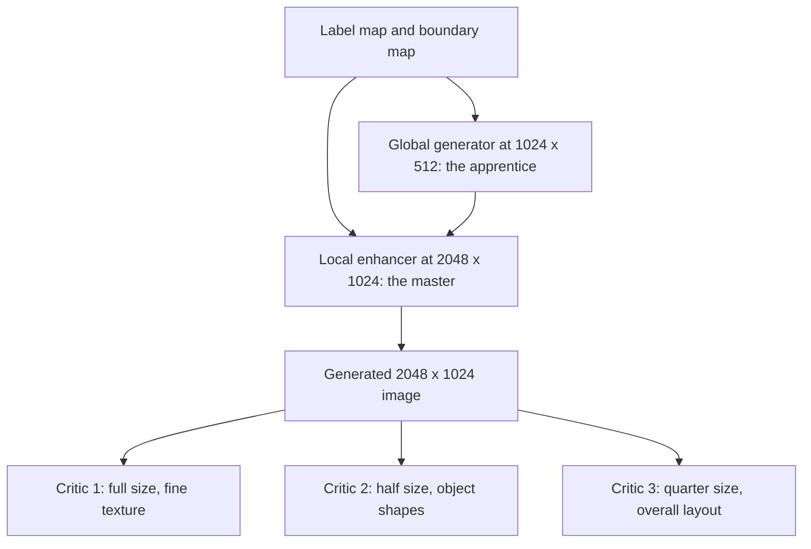

## The hook

Colour a picture the way a child fills in a colouring book: this region is road, that one is sky, these blobs are cars and those are trees. Press a button, and a realistic street photograph comes back at 2048 × 1024 pixels, with the cars, trees and road surfaces where you drew them. Then click a car and change its colour, or swap the road texture.

In 2017, conditional GANs could do this kind of translation at around 256 × 256 pixels, and attempts at higher resolution tended to become unstable or blurry. This paper from NVIDIA and UC Berkeley, usually called pix2pixHD, showed how to reach megapixel output. Its answer was not one bigger network but a better division of labour, both in painting the image and in judging it.

## Before you start

You should know how a [GAN](article:paper-gan) trains a generator against a discriminator, how residual blocks from [ResNet](article:paper-resnet) make deep networks trainable, and how encoder-decoder networks like [U-Net](article:paper-unet) map one image to another. The input here is a [[semantic label map]]: an image whose pixels hold class ids instead of colours.

## The world before this paper

The original pix2pix, also co-authored by Jun-Yan Zhu, made image-to-image translation popular with a [[conditional GAN]]: label maps to photos, sketches to shoes, day to night. Its discriminator judged small patches, which kept textures sharp at small sizes. But at high resolution, training became unstable and results were poor.

A different approach, Cascaded Refinement Networks, reached high resolutions without any adversarial training, using only a perceptual loss that compares deep features of the output and the real photo. Training was stable, but the images looked smooth and lacked the fine, crisp detail that makes a photo convincing.

So the choice seemed to be: adversarial training with sharp detail but small images, or stable training with large but soft images.

:::history
Ting-Chun Wang, Ming-Yu Liu, Jun-Yan Zhu, Andrew Tao, Jan Kautz and Bryan Catanzaro posted the paper in November 2017, and it appeared at CVPR 2018. The authors released code, and the method became a standard baseline for high-resolution image translation.
:::

## The big idea

:::analogy
Think of painting a huge mural. An apprentice first paints a small version that gets the layout right: where the road runs, where the buildings stand. Then a master works on the full-size wall, using the small version as a guide and adding all the fine brushwork. When it is finished, three critics judge it from three distances: one across the street checks the overall composition, one halfway checks the shapes of objects, and one up close checks the brushstrokes. The mural must satisfy all three.
:::

pix2pixHD does exactly this. A [[coarse-to-fine generator]] has an apprentice network for the global layout and a master network for detail. [[Multi-scale discriminators]] are the three critics, each seeing the image at a different size. Two smaller ideas complete the picture: a [[feature matching loss]] that steadies training, and an [[instance boundary map]] that keeps neighbouring objects apart.

## How it works

### 1. The apprentice and the master

The global generator G1 works at 1024 × 512. It is built from residual blocks and learns where things go in the scene. The local enhancer G2 works at 2048 × 1024: it processes the full-size label map with its own front end, adds the result to G1's final features, and then refines them with more residual blocks into the full-size image.

Training follows the mural: first train the apprentice alone at low resolution, then attach the master and train both together at full resolution. The master never has to discover the layout from scratch.

### 2. Three critics at three distances

A discriminator can only judge what its [[receptive field]] covers. Suppose each critic sees patches of 70 × 70 pixels, the patch size used by the original pix2pix discriminator. On a 2048-pixel-wide image:

| Critic | Image it sees | 70 pixels cover in the original | Share of the width |
|---|---|---|---|
| D1 | full 2048 × 1024 | 70 px | about 3.4% |
| D2 | half size, 1024 × 512 | 140 px | about 6.8% |
| D3 | quarter size, 512 × 256 | 280 px | about 13.7% |

The same small network sees four times more of the scene on the quarter-size image. So D3 can complain when a road bends wrongly across the picture, while D1 complains about blurry tyres. Making one discriminator see as much would need a much deeper or wider network, with more memory and more risk of overfitting. The generator's adversarial loss is the sum over all three critics.

### 3. Feature matching: copying the critics' notes

GAN training can swing wildly, as the generator chases whatever currently fools the critic. The feature matching loss adds a calmer signal. Run the real photo and the generated image through each discriminator, and compare their intermediate features layer by layer with an L1 distance. For layer i of critic k:

$$\mathcal{L}_{FM} = \frac{1}{N_i}\left\| D_k^{(i)}(s, x) - D_k^{(i)}(s, G(s)) \right\|_1$$

where s is the label map, x the real photo, G(s) the generated image and N_i the number of values in the layer. In the mural picture, the generator learns not just whether a critic approves but what the critic noticed, and tries to make its painting produce the same notes as the real scene.

A made-up example: one layer has four values. For the real photo they are 2.0, 4.0, 1.0, 3.0; for the generated image 2.5, 3.0, 1.0, 5.0. The absolute differences are 0.5, 1.0, 0.0 and 2.0, summing to 3.5, and dividing by N = 4 gives a loss of 0.875 for that layer. The generator adjusts to push it towards zero.

:::insight
The critics teach in two ways. The adversarial loss says "this looks fake"; the feature matching loss says "here is how your painting differs from the real one in what I pay attention to". The second is a smoother target, which is a large part of why training stays stable at high resolution.
:::

The paper also reports a further optional improvement from adding a perceptual loss based on a pretrained VGG network.

### 4. Keeping touching objects apart

In a label map, every car pixel has the same class. Two cars parked bumper to bumper form one blob, and the generator may paint one long, strange car. pix2pixHD computes an instance boundary map, marking pixels whose object instance differs from a neighbour's, and adds it as an extra input channel. Now the master painter knows where one car ends and the next begins.

:::try-this
Draw three touching circles and shade them all solid. You see one three-lobed blob. Now draw a thin line where each pair touches. Which input would you rather give a painter? (The one with lines: they carry exactly the information the label map lost, which is what the boundary map restores.)
:::

### 5. Editing individual objects

A label map says "car" but not "red car". To allow choices, the authors train an encoder that summarises each object instance in a real image as a short feature code. After training, codes for each class are clustered into a small set of typical appearances. A user can click an object and pick a cluster, changing a car's colour or a road's texture while the layout stays fixed.

:::warning
Common misconception: "the feature matching loss replaces the adversarial loss." It does not. The adversarial loss from the three critics is still what pushes for realistic detail; feature matching steadies the training around it.
:::

## What they found

- **Higher resolution and quality.** On Cityscapes street scenes at 2048 × 1024, the results were sharper and more realistic than pix2pix and Cascaded Refinement Networks.
- **A segmentation test of realism.** Running a pretrained segmentation network on generated images, the classes it recovered matched the input labels far better than for the earlier methods, and came close to its score on real photos.
- **People preferred it.** In side-by-side human studies, participants chose pix2pixHD over both baselines most of the time, on street and indoor datasets.
- **Each part helps.** Ablations showed gains from the multi-scale critics, from feature matching and from instance boundaries, which improved how separate objects, such as cars, looked.
- **Interactive editing.** The instance codes allowed changing object appearance and adding or removing objects on the label map.

## What it got wrong (or left open)

- **Needs paired, labelled data.** Every training photo needs a pixel-accurate label map and instance ids, which are slow and expensive to annotate.
- **Heavy to train.** Two generators and three discriminators at full resolution need a lot of GPU memory.
- **Labels can fade inside the network.** The label map enters only at the input, and normalisation layers deeper in the network can wash out that information. A successor addressed exactly this.
- **Limited variety.** The cluster codes give a handful of styles per class, not the full range of real appearances.

## What happened next

In 2019, NVIDIA researchers introduced SPADE, the method behind the GauGAN demo, which feeds the label map into every normalisation layer so the layout is never washed out, while keeping pix2pixHD's multi-scale discriminators and feature matching. The same team extended the approach to video with vid2vid, adding consistency over time. Later, high-resolution generation largely moved to working in compressed latent spaces, as in [Taming Transformers](article:paper-taming-transformers-for-high-resolution-image-synthesis) and [Latent Diffusion](article:paper-latent-diffusion), but the coarse-to-fine and multi-scale ideas remain common.

## Key takeaways

- pix2pixHD turns semantic label maps into 2048 × 1024 photos with a conditional GAN, far larger than earlier adversarial methods managed.
- A global generator lays out the scene at low resolution, and a local enhancer adds full-resolution detail on top, trained in that order.
- Three discriminators at different image sizes judge global layout and fine texture together, without one giant critic.
- A feature matching loss on the discriminators' intermediate features stabilises training, and instance boundary maps keep touching objects separate.
- Per-object feature codes let users change the appearance of individual objects while keeping the layout fixed.
