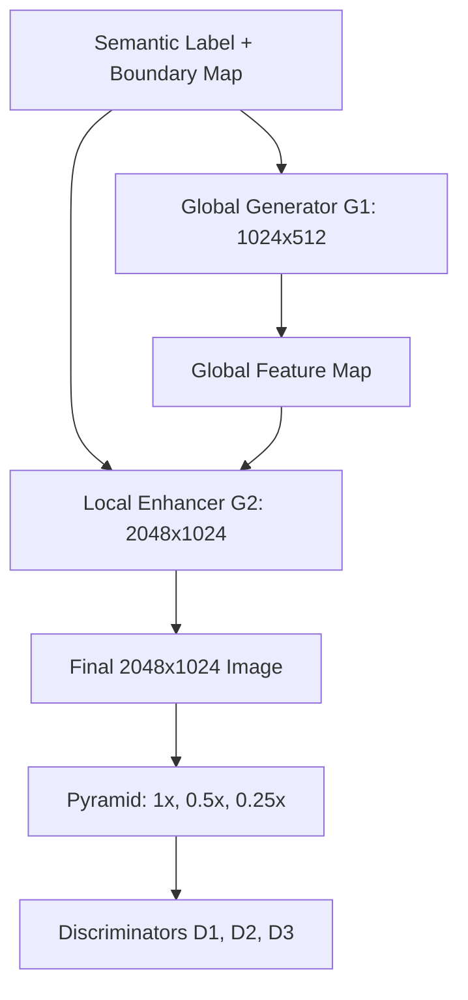
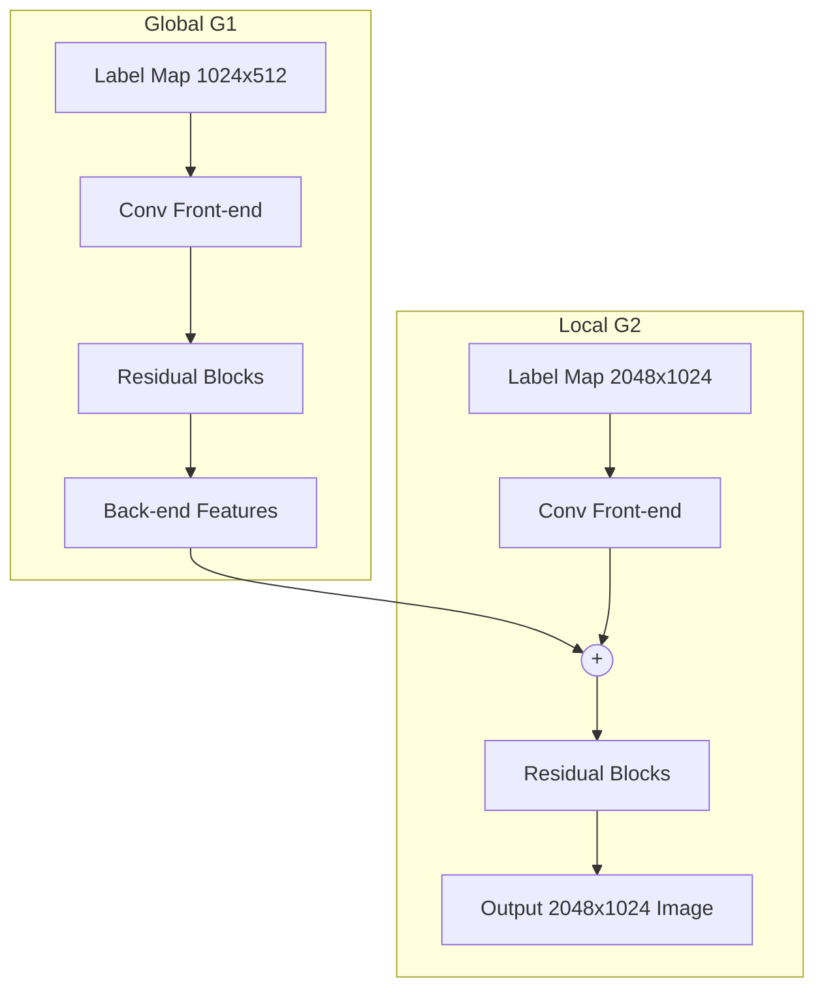

## The hook

Imagine drawing a rough digital sketch where you color a block blue for "sky", gray for "road", and red for "car". You tap a button, and the cartoonish silhouette turns into a crisp, photorealistic $2048 \times 1024$ street scene: raindrops glinting on car windshields, distinct leaves on roadside trees, and asphalt textured with pebbles. In 2017, neural networks could barely generate $256 \times 256$ postage stamps without devolving into a muddy mess. This paper showed how to shatter that resolution ceiling.

:::analogy
Creating a megapixel painting is like painting a giant public mural. An apprentice first sketches the broad layout and color blocks on a smaller canvas. Then, a master painter stands directly at the full-sized wall, adding intricate brushwork on top of that layout. 

Meanwhile, three art critics evaluate the artwork at three different distances: one stands across the street to judge the overall composition, one stands midway to inspect the figures, and one stands inches away checking the sharpness of the brushstrokes.
:::

## Before you start

You should already be comfortable with:
- How [Generative Adversarial Networks](article:paper-gan) train a generator and a discriminator in an adversarial game.
- How [Residual Networks](article:paper-resnet) use skip connections to train deep convolutional backbones without gradient vanishing.
- How [U-Net](article:paper-unet) passes spatial features between downsampling and upsampling paths.

## The world before this paper

In late 2016, image-to-image translation had a breakthrough with the original pix2pix model. Using conditional GANs, pix2pix mapped inputs to outputs across domains: black-and-white drawings into color photos, edge sketches into shoes, and segmentation masks into street views.

```
+--------------------------------------------------------+
|                      pix2pix                           |
|  - Resolution capped at 256x256                        |
|  - U-Net Generator + Single PatchGAN Discriminator     |
|  - Unstable at megapixel scales                        |
+--------------------------------------------------------+
                           vs
+--------------------------------------------------------+
|          Cascaded Refinement Networks (CRN)            |
|  - Reached 2048x1024 resolution                        |
|  - Dropped GANs completely (perceptual loss only)      |
|  - Safe, but blurry; lacked sharp high-frequency edges |
+--------------------------------------------------------+
```

The issue was scale. When researchers tried to train pix2pix on full high-definition images like $2048 \times 1024$ photographs, training collapsed. The discriminator became either overwhelmed or overwhelmingly strong, gradients vanished or exploded, and the outputs became full of bizarre repeating artifacts.

A competing 2017 method called Cascaded Refinement Networks (CRN) bypassed this adversarial instability by throwing out the discriminator altogether. CRN used direct regression with a perceptual loss based on a frozen neural network. This stabilized the training and let CRN reach $2048 \times 1024$, but the results paid a heavy price: CRN images were smooth, plastic, and blurry. Without an adversarial game pushing the network, it could not invent the sharp, high-frequency micro-textures that make a photograph look real.

:::history
By mid-2017, the prevailing wisdom in computer vision was that GANs were simply too unstable to synthesize megapixel images directly. Most researchers assumed high-resolution neural rendering would have to rely on non-adversarial regression. The authors at NVIDIA and UC Berkeley set out to prove that GANs were not broken—their architectures were just looking at the world at the wrong scale.
:::

## The big idea

Instead of forcing a single monolithic generator to turn a tiny label map into a giant photo in one shot, the authors split the problem into a coarse-to-fine hierarchy. A base network figures out the global scene, and an enhancer network paints the fine details. 

To guide them, the authors deployed [[Multi-scale discriminators|multi-scale discriminators]]: three separate critics looking at an image pyramid. The first critic looks at the full-resolution image to judge tiny details. The second critic looks at a $2\times$ downsampled image. The third critic looks at a $4\times$ downsampled image to judge overall scene coherence. 

To prevent neighboring objects of the same class from bleeding together, they added [[Instance boundary map|instance boundary maps]]. Finally, they stabilized the adversarial game by using the discriminators' internal activations as a guide, known as a [[Feature matching loss|feature matching loss]].



## How it works

The complete framework—known colloquially as **pix2pixHD**—combines four key engineering choices.

### 1. The Coarse-to-Fine Generator

The generator is split into two connected networks:
1. **$G_1$ (Global Generator):** Operates at $1024 \times 512$ resolution. Built out of residual blocks, it learns the global structure of the scene (where the buildings sit relative to the road and sky).
2. **$G_2$ (Local Enhancer):** Operates at $2048 \times 1024$ resolution. It takes the full-resolution label map, passes it through its own convolutional front-end, and adds the output feature map directly to the final feature map of $G_1$.



During training, $G_1$ is trained first on low-resolution images. Then, $G_2$ is attached, and both networks train together on full-resolution images. This coarse-to-fine setup ensures that high-resolution generation builds on a stable foundation.

### 2. Multi-Scale Discriminators

If you want a single convolutional discriminator to evaluate whether a $2048 \times 1024$ image looks like a real city street, it needs a massive **receptive field**. To see across whole buildings and avenues, the discriminator would need dozens of layers or huge convolutional kernels. This blows up memory usage and easily leads to overfitting.

The paper solves this with three identical discriminators: $D_1$, $D_2$, and $D_3$.
- $D_1$ evaluates the original $2048 \times 1024$ image (focusing on razor-sharp textures, like leaf veins and wheel rims).
- $D_2$ evaluates the image downsampled by $2\times$ ($1024 \times 512$).
- $D_3$ evaluates the image downsampled by $4\times$ ($512 \times 256$). Because its input is downsampled, its receptive field spans wide swaths of the scene, allowing it to penalize global inconsistencies.

The minimax adversarial loss simply sums across all three critics:

$$\min_{G} \max_{D_1, D_2, D_3} \sum_{k=1}^{3} \mathcal{L}_{\text{GAN}}(G, D_k)$$

### 3. Discriminator Feature Matching Loss

Standard GAN training often oscillates wildly: the generator over-corrects to trick the discriminator, leading to mode collapse or unnatural artifacts. 

To stabilize this, the authors borrow the internal layers of $D_1$, $D_2$, and $D_3$. Instead of only caring whether the final scalar output says "real" or "fake", the generator is penalized if its intermediate feature activations inside the discriminator look different from those of real images:

$$\mathcal{L}_{\text{FM}}(G, D_k) = \mathbb{E} \left[ \sum_{i=1}^{T} \frac{1}{N_i} \left\| D_k^{(i)}(s, x) - D_k^{(i)}(s, G(s)) \right\|_1 \right]$$

Here:
- $D_k^{(i)}$ denotes the feature activations at layer $i$ of discriminator $k$.
- $N_i$ is the number of elements in that layer's activation map.
- $s$ is the input semantic label map, and $x$ is the real photo.
- $\|\cdot\|_1$ is the L1 distance (sum of absolute differences).

:::insight
During the feature matching step, the discriminator acts purely as a feature extractor. The discriminator does **not** try to maximize this difference; only the generator minimizes it to make its internal feature statistics match real photographs.
:::

#### A tiny worked example
Suppose layer 1 of discriminator $D_1$ produces a tiny $2 \times 2$ activation map ($N_1 = 4$). 
For a real car image $x$, the activation values are:
$$\begin{bmatrix} 2.0 & 4.0 \\ 1.0 & 3.0 \end{bmatrix}$$

For the generator's synthetic image $G(s)$, the activation values at the exact same layer are:
$$\begin{bmatrix} 2.5 & 3.0 \\ 1.0 & 5.0 \end{bmatrix}$$

We calculate the absolute differences element by element:
- $|2.0 - 2.5| = 0.5$
- $|4.0 - 3.0| = 1.0$
- $|1.0 - 1.0| = 0.0$
- $|3.0 - 5.0| = 2.0$

Summing them gives $0.5 + 1.0 + 0.0 + 2.0 = 3.5$. Dividing by $N_1 = 4$, the feature matching penalty for this single layer is $\frac{3.5}{4} = 0.875$. The generator updates its weights to push this score toward zero.

### 4. Preventing Merged Objects with Instance Boundaries

In a standard semantic label map, all cars share the exact same category label (e.g., class 26). When five cars are parked bumper-to-bumper along a curb, their pixels touch and form one giant, unbroken shape.

```
Semantic Map Only:
[CAR][CAR][CAR][CAR]  --> Model generates one bizarre 8-wheeled stretch limousine!

Semantic Map + Boundary:
[CAR] | [CAR] | [CAR] | [CAR]  --> Model generates four distinct cars with clear gaps.
```

The authors computed a 1-pixel binary [[Instance boundary map|instance boundary map]] by checking whether a pixel's object instance ID differs from its neighbors. Appending this boundary channel to the input tells the generator exactly where one car ends and the next begins.

:::try-this
Draw three identical circles touching each other side by side. If you color them all solid black, you see a three-lobed blob with no clear borders. Now draw a thin white line right through the touching points. Suddenly, your brain perceives three distinct spheres sitting next to each other. That 1-pixel separator is all pix2pixHD needs to keep adjacent objects separate.
:::

### 5. Interactive Editing via Feature Embeddings

Real scenes are multimodal: a road could be smooth black asphalt or pale cobblestone; a car could be cherry red or dark navy. 

To give users creative control, the authors trained an encoder network $E$ alongside the GAN. For every object in a real image, $E$ predicts a low-dimensional vector (3 dimensions per instance) capturing its texture and color. They pooled these vectors across each instance and clustered them using $K$-means ($K=10$). 

During editing, a user does not have to guess numbers in a continuous latent space: they simply click on a car and cycle through 10 distinct appearance modes, changing a vehicle from blue to white, or turning an asphalt street into brick.

## What they found

The authors tested pix2pixHD primarily on the Cityscapes street dataset ($2048 \times 1024$ resolution) and the NYU Indoor RGBD dataset, comparing directly against pix2pix and CRN.

```
Cityscapes Semantic Segmentation Scores (Evaluated by PSPNet)

Method          Pixel Accuracy     Mean IoU
--------------------------------------------
CRN                 70.55%          0.3483
pix2pix             78.34%          0.3948
pix2pixHD (Ours)    83.78%          0.6389
Oracle (Real Image) 84.29%          0.6857
```

To evaluate realism objectively, the authors fed the synthesized images into a pre-trained semantic segmentation network (PSPNet). If the generated street looks real, an independent neural network should be able to identify cars, roads, and pedestrians just as accurately as on a real photo. Pix2pixHD achieved a mean IoU of 0.6389, nearly matching the real ground truth photos (0.6857) and crushing both CRN (0.3483) and pix2pix (0.3948).

Human perceptual studies told an even clearer story:
- In unlimited-time pairwise tests on Cityscapes, human judges preferred pix2pixHD over pix2pix **93.8%** of the time, and over CRN **86.2%** of the time.
- On the NYU indoor dataset, users preferred pix2pixHD **86.7%** of the time over pix2pix, and **63.7%** over CRN.
- In ablation studies, adding instance boundary maps boosted user preference in car regions to **64.34%**, confirming that distinct object boundaries matter for human perception.
- Using three multi-scale discriminators instead of a single discriminator was preferred by **69.2%** of participants, raising mean IoU from 0.5775 to 0.6389.

:::warning
You might assume that matching discriminator features replaces the classic GAN loss entirely. It does not. The adversarial minimax loss is what forces the generator to innovate believable details; the feature matching loss acts as a stabilizer that prevents training from flying off the rails.
:::

## What it got wrong (or left open)

While pix2pixHD set a new benchmark for high-resolution conditional generation, it left several challenges unresolved:

1. **Massive GPU Memory Requirements:** Training a two-stage generator with three discriminators at $2048 \times 1024$ required high-end enterprise GPUs with massive VRAM, putting high-resolution GAN training out of reach for independent researchers at the time.
2. **Dependence on Expensive Labels:** The pipeline requires perfectly aligned pairs of high-resolution photographs and pixel-accurate semantic maps (including instance IDs). Creating these datasets requires hundreds of hours of manual annotation.
3. **Artifacts in Distant Details:** When objects were small or far away in the background (like tiny pedestrian faces or distant tree branches), pix2pixHD still produced blurry or distorted geometry.
4. **Washing Out Label Details:** Passing semantic layouts through standard normalization layers often washed out semantic information in deeper layers—a problem that a successor paper would soon fix.

## What happened next

Pix2pixHD immediately became the gold-standard architecture for high-resolution image translation, inspiring a wave of successors:

- In 2019, NVIDIA researchers discovered that standard normalization layers inadvertently wash out semantic mask information. They invented Spatially Adaptive Denormalization (SPADE), releasing the famous **GauGAN** app, which used pix2pixHD's multi-scale discriminator approach while replacing its generator backbone.
- The multi-scale generator and multi-critic design were ported to high-resolution video-to-video synthesis (vid2vid), powering realistic neural video dubbing and virtual drive simulators.
- The coarse-to-fine philosophy directly influenced modern generative vision pipelines, laying the architectural groundwork before latent approaches like [Latent Diffusion](article:paper-latent-diffusion) and [Taming Transformers](article:paper-taming-transformers-for-high-resolution-image-synthesis) shifted high-resolution generation into compressed representation spaces.

## Key takeaways

- Conditional GANs can synthesize realistic $2048 \times 1024$ images when generation and discrimination are decomposed across multiple scales.
- Coarse-to-fine generators allow models to establish global composition first before dedicating network capacity to local textures.
- Multi-scale discriminators evaluate real and fake images across an image pyramid, balancing wide scene-level context with sharp pixel-level details without blowing up model depth.
- Discriminator feature matching provides a crucial stabilizing loss that keeps high-resolution adversarial training smooth and robust.
- 1-pixel instance boundary maps prevent adjacent objects of the identical category from blending into messy, merged shapes.
