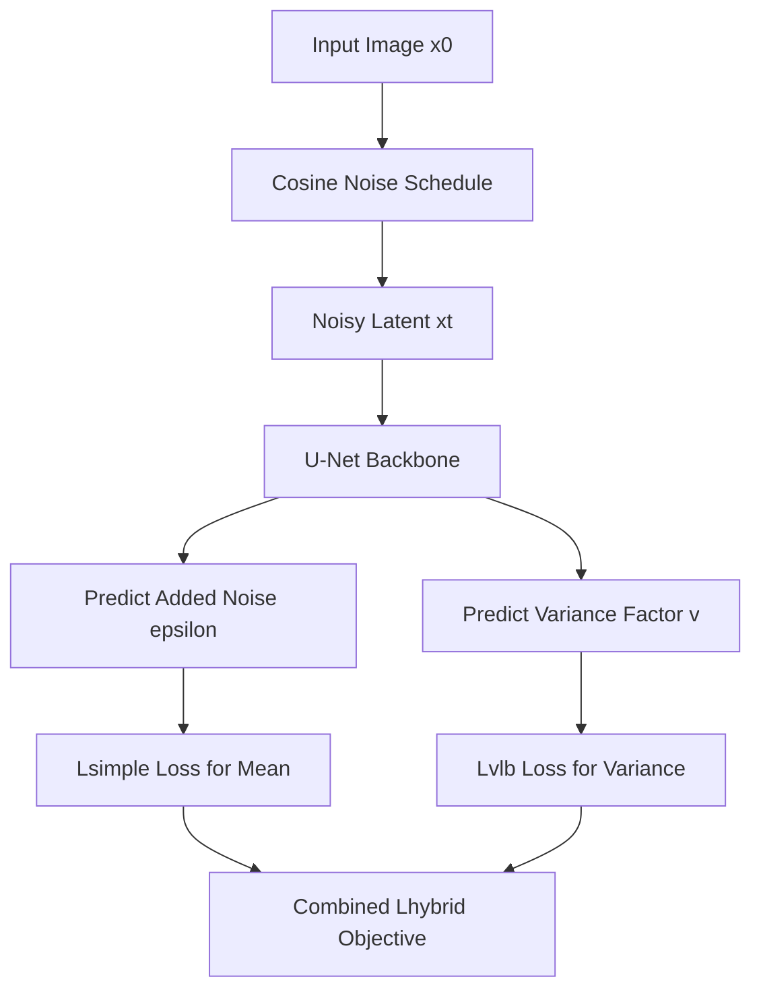
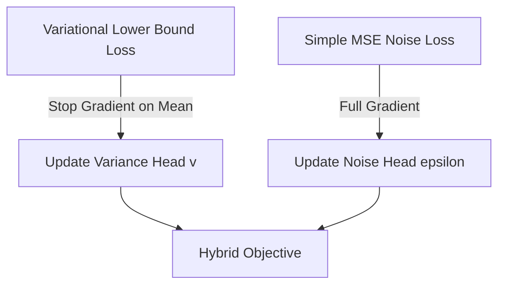
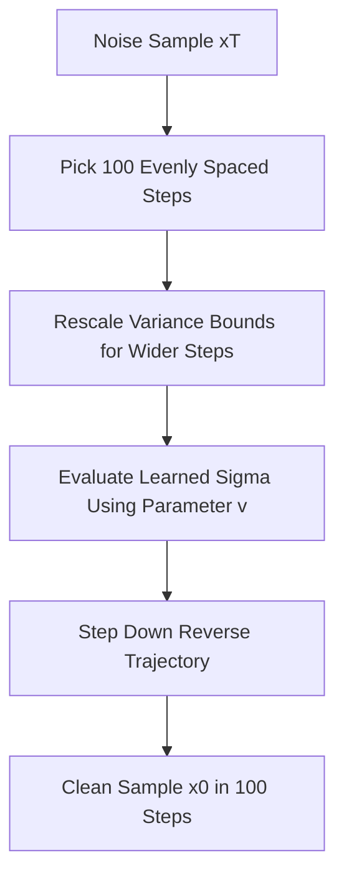

## The hook

In late 2020, denoising diffusion models looked like an astonishing party trick that was far too slow to use. They could generate photorealistic faces, but creating a single picture took several minutes on a high-end graphics card because the model had to take four thousand tiny, nervous steps. Worse, when evaluated on standard information-theory metrics like log-likelihood, diffusion appeared mediocre, leading many researchers to suspect these networks were quietly dropping modes and ignoring parts of the data. Alex Nichol and Prafulla Dhariwal showed that diffusion models were not flawed at their core; they were simply walking blindfolded with a poorly tuned pace.

## Before you start

To get the most out of this article, make sure you are comfortable with:
- How score-based generation reverses Gaussian noise step by step in [DDPM](article:paper-ddpm).
- How latent variables and the evidence lower bound work in [VAEs](article:paper-vae).
- How non-Markovian step skipping accelerates inference in [DDIM](article:paper-denoising-diffusion-implicit-models).

## The world before this paper

The machine learning community spent years caught in a tug-of-war between two generative philosophies.

On one side stood [GANs](article:paper-gan). A generator and discriminator fought each other in an adversarial game. GANs generated crisp images in a single forward pass, but training them felt like balancing a pencil on its tip. They suffered from mode collapse, completely ignoring entire categories of data, and offered no straightforward way to measure data likelihood.

On the other side stood likelihood-based models, such as autoregressive networks and [VAEs](article:paper-vae). They optimized the [[Variational Lower Bound (VLB)]] directly, capturing every corner of the distribution. But autoregressive models generated images one slow pixel at a time, and standard VAEs produced blurry textures.

Then Jonathan Ho and colleagues published [DDPM](article:paper-ddpm). By corrupting an image with hundreds of subtle doses of Gaussian noise and training a neural network to estimate the added noise at each step, they produced samples rivaling GANs.

Yet DDPM had two glaring flaws:

1. **Abysmal log-likelihood:** On ImageNet $64 \times 64$, DDPM scored roughly $3.99$ bits per dimension, trailing far behind autoregressive models. This suggested the model might be skipping rare training images.
2. **Excruciatingly slow sampling:** Turning random noise into an image required stepping through $1{,}000$ to $4{,}000$ sequential evaluations of a massive U-Net. Generating a small batch of images took minutes.

To stabilize training, the original DDPM authors made a radical simplification: they fixed the reverse variance to an untrained constant instead of letting the network learn it, and they used a crude linear noise schedule. Nichol and Dhariwal set out to ask a fundamental question: what happens if we actually fix the math?

:::history
Alex Nichol and Prafulla Dhariwal worked together at OpenAI. While the broader community treated DDPM's thousand-step requirement as an unavoidable law of physics, Nichol and Dhariwal suspected that DDPM's hand-crafted shortcuts—specifically freezing the variance and using a linear schedule—were hobbling both its speed and its statistical rigor.
:::

## The big idea

:::analogy
Imagine hiking down a steep, fog-covered mountain trail. 

If you have no idea how wide the path is (a fixed, rigid guess for variance), you dare not take large strides. You must take $4{,}000$ tiny baby steps, shuffling forward an inch at a time so you do not tumble off the cliff.

If your guide measures the exact width of the trail at every turn (a learned variance) and smooths out the steepest drop-offs (a cosine schedule), you can see exactly where it is safe to plant your boots. Instead of thousands of shuffling steps, you can stride down confidently in $50$ to $100$ long bounds, reaching the mountain base just as safely in a tenth of the time.
:::

Nichol and Dhariwal realized that the network could learn its own uncertainty. By parameterizing the variance as a smooth interpolation between theoretical bounds, training on a hybrid loss, and replacing the linear noise schedule with a smooth cosine function, diffusion models could match the likelihood of autoregressive models while slicing sampling passes by an order of magnitude.

## How it works

Let us walk through the four interconnected engineering steps that transformed diffusion from a slow curiosity into a practical engine.

### 1. The Learned Variance Parameterization

In diffusion, we start with real data $x_0$ and destroy it over $T$ timesteps by adding Gaussian noise:

$$q(x_t \mid x_{t-1}) = \mathcal{N}\left(x_t; \sqrt{1 - \beta_t}\, x_{t-1}, \beta_t \mathbf{I}\right)$$

Here, $\beta_t \in (0, 1)$ governs the noise injected at step $t$. To generate an image, we reverse this process:

$$p_\theta(x_{t-1} \mid x_t) = \mathcal{N}\left(x_{t-1}; \mu_\theta(x_t, t), \Sigma_\theta(x_t, t)\right)$$

In DDPM, the mean $\mu_\theta$ was predicted by a neural network, but the variance $\Sigma_\theta$ was locked to a fixed diagonal matrix $\sigma_t^2 \mathbf{I}$. Theory provides two extreme bounds for this variance:

- **Upper bound ($\beta_t$):** The true posterior variance if the original image $x_0$ was pure isotropic Gaussian noise.
- **Lower bound ($\tilde{\beta}_t$):** The true posterior variance if the original image $x_0$ was a single deterministic point:

$$\tilde{\beta}_t = \frac{1 - \bar{\alpha}_{t-1}}{1 - \bar{\alpha}_t} \beta_t$$

where $\alpha_t = 1 - \beta_t$ and $\bar{\alpha}_t = \prod_{s=1}^t \alpha_s$.

Ho et al. observed that choosing either extreme yielded almost identical sample quality when $T = 1{,}000$. Why? Because throughout most of the process, $\beta_t$ and $\tilde{\beta}_t$ are nearly identical. They only diverge near $t=0$, where the model resolves fine pixel textures.

Because the numerical gap between $\beta_t$ and $\tilde{\beta}_t$ is tiny, asking a neural network to predict raw variance directly causes wild instability. Nichol and Dhariwal introduced [[Learned Variance Parameterization]]. Instead of predicting variance directly, the network outputs an unconstrained vector $v$:

$$\Sigma_\theta(x_t, t) = \exp\left(v \log \beta_t + (1 - v) \log \tilde{\beta}_t\right)$$

- When $v = 0$, the model picks the lower bound $\tilde{\beta}_t$.
- When $v = 1$, the model picks the upper bound $\beta_t$.
- When $v$ is between $0$ and $1$, it smoothly blends between the two in log space.

Let us test this with numbers.

:::try-this
Suppose at a specific timestep, $\beta_t = 0.04$ and $\tilde{\beta}_t = 0.01$.

If the neural network outputs $v = 0.5$:
1. Compute $\log \beta_t = \log(0.04) \approx -3.219$
2. Compute $\log \tilde{\beta}_t = \log(0.01) \approx -4.605$
3. Blend them: $0.5(-3.219) + 0.5(-4.605) = -3.912$
4. Exponentiate: $\exp(-3.912) = 0.02$

The network smoothly lands at the geometric mean ($0.02$) without ever needing to output precarious numbers near zero directly.
:::

### 2. The Hybrid Loss

How do we train $v$? The simplified DDPM loss ($L_{\text{simple}}$) only trains the network to predict the added noise $\epsilon$. It contains zero gradient signal for $\Sigma_\theta$.

The true statistical objective is the [[Variational Lower Bound (VLB)]], denoted as $L_{\text{vlb}}$. It computes the Kullback-Leibler divergence between the ground-truth reverse distribution and the model's predicted Gaussian at every step.

However, training solely on $L_{\text{vlb}}$ produces blurry images. The mean squared error in $L_{\text{simple}}$ places heavier weight on difficult middle timesteps, which makes images sharp. To get the best of both worlds, the authors constructed a hybrid loss:

$$L_{\text{hybrid}} = L_{\text{simple}} + \lambda L_{\text{vlb}}$$

They set $\lambda = 0.001$. Crucially, they placed a **stop-gradient** on $\mu_\theta$ inside the $L_{\text{vlb}}$ term:

$$\text{stop\_gradient}(\mu_\theta)$$

This tiny technical choice ensures $L_{\text{simple}}$ is the sole driver of the image mean (keeping samples sharp), while $L_{\text{vlb}}$ exclusively guides the variance vector $v$.

### 3. The Cosine Noise Schedule

The original DDPM used a linear schedule: $\beta_t$ grew linearly from $\beta_1 = 10^{-4}$ to $\beta_T = 0.02$.

This linear ramp had a severe flaw. The cumulative signal factor $\bar{\alpha}_t$ dropped toward zero much too quickly. By step $3{,}000$ out of $4{,}000$, the image was already pure, unrecognizable static. The model spent the final quarter of its steps predicting noise on data that contained no image information at all.

Nichol and Dhariwal proposed the [[Cosine Schedule]]:

$$\bar{\alpha}_t = \frac{f(t)}{f(0)}, \quad f(t) = \cos^2\left(\frac{\frac{t}{T} + s}{1 + s} \cdot \frac{\pi}{2}\right)$$

Here, $s = 0.008$ is a tiny offset that prevents $\beta_0$ from being zero.

The cosine schedule produces a gentle, linear drop in signal through the middle steps, with flat, delicate transitions near $t=0$ (clean image) and $t=T$ (pure noise). It avoids sudden information shock at the start and never wastes steps on pure noise at the end.

:::insight
A linear noise schedule destroys image details too quickly in low-resolution images. A cosine schedule degrades information steadily, giving every timestep a meaningful job.
:::

### 4. Strided Fast Sampling

With a learned variance and a smooth cosine schedule, you no longer need all $4{,}000$ steps to produce a crisp image.

Suppose we train with $T = 4{,}000$ steps, but during inference we only want to run $K = 100$ steps. We pick a strided sequence of timesteps $S = (s_1, s_2, \dots, s_K)$ evenly spaced between $1$ and $T$.

Because our model outputs a fractional interpolation $v$ rather than fixed numbers, the variance formula automatically adjusts to the larger gap between steps:

$$\beta_{S_t} = 1 - \frac{\bar{\alpha}_{S_t}}{\bar{\alpha}_{S_{t-1}}}$$

The model plugs this rescaled gap directly into its learned variance formula.

## What they found

The authors validated their discoveries across ImageNet $64 \times 64$ and CIFAR-10.

### Competitive Log-Likelihoods

On ImageNet $64 \times 64$, baseline DDPM ($T=1{,}000$) scored an NLL of $3.99$ bits per dimension. By bumping $T$ to $4{,}000$, adding the cosine schedule, and training with importance-sampled $L_{\text{vlb}}$, Nichol and Dhariwal drove NLL down to **$3.53$ bits/dim**.

This matched top-tier convolutional autoregressive models like PixelCNN ($3.57$) and closed the historical gap between diffusion and likelihood-based architectures.

| Model Setup (ImageNet $64 \times 64$) | Schedule | Loss Objective | NLL (bits/dim) $\downarrow$ | FID $\downarrow$ |
| :--- | :--- | :--- | :--- | :--- |
| Baseline DDPM ($T=1\text{K}$) | Linear | $L_{\text{simple}}$ | 3.99 | 32.5 |
| Baseline DDPM ($T=4\text{K}$) | Linear | $L_{\text{simple}}$ | 3.77 | 31.3 |
| Improved DDPM | Cosine | $L_{\text{hybrid}}$ | 3.62 | 28.0 |
| Improved DDPM ($1.5\text{M}$ iters) | Cosine | $L_{\text{hybrid}}$ | 3.57 | **19.2** |
| Improved DDPM ($1.5\text{M}$ iters) | Cosine | $L_{\text{vlb}}$ (resampled) | **3.53** | 40.1 |

### Slashing Sampling Steps by 90%

The most dramatic practical result was inference speed. When running models trained with fixed variances, reducing sampling steps caused sample quality to crater.

In contrast, models trained with $L_{\text{hybrid}}$ and learned variances preserved their visual quality down to **$100$ or even $50$ sampling steps**. Generating an image went from taking several minutes down to a few seconds.

### Mode Coverage: Diffusion vs GANs

To determine whether diffusion models capture data modes better than GANs, the authors turned to [[Precision and Recall for Generative Models]]:

- **Precision** measures sample realism (do generated images look like valid dataset items?).
- **Recall** measures distribution coverage (does the model reproduce the full variety of real data?).

On class-conditional ImageNet $64 \times 64$, BigGAN-deep achieved an FID of $4.06$ with a recall of $0.59$. The large Improved DDPM model beat BigGAN on image quality with an FID of **$2.92$**, while achieving a recall of **$0.71$**.

Diffusion did not just generate sharp pictures; it generated diverse pictures, proving it did not suffer from the insidious mode collapse that plagued GANs.

:::warning
Do not confuse optimizing $L_{\text{vlb}}$ with generating pretty pictures. Direct optimization of the variational lower bound achieved the best negative log-likelihood ($3.53$), but its FID degraded from $19.2$ to $40.1$. The model wasted network capacity on imperceptible high-frequency pixel noise instead of recognizable visual structures. That is why $L_{\text{hybrid}}$ is preferred in practice.
:::

## What it got wrong (or left open)

While the paper transformed diffusion into an efficient, competitive class of models, several friction points remained:

1. **Still slower than GANs:** Dropping from $4{,}000$ steps to $50$ steps was a ten-to-forty-fold speedup, but fifty forward passes through a U-Net is still fifty times slower than a single GAN generator pass. Real-time generation remained out of reach.
2. **The NLL-FID tradeoff remained unresolved:** You still had to choose between optimal log-likelihood ($L_{\text{vlb}}$) and optimal visual quality ($L_{\text{hybrid}}$). The field lacked a unified objective that maximized both simultaneously.
3. **Pixel-space computational overhead:** The model still operated directly in high-dimensional image space. Generating larger images ($256 \times 256$ or $512 \times 512$) remained prohibitively expensive without architectural workarounds.

## What happened next

This paper served as the direct springboard for the modern generative AI boom.

A few months later, Dhariwal and Nichol used these insights to publish *Diffusion Models Beat GANs on Image Synthesis*, introducing classifier guidance and cementing diffusion as the king of computer vision.

The cosine schedule and learned variance parameterization instantly became standard building blocks throughout the field:
- OpenAI used them in GLIDE and DALL-E 2.
- The community paired these sampling tricks with latent representations in [Latent Diffusion](article:paper-latent-diffusion) (the foundation of Stable Diffusion), moving the denoising process into compressed latent spaces to tackle megapixel images.
- Later works on distilled samplers built directly upon the strided sampling concepts formalized here.

## Key takeaways

- Learning the reverse process variance through log-space interpolation allows diffusion models to take large, strided steps without destabilizing the sampling trajectory.
- The hybrid loss ($L_{\text{hybrid}}$) lets a simple MSE loss guide the visual mean while an evidence lower bound trains the variance via a stop-gradient.
- The cosine noise schedule prevents premature destruction of image features, ensuring every diffusion step performs useful work.
- Improved DDPM models generate high-fidelity images in just $50$ to $100$ steps instead of $4{,}000$, cutting sampling time by an order of magnitude.
- Diffusion models achieve substantially higher distribution recall than GANs, verifying that they cover rare modes instead of memorizing narrow subsets of data.
