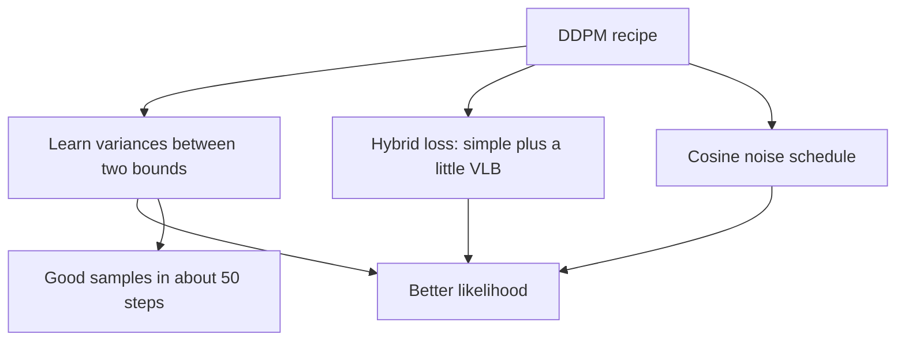

## The hook

By early 2021, diffusion models made beautiful pictures but had an awkward report card. Their likelihood scores, the standard test of how well a model captures the data, trailed other model families. They needed hundreds or thousands of steps to sample. And nobody was sure they could match GANs on big, diverse datasets like ImageNet.

Two OpenAI researchers took the original recipe apart piece by piece, like mechanics tuning an engine. They did not invent a new model. They found a handful of small, careful changes that fixed most of the weaknesses at once, and within months the same pair showed diffusion beating GANs.

## Before you start

You should know the basic diffusion recipe from [Denoising Diffusion Probabilistic Models](article:paper-ddpm): add noise step by step, train a network to predict that noise, then reverse the process. Knowing that sampling can skip steps, from [Same Model, Fifty Times Fewer Steps](article:paper-denoising-diffusion-implicit-models), helps.

## The world before this paper

DDPM trained a network to predict the noise in a noisy image with a simple squared-error loss, which the authors called $L_{\text{simple}}$. Two choices in that recipe were fixed by hand:

- **The [[noise schedule]]**: noise increased linearly from step 1 to step 1,000.
- **The reverse-step [[variance]]**: how much fresh randomness to add at each generation step was a constant, not learned.

These shortcuts made training simple and samples pretty, but the model's [[log-likelihood]] was poor, and sampling with fewer steps hurt quality badly.

:::history
Alex Nichol and Prafulla Dhariwal at OpenAI wanted to know whether diffusion models could be both good at likelihood and practical at scale. Their paper appeared on arXiv in February 2021 and at ICML 2021. Later that year they published "Diffusion Models Beat GANs on Image Synthesis", building directly on these improvements.
:::

## The big idea

:::analogy
Think of tuning a car that runs well but drinks fuel and needs a long warm-up. You do not redesign the engine. You adjust the fuel mixture so it is not fixed at one setting, smooth out the gear ratios so no gear is wasted, and add a sensor so the engine learns from more information. Each tweak is small. Together they turn a showroom car into one you can actually drive every day.
:::

The paper's big idea is that diffusion's weaknesses came from a few hand-fixed choices, not from the approach itself. Let the network learn its step variances, spread the noise more evenly over time, and train with a loss that cares about likelihood as well as image quality. Those three adjustments are the fuel mixture, the gear ratios and the sensor.

## How it works

### 1. Learn the variance, safely

DDPM's reverse-step variance was fixed to one of two sensible values, $\beta_t$ or $\tilde\beta_t$, which turned out to be close to each other for most steps. Instead of predicting a variance from scratch, which proved unstable, the network outputs a number $v$ per dimension and the variance is a blend between the two bounds:

$$\Sigma_\theta(x_t, t) = \exp\big(v \log \beta_t + (1 - v) \log \tilde\beta_t\big)$$

- $\beta_t$ and $\tilde\beta_t$ are the upper and lower sensible values for step t.
- $v$ between 0 and 1 picks a point between them on a log scale.

This is the fuel mixture: adjustable, but within safe limits.

### 2. A hybrid loss

$L_{\text{simple}}$ ignores the variance completely, so it cannot teach $v$. The full [[variational lower bound]] $L_{\text{vlb}}$ does, but is noisy to optimise. The paper adds a little of it:

$$L_{\text{hybrid}} = L_{\text{simple}} + \lambda L_{\text{vlb}}, \quad \lambda = 0.001$$

The mean is still learned mainly through the stable simple loss; the small VLB term teaches the variances. The paper also showed that sampling time steps for the VLB with importance sampling, favouring steps where the loss is large and noisy, made pure VLB training workable.

### Why the VLB is hard to train on

The variational bound is a sum of terms, one per time step, and those terms differ enormously in size: the first few steps contribute far more than the rest. If you train on a random step each time, the loss jumps wildly between examples, which makes gradients noisy. Importance sampling fixes this by picking steps in proportion to how large their loss terms have been recently, then reweighting so the average is still correct. It is like an examiner spending more time on the questions students most often get wrong, while still grading the whole paper fairly.

### 3. A cosine noise schedule

With the linear schedule, especially for small 64 by 64 images, the image was almost pure noise well before the last step, so many final steps did little useful work. The cosine schedule sets the remaining signal as

$$\bar\alpha_t = \frac{f(t)}{f(0)}, \quad f(t) = \cos^2\!\left(\frac{t/T + s}{1 + s} \cdot \frac{\pi}{2}\right)$$

- $\bar\alpha_t$ is the fraction of the original image left at step t.
- $s$ is a small offset (0.008 in the paper) so the first steps are not too tiny.

This is the gear ratio fix: information is destroyed gradually across the whole range, so no stretch of steps is wasted.

### A quick feel for the schedules

| Point in the process | Linear schedule (signal left) | Cosine schedule (signal left) |
|---|---|---|
| Start | almost all | almost all |
| Middle | already very little | about half |
| Last fifth | practically none | small but non-zero |

The exact numbers depend on settings, but the shape is the point: the cosine curve keeps useful signal for longer.

:::try-this
Using $f(t) = \cos^2(\frac{t/T + s}{1+s} \cdot \frac{\pi}{2})$ with s close to 0, estimate $\bar\alpha$ at the halfway point t = T/2. (The angle is about π/4, and cos²(π/4) = 0.5, so about half the signal remains, versus far less with the linear schedule.)
:::

:::insight
Learning the variances matters most when you take fewer steps. With big jumps between noise levels, how much randomness to add at each jump is no longer a detail, and a learned value adapts where a fixed one cannot.
:::

## What they found

- **Competitive log-likelihoods.** With these changes, diffusion models reached log-likelihoods competitive with other likelihood-based models on datasets such as CIFAR-10 and ImageNet 64 by 64, a big improvement over DDPM.
- **Fast sampling with learned variances.** Models with learned variances produced near-full-quality samples with as few as 50 sampling steps, where fixed-variance models degraded more.
- **Better coverage than GANs.** Measuring precision and [[recall]] against BigGAN at a similar [[FID]], the diffusion model had substantially higher recall: it covered more of the variety in the data.
- **Smooth scaling.** Sample quality and likelihood improved predictably as model size and training compute grew.

:::warning
Common misconception: "better likelihood always means better-looking images." The two can disagree. A model can assign high probability to real data and still produce some odd samples, or vice versa. This paper improved both, but it measured them separately for good reason.
:::

Taken together, the paper reads like a careful lab notebook: change one ingredient, measure, keep what helps. Many later diffusion papers follow the same style.

## What it got wrong (or left open)

- **Still slower than GANs.** Fifty network passes is far better than a thousand, but still fifty times one GAN pass.
- **Unconditional quality on ImageNet still trailed the best GANs** in this paper; closing that gap needed the guidance techniques of the follow-up.
- **The hybrid weight and schedule offset were tuned by hand**, leaving open what the best design choices are in general.

## What happened next

Months later, the same authors published "Diffusion Models Beat GANs on Image Synthesis", adding architecture improvements and classifier guidance, which steers samples toward a class using a separate classifier. Diffusion overtook GANs on ImageNet image quality, ending the long dominance of GANs described in [the GAN article](article:paper-gan).

OpenAI's GLIDE and DALL·E 2 built text-to-image systems on diffusion, and [latent diffusion](article:paper-latent-diffusion) moved the process into a compressed space to make it cheap enough for everyone. The cosine schedule and learned variances became common ingredients. Later, [Elucidating the Design Space of Diffusion-Based Generative Models](article:paper-elucidating-the-design-space-of-diffusion-based-generative-m) revisited all of these knobs together and simplified them further.

## Key takeaways

- Diffusion's early weaknesses in likelihood and sampling speed came mostly from a few hand-fixed choices.
- Letting the network learn each step's variance, as a blend between two safe bounds, improved likelihood and made sampling with about 50 steps work well.
- A hybrid loss adds a small amount of the variational bound to the simple loss so the variances can be trained without destabilising the mean.
- A cosine noise schedule spreads information loss evenly across steps, so fewer steps are wasted on near-pure noise.
- These changes set up the follow-up work in which diffusion models beat GANs on image quality.
