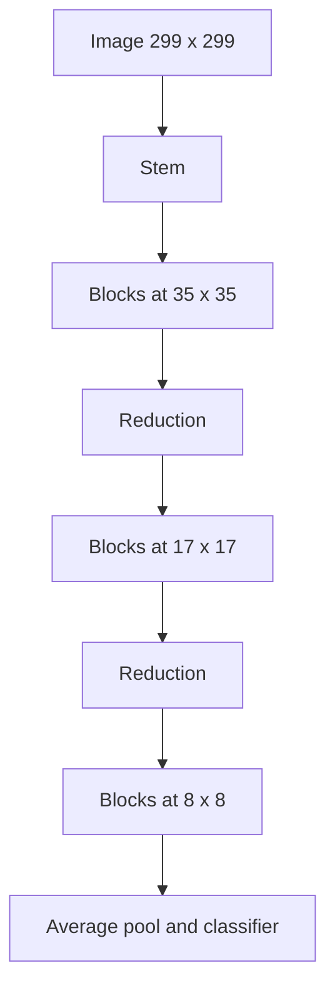
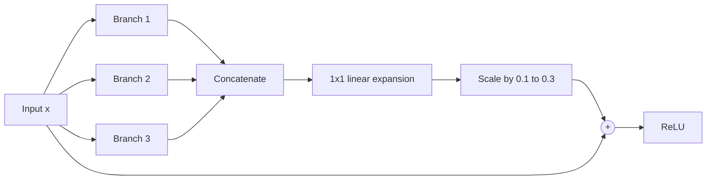

## The hook

At the end of 2015, Microsoft's ResNet won ImageNet with networks over a hundred layers deep, held together by shortcut connections. Many people concluded that very deep networks need such shortcuts to train at all, but Google's Inception team, whose networks were already deep and accurate without them, was not so sure. Was the shortcut essential, or just very convenient?

In early 2016, Christian Szegedy, Sergey Ioffe, Vincent Vanhoucke and Alex Alemi ran the experiment properly. They built a cleaner, larger Inception network without shortcuts, and residual versions with matching cost, then compared them. The answer was more nuanced than either camp expected.

## Before you start

You should know the multi-branch [[Inception module]] from [GoogLeNet](article:paper-going-deeper-with-convolutions), the [[residual connection]] from [ResNet](article:paper-resnet), and how [Batch Normalization](article:paper-batch-normalization) stabilises activations during training.

## The world before this paper

Two families led image classification.

- **Inception networks** split each block into parallel branches, such as 1x1, 3x3 and factorised larger filters plus pooling, and concatenate their outputs along the channel dimension. By Inception-v3 they were accurate and efficient, but the blocks had grown irregular.
- **ResNets** used simpler blocks but added the input back to the output: y = x + F(x). The block only learns a correction F(x), and gradients flow straight back along the shortcut.

The ResNet paper argued that residual connections are what make very deep networks trainable. Inception's results suggested otherwise, but the two families had never been compared on equal terms.

:::history
The authors explain that earlier Inception designs were constrained by Google's older DistBelief training system, which required splitting models across machines and led to uneven, hand-tuned block sizes. Moving to TensorFlow removed those constraints, so they could redesign the network uniformly. The paper was posted in February 2016 and appeared at AAAI 2017.
:::

## The big idea

:::analogy
Think of a document passed along a line of editing desks. In the classic Inception style, each desk retypes the whole document in its own words before passing it on. In the residual style, each desk keeps the original pages and pencils corrections in the margin, so even if a desk does nothing useful, the document reaches the next desk intact. But if a new, untrained editor scribbles large, wild corrections all over the page, the document becomes unreadable. The fix is simple: tell every desk to use a light pencil.
:::

The paper's answers map onto that line of desks:

- **Retyping can work.** A carefully redesigned, deeper Inception network without shortcuts, Inception-v4, reached accuracy similar to the residual versions.
- **Margin notes are faster.** Residual connections made Inception networks train significantly faster.
- **Use a light pencil.** Very wide residual Inception networks became unstable unless each residual branch was scaled down before being added, called [[residual scaling]].

## How it works

The paper defines three networks:

| Network | Shortcuts | Cost roughly matches |
|---|---|---|
| Inception-v4 | no | (new, larger design) |
| Inception-ResNet-v1 | yes | Inception-v3 |
| Inception-ResNet-v2 | yes | Inception-v4 |

### A uniform layout

All three start with a [[stem]] that turns a 299 × 299 image into a 35 × 35 grid of features. Then come three stages of blocks working at 35 × 35, 17 × 17 and 8 × 8, separated by reduction blocks that halve the grid while adding channels, and end with global average pooling and a classifier.

### Turning concatenation into addition

In an Inception-ResNet block, the branches still run in parallel and their outputs are concatenated. But instead of becoming the block's output, they are added to the input. That needs matching shapes: if the input has 384 channels and the branches together give 192, they cannot be added. So a [[filter-expansion layer]], a 1x1 convolution with no activation, maps the branches back to the input's channel count before the addition.

The residual blocks are also simpler than the pure Inception ones, since the shortcut carries much of the load.

### Why margin notes train faster

During training, the error signal travels backwards from the classifier to the stem. In a plain stack, it must pass through every block's layers, and each one can shrink or distort it. With a shortcut, the gradient of y = x + F(x) with respect to x always includes a direct term of 1 from the x part, so part of the signal reaches early layers untouched. In the desk picture, feedback on the final document can be traced straight back to the original pages instead of through every retyped copy. Early layers therefore start learning useful features sooner, which is consistent with the much faster training the paper observed.

### The light pencil

When the number of filters went above about 1,000, residual variants became unstable: early in training, the network "died", and the activations before average pooling became zeros. The paper reports that lowering the learning rate or adding extra batch normalization did not prevent this. What did was multiplying the residual branch by a constant between about 0.1 and 0.3 before the addition:

$$y = \mathrm{ReLU}(x + s \cdot F(x)), \quad s \in [0.1, 0.3]$$

Here is a made-up illustration of why a light pencil helps. Suppose an input feature is 4.0 and an untrained branch outputs −15.0.

| | Calculation | Output |
|---|---|---|
| No scaling | ReLU(4.0 − 15.0) = ReLU(−11.0) | 0, the feature is gone |
| s = 0.1 | ReLU(4.0 + 0.1 × (−15.0)) = ReLU(2.5) | 2.5, the feature survives |

Repeated over many blocks, large unscaled corrections can push many units to zero, where no gradient flows. Scaled corrections leave the shortcut in charge early on, and the branches can grow their influence as they learn.

:::insight
A residual block works best when it starts close to "do nothing and pass the input along". Scaling the branch keeps every desk's pencil light at first, so the signal survives the whole line while the editors learn what to write.
:::

:::try-this
Assume each of 20 residual blocks adds an independent correction with variance 1 to a signal of variance 1. What is the final variance without scaling, and with s = 0.2? (Without scaling 1 + 20 = 21. With s = 0.2 each correction has variance 0.04, so 1 + 20 × 0.04 = 1.8. The scaled signal stays far closer to its starting size.)
:::

:::warning
Common misconception: "the paper proved residual connections are useless." It found that they are not required to reach good accuracy, but they clearly speed up training, and the residual networks were slightly more accurate at similar cost. Shortcuts are a powerful optimisation aid, not a requirement for depth.
:::

One more practical detail: the authors did not use batch normalization on top of the additions, only on the other layers, which saved enough memory to fit the larger models on a single GPU. That was a hardware trade-off rather than a design principle.

## What they found

- **Faster training with shortcuts.** Inception-ResNet networks reached a given accuracy much sooner than Inception networks of similar cost.
- **Similar final accuracy.** Given enough training, Inception-v4 came close to Inception-ResNet-v2, and the residual version led only by a thin margin.
- **Scaling is necessary for wide residual blocks.** Without it, wide models died early in training; with it, they trained stably.
- **State of the art at the time.** An [[ensemble]] of three Inception-ResNet-v2 models and one Inception-v4 reached 3.08% top-5 error on the ImageNet classification test set.

## What it got wrong (or left open)

- **Scaling chosen by trial and error.** The 0.1 to 0.3 range worked, but the paper gave no theory predicting when blocks become unstable or what value is best.
- **Design still hand-crafted.** Despite being more uniform, the blocks remained detailed manual designs with many choices.
- **Hardware-driven choices.** Skipping batch normalization after additions was about memory, not accuracy, which makes some comparisons less clean.

## What happened next

Inception-ResNet-v2 became a popular pretrained backbone for detection, segmentation and transfer learning. The idea of starting residual branches small reappeared in many later forms: initialising the last layer of each residual branch at zero, learnable per-block scaling factors in vision transformers, and similar tricks for training very deep transformers. Architecture design moved towards simpler repeated blocks, as in [ResNeXt](article:paper-aggregated-residual-transformations-for-deep-neural-networks), and later towards automated search.

## Key takeaways

- The paper compared Inception networks with and without residual connections at matched computational cost.
- Residual connections significantly sped up training, while final accuracy was similar, with the residual versions slightly ahead.
- Inception-ResNet blocks concatenate their branches, then use a 1x1 linear filter-expansion layer so the result can be added to the input.
- Very wide residual Inception networks died early in training unless each residual branch was scaled by about 0.1 to 0.3 before the addition.
- An ensemble of three Inception-ResNet-v2 models and one Inception-v4 reached 3.08% top-5 error on the ImageNet test set.
