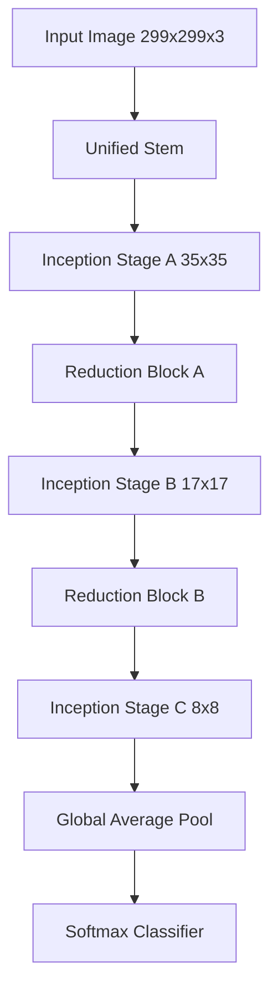
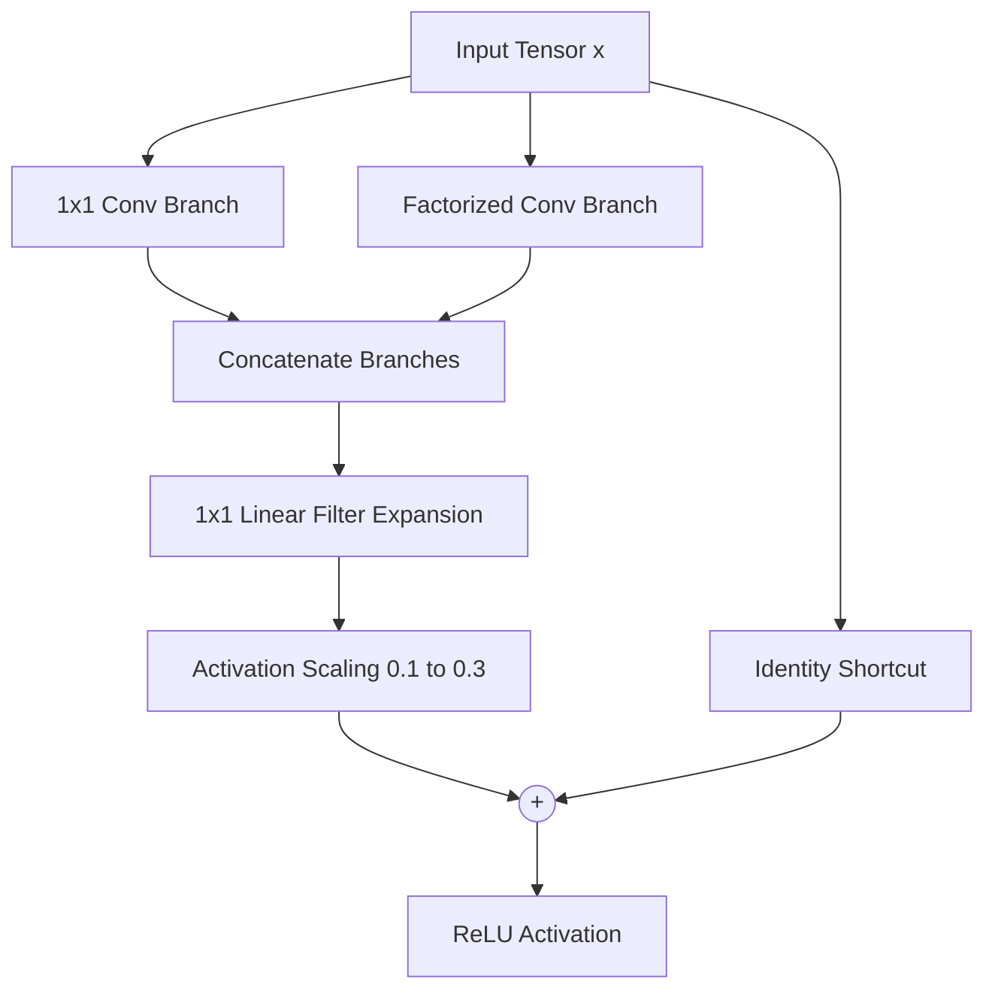

## The hook

In late 2015, the deep learning world rallied behind a new dogma: if you want a network with over a hundred layers, skip connections are mandatory. Microsoft had just shattered ImageNet records with ResNet by adding bypass lines around layers, and many researchers concluded that plain feedforward stacks had hit an unbreakable mathematical wall. But the Google engineers behind GoogLeNet wondered if that conclusion was premature. Did depth truly require shortcuts, or had earlier networks simply been built with clumsy plumbing?

## Before you start

Before reading this, you should feel comfortable with:
- How parallel convolution branches work in [GoogLeNet](article:paper-going-deeper-with-convolutions)
- Why identity shortcuts rescue deep gradients in [ResNet](article:paper-resnet)
- How feature standardization keeps training stable in [Batch Normalization](article:paper-batch-normalization)

## The world before this paper

In 2014 and 2015, two architectural philosophies dominated computer vision.

The first was the Inception philosophy, pioneered by Google in [GoogLeNet](article:paper-going-deeper-with-convolutions). An [[Inception Module]] did not force you to pick a single filter size. Instead, it split the input into parallel paths: a $1 \times 1$ convolution for cheap pooling across channels, a $3 \times 3$ for local textures, a $5 \times 5$ (later factorized into two $3 \times 3$s) for larger shapes, and a pooling branch. At the end of the block, all outputs were stacked along the channel axis. This allowed the network to inspect the image at multiple scales at the same time while keeping computational costs modest.

The second philosophy arrived with [ResNet](article:paper-resnet). Instead of widening layers with multiple branches, ResNet went ridiculously deep—up to 152 layers—by introducing a [[Residual Connection]]. Each block computed a small change, $F(x)$, and added the original input back:

$$y = F(x) + x$$

The community quickly treated ResNet's identity shortcut as an absolute requirement for ultra-deep vision models. If you did not have shortcuts, your gradients would wither and die.

:::history
The original Inception models suffered from technical debt. They were engineered inside Google's legacy DistBelief framework, which required manually chopping a model into pieces across multiple computers. Because different machines had different memory limits, the Inception blocks had awkward, asymmetrical channel sizes. Once Google migrated to TensorFlow, those infrastructure shackles vanished, giving the authors freedom to rethink the architecture from a blank slate.
:::

## The big idea

The authors set out to answer two fundamental questions. First, can a pure Inception network reach modern competitive accuracy without any residual shortcuts if you clean up its architecture and scale it up? Second, what happens when you marry the two architectures and replace Inception's channel concatenation with residual addition?

:::analogy
Imagine an artisan workshop building custom furniture. An Inception block is a large room with specialized workbenches operating side by side: one person carves fine details, another sands wide panels, and a third paints. 

A residual connection is an express freight elevator running right past the workshop floor. You can either dump your materials into the workshop and wait for the finished piece (pure Inception), or send the raw piece down the elevator while the workshop crafts a small decorative trim to bolt on at the end (Inception-ResNet). 

If the trim is too heavy, the elevator cable snaps and the project is ruined. To prevent disaster, you scale down the weight of the trim before bolting it on.
:::

The authors discovered that residual connections are not a mathematical requirement for high accuracy. A well-designed, deep feedforward network without any shortcuts—which they named **Inception-v4**—performed just as well as its residual cousins. What residual connections actually provided was pure training velocity: they allowed models to learn dramatically faster.

## How it works

The paper introduced three major architectures:
1. **Inception-v4**: A streamlined, non-residual network.
2. **Inception-ResNet-v1**: A hybrid model tuned to match the computational cost of Inception-v3.
3. **Inception-ResNet-v2**: A wider hybrid model matching the raw compute budget of Inception-v4.

To make these models work smoothly, the team solved three key architectural problems.

### 1. Cleaning up the stem and blocks

Previous Inception variants started with messy, ad-hoc convolutional layers. The new designs introduced a unified front end called the [[Stem]]. The stem aggressively cuts down spatial resolution from $299 \times 299$ pixels to $35 \times 35$ pixels using alternating small convolutions and pooling paths before any main blocks run.

After the stem, the network processes representations through three stages of blocks (A, B, and C), each operating at a specific grid size ($35 \times 35$, $17 \times 17$, and $8 \times 8$). Between these stages sit specialized reduction blocks that shrink height and width while expanding channels, avoiding representational bottlenecks.

### 2. Replacing concatenation with addition

In standard Inception, the parallel branch outputs are stacked side by side along the channel dimension. In Inception-ResNet, the authors wanted to use additive shortcuts instead:

$$y = \text{ReLU}(x + F(x))$$

This introduced a shape mismatch. If the input $x$ has 384 channels, but the parallel convolution branches produce 192 channels combined, you cannot add them directly.

To fix this, the authors placed a [[Filter-expansion Layer]] immediately after the branches. This is a $1 \times 1$ convolution with linear activation (no ReLU) that projects the combined branch features back up to match the exact channel depth of $x$.

### 3. Taming the unstable wide residual blocks

When the authors expanded Inception-ResNet-v2 to have more than 1,000 filters in its deep stages, training abruptly collapsed. After a few tens of thousands of steps, the activations right before average pooling crashed to zero. The network died completely.

Lowering the learning rate did not help. Adding extra batch normalization did not fix it either.

Their solution was [[Activation Scaling]]: multiply the output of the residual branch by a small constant factor $s \in [0.1, 0.3]$ before adding it to the shortcut path.

$$y = \text{ReLU}(x + s \cdot F(x))$$

:::insight
When a residual block has over 1,000 channels, summing unscaled variances causes activations in early training to explode or saturate downstream ReLUs, shutting off gradients entirely. Scaling down the residual branch keeps the shortcut dominant during early steps, preventing the network from dying.
:::

:::try-this
Work through this mental check: suppose the identity path $x$ carries a feature value of $4.0$, and the residual branch $F(x)$ computes a volatile early update of $-15.0$. 

Without scaling:
$$y = \text{ReLU}(4.0 - 15.0) = \text{ReLU}(-11.0) = 0$$

If this happens across all channels, your signal dies. 

Now apply activation scaling with $s = 0.1$:
$$y = \text{ReLU}(4.0 + 0.1 \times (-15.0)) = \text{ReLU}(4.0 - 1.5) = 2.5$$

The feature survives, gradients flow backward, and the layer stays alive while weights stabilize.
:::

:::warning
You might wonder why the authors did not just put batch normalization everywhere to prevent activations from blowing up. They actually omitted batch normalization on top of the residual summation points on purpose. The reason was purely practical: those tensor addition maps had large spatial dimensions, and storing their statistics during training drained GPU memory. Omitting normalization after the plus sign let them fit larger models onto a single Kepler GPU.
:::

## What they found

The empirical results answered both questions with startling clarity.

### 1. Residual connections accelerate, but do not boost final capacity

When comparing Inception-v4 (pure) against Inception-ResNet-v2 (residual), the training curves revealed a dramatic difference in speed. Inception-ResNet reached low error rates in far fewer epochs. 

However, given enough training steps, the pure Inception-v4 caught up. On the ImageNet validation set (single-crop, non-blacklisted subset):
- **Inception-v4**: 20.0% top-1 error, 5.0% top-5 error
- **Inception-ResNet-v2**: 19.9% top-1 error, 4.9% top-5 error

The residual connection was an optimization booster, not a magical gatekeeper of representational power. Final accuracy depended primarily on model capacity, not on whether layers had shortcuts.

| Architecture | Top-1 Error (1 crop) | Top-5 Error (1 crop) | Top-5 Error (144 crops) |
| :--- | :--- | :--- | :--- |
| Inception-v3 | 21.2% | 5.6% | 4.3% |
| Inception-ResNet-v1 | 21.3% | 5.5% | 4.3% |
| Inception-v4 | 20.0% | 5.0% | 3.8% |
| Inception-ResNet-v2 | 19.9% | 4.9% | 3.7% |

### 2. High-end ensemble performance

The authors combined one pure Inception-v4 model with three Inception-ResNet-v2 models into a 4-model ensemble. On the full 50,000-image ImageNet validation set using multi-crop evaluation, the ensemble achieved 3.1% top-5 error.

When evaluated on the official ILSVRC test set, the ensemble scored **3.08% top-5 error**, establishing a new state of the art for image classification.

## What it got wrong (or left open)

While the engineering was brilliant, the paper left several puzzles unsolved:

1. **Ad-hoc scaling factors**: The activation scaling constant ($0.1$ to $0.3$) was chosen purely through trial and error. The paper provided no rigorous mathematical theory predicting exactly when a layer would destabilize or what the optimal multiplier should be.
2. **GPU memory workarounds mistaken for design**: Leaving out batch normalization on top of residual additions was done solely to squeeze models into single-GPU memory limits. The authors admitted this was a hardware compromise rather than an optimal architectural choice.
3. **Diminishing ensemble returns**: Gains in single-model accuracy did not translate to equally massive ensemble gains. Because Inception-v4 and Inception-ResNet-v2 shared similar stems and feature representations, their errors were partially correlated, limiting the diversity bonus of ensembling them together.

## What happened next

Inception-ResNet-v2 and Inception-v4 quickly became standard feature extractors across computer vision. For years, researchers downloading pretrained backbones for object detection, segmentation, and medical imaging routinely chose Inception-ResNet-v2 when they wanted maximum accuracy.

The paper's discovery that residual branches must be scaled down when widening channels became a cornerstone of modern deep architecture design. You will find descendants of this technique everywhere:
- [ResNeXt](article:paper-aggregated-residual-transformations-for-deep-neural-networks) extended the multi-branch concept into grouped convolutions with residual links.
- Modern large language models like [Llama](article:paper-llama) apply similar residual scaling factors to stabilize training when hidden dimensions swell to thousands of units.

Ultimately, the paper demystified residual networks. Skip connections did not alter the fundamental representational ceiling of deep neural networks—they just made the optimization terrain smooth enough to reach the summit in half the time.

## Key takeaways

- Residual shortcuts dramatically accelerate training convergence, but they are not an absolute requirement for training deep models to competitive accuracy.
- A well-engineered, uniform feedforward convolutional network without any skip connections (Inception-v4) achieves virtually identical accuracy to a residual network of equivalent compute.
- Combining multi-branch Inception modules with residual additions requires a $1 \times 1$ filter-expansion layer to match channel depths before addition.
- In very wide networks exceeding 1,000 filters, residual activations must be scaled down by a factor between 0.1 and 0.3 to prevent the network from dying early in training.
- An ensemble of one Inception-v4 and three Inception-ResNet-v2 models achieved a state-of-the-art 3.08% top-5 error on the ImageNet test set.
