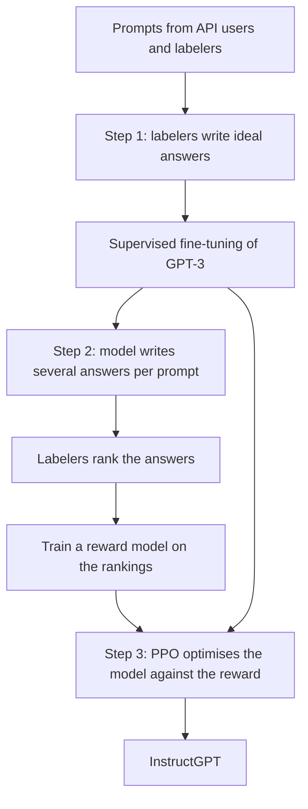

## The hook

Ask the raw GPT-3 to "Explain the moon landing to a six-year-old," and it might reply with a list of similar requests: "Explain the theory of gravity to a six-year-old. Explain the theory of relativity to a six-year-old." Perfectly reasonable, if your only goal is to continue text that looks like the internet. Completely useless if you wanted an answer.

In early 2022, OpenAI published a recipe for fixing this. Human writers showed the model what good answers look like. Human raters ranked the model's attempts. And a reinforcement learning algorithm pushed the model toward what people preferred. The result, InstructGPT, was preferred by people over GPT-3, even when it was over a hundred times smaller. Ten months later, OpenAI released a sibling model trained the same way, with a chat interface. It was called ChatGPT.

## Before you start

You need [GPT-3](article:paper-gpt-3) and its habit of simply continuing text, and the reinforcement learning algorithm from [Learn Fast, But Not Too Fast](article:paper-ppo). This paper puts the two together, with people in the loop.

## The world before this paper

GPT-3 was powerful but awkward. It was trained to predict the next word on internet text, and that objective is not the same as "help the user." Getting good results required careful prompt engineering. Even then, it could ignore instructions, make up facts (a problem called [[hallucination]]), or produce toxic text, because all of those things appear on the internet.

The gap between what a model is trained to do and what people want it to do is the problem of [[alignment]].

:::history
The core technique already existed in smaller settings. In 2017, Paul Christiano and colleagues at OpenAI and DeepMind trained agents to do backflips in simulation using human comparisons of short video clips instead of a hand-written reward. In 2020, an OpenAI team used the same idea to train models that wrote summaries people preferred over human-written reference summaries. InstructGPT applied this approach to general instruction following, using prompts that real customers had submitted to the GPT-3 API.
:::

## The big idea

You cannot write down a formula for "a helpful answer," but people can recognise one, and they can easily say which of two answers is better. So collect human judgements, train a model to predict them, and optimise the language model against that prediction. This is reinforcement learning from human feedback, [[RLHF]].

:::analogy
Think of training a new trainee at a busy restaurant. First, an experienced server demonstrates how to take orders and describe dishes (demonstrations). Then a manager watches the trainee handle several tables and ranks the interactions from best to worst (rankings). From many such rankings, the trainee builds an internal sense of "what my manager would like." Finally, the trainee practises constantly, guided by that internal sense, while being careful not to develop weird habits that merely please the manager's quirks.
:::

:::insight
Human preferences can be turned into a training signal: a reward model learns to predict which answers people prefer, and reinforcement learning then teaches the language model to produce them.
:::

## How it works

### Step 1: show it what good looks like

A team of about 40 contractors wrote high-quality responses to prompts, which came mostly from real users of the GPT-3 API, plus some written by the labelers themselves to cover gaps. The prompts spanned brainstorming, open questions, classification, rewriting, summarisation, coding help and more. GPT-3 was then fine-tuned on these demonstrations, a step called [[supervised fine-tuning]] (SFT).

### Step 2: learn what people prefer

Writing ideal answers is slow; comparing answers is fast. So for each of many prompts, the model generated several answers, and labelers ranked them from best to worst. These rankings trained a [[reward model]]: a network that reads a prompt and an answer and outputs a single score.

The training rule is simple: for any two answers where people preferred $y_w$ over $y_l$, push the reward model to score $y_w$ higher. The loss for one comparison is

$$\text{loss} = -\log \sigma\big(r(x, y_w) - r(x, y_l)\big)$$

- $r(x, y)$ is the reward model's score for answer $y$ to prompt $x$.
- $\sigma$ is the sigmoid, which turns the score difference into a probability that $y_w$ is better.
- The loss is small when the preferred answer scores clearly higher.

### Step 3: practise against the reward

Finally, the SFT model was optimised with [PPO](article:paper-ppo). For each prompt, the model writes an answer, the reward model scores it, and PPO adjusts the model to make high-scoring answers more likely.

There is a danger here. The reward model is only an imitation of human judgement, with blind spots. A model optimised hard against it might discover strange answers that score highly but that real people would hate. To guard against this, the reward included a [[KL penalty]] for drifting too far from the SFT model's behaviour.

### A worked example of the reward model loss

For a prompt, labelers preferred answer A over answer B. The reward model currently scores A at 1.2 and B at 0.4.

- Difference: $1.2 - 0.4 = 0.8$.
- Probability the model assigns to "A is better": $\sigma(0.8) \approx 0.69$.
- Loss: $-\log 0.69 \approx 0.37$.

Training nudges the scores apart. If A reached 2.4 while B stayed at 0.4, the difference would be 2.0, the probability about 0.88, and the loss about 0.13.

:::try-this
Suppose the reward model mistakenly scores the less-preferred answer B at 1.0 and the preferred answer A at 0.5. Compute the probability the model assigns to "A is better" and the loss. ($\sigma(-0.5) \approx 0.38$, loss $\approx 0.97$. A large loss, so training will strongly correct this mistake.)
:::

## What they found

- **Preferred by people, even when smaller.** Labelers preferred outputs from the 1.3 billion parameter InstructGPT to those of the 175 billion parameter GPT-3, despite it having over 100 times fewer parameters. The 175 billion parameter InstructGPT was preferred to GPT-3 about 85% of the time, and to a GPT-3 given a carefully designed few-shot prompt about 71% of the time.
- **More truthful.** On the TruthfulQA benchmark, InstructGPT gave truthful and informative answers about twice as often as GPT-3, and on tasks where it should stick to the given text, like summarising, it made up information about half as often.
- **Less toxic when asked to be respectful.** When prompted to be respectful, it produced about 25% fewer toxic outputs than GPT-3.
- **No improvement on bias.** On benchmarks measuring social bias, InstructGPT did not improve over GPT-3.
- **Generalised beyond the training data.** It could follow instructions in languages and coding tasks that were rare in the fine-tuning data.

:::warning
Common misconception: "RLHF makes models truthful and safe." It made the model noticeably more helpful and somewhat more truthful, but it still made up facts, could follow harmful instructions, and showed biases. RLHF teaches a model to produce what raters prefer, which is not the same as what is true.
:::

## What it got wrong (or left open)

The paper found an [[alignment tax]]: the RLHF model performed worse than GPT-3 on some standard academic benchmarks. Mixing in some of the original pre-training objective during PPO, a variant they called PPO-ptx, recovered most of the lost performance.

The authors were also explicit about **whose** preferences the model learned: a few dozen contractors, guided by instructions written by OpenAI, judging prompts from API customers. That is a narrow slice of humanity. Deciding whose values a model should reflect is a question the paper raised but could not settle.

Finally, models trained this way can learn to sound confident and agreeable rather than be correct, because raters can be swayed by fluent, plausible-sounding answers.

## What happened next

- In November 2022, OpenAI released ChatGPT, described as a sibling model to InstructGPT trained with the same methods on conversational data. It reached a huge audience within weeks.
- RLHF became the standard final stage for chat assistants across the industry.
- [Direct Preference Optimization](article:paper-dpo) showed how to train on preference comparisons without a separate reward model or a reinforcement learning loop.
- Other methods explored replacing some human feedback with AI feedback guided by written principles, to make alignment cheaper and more transparent.

## Key takeaways

- A model trained only to predict internet text does not reliably follow instructions; InstructGPT addressed this alignment gap with human feedback.
- The recipe has three steps: supervised fine-tuning on human demonstrations, training a reward model on human rankings, and optimising with PPO against that reward.
- A KL penalty keeps the model close to its supervised version so it does not exploit the reward model's blind spots.
- People preferred a 1.3 billion parameter InstructGPT over the 175 billion parameter GPT-3, and the model was more truthful and less toxic when asked.
- The same recipe produced ChatGPT and became the standard way to turn language models into assistants.
