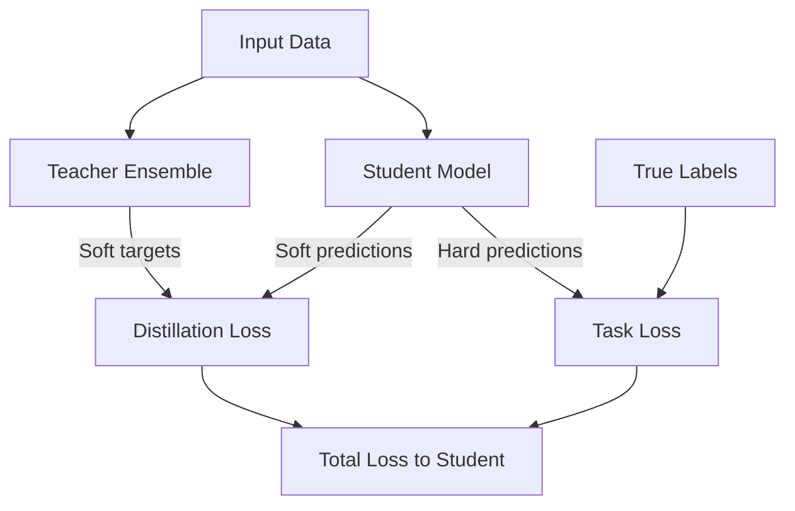

## The hook

When an image classifier looks at a photograph of a BMW, it knows the picture contains a car. But does it think the BMW looks more like a garbage truck or a carrot?

A standard training label tells the network none of this. The label stamps a rigid 1 on *car* and 0 on everything else, treating every mistake as equally absurd. Yet deep inside a well-trained network, the predicted probability for *truck* might be one in a thousand, while the probability for *carrot* is one in a billion. 

That buried similarity structure—dubbed **[[Dark Knowledge]]**—reveals how a model actually understands the world. How can we pull this subtle knowledge out of an expensive ensemble of giants and transfer it into a small, lightning-fast model?

## Before you start

You should be comfortable with multi-class classification, the softmax function, and cross-entropy loss. It also helps to understand how ensembles and regularization work from [Dropout](article:paper-dropout), because this paper sets out to condense large, heavily regularized models into compact ones.

:::analogy
Think of distillation as **an apprentice learning from a master**. A novice carpenter could learn solely by looking at finished chairs and guessing the rules. But they will learn far faster and avoid costly blunders if they stand beside the master, studying the master's hesitations, second thoughts, and near-misses on every cut.
:::

## The world before this paper

In biology, many insects undergo complete metamorphosis. A caterpillar spends its days gorging on leaves, optimized entirely for extracting energy and nutrients from its environment. Later, it pupates and emerges as an agile butterfly, an entirely different body optimized for traveling and reproduction.

Machine learning historically ignored that lesson. Engineers used the same architecture for both stages of a model's life: the heavy training phase and the real-time serving phase.

Training an enormous ensemble of neural networks extracts intricate structure from complex datasets. But serving twenty huge networks in parallel inside a smartphone app or a live speech recognizer is far too slow and memory-intensive.

Before this paper, Cristian Buciluǎ, Rich Caruana, and their collaborators showed that you could compress an ensemble into a single network. Their trick was matching the raw, unnormalized outputs—the [[Logits]]—using mean squared error. It worked, but it treated every logit equally, ignoring how the network balances relative confidences across different categories.

:::history
In 2006, Rich Caruana's team proved that small models could match big ensembles if trained on pseudo-labeled data. In 2014, Jimmy Ba and Caruana extended this to deep neural nets by directly predicting the ensemble's pre-softmax logits. Hinton, Vinyals, and Dean set out to unify this work under a principled probabilistic framework.
:::

## The big idea

Hinton, Vinyals, and Dean challenged a widespread assumption: that a neural network's knowledge lives inside its weight matrices.

If knowledge were just the weights, you could never transfer it into a network with a completely different shape. The authors argued instead that knowledge is the **learned mapping from inputs to output vectors**. The smooth contours of that mapping tell you how to generalize.

:::insight
A trained model's knowledge is not its frozen weight matrices. It is the smooth mapping it learned from inputs to relative output probabilities.
:::

When an ensemble classifies an image, it outputs a probability distribution. The correct class might get 0.99, while two incorrect classes get $10^{-5}$ and $10^{-9}$. That tiny difference between $10^{-5}$ and $10^{-9}$ is invisible to standard loss functions, but it contains crucial information about similarity. 

The big idea of **distillation** is simple: soften those output distributions into **[[Soft Targets]]** by raising a knob called [[Temperature]], and train a compact student network to reproduce those softened distributions.

## How it works

### Softening probabilities with temperature

In a standard network, the final layer produces raw numbers called logits ($z_i$). To turn them into probabilities ($q_i$), we run them through the softmax function:

$$q_i = \frac{e^{z_i / T}}{\sum_j e^{z_j / T}}$$

Here, $z_i$ is the logit for class $i$, and $T$ is the [[Temperature]]. 

In standard networks, $T = 1$. When $T = 1$, large logits dominate the exponentiation, pushing the winner close to 1.0 and squashing all other classes toward 0. 

As $T$ grows, the numbers inside the exponents shrink closer to zero. Because $e^0 = 1$, the resulting probabilities spread out. The winning class still wins, but the runners-up become large enough to compute with.

Recall our carpentry apprentice: turning up the heat is like asking the master to voice their subtle second thoughts aloud rather than mumbling them under their breath. At $T=1$, the master blurted out only the final choice. At elevated $T$, the master explicitly reveals how close the second-best option really was.

### The loss function

During distillation, the student trains on a weighted combination of two losses:

1. **Distillation loss (soft loss):** The cross-entropy between the student's softened probabilities and the teacher's soft targets, both computed at temperature $T$.
2. **Student task loss (hard loss):** The standard cross-entropy between the student's regular predictions (computed at normal temperature $T = 1$) and the original ground truth [[Hard Targets]].

$$L = \alpha L_{\text{hard}} + (1 - \alpha) T^2 L_{\text{soft}}$$

Here, $\alpha$ is a balance weight between 0 and 1, and $T^2$ is an essential gradient-scaling multiplier.

### Why multiply by $T^2$?

Before looking at the math, pause and predict: if you raise the temperature from $T=1$ to $T=10$, what happens to the gradient magnitude of the soft loss? Does it drop by 10x, stay constant, or drop by 100x?

You might expect a factor of 10, but the reveal is surprising: it drops by a factor of 100.

Look at the gradient of the soft cross-entropy loss with respect to a student logit $z_i$:

$$\frac{\partial C}{\partial z_i} = \frac{1}{T} (q_i - p_i)$$

Here, $q_i$ is the student's soft probability and $p_i$ is the teacher's soft target. 

At high temperatures, both $q_i$ and $p_i$ approach uniform values ($1/N$). When you expand the exponentials using a first-order Taylor series ($e^x \approx 1 + x$), the difference $(q_i - p_i)$ scales proportionally to $1/T$. 

Combined with the $1/T$ factor in front of the derivative, the total gradient scales as $1/T^2$. If you raise the temperature from 1 to 10 without compensating, your gradients drop by a factor of 100. Multiplying the distillation loss by $T^2$ ensures that no matter what temperature you choose, the balance between soft targets and hard ground truth labels stays steady.

### Logit matching is a high-temperature limit

Caruana's earlier approach trained a student to match the teacher's unnormalized logits using squared error: $\frac{1}{2}(z_i - v_i)^2$. 

Hinton and his co-authors proved mathematically that Caruana's approach is actually a special case of distillation. When $T \to \infty$ and the logits are zero-centered ($\sum_j z_j = \sum_j v_j = 0$), the soft gradient becomes:

$$\frac{\partial C}{\partial z_i} \approx \frac{1}{N T^2} (z_i - v_i)$$

This matches the gradient of mean squared error between logits. 

However, full distillation at moderate temperatures offers a key advantage: it ignores very negative logits. In a teacher model, logits that are deeply negative are barely constrained during training and are full of noisy fluctuations. Distillation naturally dampens that noise while highlighting meaningful near-misses.

### A worked example with real numbers

Imagine a vision model deciding between three classes: **Cat**, **Dog**, and **Car**.

Suppose the teacher produces these logits:
- $v_{\text{cat}} = 6.0$
- $v_{\text{dog}} = 3.0$
- $v_{\text{car}} = -3.0$

Let's trace what happens at $T = 1$ versus $T = 3$.

| Step | Operation | Cat | Dog | Car | Sum |
|---|---|---|---|---|---|
| 1. Teacher at $T = 1$ | $e^{v_i}$ | $e^{6.0} \approx 403.43$ | $e^{3.0} \approx 20.09$ | $e^{-3.0} \approx 0.05$ | $423.57$ |
| | Probabilities ($p_i$) | **0.9525** | **0.0474** | **0.0001** | 1.0000 |
| 2. Scale by $T = 3$ | $v_i / 3$ | 2.0 | 1.0 | -1.0 | — |
| | $e^{v_i / 3}$ | $e^{2.0} \approx 7.389$ | $e^{1.0} \approx 2.718$ | $e^{-1.0} \approx 0.368$ | $10.475$ |
| | Soft Targets ($p_i$) | **0.7054** | **0.2595** | **0.0351** | 1.0000 |

Notice what happened. At $T = 1$, the Car probability is $0.0001$. Its gradient signal is virtually dead. The student cannot tell whether the teacher considered a Cat to be closer to a Dog or a Car. 

At $T = 3$, the dark knowledge emerges clearly: Dog ($0.2595$) is roughly 7.4 times more probable than Car ($0.0351$). The teacher is telling the apprentice: *"This is a cat. But if I were forced to make a mistake, it would be a dog, never a car."*

Now suppose the student currently produces logits $z = [3.0, 0.0, -3.0]$. At $T = 3$, the student's scaled logits are $[1.0, 0.0, -1.0]$.

The student's exponentiated values are $e^1 \approx 2.718$, $e^0 = 1.0$, and $e^{-1} \approx 0.368$, summing to $4.086$. 

The student's softened probabilities are:
- $q_{\text{cat}} = 2.718 / 4.086 = 0.6652$
- $q_{\text{dog}} = 1.0 / 4.086 = 0.2447$
- $q_{\text{car}} = 0.368 / 4.086 = 0.0901$

Let's compute the distillation gradient before and after $T^2$ scaling:

$$\frac{\partial C}{\partial z_i} = \frac{1}{T}(q_i - p_i) = \frac{1}{3}(q_i - p_i)$$

- For Cat: $\frac{1}{3}(0.6652 - 0.7054) = -0.0134$
- For Dog: $\frac{1}{3}(0.2447 - 0.2595) = -0.0049$
- For Car: $\frac{1}{3}(0.0901 - 0.0351) = +0.0183$

Notice how small these raw updates are. If we did not scale them by $T^2$ ($3^2 = 9$), the hard target loss would completely overpower them. Multiplying by 9 gives:

- $\Delta z_{\text{cat}} = 9 \times (-0.0134) = -0.1206$
- $\Delta z_{\text{dog}} = 9 \times (-0.0049) = -0.0441$
- $\Delta z_{\text{car}} = 9 \times (+0.0183) = +0.1647$

The student receives a clear nudge to push up its Cat and Dog logits, and pull down its Car logit.

:::try-this
Take a toy two-class problem where the teacher outputs logits $[10.0, 0.0]$. At $T=1$, calculate the probability of the second class. Then recalculate it at $T=10$.
*(At $T=1$, $e^0 / (e^{10} + 1) \approx 0.000045$. At $T=10$, the scaled logits are $[1.0, 0.0]$, giving $e^0 / (e^1 + 1) \approx 0.269$. A dormant signal becomes an active guide.)*
:::

## What they found

The authors tested distillation across three very different domains: handwritten digit recognition, large-scale speech recognition, and giant image classification.

### MNIST and learning without seeing

On MNIST, a large teacher network with two 1,200-unit hidden layers trained with dropout made **67 test errors**. A small baseline network with two 800-unit hidden layers trained without regularization made **146 errors**. 

When that same small 800-unit network was trained solely to match the soft targets of the big network at $T = 20$, it achieved **74 errors**. The small student captured nearly the entire performance advantage of the massive regularized teacher.

To push the concept to its absolute limit, the authors ran an audacious test: they removed every single image of the digit **3** from the student's training set. 

Predict what happens when that student faces 1,010 test images of the digit 3—a digit it has never seen once in training. Does it score 0%, guess randomly at 10%, or fail completely?

The reveal stunned researchers at the time: after adjusting for the missing class bias by +3.5, the student scored **98.6% correct** on a digit it was never explicitly taught. It made only 109 errors across the entire test set, with just 14 errors on 3s.

Our apprentice carpenter analogy explains it: by watching the master hesitate between neighboring options on familiar cases (like noticing that certain 2s and 8s look a bit like a 3), the apprentice absorbed what a 3 must look like without ever having seen one labeled directly.

### Speech recognition at Google

The authors tested distillation on Google's Android voice search acoustic model. The baseline was a deep network with 8 hidden layers of 2,560 units and 14,000 output labels, totaling roughly 85 million parameters.

| System | Test Frame Accuracy | Word Error Rate (WER) |
|---|---|---|
| Baseline Single Model | 58.9% | 10.9% |
| 10x Ensemble | 61.1% | 10.7% |
| Distilled Single Model | 60.8% | 10.7% |

The 10-model ensemble shaved the Word Error Rate from 10.9% to 10.7% and bumped frame accuracy by 2.2 percentage points. Running a 10-model ensemble in production would require ten times the compute budget. 

Distilling that ensemble into a single model of the exact same size as the baseline recovered over **80% of the frame accuracy gain** and matched the ensemble's **10.7% Word Error Rate** exactly. Production got all the benefits of an ensemble for free.

### Soft targets prevent overfitting

In a further speech experiment, the team trained the 85-million parameter model on just 3% of the training data (about 20 million audio frames). 

Trained on standard hard labels, the model overfit catastrophically: test accuracy peaked early at 44.5% before crashing. 

When trained on soft targets generated by a teacher that saw the full dataset, the student reached **57.0% test accuracy** without any early stopping. The soft targets acted as a powerful regularizer: because the apprentice learned the master's smooth reasoning across all alternatives, it could not overfit to quirky noise in individual one-hot answers.

### Specialist models on the JFT dataset

Finally, the authors tackled Google's internal JFT dataset: 100 million images across 15,000 categories. Training an ensemble across all 15,000 classes would take years of compute. 

Instead, they trained one generalist network, clustered classes that the generalist frequently confused into confusable subsets, and trained 61 **specialist models** on those clusters. Combining the generalist with these 61 specialists boosted top-1 conditional accuracy on the specialist classes from **43.1% to 45.9%**.

:::warning
Distillation does not require the student architecture to mimic or mirror the internal layers or hidden dimensions of the teacher. The student treats the teacher strictly as a black box that produces soft probability vectors over a [[Transfer Set]]. The student can be shallower, narrower, or built from completely different layers.
:::

## What it got wrong (or left open)

The paper had several blind spots that later researchers had to tackle.

First, **distillation does not always work best with the biggest teacher.** If the teacher is radically larger or has vastly more representational capacity than the student, its softened outputs can be too complex for the smaller student to reproduce. In practice, students often learn better from an intermediate-sized teacher than from an incomprehensible giant.

Second, the paper only looked at the final output probabilities. It completely bypassed intermediate representations. If a network has 50 layers, matching only the final output discards rich internal representations formed at layers 10, 20, and 30.

Third, while the paper introduced specialist models for JFT, it left open how to distill all 61 specialists back into a single unified generalist model.

### Interview follow-ups

Here are questions interviewers love to ask about knowledge distillation, along with how to answer them.

**Q: Why don't we just use a temperature of $T=1000$ all the time?**
*Answer:* As $T \to \infty$, distillation converges to minimizing mean squared error between zero-centered logits. But logits with large negative values are noisy and poorly constrained by the teacher's training loss. Moderate temperatures act as a filter: they soften the distribution enough to reveal relationships between plausible classes while leaving irrelevant, noisy negative logits suppressed.

**Q: Does the transfer set need ground truth labels?**
*Answer:* No. The distillation loss only compares the teacher's soft targets with the student's soft predictions. You can distill knowledge into a student using uncurated, unlabeled data. Ground truth labels are only required if you explicitly include the hard cross-entropy loss term ($L_{\text{hard}}$).

**Q: How does temperature change between training and inference?**
*Answer:* Temperature is elevated strictly during the student's training phase ($T > 1$) to expose the teacher's soft probability distributions. During test-time deployment, the student operates at standard temperature ($T = 1$) so that it makes sharp, calibrated classifications.

## What happened next

Distillation became one of the foundational pillars of modern model compression and efficiency.

In 2014, Adriana Romero and colleagues published *FitNets*, extending distillation to intermediate hidden layers by training a student's intermediate representations to match the teacher's through projection layers.

When large transformer models arrived, distillation became essential for deploying them to production:
- In 2019, Hugging Face released **DistilBERT**, compressing BERT by 40% while retaining 97% of its language understanding capabilities and running 60% faster.
- In the era of large language models, distillation took on a new life: developers routinely use frontier models to generate reasoning traces, synthetic datasets, and instruction pairs to train compact, open-source models like [Llama](article:paper-llama).

To see how this exact trick was adapted to train vision transformers without requiring millions of private images, turn next to [Vision Transformers Without a Private Photo Archive](article:paper-training-data-efficient-image-transformers-distillation-thro).

## Key takeaways

- A model's knowledge is captured by the smooth mapping it learns from inputs to output probabilities, not by its raw parameter values.
- Dark knowledge lives in the relative probabilities of incorrect classes, which reveal semantic similarities that one-hot labels erase.
- Raising the temperature in the softmax function softens probability distributions, pulling hidden similarity ratios into view.
- When combining soft distillation loss with hard label loss, the soft gradient must be multiplied by $T^2$ to keep gradient magnitudes balanced across temperatures.
- Distillation allows a compact student network to achieve the generalization accuracy of a large ensemble while running at the speed of a lightweight model.
