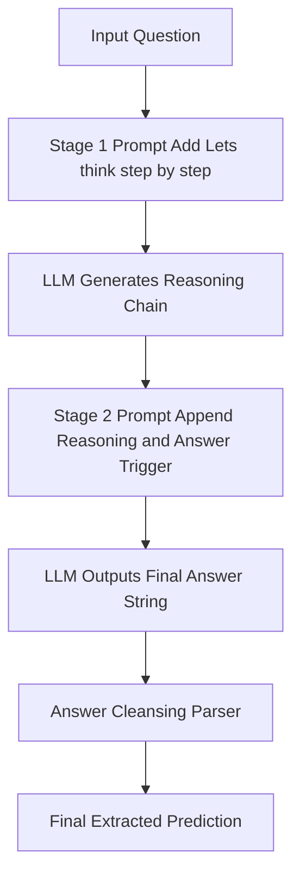

## The hook

Give a large language model a multi-step arithmetic problem and ask it directly for the answer, and it fails miserably. For months, the AI community believed you had to handcraft careful demonstrations to teach models how to reason. Then a team of researchers appended four words to the prompt: *Let's think step by step*. Without a single worked example, accuracy on a classic grade-school arithmetic benchmark jumped from under 18% to nearly 79%.

## Before you start

To get the most out of this article, make sure you understand:
- How models generate text from prompts, covered in [Just Show It a Few Examples](article:paper-gpt-3).
- How models learn to follow instructions, covered in [How a Text Predictor Learned to Be Helpful](article:paper-instructgpt).
- Why worked examples help models solve word problems, covered in [Show Your Working: The Prompt That Unlocked Reasoning](article:paper-chain-of-thought).

## The world before this paper

In early 2022, everyone knew large language models were amazing wordsmiths but terrible logicians. If you asked a model a factual question like "What is the capital of Kenya?", it answered instantly. But if you gave it a two-step puzzle—like calculating the number of tennis balls left in a bucket after several rounds of practice—the model guessed blindly and almost always missed.

The common diagnosis was that neural networks only perform fast, intuitive pattern matching. Cognitive psychologists call this System-1 thinking: split-second intuition without deliberate analysis. In contrast, multi-step math or logic requires slow, deliberate calculation, known as [[System-2 Reasoning]]. Because language models output one token after another, predicting the final answer right away forced them to compute the entire multi-step solution in a single forward pass.

:::history
When researchers realized this, the initial breakthrough came from Jason Wei and his colleagues in early 2022. They introduced [[Chain of Thought (CoT)|Chain of Thought]] prompting. By providing several few-shot exemplars that wrote out intermediate reasoning steps, they demonstrated that huge models like PaLM could solve tough word problems. But everyone drew the same conclusion from that paper: the model only reasoned because human engineers painstakingly taught it how via in-context demonstrations.
:::

Because few-shot prompts worked so well, researchers treated in-context demonstrations as an absolute necessity. Nobody even bothered to measure whether a model could generate reasoning chains on its own, without examples.

## The big idea

The authors suspected that the capacity for logical deduction was not created by few-shot demonstrations. Instead, that reasoning capacity was already sitting dormant inside pretrained language models.

When you ask a model a question and immediately follow it with "The answer is:", you force it to compress an entire deduction into the very next word. But if you alter the conversational context so the most natural continuation is an explanation, the model happily generates its own scratchpad.

:::analogy
Asking an LLM for an immediate answer is like demanding that a student solve a three-step algebra problem entirely in their head in two seconds. They will panic and blurt out an incorrect guess. Adding *Let's think step by step* is like handing that student a blank sheet of scratch paper and asking them to show their work first.
:::

The authors called this approach [[Zero-shot-CoT]]. It requires zero demonstrations, zero fine-tuning, and zero task-specific customization. A single universal sentence unlocks latent reasoning across math, symbolic logic, and planning.

## How it works

To make zero-shot reasoning work reliably, you cannot just tell the model to think and hope it ends its monologue with a tidy final number. Kojima and his team designed an elegant two-stage pipeline.



### Stage 1: Reasoning extraction

First, the system wraps the user's question with a trigger phrase designed to elicit an intermediate explanation:

```text
Q: A juggler can juggle 16 balls. Half of the balls are golf balls,
and half of the golf balls are blue. How many blue golf balls are there?
A: Let's think step by step.
```

The language model takes this prompt and generates a stream of tokens using greedy decoding. Because the prompt sets up the tone of an educator working through a problem, the model writes out the intermediate logic:

```text
There are 16 balls in total. Half of the balls are golf balls.
That means that there are 8 golf balls. Half of the golf balls are blue.
That means that there are 4 blue golf balls.
```

### Stage 2: Answer extraction

Now we have a great explanation, but the model has not delivered a crisp, machine-readable answer yet. If an automated grading script checks the text, parsing where the answer lives inside a conversational paragraph is messy.

To solve this, the pipeline feeds the generated reasoning back into the model alongside an answer extraction trigger:

```text
[Question + Stage 1 Prompt + Generated Reasoning]
Therefore, the answer (arabic numerals) is
```

When prompted with this completion, the model completes the thought with a simple token: `4`.

### Answer cleansing

Finally, the authors apply a tiny deterministic parser called [[Answer Cleansing]]. If the task requires a number, the parser scans the Stage 2 output and picks out the first sequence of digits. If the task is multiple choice, it grabs the first uppercase option letter (such as A through E). This eliminates trailing punctuation, stray conversational filler, and formatting quirks.

:::try-this
Take this word problem: *"A bakery has 24 cupcakes. A customer buys 1/3 of them. Then the baker bakes 6 more. How many cupcakes are in the bakery?"*
Try answering it by directly guessing the final number in one second. Now write out:
1. One third of 24 is 8.
2. 24 minus 8 is 16.
3. 16 plus 6 is 22.
Notice how each small sentence turns a hard three-step mental calculation into three trivial one-step calculations. That is exactly what the model does token by token.
:::

## What they found

The results sent shockwaves through the community. On the MultiArith benchmark, standard zero-shot prompting on InstructGPT achieved an accuracy of only 17.7%. Appending the simple phrase *Let's think step by step* boosted that score to 78.7%.

On the challenging GSM8K grade-school math benchmark, standard zero-shot accuracy sat at 10.4%. With Zero-shot-CoT, it leaped to 40.7%.

```
MultiArith Accuracy (InstructGPT text-davinci-002)
Standard Zero-Shot:  [===                 ] 17.7%
Zero-Shot-CoT:       [====================] 78.7%

GSM8K Math Accuracy (InstructGPT text-davinci-002)
Standard Zero-Shot:  [==                  ] 10.4%
Zero-Shot-CoT:       [==========          ] 40.7%
```

The technique was not just an arithmetic party trick. It extended to symbolic and logical tasks:
- **Last Letter Concatenation:** Combining the final letters of words jumped from 0.2% to 57.6%.
- **Coin Flip Tracking:** Tracking the orientation of a flipped coin surged from 12.8% to 91.4%.
- **Model Scale Matters:** On small models (under 10 billion parameters), the technique yielded almost no gain. But once models grew past 100 billion parameters (like PaLM 540B and InstructGPT), the reasoning curve skyrocketed.

:::insight
Chain-of-thought capability is an emergent property of model scale. The logic already exists in the weights of massive models; you just need to prompt the model to allocate compute tokens to intermediate thoughts before committing to an answer.
:::

### Does the exact wording matter?

The authors tested 16 different prompt variations on MultiArith to see if *Let's think step by step* was special.

| Prompt Template | Category | MultiArith Accuracy |
| :--- | :--- | :--- |
| **Let's think step by step.** | Instructive | **78.7%** |
| First, | Instructive | 77.3% |
| Let's think about this logically. | Instructive | 74.5% |
| Let's solve this problem by splitting it into steps. | Instructive | 72.2% |
| Let's think | Instructive | 57.5% |
| Don't think. Just feel. | Misleading | 18.8% |
| Abrakadabra! | Irrelevant | 15.5% |
| *Standard Zero-Shot (No trigger)* | Baseline | 17.7% |

Any prompt that encouraged stepwise decomposition led to massive improvements. Misleading or irrelevant prompts kept performance near the baseline.

## What it got wrong (or left open)

While the paper made reasoning dramatically cheaper, it revealed several quirks and limitations:

:::warning
Zero-shot-CoT does not match the peak accuracy of human-crafted few-shot demonstrations. On GSM8K, 8-shot CoT achieved 48.7%, compared to 40.7% for Zero-shot-CoT. Demonstrations still guide the model on formatting and specific stylistic expectations better than a generic prompt.
:::

Second, the model occasionally suffers from overthinking. In error analyses, the authors observed that the model sometimes deduced the correct answer early in its reasoning chain, but kept generating subsequent lines of unnecessary logic, confusing itself and ultimately flipping its answer to an incorrect one.

Third, Zero-shot-CoT provides virtually no benefit on simple, single-step tasks (such as basic single-operation addition or subtraction) or standard commonsense benchmarks like CommonsenseQA. If a question does not require intermediate deductions, forcing an artificial chain of steps introduces extra opportunities for hallucinations.

Finally, the phrasing was discovered purely through manual experimentation. The authors did not offer a formal method for automatically finding the best possible trigger sentence.

## What happened next

This paper changed the standard evaluation protocol for every subsequent reasoning study. After Kojima et al., researchers could no longer claim that reasoning required complex exemplars; Zero-shot-CoT became the de facto minimal baseline for any benchmark.

Building directly on this insight, researchers soon asked: if four hand-picked words could boost accuracy by 60 percentage points, could an algorithm find even better words? This inspired Automatic Prompt Engineer (APE), where language models themselves were tasked with searching for and optimizing trigger phrases.

Soon after, other researchers combined this idea with voting strategies. Papers like [Why Multiple Reasoning Paths Beat One Greedy Guess](article:paper-self-consistency-improves-chain-of-thought-reasoning-in-lang) sampled multiple different reasoning paths and took the majority vote, pushing accuracy even higher. Eventually, tree-based search methods explored in [Giving Language Models the Power to Backtrack](article:paper-tree-of-thoughts-deliberate-problem-solving-with-large-langu) extended stepwise generation into deliberate search trees.

Most importantly, this paper changed how people viewed language models. They were no longer seen as static search engines that either knew an answer or didn't. They were systems that needed computational room to think.

## Key takeaways

- Adding *Let's think step by step* unlocks latent multi-step reasoning in large language models without any task-specific demonstrations.
- The two-stage pipeline separates reasoning generation from answer extraction, allowing clean evaluation without human prompt engineering.
- Multi-step reasoning is an emergent ability that appears sharply in models scaled past tens of billions of parameters, while remaining largely absent in smaller networks.
- While few-shot demonstrations still achieve higher peak scores, universal zero-shot triggers provide an indispensable, task-agnostic baseline.
