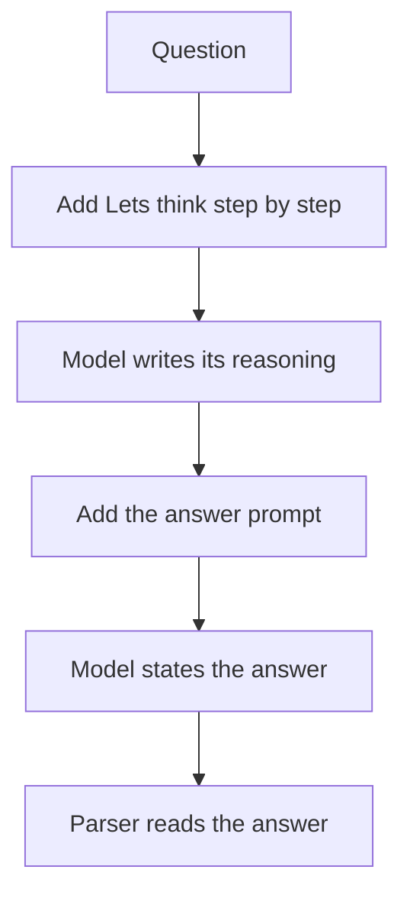

## The hook

In early 2022, getting a language model to solve a word problem meant writing a few worked solutions by hand and pasting them into the prompt. A different set of worked examples for maths, another for logic puzzles, another for dates.

Then a team from the University of Tokyo and Google tried something almost too simple. They wrote no examples at all and added one line before the answer: "Let's think step by step." On one arithmetic benchmark, accuracy went from 17.7% to 78.7%. How can five words do that?

## Before you start

You should know how [GPT-3](article:paper-gpt-3) continues a prompt one token at a time, how [InstructGPT](article:paper-instructgpt) was trained to follow instructions, and the idea behind [chain-of-thought prompting](article:paper-chain-of-thought): showing worked examples makes a model write its own steps.

## The world before this paper

Large models were good at many tasks with [[zero-shot prompting]], where you simply ask. Multi-step reasoning was the weak spot. Ask "how many are left after these three operations?" and the model often wrote a number straight away, usually the wrong one.

[[Few-shot chain of thought]] fixed much of that. You give the model a few examples whose answers show the working, and it imitates that style on the new question. But someone has to write those examples, and good ones for maths do not transfer well to, say, tracking a coin through flips.

:::history
Takeshi Kojima, Shixiang Shane Gu, Machel Reid, Yutaka Matsuo and Yusuke Iwasawa posted the paper in May 2022, and it appeared at NeurIPS 2022. The common belief was that the worked examples were teaching the model to reason. The authors suspected the ability was already there, and that the examples mostly changed what kind of text the model thought should come next.
:::

## The big idea

:::analogy
Picture an exam hall. A student who must write the final answer straight into a small box guesses on the hard questions. Give the same student a rough sheet and say "work it out first", and they write the steps, catch the carry, and get it right. Then, at the end, they copy the result neatly into the answer box.
:::

[[Zero-shot-CoT]] does exactly this. The [[trigger phrase]] "Let's think step by step" is the rough sheet. It makes an explanation the most natural continuation, so the model writes intermediate steps instead of jumping to a number. A second prompt is the answer box: it asks for the final result in a fixed format.

Why would writing steps help? A language model produces each token from what came before. If the next token must be the final number, the whole calculation has to happen inside one prediction. If the model first writes "one third of 24 is 8", that 8 is now on the page, and the next step only needs to build on it. Each written step turns a hard jump into a short hop.

:::insight
The reasoning ability was already in the large models. The trigger did not teach anything new; it changed which continuation was most likely, so the model spent tokens working the problem out before committing to an answer.
:::

## How it works

### Stage 1: reasoning on the rough sheet

The prompt is the question, then "A: Let's think step by step." The model continues freely. Here is the kind of trace you hope for, on our own example problem:

| Step | What the model writes | Running value |
|---|---|---|
| Question | A shop has 24 cupcakes. A customer buys a third of them. The baker then makes 6 more. How many are there now? | |
| 1 | A third of 24 is 24 ÷ 3 = 8. | 8 sold |
| 2 | After the sale, 24 − 8 = 16 are left. | 16 |
| 3 | The baker adds 6, so 16 + 6 = 22. | 22 |

Each line needs only one small operation. Asked for the answer directly, the model would have to do all three inside a single next-token prediction.

### Stage 2: copying into the answer box

Free-form reasoning can end anywhere: "so there are 22", "22 cupcakes in total", or it may keep chatting. So the method runs a second prompt. It takes the question, the trigger and the generated reasoning, and appends an answer prompt suited to the task. For numbers the paper uses "Therefore, the answer (arabic numerals) is". The model continues with something short like "22."

### Stage 3: reading the box

A small rule-based parser then pulls out the answer: the first number for arithmetic tasks, or the first option letter for multiple choice. This [[answer extraction]] step matters for scoring. Without it, a correct answer buried in a sentence could be marked wrong.

| Raw output after the answer prompt | Task type | Parsed answer |
|---|---|---|
| 22. | number | 22 |
| 22 cupcakes are left in the shop. | number | 22 |
| (C) 22 | multiple choice | C |

Notice that the same trigger and the same two-stage recipe are used for every task. Only the format hint in the answer prompt changes. That is what "zero-shot" means here: no task-specific examples at all.

:::try-this
A model is given: "Riya has 5 boxes with 4 pens each. She gives away 7 pens. How many pens does she have?" With the trigger, write the steps a good trace would contain, then say how many separate operations a direct answer would have to hide. (Steps: 5 × 4 = 20, then 20 − 7 = 13. A direct answer hides two operations in one prediction.)
:::

### Does the exact wording matter?

The authors tried many trigger phrases. Phrases that encourage step-by-step working, such as asking the model to think logically or to start with "First,", also helped a lot, and "Let's think step by step" did best in their comparison. Phrases that were misleading or irrelevant did not help. In the analogy, the student needs to be told to use the rough sheet. Saying something unrelated before the exam does nothing.

:::warning
Common misconception: "The phrase is a magic spell that works on any model." The gains depended heavily on scale. In the paper, small models barely improved, while large models improved sharply. A small model given a rough sheet still cannot do the steps.
:::

## What they found

The abstract gives the headline numbers, with the large InstructGPT model text-davinci-002:

| Benchmark | Zero-shot | Zero-shot-CoT | Ratio |
|---|---|---|---|
| MultiArith, arithmetic word problems | 17.7% | 78.7% | about 4.4 times |
| GSM8K, grade-school maths | 10.4% | 40.7% | about 3.9 times |

The paper reports improvements of similar size with a second large model, the 540-billion-parameter PaLM, and gains across arithmetic, symbolic reasoning such as last-letter concatenation and coin tracking, and other logical reasoning tasks.

Three further findings stand out:

- **Scale matters.** Plain zero-shot accuracy on these tasks stayed fairly flat as models grew. Zero-shot-CoT accuracy rose steeply with size.
- **Examples still help more.** Hand-written few-shot chain-of-thought prompts generally scored higher than the zero-shot trigger. The value of Zero-shot-CoT is that it is a strong, free baseline that needs no examples.
- **Not every task benefits.** On CommonsenseQA, a question-answering benchmark that needs knowledge more than multi-step calculation, the trigger gave little or no gain.

## What it got wrong (or left open)

- **Overthinking.** The authors' error analysis found cases where the model reached the right answer, kept writing unnecessary steps, and talked itself into a wrong one. The rough sheet can also be a place to wander off.
- **Reasoning can be wrong but sound confident.** A fluent chain of steps is not a proof. Nothing in the method checks whether each step is true.
- **Found by hand.** The best trigger came from trying phrases manually. The paper does not explain why one wording beats another, or how to find the best one automatically.
- **Two calls per question.** The answer-extraction stage roughly doubles the number of model calls, though the second call is short.

## What happened next

Zero-shot-CoT quickly became a standard baseline in reasoning papers: before claiming your elaborate prompt helps, show it beats "Let's think step by step".

It also combined well with later ideas. [Self-consistency](article:paper-self-consistency-improves-chain-of-thought-reasoning-in-lang) samples many reasoning paths, with or without examples, and takes a majority vote on the answers. [Letting a Language Model Back Up and Try Again](article:paper-tree-of-thoughts-deliberate-problem-solving-with-large-langu) turned single chains into a search over partial reasoning. Other work searched automatically for better trigger phrases.

The broader lesson lasted longest: a model may know how to do something that a plain prompt does not bring out, and giving it room to work before answering is one of the cheapest ways to get more from it.

## Key takeaways

- Zero-shot-CoT adds a generic trigger such as "Let's think step by step", lets the model write its reasoning, then asks a second time for the answer in a fixed format.
- Written steps help because each token builds on what is already on the page, so a multi-step calculation becomes a series of small hops.
- With text-davinci-002, the method raised MultiArith accuracy from 17.7% to 78.7% and GSM8K from 10.4% to 40.7%, with no task-specific examples.
- The gains grew sharply with model size, so the trigger mostly helps large models that already have the underlying ability.
- Hand-written few-shot examples generally still did better, and the method gave little help on commonsense tasks and no protection against confident but wrong reasoning.
