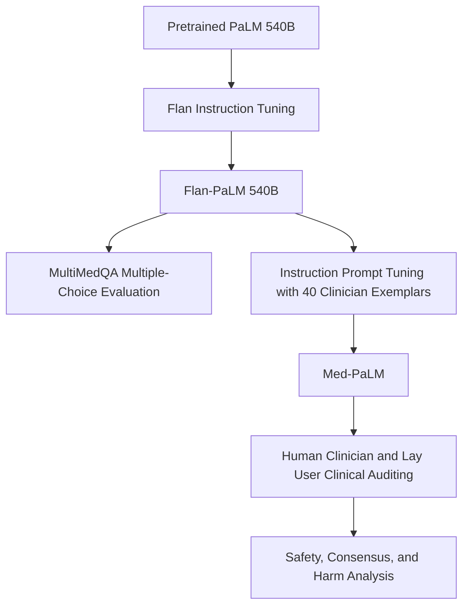
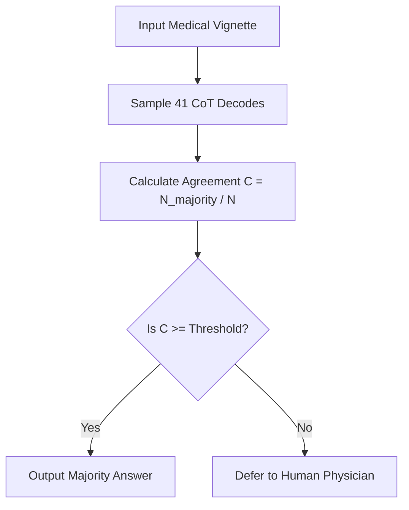

## The hook

If an artificial intelligence model passes a US medical licensing examination, would you trust it to tell a worried parent whether their newborn baby's jaundice needs emergency care? In late 2022, giant language models proved they could ace multiple-choice questions designed for graduating doctors. Yet when asked open-ended consumer health questions, those same systems hallucinated treatments, omitted critical caveats, and gave advice that real doctors warned could cause severe injury.

:::analogy
A raw large language model is like a brilliant university graduate who spent four years speed-reading every medical textbook on the internet. They can pass written exams with flying colors, but place them in front of a patient without hospital training, and they might suggest an ungrounded remedy with complete confidence. [[Instruction Prompt Tuning]] acts like a focused residency orientation, training that graduate to follow clinical norms: pause, state risks clearly, prioritize safety, and remain grounded in medical consensus.
:::

## Before you start

To get the most out of this piece, you should be familiar with step-by-step reasoning prompts in [Show Your Working: The Prompt That Unlocked Reasoning](article:paper-chain-of-thought) and how base predictors are turned into helpful assistants in [How a Text Predictor Learned to Be Helpful](article:paper-instructgpt).

## The world before this paper

Until 2022, natural language processing for medicine relied on domain-specific transformers like PubMedBERT and BioGPT. Researchers trained these models directly on biomedical abstracts and papers. While these models excelled at finding entity names or classifying short excerpts, their scale was modest—typically hundreds of millions of parameters, occasionally a few billion. They struggled with complex clinical vignettes that required multi-step deduction across symptoms, lab tests, and disease pathways.

Then came general-purpose giants. Massive models like Google's PaLM (540 billion parameters) and its instruction-tuned sibling Flan-PaLM proved that general language models could absorb massive amounts of knowledge. But applying them to medicine hit two walls:

1. **Benchmark myopia:** The field measured progress with multiple-choice tests (such as MedQA or MedMCQA) or automated text metrics like BLEU. Neither told you whether an answer was dangerous to a patient.
2. **Alignment hazards:** A generic model aims to please the user and keep talking. In medicine, being overly confident or omitting a rare differential diagnosis can lead to catastrophe.

:::history
When researchers tried to adapt 540-billion-parameter models to medicine, full fine-tuning was off the table. Updating half a trillion weights for every clinical subfield would require immense supercomputing resources. Worse, collecting tens of thousands of expert-written medical answers to run standard supervised tuning was impossible because doctor time is scarce and expensive. The authors needed a method that could steer a massive model using only a tiny handful of high-quality clinical demonstrations.
:::

## The big idea

The research team recognized that passing board exams is only half the battle; clinical communication requires deep safety alignment. They proposed a two-step approach:

First, build a comprehensive testing arena called [[MultiMedQA]]. It paired established exam datasets with real-world consumer questions, audited along clinical dimensions like scientific consensus, likelihood of harm, bias, and missing information.

Second, align the model using **[[Instruction Prompt Tuning]]**. Instead of altering the frozen 540-billion-parameter model or relying only on text prompts, they trained a compact set of continuous vectors—a [[Soft Prompt]]—prepended directly to clinician-crafted instructions and exemplars. With just 40 expert-crafted question-answer pairs, they transformed Flan-PaLM into **Med-PaLM**, cutting potentially harmful responses by more than four-fifths.

## How it works

Let us walk through the pieces that take an instruction-tuned model and turn it into a medically aligned system.

### Step 1: The MultiMedQA benchmark

The authors brought together six existing datasets and created a seventh:

- **MedQA:** US Medical Licensing Examination (USMLE) questions.
- **MedMCQA:** Questions from Indian medical entrance exams (AIIMS/NEET).
- **PubMedQA:** Biomedical research questions with yes/no/maybe answers drawn from abstracts.
- **MMLU clinical topics:** Subsets covering anatomy, clinical knowledge, genetics, and professional medicine.
- **LiveQA and MedicationQA:** Consumer health questions submitted to medical libraries.
- **HealthSearchQA:** A new dataset of 3,375 commonly searched consumer health queries.

### Step 2: Prompting for reasoning and consistency

To tackle multiple-choice exams, the authors combined three strategies:

1. **Few-shot prompting:** Giving the model a few input-output pairs inside the prompt.
2. **Chain-of-thought (CoT):** Asking the model to write out clinical rationales before producing an option letter.
3. **[[Self-Consistency Prompting]]:** Sampling multiple distinct chain-of-thought solutions from the model and taking a majority vote.

Because medical reasoning paths can branch, a single generation might stumble into an incorrect conclusion. By sampling $K$ paths (the paper used $K = 11$) and selecting the option that receives the most votes, the model cancels out spurious errors.

:::try-this
Imagine a diagnostic puzzle where a patient's lab results could suggest either Condition A or Condition B. If you ask a language model once at temperature $T = 0.7$, it might flip a coin and argue for Condition B. If you sample 11 distinct runs, 8 runs might identify a subtle clue pointing to Condition A, while only 3 pick Condition B. Voting across all 11 runs filters out the noisy paths.
:::

### Step 3: Deferring uncertain answers

What should a medical model do when its confidence is low? The team introduced a [[Selective Prediction]] mechanism using self-consistency.

Let $N$ be the total number of sampled reasoning decodes, and let $N_{\text{majority}}$ be the count of decodes backing the winning answer. We define model agreement as:

$$C = \frac{N_{\text{majority}}}{N}$$

Where:
- $C$ is the agreement score between 0 and 1.
- $N_{\text{majority}}$ is the number of decodes agreeing on the most common answer.
- $N$ is the total number of decodes sampled.

If you generate $N = 41$ decodes, and 37 pick option (B), then:

$$C = \frac{37}{41} \approx 0.902$$

If only 18 pick option (B), $C = 18 / 41 \approx 0.439$. By choosing a threshold $\theta$, the model only answers if $C \ge \theta$. If $C < \theta$, the system defers the question to a human doctor. As the deferral rate rose to 45% of questions, the model's accuracy on the remaining queries jumped to 82.5%.

### Step 4: Instruction prompt tuning

When doctors evaluated Flan-PaLM on free-form consumer questions, the model often gave answers that were vague, out of step with guidelines, or potentially hazardous. Full fine-tuning was too expensive, and plain text prompting could not reliably enforce clinical caution.

The authors turned to parameter-efficient tuning. In standard prompt tuning, you attach a sequence of learnable vector tokens $P = [p_1, p_2, \dots, p_l]$ to the front of tokenized input text $X$, training only $P$ while freezing the transformer:

$$\hat{Y} = \text{LLM}([P; X])$$

Instruction prompt tuning takes this a step further. Instead of replacing the human instruction, the learned [[Soft Prompt]] vectors are prepended to a *structured prompt* that already contains a system instruction, domain guidelines, and few-shot clinician demonstrations:

$$\hat{Y} = \text{LLM}([P; \text{Instruction}; \text{Exemplars}; \text{User Question}])$$

:::insight
Instruction prompt tuning creates a hybrid prompt: continuous vectors learn general domain adaptation through gradient descent, while human-readable text supplies task-specific rules and demonstrations. This allowed the authors to align a 540-billion-parameter giant using just 40 expert-curated answers.
:::

## What they found

The paper delivered two major findings: raw scale enables exam performance, but prompt alignment is what delivers clinical safety.

### 1. Crushing medical licensing exams

Flan-PaLM 540B reached state-of-the-art results across every multiple-choice dataset in MultiMedQA:

- On **MedQA (USMLE 4-option)**, Flan-PaLM reached **67.6%**, beating the prior best model (PubMedGPT at 50.3%) by **17.3 percentage points**.
- On **MedMCQA**, it achieved **57.6%**, beating Galactica (52.9%).
- On **PubMedQA**, it scored **79.0%**, slightly exceeding the measured single-rater human benchmark of 78.0%.
- On **MMLU clinical topics**, it scored over 80% across clinical knowledge and professional medicine.

Scaling from 8 billion to 540 billion parameters doubled exam performance across multiple datasets.

### 2. Closing the clinical safety gap

When expert doctors conducted double-blind evaluations of long-form answers to consumer queries, raw Flan-PaLM showed alarming gaps. But Med-PaLM closed those gaps across several safety dimensions:

| Clinical evaluation axis | Flan-PaLM 540B | Med-PaLM 540B | Clinicians |
| :--- | :--- | :--- | :--- |
| **Aligned with scientific consensus** | 61.9% | **92.6%** | 92.9% |
| **Potential to cause harm** | 29.7% | **5.8%** | 6.5% |
| **Evidence of incorrect retrieval** | 23.1% | **16.9%** | 3.6% |
| **Omission of important information** | 47.2% | **15.1%** | 11.1% |
| **Demonstrated demographic bias** | 7.9% | **0.8%** | 1.4% |

By spending gradient updates on just 40 clinician exemplars, Med-PaLM brought consensus alignment from 61.9% up to 92.6%—matching practicing physicians. Potential harm plummeted from nearly 30% down to under 6%.

## What it got wrong (or left open)

Despite the dramatic improvements, the authors were careful to point out serious unresolved issues:

:::warning
Passing medical board exams does not make a model a doctor. Med-PaLM generated answers that clinicians judged to contain incorrect or inappropriate content in **18.7%** of cases—a rate slightly higher than Flan-PaLM (16.1%) and far worse than real clinicians (1.4%).
:::

Why did Med-PaLM have more factual slips than Flan-PaLM? Because instruction prompt tuning taught the model to produce much longer and more comprehensive explanations. While that reduced omitted details (dropping missing information from 47.2% to 15.1%), writing longer answers created more opportunities for factual misstatements.

Other critical limitations included:

- **English-only evaluation:** MultiMedQA was entirely in English, leaving open how these models behave in global healthcare systems with diverse languages and health literacies.
- **Static parametric knowledge:** The models relied entirely on memorized weights. Because medical consensus evolves as new trials conclude, static models risk serving outdated guidance unless paired with external search tools.
- **Rater subjectivity:** Long-form answers were reviewed by single clinicians rather than consensus panels, and judging "harm" in open-ended text is inherently subjective.

## What happened next

This paper marked a turning point in medical AI. It showed the community that biomedical NLP needed to move beyond classification and entity extraction toward conversational alignment audited by medical professionals.

Shortly after this work, the authors introduced Med-PaLM 2, which pushed USMLE accuracy past 85%—well into expert physician territory. The evaluation methodology established here—combining MultiMedQA with clinical audits of consensus, harm, and bias—became the standard playbook for evaluating subsequent foundation models in medicine, including Med-Gemini. Furthermore, the hybrid combination of soft prompts with structured instruction tuning helped validate parameter-efficient tuning methods like [Fine-Tune a Giant by Training a Tiny Add-On](article:paper-lora) for sensitive domains where full model retraining is impractical.

## Key takeaways

- General-purpose language models scaled to hundreds of billions of parameters can master medical licensing examinations without task-specific pretraining.
- Multiple-choice exam accuracy is a misleading proxy for clinical safety, as models with high exam scores can still recommend harmful treatments in free-form conversation.
- Instruction prompt tuning aligns massive language models to complex, safety-critical domains using only a few dozen expert-crafted examples.
- Self-consistency voting allows models to gauge their own uncertainty, enabling selective prediction where ambiguous clinical queries are safely deferred to human doctors.
