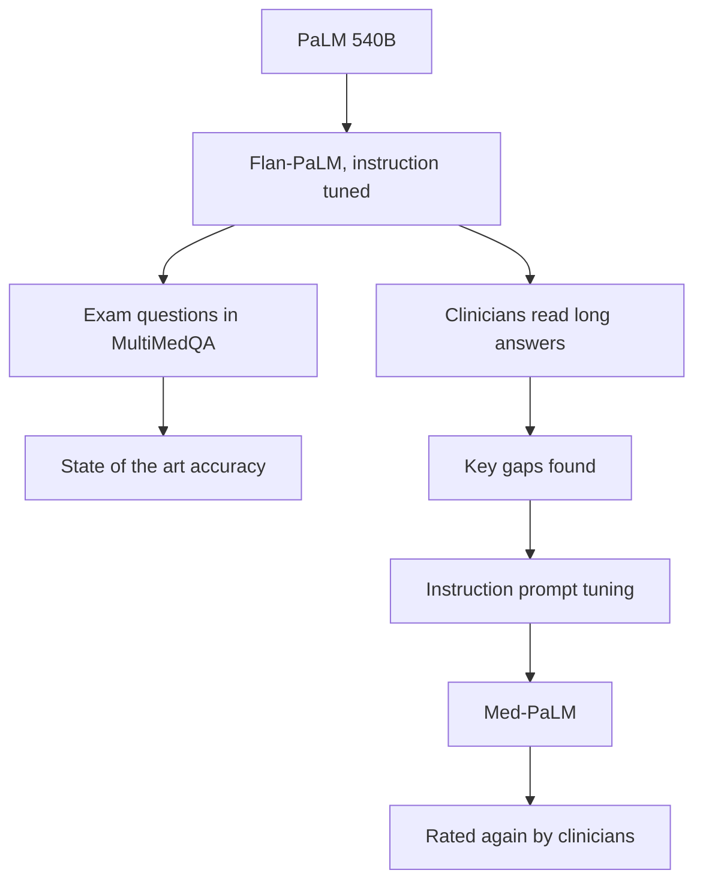

## The hook

A medical student can memorise every textbook and still freeze on the ward. The patient does not offer four options labelled A to D. They describe a rash, ask whether they should worry, and need an answer that is correct, complete and safe.

In late 2022, a Google team found that a giant language model could beat every earlier system on medical exam questions. Then they asked real doctors to read its answers to ordinary health questions, and the doctors found serious problems. This paper is the story of both results, and of the small fix in between.

## Before you start

You should know how asking a model to reason step by step improves answers, from [chain-of-thought prompting](article:paper-chain-of-thought). It helps to know how [InstructGPT](article:paper-instructgpt) turned a raw text predictor into an assistant that follows instructions. No medical knowledge is needed.

## The world before this paper

Medical language models were usually judged by automated scores on a few benchmarks: pick the right option, or match a reference answer word for word. Each team chose its own tests, and nobody had a standard way to judge whether a free-text answer was safe.

Meanwhile, general models had grown huge. Google's PaLM had 540 billion parameters, and Flan-PaLM was a version further trained to follow instructions. Could a model like that, never built for medicine, hold real clinical knowledge? And how would you even tell?

:::history
Karan Singhal, Shekoofeh Azizi, Tao Tu and colleagues at Google Research and DeepMind posted the paper in December 2022; it was published in Nature in 2023. Their abstract opens with the problem: the quality bar for medical uses is high, and current evaluations "typically rely on automated evaluations on limited benchmarks".
:::

## The big idea

:::analogy
Think of a brilliant medical student. Their written exam score tells you they know facts. Before they treat anyone, senior doctors watch them on ward rounds and judge how they talk to patients: do they agree with accepted practice, miss anything important, or say something that could hurt someone? A student who aces the exam can still fail the ward round. The fix is not to send them back to medical school; it is a short orientation from senior staff, with a few model answers, on how this hospital expects them to speak.
:::

The paper has three parts that follow the student's journey.

- **The written exam.** [[MultiMedQA]], a benchmark combining six existing medical question sets with a new one, [[HealthSearchQA]].
- **The ward round.** A [[human evaluation]] framework in which clinicians rate long answers along several axes, including factuality, precision, possible harm and bias.
- **The orientation.** [[Instruction prompt tuning]], a cheap way to adapt the frozen model using a few clinician-written examples. The result is called Med-PaLM.

## How it works

### Step 1: the written exam

MultiMedQA mixes three kinds of questions:

- **Professional exams**, such as MedQA (questions in the style of the US Medical Licensing Examination) and MedMCQA (Indian medical entrance exams).
- **Research questions**, such as PubMedQA, answered yes, no or maybe from a study's abstract.
- **Everyday questions** from the public: LiveQA, MedicationQA, and the new HealthSearchQA, built from medical questions people commonly search online.

The paper also used the clinical topics of the MMLU benchmark. The multiple-choice sets can be scored automatically. The everyday questions need free-text answers, and only people can judge those well.

### Step 2: prompting for the exam

To get the best exam scores from Flan-PaLM, the authors combined three prompting strategies: a few worked examples in the prompt, [chain-of-thought](article:paper-chain-of-thought) reasoning, and [[self-consistency]], where the model reasons several times and the answers are put to a vote.

Here is a toy vote. Seven sampled reasoning paths end in these answers:

| Path | 1 | 2 | 3 | 4 | 5 | 6 | 7 |
|---|---|---|---|---|---|---|---|
| Answer | B | A | B | B | C | B | B |

B wins with 5 of 7 votes, an agreement of about 0.71. One unlucky reasoning path no longer decides the answer. In our analogy, it is like asking the student to work through the case several times and trusting the conclusion they keep reaching.

:::try-this
Another question's seven paths give B, A, C, B, C, A, B. What does the vote return, and how much do the paths agree? Should a careful system answer this one? (B wins with only 3 of 7 votes, an agreement of about 0.43. Low agreement is a warning sign, and the paper explored using it as a signal for when a model should defer to a human instead of answering.)
:::

### Step 3: the ward round

For free-text answers, clinicians rated responses on axes such as agreement with scientific consensus, signs of incorrect reasoning or recall, missing information, the extent and likelihood of possible harm, and bias. Lay users rated whether answers were helpful and addressed the question. Clinician-written answers were rated the same way, as a reference.

### Step 4: the orientation

Retraining 540 billion parameters for medicine would be very expensive, and expert-written answers are scarce, since doctors' time is precious. So the authors used a [[soft prompt]]: a short run of learned vectors placed in front of the input. The model stays frozen; only those vectors are trained.

Instruction prompt tuning goes one step further. The learned vectors sit in front of a written instruction and a few example answers written by clinicians, then the user's question. The written part says what good answers look like; the learned part adapts the model's behaviour in ways that are hard to put into words. That is the orientation from the analogy: written guidance plus a few model answers, while the student's years of knowledge stay untouched.

### How small is the change?

PaLM 540B represents each token as a vector of 18,432 numbers. Take an illustrative soft prompt of 100 vectors:

$$100 \times 18{,}432 = 1{,}843{,}200 \text{ trainable numbers}$$

Compared with 540 billion frozen parameters, that is about 0.0000034 of the model, roughly one trainable number for every 293,000 frozen ones. The orientation is tiny next to the medical school.

:::insight
Knowing facts and communicating them safely are different skills. A frozen model can hold a lot of medical knowledge, and a very small amount of tuning, guided by experts, can change how it uses that knowledge.
:::

## What they found

The abstract reports these results.

- **State-of-the-art exam accuracy.** Flan-PaLM, with the combined prompting strategies, reached state-of-the-art accuracy on every MultiMedQA multiple-choice dataset: MedQA, MedMCQA, PubMedQA and the MMLU clinical topics.
- **67.6% on MedQA.** On the US licensing-style questions, Flan-PaLM scored 67.6%, beating the previous best by over 17%. With four options, random guessing would get about 25%.
- **Key gaps at the bedside.** Human evaluation of Flan-PaLM's long answers revealed key gaps, which is exactly why the authors did not stop at the exam.
- **Med-PaLM helped, but not enough.** After instruction prompt tuning, Med-PaLM "performs encouragingly, but remains inferior to clinicians".
- **Scale and tuning both matter.** Comprehension, recall of knowledge and medical reasoning improved with model size and with instruction prompt tuning.

:::warning
Common misconception: "a model that passes medical exams is ready to give medical advice." The paper's own evidence says otherwise. The exam score was state of the art, yet clinicians found key gaps in free-text answers, and even after tuning the model remained below clinicians. Passing the written exam is not passing the ward round.
:::

## What it got wrong (or left open)

The authors were open about the limits.

- **Human evaluation is small and subjective.** A limited panel of raters judged a limited set of answers; different raters, countries or specialties could judge differently.
- **Clinicians answering in a test setting are not clinicians at work.** The comparison answers were written without a real patient, history or follow-up.
- **Benchmarks miss real care.** Questions in English, from a few sources, cannot cover the variety of real patients, languages and settings.
- **Safety and fairness need much more work.** The paper treats its bias and harm checks as a starting point, not proof that the model is safe to deploy.

## What happened next

The same group followed up in 2023 with Med-PaLM 2, built on a newer base model, which reported large further gains on licensing-style questions and was again tested with physician ratings. The evaluation idea mattered as much as the model: later medical AI work commonly reports human ratings for harm, completeness and consensus, not just multiple-choice accuracy.

On the method side, voting over reasoning paths connects to [self-consistency](article:paper-self-consistency-improves-chain-of-thought-reasoning-in-lang), and adapting a frozen model with a few trainable parameters belongs to the same family as [LoRA](article:paper-lora). The ward-round lesson stayed: you judge a medical model by how it answers people, not only by how it picks options.

## Key takeaways

- The paper built MultiMedQA, combining six existing medical question sets with the new HealthSearchQA, and a human evaluation framework for free-text answers.
- Flan-PaLM reached state-of-the-art accuracy on every MultiMedQA multiple-choice dataset, including 67.6% on MedQA.
- Clinicians reading Flan-PaLM's long answers still found key gaps, showing that exam scores do not measure safe communication.
- Instruction prompt tuning trains only a small soft prompt in front of written instructions and clinician examples, leaving the huge model frozen.
- The resulting Med-PaLM performed encouragingly but remained inferior to clinicians, so the paper argues for better evaluation as much as better models.
