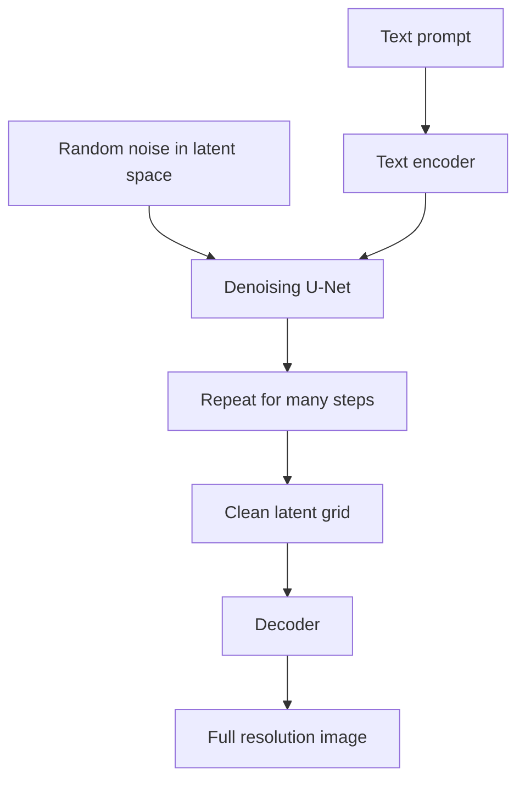

## The hook

In August 2022, something unusual happened in AI. A model that could turn a sentence like "an astronaut riding a horse, oil painting" into a detailed picture was released with its weights free for anyone to download. It ran on an ordinary gaming graphics card. Within weeks, millions of people were generating images on their own computers, artists were furious and fascinated in equal measure, and a wave of apps and startups was born.

The model was Stable Diffusion. The research behind it came from a university group in Munich, and its central trick was beautifully economical: do not paint with pixels. Paint in a compressed sketch of the image, and only render the pixels at the very end.

## Before you start

You need the diffusion process from [Creating Images by Removing Noise](article:paper-ddpm), and the encoder-decoder idea from [How to Squeeze a Picture Into Thirty Numbers](article:paper-deep-autoencoders). The denoiser is a [U-Net](article:paper-unet), and prompts are injected with attention, as in [Attention Is All You Need](article:paper-attention-is-all-you-need).

## The world before this paper

Diffusion models had just shown they could match or beat GANs on image quality. But they were brutally expensive. A denoising U-Net had to process every pixel of the image at every one of hundreds of steps. For a 512 by 512 colour image, that is about 786,000 numbers, run through a big network hundreds of times, for a single picture. Training the best models took hundreds of GPU-days, and sampling was slow too.

:::history
Robin Rombach, Andreas Blattmann, Dominik Lorenz, Patrick Esser and Björn Ommer worked in Ommer's computer vision group, which moved from Heidelberg University to LMU Munich. Esser and Rombach had already built "taming transformers" (2021), which compressed images into a learned code before generating. The new paper combined that compression idea with diffusion, and noticed something about where the cost of generation was being spent.
:::

Their observation: most of the bits in an image are imperceptible detail. Much of a pixel-based model's effort goes into getting high-frequency texture exactly right, while the semantic content, what is in the picture and how it is arranged, lives in a much smaller amount of information.

## The big idea

Split image generation into two stages:

1. **[[Perceptual compression]].** Train an [[autoencoder]] once to squeeze images into a much smaller [[latent space]] and rebuild them with little visible loss.
2. **Diffusion in the latent space.** Train a diffusion model to generate these small latent grids instead of pixels. Then decode the result into a full image.

:::analogy
Think of an architect versus a builder. An architect works on blueprints: small, light, quick to revise, but containing everything essential about the building. Only when the design is final does the builder turn it into bricks and paint. Pixel-based diffusion was like redesigning a house by moving real bricks around at every step. Latent diffusion does all the creative iteration on the blueprint, and only builds once at the end.
:::

:::insight
Separate "what the image means" from "how every pixel looks." Spend the expensive, iterative generation on meaning in a small space, and let a cheap decoder handle the pixels.
:::

## How it works

### Stage 1: the compressor

The autoencoder's encoder shrinks an image by a downsampling factor $f$ in width and height. With $f = 8$, a 512 by 512 colour image becomes a 64 by 64 grid with a few channels, the setup later used by Stable Diffusion with 4 channels. The decoder rebuilds the full image from that grid.

To keep reconstructions sharp instead of blurry, the autoencoder was trained with a perceptual loss (comparing images the way a vision network sees them) and an adversarial loss (a small discriminator, borrowed from [GANs](article:paper-gan), that penalises unrealistic texture). A light regularization kept the latent space well-behaved, in one variant a small KL penalty like a [VAE](article:paper-vae)'s.

### Stage 2: diffusion on the blueprint

The diffusion model is the same idea as DDPM: add noise to latents, train a U-Net to predict the noise, and at generation time denoise from pure static. It just works on the 64 by 64 grid instead of the 512 by 512 image.

### Steering with words

To make the model follow prompts, the authors added [[cross-attention]] layers inside the U-Net. The prompt is turned into a sequence of vectors by a text encoder. At several resolutions in the U-Net, each location in the image grid produces a query, the prompt's vectors provide keys and values, and each region pulls in the words most relevant to it. This general [[conditioning]] mechanism worked for text, class labels, layouts and more.

### A worked example: how much cheaper?

Count the numbers each model must process per step:

- Pixel space at 512 by 512 with 3 colour channels: $512 \times 512 \times 3 = 786{,}432$.
- Latent space at 64 by 64 with 4 channels: $64 \times 64 \times 4 = 16{,}384$.

That is 48 times fewer numbers. Network cost does not scale perfectly with input size, but the savings in memory and compute are dramatic, which is exactly why the model fits on a consumer GPU.

:::try-this
Suppose you used a gentler compression factor of $f = 4$ instead of 8, keeping 4 channels. How big is the latent grid for a 512 by 512 image, and how many times smaller than the pixel image is it? (The grid is 128 by 128 by 4, which is 65,536 numbers: 12 times smaller. Less compression means better detail but more cost, which is the trade-off the paper explored.)
:::

### Following the prompt more closely

For text-to-image, the authors used [[classifier-free guidance]]: at each step, the model predicts the noise twice, once with the prompt and once without, and pushes the result further in the direction the prompt suggests. Turning up the guidance makes images match the text more closely, at some cost to variety.

## What they found

- **The sweet spot of compression.** Too little compression (small $f$) left training slow; too much (large $f$) lost detail. Moderate factors such as 4 to 8 gave the best balance of quality and speed.
- **Strong results across tasks.** Latent diffusion models achieved competitive or state-of-the-art results on unconditional face generation, class-conditional ImageNet generation, image inpainting, super-resolution and layout-to-image synthesis, with far lower compute than pixel-based diffusion.
- **Text-to-image.** A model of about 1.45 billion parameters, trained on image-caption pairs from the large public LAION dataset, produced convincing images from free-form prompts.
- **Large images.** Because the model is convolutional, it could generate images larger than its training size, such as wide landscapes, by working on larger latent grids.

:::warning
Common misconception: "Stable Diffusion stores compressed copies of its training images and stitches them together." The model's weights are a few gigabytes, while its training data was billions of images; it learned general patterns, not a library. That said, research has shown that heavily duplicated training images can sometimes be reproduced closely, which is part of the legal debate around these models.
:::

## What it got wrong (or left open)

The decoder sets a ceiling on quality. Fine details such as small text, faces in a crowd or intricate hands depended on what the compressed latent could encode, and early models were notorious for garbled text and extra fingers.

Sampling still took dozens of steps, not one. And the paper's text-to-image model was trained on web-scraped data, which inherits the biases and the copyright questions of the internet. Lawsuits from artists and image libraries followed after Stable Diffusion's release.

## What happened next

- In August 2022, Stability AI, with the CompVis group and Runway, released **Stable Diffusion**, a latent diffusion model using a [CLIP](article:paper-clip) text encoder, with open weights. It became the most widely used image generation model in the world.
- A huge open ecosystem grew around it: fine-tuning on personal photos, ControlNet for steering with sketches and poses, and community models for every art style.
- Later versions grew larger and replaced the U-Net with Transformers, while keeping the core idea of diffusing in a learned latent space.
- The same recipe, compress first and generate in latent space, was adopted for video and audio generation.

## Key takeaways

- Latent diffusion first trains an autoencoder to compress images into a small latent grid, then runs diffusion in that grid instead of on pixels.
- Separating perceptual compression from generation cut compute dramatically while keeping image quality high.
- Cross-attention layers inside the denoising U-Net let text, labels or layouts steer the image.
- Moderate compression factors gave the best trade-off, and one compressor could serve many tasks.
- The approach became Stable Diffusion, the open model that brought text-to-image generation to consumer hardware.
