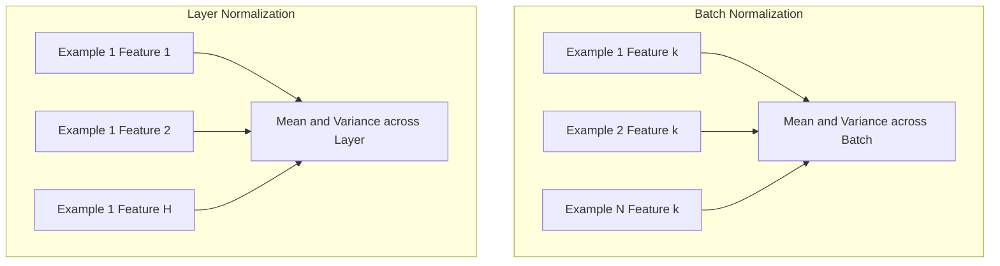
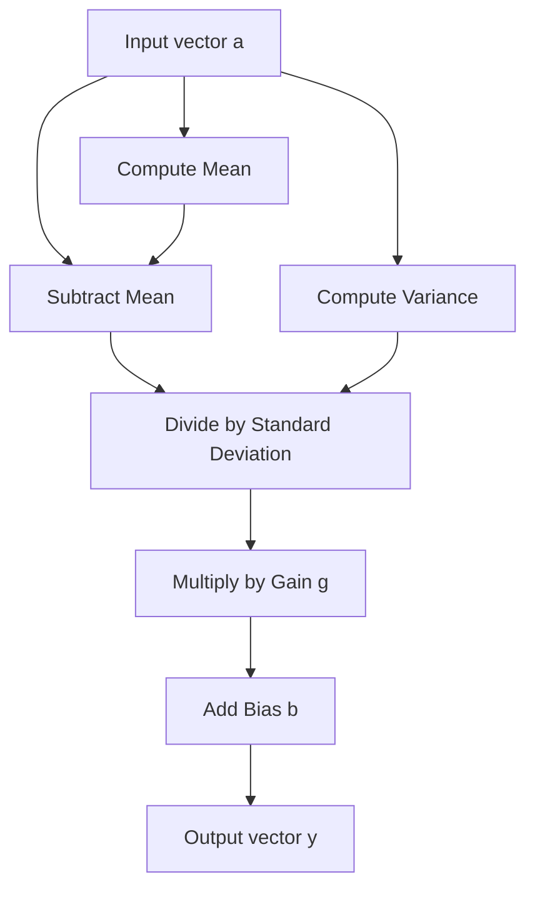

## The hook

In 2015, [[Batch Normalization]] looked like magic. It kept activations stable, allowed aggressive learning rates, and made deep vision networks train in a fraction of the time. But the moment researchers tried running it on text, audio, or recurrent networks, the machinery jammed.

If your sentences were different lengths, later words had almost no companions in the batch to compute averages over. If you processed one example at a time on an embedded chip, the entire technique broke down. Why did one example need twenty random neighbors just to figure out its own scale?

In 2016, Jimmy Lei Ba, Jamie Ryan Kiros, and Geoffrey Hinton asked a simple question: what if a network stops pooling numbers across other people's homework, and instead grades each student against their own performance?

## Before you start

Before reading this, you should understand how standard normalization works in deep networks from [Batch Normalization](article:paper-batch-normalization). It also helps to be familiar with recurrent models from [LSTMs](article:paper-lstm) and standard training pipelines from [Gradient Descent](article:primer-gradient-descent).

## The world before this paper

To train a deep network, you feed numbers through layer after layer. In each layer, the inputs get multiplied by a weight matrix, summed up, and pushed through a non-linearity.

The catch is that every time layer 1 updates its weights, the numbers entering layer 2 shift. Layer 2 must now adapt to a moving target. In deep networks, this internal [[Covariate Shift]] compounds across layers, forcing engineers to use tiny learning rates and delicate weight initializations.

:::analogy
Imagine a school that grades tests on a curve. 

In **Batch Normalization**, a student's physics grade is evaluated against every other student's physics grade across the class that morning. If your classmates all bomb, your score looks high; if you take the test alone in an empty room, the grading scheme collapses.

In **Layer Normalization**, the teacher looks only at *your* report card. They calculate your personal average across math, history, physics, and literature, and evaluate how far each subject falls above or below your own baseline.
:::



Batch Normalization solved internal covariate shift for vision models by standardizing each feature across the mini-batch. But in sequence modeling, it created three huge headaches:

1. **Variable-length inputs.** If one sentence has four words and another has forty, how do you compute batch statistics at step 35? You might only have two examples left in the entire batch, yielding noisy, unreliable statistics.
2. **Online serving.** When deploying a model to production for single-query inference—or in [[Online Learning]] with a batch size of 1—variance across a batch of one is zero. You cannot normalize by zero.
3. **Training-inference discrepancy.** Batch Normalization requires accumulating running averages of means and variances during training to use at test time. If your test data drifts or sequence lengths vary, those running averages no longer fit.

:::history
In early 2016, researchers tried patched versions of batch normalization for recurrent networks. Some kept separate running averages for every time-step up to step 100. But if a customer gave the network a sentence of 101 words, the model had no statistics for that final step and failed.
:::

## The big idea

Ba, Kiros, and Hinton proposed transposing the calculation. Instead of normalizing each feature across all examples in the mini-batch, **[[Layer Normalization]] standardizes all features within a single example**.

:::insight
By calculating the mean and variance across the hidden units of one example at one time-step, normalization becomes completely independent of batch size and behaves identically during training and inference.
:::

Return to our report card analogy. If you grade each student against their own average across subjects, you do not care how many students showed up to class. If there is only one student in the room, their grading curve works just as well as if there were five hundred. 

For recurrent networks, each time-step is simply another test day for that individual student. You evaluate their performance on that day across their internal subjects without needing to remember what other students scored at hour 7.

## How it works

### The formulation

Let $H$ be the number of hidden units in a layer. Let $a$ be the vector of summed inputs (the pre-activations, right after $W x$ but before the non-linearity) for a single example:

$$\mu = \frac{1}{H} \sum_{i=1}^H a_i$$

$$\sigma = \sqrt{\frac{1}{H} \sum_{i=1}^H (a_i - \mu)^2 + \epsilon}$$

Here is what each symbol means:
- $H$ is the total number of features (hidden dimension) in this layer.
- $a_i$ is the pre-activation value of the $i$-th hidden neuron.
- $\mu$ is the average activation across all neurons for this single input.
- $\sigma$ is the standard deviation across all neurons for this single input.
- $\epsilon$ is a tiny positive constant (like $10^{-5}$) added to prevent division by zero.

Once we have $\mu$ and $\sigma$, we normalize each feature and apply two learnable parameters: [[Gain and Bias]]:

$$y_i = g_i \cdot \left(\frac{a_i - \mu}{\sigma}\right) + b_i$$

- $g_i$ is a learned gain (scale) parameter for neuron $i$, initialized to 1.
- $b_i$ is a learned bias (shift) parameter for neuron $i$, initialized to 0.
- $y_i$ is the normalized, scaled output sent into the activation function.



### Why do we need gain and bias?

Wait, why standardize numbers to zero-mean and unit-variance just to immediately scale and shift them with $g$ and $b$?

In our report card analogy, raw standardization flattens every subject. But getting an 80 in quantum mechanics might be much harder and carry more information than getting an 80 in an introductory seminar. 

The learnable parameters $g$ and $b$ allow the network to restore distinct scales to different features if the task demands it. Crucially, $g$ and $b$ are learned slowly by gradient descent across the entire dataset, separating the scale of individual features from the volatile fluctuations of incoming activations.

### A worked example with real numbers

Let us trace a single training example through a hidden layer of size $H = 4$. 

Suppose our incoming pre-activations are:
$$a = [2.0, 4.0, 6.0, 8.0]$$

We set initial gain $g = [1.0, 1.0, 1.0, 1.0]$, bias $b = [0.0, 0.0, 0.0, 0.0]$, and $\epsilon = 0$.

**Step 1: Compute the mean $\mu$ across features.**
$$\mu = \frac{2.0 + 4.0 + 6.0 + 8.0}{4} = \frac{20.0}{4} = 5.0$$

**Step 2: Compute the variance $\sigma^2$.**
$$\sigma^2 = \frac{(2-5)^2 + (4-5)^2 + (6-5)^2 + (8-5)^2}{4}$$
$$\sigma^2 = \frac{(-3)^2 + (-1)^2 + (1)^2 + (3)^2}{4} = \frac{9 + 1 + 1 + 9}{4} = \frac{20}{4} = 5.0$$

**Step 3: Compute the standard deviation $\sigma$.**
$$\sigma = \sqrt{5.0} \approx 2.236$$

**Step 4: Standardize each element.**
$$\hat{a}_1 = \frac{2.0 - 5.0}{2.236} = \frac{-3.0}{2.236} \approx -1.342$$
$$\hat{a}_2 = \frac{4.0 - 5.0}{2.236} = \frac{-1.0}{2.236} \approx -0.447$$
$$\hat{a}_3 = \frac{6.0 - 5.0}{2.236} = \frac{1.0}{2.236} \approx +0.447$$
$$\hat{a}_4 = \frac{8.0 - 5.0}{2.236} = \frac{3.0}{2.236} \approx +1.342$$

**Step 5: Apply gain and bias.**
Since $g_i = 1.0$ and $b_i = 0.0$ for all units:
$$y = 1.0 \cdot \hat{a} + 0.0 = [-1.342, -0.447, +0.447, +1.342]$$

Notice the symmetry: the mean is exactly 0.0 and the variance is 1.0.

:::try-this
Change the inputs to $a = [10.0, 20.0, 30.0]$ with $H = 3$. Before doing any math, predict what the normalized value of the middle element will be. Then compute the full vector with $g=1$ and $b=0$. (Because 20 equals the mean, the middle difference is zero, so the normalized value is exactly 0.0. Mean is 20.0, $\sigma^2 = \frac{100 + 0 + 100}{3} \approx 66.67$, $\sigma \approx 8.165$, giving $[-1.225, 0.0, +1.225]$.)
:::

### The magic of scaling invariance

Before reading the next sentence, pause and make a prediction: what happens if you multiply all the weights in $W$ by a constant factor of 10? Does the layer's output jump tenfold, or does something else happen?

Guess the outcome before reading on.

If you guessed that the output explodes by a factor of 10, intuition misled you: the normalized output does not change at all. Every pre-activation scales by 10, so the mean scales by 10, and the standard deviation scales by 10. When you compute $(10a_i - 10\mu)/(10\sigma)$, the factor of 10 cancels out completely.

Ba, Kiros, and Hinton proved two helpful invariance properties:
1. **Scaling the input vector:** If an input $x$ is scaled by $\alpha$, both $\mu$ and $\sigma$ scale by $\alpha$, canceling out.
2. **Scaling the weight matrix:** If all weights in $W$ are scaled by $\alpha$, the activations scale by $\alpha$, and the ratio cancels it out.

If the norm of a weight vector grows large during training, the effective gradient update on its direction becomes smaller. The normalization scalar $\sigma$ acts like an automatic gear shift: when weights get too big, it reins in their effective learning rate, preventing parameters from spiraling out of control.

## What they found

The authors put Layer Normalization to the test across a broad set of challenging sequential and recurrent tasks.

### Faster recurrent convergence
On sentence embedding with Skip-Thoughts, an attentive question-answering reader, and image-caption ranking using Gated Recurrent Units (GRUs), Layer Normalization consistently sped up training. 

In the image retrieval task on MSCOCO, the layer-normalized model reached its best validation score in **60% of the time** required by the baseline model, while achieving a higher final Recall@1 (38.9 vs 37.8).

```
Model Comparison: Image Retrieval on MSCOCO (Recall@1)
Baseline Order-Embedding: [37.8%]
Order-Embedding + LN:     [38.9%] (Converged in 60% of baseline training time)
```

### Stability over long sequences
The team tested long-horizon sequence generation using the IAM Online Handwriting Database, where sequences average 700 steps. 

With small mini-batches of size 8, Batch Normalization struggled with high-variance statistics. Layer Normalization stabilized the recurrent dynamics, allowing the network to converge much faster without exploding gradients.

### Robustness across batch sizes
On permutation-invariant MNIST using a fully-connected network, the authors varied the batch size from 128 down to 4. 

Batch Normalization performed well at batch size 128, but its training curve degraded severely at batch size 4 due to noisy estimation of the mini-batch statistics. Layer Normalization traced nearly the exact same smooth learning curve whether the batch size was 128 or 4.

:::warning
Common misconception: Layer Normalization was **not** invented for Transformers. Vaswani and colleagues adopted it in 2017's [Attention Is All You Need](article:paper-attention-is-all-you-need), but Ba, Kiros, and Hinton created it in 2016 specifically to solve the headaches of Recurrent Neural Networks (RNNs, LSTMs, and GRUs).
:::

## What it got wrong (or left open)

Layer Normalization was not a universal drop-in replacement for Batch Normalization. The paper documented an important place where it stumbled.

### Why it failed on convolutional vision models
In vision models, convolutional layers slide small filters across an image grid. When the authors tested Layer Normalization on standard ConvNets, Batch Normalization beat it handily.

Why? Consider the visual features in an image. Neurons near the borders often sit in empty padding or background space; their activations are consistently near zero. Neurons in the center fire strongly on visual edges and textures. 

If you average across all features in a convolutional layer, you pool border pixels together with center pixels. Layer Normalization assumes that all hidden units in a layer make roughly similar contributions and share statistics. In ConvNets, spatial location breaks that assumption.

### Position inside residual blocks
The paper demonstrated Layer Normalization inside recurrent steps and standard MLP layers. It did not explore where normalization should live inside deep residual networks. 

Later practitioners discovered that whether you place Layer Normalization *before* the residual addition (Pre-LN) or *after* it (Post-LN) dramatically affects gradient flow in 100-layer models.

### Interview follow-ups

Here are questions engineers and interviewers often ask about Layer Normalization:

- **Why does LayerNorm require no running statistics at test time, unlike BatchNorm?**  
  *Answer:* BatchNorm computes statistics across batch samples. At test time, a user might submit a single sample ($N=1$), where batch variance cannot be calculated, forcing BatchNorm to use running statistics saved from training. LayerNorm only averages across the feature dimension of the current sample. All required numbers are present right inside that single test vector.

- **What happens if a layer has a hidden dimension of $H=1$?**  
  *Answer:* If $H=1$, the single value $a_1$ is equal to the mean $\mu = a_1$. The numerator $(a_1 - \mu)$ becomes zero, so the normalized output is identically 0 (plus the bias $b$). Layer Normalization requires a sufficiently wide feature dimension $H$ (typically 128 to 4096 in modern networks) to calculate meaningful sample statistics.

- **Why can't Layer Normalization replace Batch Normalization in ResNet-50 for ImageNet?**  
  *Answer:* In CNNs, different spatial locations have completely different activation distributions (for example, edges vs. background). Normalizing across all channels and spatial positions destroys the relative spatial signals that convolutions rely on.

## What happened next

When Ashish Vaswani and the Google team designed their sequence architecture in 2017, they needed a normalization technique that could handle variable-length sentences without tracking batch statistics across time-steps. 

Layer Normalization fit like a glove. Every token vector could be normalized across its embedding dimension ($d_{\text{model}}$), completely isolated from every other token in the prompt.

Almost every landmark foundation model built since relies on Layer Normalization or its direct descendants:
- [BERT](article:paper-bert) and [GPT-1](article:paper-gpt-1) embedded Layer Normalization into every sub-layer block.
- As models grew into hundreds of billions of parameters, researchers realized that computing the mean shift $\mu$ was largely unnecessary. In 2019, Biao Zhang and Rico Sennrich proposed **RMSNorm** (Root Mean Square Normalization), which skips subtracting the mean and only scales by the root mean square of activations. Modern models like [Llama](article:paper-llama) use RMSNorm for a 10% to 50% speedup on GPU hardware.
- Vision researchers eventually adapted feature-wise normalization to computer vision through **Group Normalization**, dividing channels into groups to avoid the pitfalls of whole-layer pooling on images.

Once deep models had a way to normalize sequence representations token by token, the stage was set for a radical architecture that tossed recurrence out the window entirely. Discover how eight researchers used self-attention and layer normalization to change AI forever in [The Paper That Taught Machines Where to Look](article:paper-attention-is-all-you-need).

## Key takeaways

- Layer Normalization standardizes activations across the hidden features of a single example, rather than across the examples in a mini-batch.
- Because it operates strictly within one example, it behaves identically during training and testing, requiring no stored running averages.
- It solved the core issues of Batch Normalization in sequence models: variable sequence lengths, small batch sizes, and single-example online inference.
- Learnable gain and bias parameters restore expressive capacity, letting the network scale or shift specific features if the task requires it.
- While inferior to Batch Normalization in standard convolutional vision networks, Layer Normalization became the universal standard for Transformers and modern LLMs.
