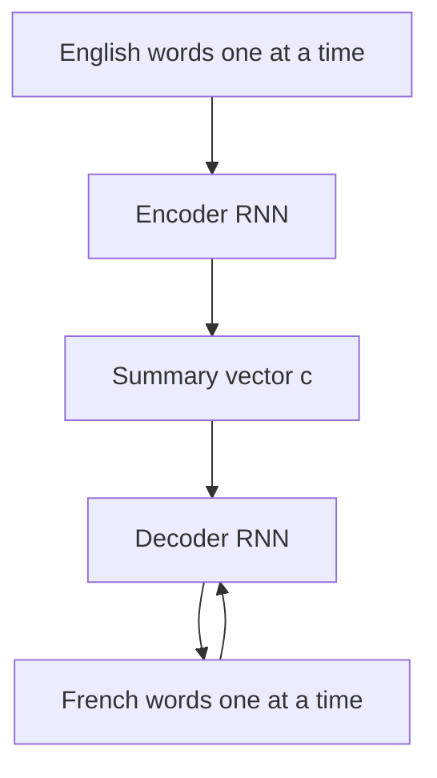

## The hook

A phrase like "a cup of tea" becomes "une tasse de thé" in French. The words line up nicely. But "I miss you" becomes "tu me manques", where the subject and object swap places. No word-for-word lookup gets that right.

In 2014, translation systems handled this with huge tables of memorised phrase pairs and a pile of hand-tuned scores. A group in Montreal asked a different question: could one neural network read a phrase, boil it down to a single list of numbers, and let a second network write the translation from that list alone?

## Before you start

You should know how [recurrent networks keep a memory across steps](article:paper-lstm), including why plain recurrent networks forget, and how [words become vectors](article:paper-word2vec). Matrix-vector products and the sigmoid function are enough maths.

## The world before this paper

Machine translation in 2014 meant [[Phrase-based SMT]]. A system cut the English sentence into short phrases, looked each one up in a phrase table built by counting how often phrases lined up in translated documents, and tried many combinations. A [[log-linear model]] ranked the candidates: a weighted sum of features such as "how often did this phrase pair appear" and "how fluent does the French look".

That worked, but the phrase table was noisy. Rare phrases had unreliable counts, and frequent junk pairs scored well just because they were frequent. Neural networks had started to help, mostly as language models that judged French fluency. Feedforward networks needed a fixed number of input words, though, and plain recurrent networks struggled to remember the start of a phrase by its end.

:::history
Kyunghyun Cho, Bart van Merriënboer, Caglar Gulcehre, Dzmitry Bahdanau, Fethi Bougares, Holger Schwenk and Yoshua Bengio posted the paper in June 2014, and it appeared at EMNLP that year. Schwenk's group had built the continuous-space language models that phrase-based systems already used. The team wanted a network that took the source phrase into account, not just the French side.
:::

## The big idea

:::analogy
Picture a conference interpreter who cannot see the slides. She listens to the whole English phrase, then writes one short note on an index card. The card has fixed space, whatever the length of the phrase. Then she puts the speaker out of her mind and speaks French, using only the card and what she has already said.
:::

That is the [[encoder-decoder]]. The encoder is the listening interpreter: a recurrent network that reads the phrase one word at a time and updates its hidden state. Its final hidden state is the index card, a [[summary vector]] called $c$. The decoder is the speaking interpreter: a second recurrent network that generates the French words one by one, looking at $c$ at every step.

The paper made a second contribution that ended up even more widely used. To make the interpreter good at deciding what to keep on the card, the authors designed a new recurrent unit with two gates. It was later named the gated recurrent unit, or GRU.

## How it works

### The encoder writes the card

The encoder reads words $x_1, \dots, x_T$. At each step it combines the previous hidden state with the current word:

$$h_t = f(h_{t-1}, x_t)$$

Here $h_t$ is the hidden state after reading word $t$, a vector of numbers, and $f$ is the recurrent unit. After the last word, the card is simply $c = h_T$.

### The decoder speaks from the card

The decoder has its own hidden state, which depends on its previous state, the word it just produced and the card:

$$s_t = f(s_{t-1}, y_{t-1}, c)$$

Then it turns $s_t$, $y_{t-1}$ and $c$ into a probability for every French word in the vocabulary, using a softmax. Training pushes up the probability of the correct French phrase given the English one, over many phrase pairs. Because $c$ feeds every decoder step, the interpreter keeps glancing at the card the whole time she speaks.

### The gated unit: an eraser and a pencil

A plain recurrent unit rewrites its whole state at every step: $h_t = \tanh(W x_t + U h_{t-1})$. On the index card, that is like rewriting the entire note after every word. After a few filler words, the important word from the start has faded.

The new unit gives the interpreter two controls. The [[reset gate]] $r$ decides how much of the old note to look at while drafting a new one. The [[update gate]] $z$ decides whether to keep the old note or swap in the draft:

$$r = \sigma(W_r x_t + U_r h_{t-1}) \qquad z = \sigma(W_z x_t + U_z h_{t-1})$$

$$\tilde{h} = \tanh\big(W x_t + U (r \odot h_{t-1})\big)$$

$$h_t = z \odot h_{t-1} + (1 - z) \odot \tilde{h}$$

In plain words: $\sigma$ squashes any number into the range 0 to 1, so both gates act like dials. $W$ and $U$ matrices are learned weights for the current word and the old state. $\odot$ multiplies two vectors entry by entry.

$\tilde{h}$ is the draft note. The last line blends old note and draft: $z$ near 1 keeps the old note, $z$ near 0 takes the draft. Each hidden unit has its own gates, so some units learn to hold long-term facts while others react to the latest word.

:::insight
The update gate lets a unit copy its state forward almost unchanged. That copying path is what lets information, and the training signal, survive many steps.
:::

### A worked example

Take a single hidden unit with $W = 1.5$ and $U = 1$. Inputs are one number per word: 1.0 for an important word, 0.0 for two filler words, then −1.0 for a new important word. Suppose the learned gates come out as in the table. The draft and new state follow from the formulas above, starting at $h_0 = 0$.

| Step | Input $x$ | $z$ | $r$ | $r \cdot h_{t-1}$ | Draft $\tilde{h}$ | New $h_t$ |
|---|---|---|---|---|---|---|
| 1 | 1.0 | 0.1 | 0.5 | 0.000 | 0.905 | 0.815 |
| 2 | 0.0 | 0.9 | 0.9 | 0.733 | 0.625 | 0.796 |
| 3 | 0.0 | 0.9 | 0.9 | 0.716 | 0.614 | 0.778 |
| 4 | −1.0 | 0.2 | 0.0 | 0.000 | −0.905 | −0.569 |

At step 1 the update gate is low, so the card takes the draft. During the filler words the update gate is high, so the note barely changes: 0.815, then 0.796, then 0.778. At step 4 the reset gate is 0, so the draft ignores the old note entirely, and the low update gate lets the new word take over.

Compare a plain recurrent unit with the same $W$ and $U$: it goes 0.905, 0.719, 0.616, −0.708. It loses about a third of the first word's signal in two filler steps, because it has no way to say "keep this".

:::try-this
In the table, suppose the update gate were exactly 1.0 at steps 2 and 3 instead of 0.9. What is $h_3$? (It stays 0.815. With $z = 1$, the new state is just the old state, so the note is copied forward untouched.)
:::

### Plugging the network into a real translator

Generating full translations with a network was slow in 2014, so the authors used the encoder-decoder in a cheaper way. They trained it on the phrase pairs from the phrase table, then asked it to score every pair: how likely is this French phrase given this English one? That score became one more feature in the log-linear model.

Here is an illustrative example of why one more feature can matter. Suppose two candidate translations have these log scores, with weights 1, 1 and 0.3:

| Candidate | Phrase-table score | Fluency score | Network score | Total without network | Total with network |
|---|---|---|---|---|---|
| A, frequent but sloppy | −0.5 | −4.0 | −6.0 | −4.5 | −6.3 |
| B, clean and faithful | −1.2 | −3.6 | −2.5 | −4.8 | −5.55 |

Without the network, A wins on its high count. With it, B wins, because the network thinks B is a much better translation of the source.

One training detail is clever. The authors ignored how often each phrase pair appeared and treated every unique pair equally. The phrase table already had count-based scores, and they wanted the network to learn which translations make sense, not which ones are common.

:::warning
Common misconception: "This paper built the first end-to-end neural translator." It did not. In the main experiment the network only rescored phrase pairs inside a traditional phrase-based system. Full sentence-to-sentence neural translation came in later papers.
:::

## What they found

The test was English to French translation from the WMT 2014 shared task, measured with [[BLEU]]. Adding the encoder-decoder's phrase scores to the baseline phrase-based system improved BLEU. The gain also added on top of a neural language model, which suggests the two neural pieces captured different things: the language model judged French fluency, while the encoder-decoder judged whether a French phrase matched the English one.

Qualitatively, the paper reports two findings:

- **Cleaner phrase choices.** For a given English phrase, the network's top-ranked French phrases tended to be sensible translations, while the count-based table's favourites were often noisy.
- **Meaningful cards.** When the summary vectors of many phrases were projected into two dimensions, phrases with similar meaning or similar grammatical structure landed near each other. The interpreter's index cards had organised themselves by meaning, without being told to.

The models were modest by later standards: 1000 hidden units, and a vocabulary limited to the 15,000 most common words in each language.

## What it got wrong (or left open)

- **The card has fixed space.** Every input, three words or thirty, had to fit into one fixed-size vector. That suits short phrases. For long sentences the interpreter's index card fills up and early details blur.
- **No full translation yet.** The network rescored a table built the old way. It could not translate a phrase the table had never seen, at least not in the reported system. The authors pointed to replacing parts of the phrase table as future work.
- **Small vocabulary.** Rare words all collapsed into one "unknown" token, which hurts any real translator.
- **Gates were proposed, not dissected.** The paper showed the unit worked here, but a careful comparison with the LSTM came in later studies.

## What happened next

Within months, the index-card idea went end to end. [Read the Whole Sentence, Then Write the Translation](article:paper-seq2seq) by Sutskever and colleagues used deep LSTMs to translate whole sentences directly, with no phrase table.

The fixed-size card was fixed next. Bahdanau, a co-author here, worked with Cho and Bengio on [The First Time a Network Learned Where to Look](article:paper-bahdanau-attention), which lets the decoder look back at every encoder hidden state instead of only the last one. In the analogy, the interpreter keeps her full notes instead of a single card. Attention later became the core of [the Transformer](article:paper-attention-is-all-you-need).

The gated unit got its name, GRU, in follow-up work from the same lab, and it became a standard alternative to the LSTM: fewer gates, no separate memory cell, often similar accuracy.

## Key takeaways

- An encoder-decoder uses one recurrent network to read an input into a fixed-size summary vector and a second to generate the output from that vector.
- The paper's gated unit, later called the GRU, uses a reset gate to choose how much of the old state shapes the new draft and an update gate to choose between keeping the old state and taking the draft.
- An update gate near 1 copies the hidden state forward almost unchanged, which helps information survive across many steps.
- In this paper the network scored phrase pairs as an extra feature in a phrase-based translator, rather than translating end to end.
- Forcing a whole sentence through one fixed-size vector became the bottleneck that attention was invented to remove.
