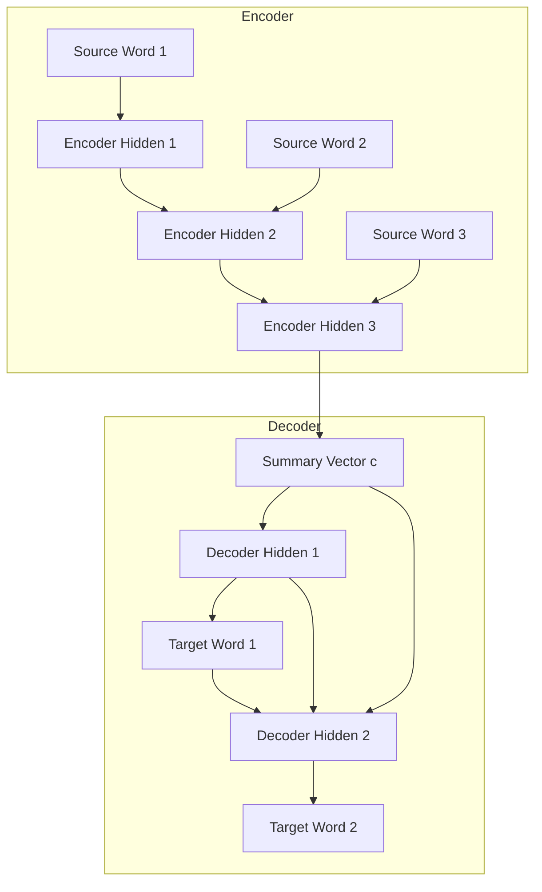
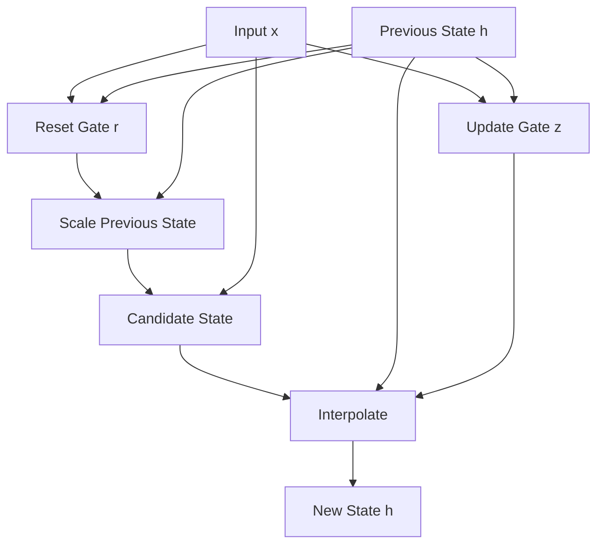

## The hook

Translating a sentence from English to French is not a word-by-word swap. Word orders swap, single words blossom into three, and entire idioms collapse into single phrases. How can a machine take five words, understand their meaning, and emit seven completely different words in another language? 

In 2014, Kyunghyun Cho and his colleagues proposed a radically simple answer: use two neural networks working as a team. One squashes the input sentence into a compact summary vector, and the second unfolds that vector into a fluent translation.

## Before you start

Before jumping in, make sure you are comfortable with:
- How words become vectors, covered in [Word2Vec](article:paper-word2vec).
- How recurrent networks update hidden states across time, covered in [LSTM](article:paper-lstm).

## The world before this paper

In 2014, machine translation was dominated by [[Phrase-based SMT]]. These statistical systems were marvels of engineering, but they were held together by duct tape and enormous lookup tables. 

A standard SMT system chopped sentences into small chunks of words, matched them against a giant dictionary of pre-calculated phrase pairs, and glued the pieces together using heuristic scoring equations. If a phrase appeared often in the training data, the system knew how to score it. If a phrase was rare or novel, the system had no idea what to do.

Researchers tried bringing neural networks into the mix, but traditional neural architectures were rigid. Standard feedforward networks required a fixed input size, like a strict window of seven words zero-padded at the edges. Other systems treated phrases as unordered bags of words, completely blind to grammar. Standard recurrent networks could process variable-length text, but standard recurrent units struggled to hold onto information across multiple steps without exploding or vanishing gradients.

Translation needed an architecture that could accept any number of incoming words, preserve their order, and emit a brand new sequence of arbitrary length.

:::analogy
Think of the system as an expert bilingual conference interpreter. 

The interpreter listens quietly while a speaker finishes an entire sentence in English. Instead of translating each word out loud as it arrives, the interpreter lets the words settle into a single clear thought scribbled on an index card. Looking at that compact conceptual note, the interpreter begins speaking fluent French, unfolding the thought word by word until the thought is complete.
:::

## The big idea

The authors introduced the [[RNN Encoder-Decoder]]. 

The model splits sequence processing into two distinct phases. The first network, called the encoder, processes a sequence of words one step at a time. When it reaches the end of the input, its final hidden state holds a single fixed-size numerical vector that acts as a summary of the entire sequence.

The second network, called the decoder, takes that summary vector and runs in reverse. At each step, it predicts the next output word based on the summary vector, the word it just generated, and its own hidden memory.

To make this architecture train reliably, the paper introduced a streamlined recurrent cell: the Gated Recurrent Unit, or GRU. Unlike the complex LSTM, which required three separate gates and a distinct memory cell, this new unit handled long-term memory with just two gates: an [[Update Gate]] and a [[Reset Gate]].

:::history
In early 2014, Yoshua Bengio's lab at the Université de Montréal was searching for a cleaner way to handle sequence memory. LSTMs worked well, but their internal mechanics felt overly baroque to many researchers. Kyunghyun Cho and the team stripped away the separate cell state, merged the input and forget concepts into a unified update gate, and designed a unit that was computationally lighter yet equally capable of catching long-range patterns.
:::

## How it works

Let's break down the pipeline into the encoder, the gating mechanics, and the decoder.

### 1. The Encoder

The encoder reads an input sequence $(x_1, x_2, \dots, x_T)$. At each step $t$, the hidden state updates based on the previous state and the current word:

$$h^{\langle t \rangle} = f(h^{\langle t-1 \rangle}, x_t)$$

Once the final word and the end-of-sequence symbol are processed, the last hidden state becomes the summary vector:

$$c = h^{\langle T \rangle}$$

This vector $c$ is a dense representation of the entire source phrase.

### 2. The Gated Recurrent Unit (GRU)

What happens inside the activation function $f$? A naive recurrent unit replaces its entire memory at every step with a hyperbolic tangent activation:

$$h^{\langle t \rangle} = \tanh(W x_t + U h^{\langle t-1 \rangle})$$

This quickly overwrites early information. The GRU fixes this with two gates.

First, the [[Reset Gate]] ($r_t$) decides how much of the past memory to drop:

$$r_t = \sigma(W_r x_t + U_r h^{\langle t-1 \rangle})$$

Here, $\sigma$ is the sigmoid function, squashing values between $0$ and $1$. $W_r$ and $U_r$ are learnable weight matrices. When $r_t$ is close to $0$, the unit acts as if it just started reading a brand-new sequence.

Next, the candidate hidden state $\tilde{h}^{\langle t \rangle}$ computes a proposed new memory:

$$\tilde{h}^{\langle t \rangle} = \tanh(W x_t + U (r_t \odot h^{\langle t-1 \rangle}))$$

The symbol $\odot$ denotes element-wise multiplication. Notice that $r_t$ directly scales $h^{\langle t-1 \rangle}$. If $r_t$ is zero, the past hidden state is completely wiped clean before computing the new proposal.

Finally, the [[Update Gate]] ($z_t$) acts as a blend slider between the old state and the candidate state:

$$z_t = \sigma(W_z x_t + U_z h^{\langle t-1 \rangle})$$

$$h^{\langle t \rangle} = z_t \odot h^{\langle t-1 \rangle} + (1 - z_t) \odot \tilde{h}^{\langle t \rangle}$$

If $z_t$ is close to $1$, the unit ignores the new candidate and carries the old state forward intact. This allows signals to travel across many steps without vanishing.

### A tiny numerical walkthrough

Imagine a GRU with a single hidden unit (1 dimension):
- Previous hidden state: $h^{\langle t-1 \rangle} = 0.80$
- New input creates raw gate values such that $r_t = 0.0$ and $z_t = 0.70$.
- Because $r_t = 0.0$, the candidate calculation ignores $h^{\langle t-1 \rangle}$. Suppose the candidate calculates to $\tilde{h}^{\langle t \rangle} = -0.50$.

Now compute the new state:

$$h^{\langle t \rangle} = (0.70 \times 0.80) + ((1 - 0.70) \times -0.50)$$
$$h^{\langle t \rangle} = 0.56 - 0.15 = 0.41$$

The unit retained $70\%$ of its previous identity while letting a small amount of new information slip in.

:::try-this
Suppose you encounter a period or punctuation mark indicating the start of an independent clause. Should the network's reset gate $r_t$ evaluate closer to $0.0$ or $1.0$? 

*Answer:* Closer to $0.0$. Setting $r_t$ near zero clears out irrelevant syntactic history from the previous sentence so the hidden state can focus on the new clause.
:::

### 3. The Decoder

The decoder generates the target translation $(y_1, y_2, \dots, y_{T'})$ one token at a time. 

At each target timestep $t$, its hidden state updates by looking at three signals: its own previous state $h^{\langle t-1 \rangle}$, the word it generated at the previous step $y_{t-1}$, and the static source summary vector $c$:

$$h^{\langle t \rangle} = f(h^{\langle t-1 \rangle}, y_{t-1}, c)$$

The probability of emitting any particular vocabulary word at step $t$ is calculated by passing those same signals through an output projection and a softmax layer:

$$P(y_t \mid y_{<t}, c) = \text{softmax}(g(h^{\langle t \rangle}, y_{t-1}, c))$$

During training, the objective is to maximize the conditional log-likelihood of all correct target sequences given their source inputs across the entire training set.

:::insight
The decoder does not just look at the summary vector once at the start. It conditions on $c$ at every single decoding step, keeping the source meaning fresh in its mind throughout generation.
:::

### Scoring phrase tables without frequencies

Rather than replacing existing translation software overnight, the authors plugged the model into an established phrase-based translation pipeline. 

Existing phrase tables relied on counting raw co-occurrences. If a pair appeared ten thousand times, it received a high score, regardless of grammatical quality. When training their RNN Encoder-Decoder, Cho and the team deliberately ignored occurrence counts, presenting every unique phrase pair with equal weight. 

Why? Because the baseline system already had raw count statistics. By stripping frequency away, the neural network was forced to spend all of its parameters learning syntax, semantics, and linguistic plausibility rather than memorizing which corporate phrases appeared most often in European parliamentary transcripts.

## What they found

The authors tested their architecture on an English-to-French translation task from the WMT'14 benchmark. They evaluated results using [[BLEU]], an automated metric scoring n-gram overlap with professional human translations.

| Model Pipeline | Dev BLEU | Test BLEU |
| :--- | :--- | :--- |
| Baseline Moses SMT | 30.64 | 33.30 |
| Baseline + RNN Encoder-Decoder | 31.20 | 33.87 |
| Baseline + CSLM + RNN Encoder-Decoder | **31.48** | **34.64** |
| Baseline + CSLM + RNN Encoder-Decoder + Word Penalty | 31.50 | 34.54 |

Adding the RNN phrase scores improved test performance from 33.30 to 33.87 BLEU. When combined with a [[CSLM]] (a continuous-space target language model), the score reached 34.64 BLEU—an improvement of over 1.3 points over the baseline.

Qualitative inspection of the phrase tables showed that the neural model consistently preferred clean, grammatically complete translations over the fragmented, noisy translations favored by count-based tables.

Furthermore, projecting the encoder's 1000-dimensional summary vectors into 2D space revealed that the network naturally clustered semantically related phrases together. Phrases describing temporal durations landed in one neighborhood, while phrases detailing geopolitical entities formed another.

:::warning
The model was not evaluated as a free-standing, end-to-end translation engine in this paper. Instead, it was used as an offline rescorer to re-rank candidate phrase pairs generated by an existing Moses SMT table.
:::

## What it got wrong (or left open)

While the paper was a landmark, it had noticeable constraints:

1. **The fixed-length bottleneck:** Squeezing a sentence into a single 1000-dimensional vector works well for short phrases. But as sentences grow past twenty or thirty words, that single vector becomes an impossible information funnel. Fine details at the start of a sentence inevitably blur by the time the encoder finishes reading.
2. **Restricted vocabulary:** Training limitations forced the team to limit the vocabulary to the 15,000 most frequent words in English and French. Any word outside this list was converted to an unknown token (`[UNK]`). Because `[UNK]` aggregated thousands of rare words, the network frequently overestimated its probability, hurting translation precision.
3. **Inability to decode independently:** Generating open-ended translations word by word was computationally slow. As a result, the authors did not run standalone end-to-end neural translations, relying instead on scoring existing phrase pairs inside a traditional SMT framework.

## What happened next

The summer of 2014 was a turning point for language processing. A few months after this paper appeared, Ilya Sutskever and his team published [Sequence to Sequence](article:paper-seq2seq), showing that a multi-layered LSTM encoder-decoder could handle end-to-end translation directly on entire sentences without relying on traditional SMT phrase tables.

Meanwhile, researchers immediately recognized the fatal flaw of the architecture: the fixed-size vector bottleneck. Dzmitry Bahdanau, a co-author on this paper, solved it later that year by inventing additive attention in [Bahdanau Attention](article:paper-bahdanau-attention). Instead of forcing the encoder to compress everything into a single index card, attention allowed the decoder to look back over every individual encoder hidden state at every generation step.

That attention mechanism eventually evolved into the self-attention of [Attention Is All You Need](article:paper-attention-is-all-you-need), eliminating recurrence altogether. Yet the foundational concept introduced here—separating a sequence problem into an encoding phase that builds meaning and a decoding phase that generates output—remains the blueprint for modern language models.

## Key takeaways

- The RNN Encoder-Decoder architecture proved that one recurrent network can compress an arbitrary sequence into a vector and another can unfold it into a new sequence.
- The Gated Recurrent Unit (GRU) provided a simpler, two-gate alternative to the LSTM that effectively prevented vanishing gradients during sequence modeling.
- Training on unique phrase pairs without frequency weighting forced the neural network to learn semantic and grammatical validity rather than raw occurrence statistics.
- The information bottleneck of cramming an entire sentence into one fixed-size vector directly prompted the invention of neural attention.
