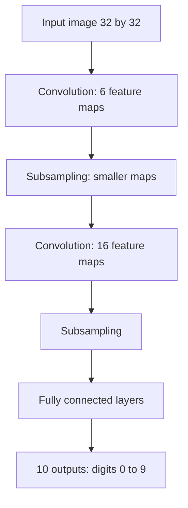

## The hook

In the late 1990s, if you deposited a cheque at certain American banks, there was a fair chance a neural network read the handwritten amount. Not in a research lab. In production, every day, on millions of cheques.

This was more than a decade before "deep learning" became a buzzword. The network was called LeNet, and the 1998 paper describing it laid out the design that, scaled up, would later recognise faces, drive cars and diagnose diseases. Its key idea is so natural that once you see it, you will wonder why anyone ever did it differently.

## Before you start

You should understand how networks learn with [backpropagation](article:paper-backpropagation). It also helps to remember from [Neural Networks from One Neuron Up](article:primer-neural-networks) that a fully connected layer links every input to every neuron.

## The world before this paper

Reading handwriting was a classic hard problem. The standard recipe had two parts. First, engineers hand-designed a **feature extractor**: code that measured stroke directions, loops, line endings and so on. Then a simple classifier learned from those features. Most of the effort, and most of the failures, lived in the hand-designed part.

You could skip the engineering and feed raw pixels into an ordinary neural network. But that had two big problems:

- **Too many weights.** A small 32 by 32 image is 1,024 pixels. Connect them to just 100 hidden neurons and you already have over 100,000 weights, which is a lot to learn from limited data.
- **No sense of space.** A fully connected network treats pixel 5 and pixel 6 as unrelated inputs, even though they are neighbours. And a "7" shifted two pixels to the right looks like a completely different input.

:::history
Yann LeCun had already shown in 1989, at AT&T Bell Labs, that a network with built-in spatial structure could learn to read handwritten zip codes from US mail using backpropagation. He drew on Kunihiko Fukushima's 1980 Neocognitron, a network inspired by the visual cortex. The 1998 paper, written with Léon Bottou, Yoshua Bengio and Patrick Haffner, was the grand, detailed summary of nearly a decade of work.
:::

## The big idea

Build what we know about images directly into the network's structure:

1. **Look locally.** A pixel's meaning depends on its neighbours, so each neuron should look at a small patch, not the whole image.
2. **Reuse detectors everywhere.** An edge is an edge wherever it appears, so the same detector should scan the whole image.
3. **Build up gradually.** Combine small patterns into bigger ones, layer by layer.

These three ideas define a convolutional neural network.

:::analogy
Think of reading a page with a magnifying glass that has a pattern stencil on it. You slide the glass across every spot on the page, and wherever the ink matches the stencil, you put a tick on a separate sheet. One stencil for vertical strokes, one for curves, one for corners. Afterwards you have a set of tick-sheets showing where each pattern occurs. Then you do the same thing on the tick-sheets, looking for combinations: a curve above a vertical stroke might be a "9." The stencils are learned, not designed.
:::

:::insight
The right structure is a form of knowledge. By building locality and weight sharing into the network, LeNet needed far fewer parameters and far less data to learn to see.
:::

## How it works

### Convolution

A [[filter]] is a small grid of weights, say 5 by 5. The network slides it across the image, and at each position computes a weighted sum of the pixels underneath. That operation is a [[convolution]], and its output is a [[feature map]]: bright where the pattern matches, dark where it does not.

Because the same 25 weights are used at every position, the filter detects its pattern **wherever** it appears. This is [[weight sharing]], and it slashes the number of parameters.

### A tiny convolution by hand

Take a 3 by 3 patch of an image and a 3 by 3 filter that detects vertical edges:

| Row | Image patch | Filter |
|---|---|---|
| Top | 0, 1, 1 | -1, 0, 1 |
| Middle | 0, 1, 1 | -1, 0, 1 |
| Bottom | 0, 1, 1 | -1, 0, 1 |

Multiply matching cells and add: the left column gives $0 \times -1$ three times, which is 0; the middle gives 0; the right gives $1 \times 1$ three times, which is 3. The total is **3**: a strong response, because the patch has a dark-to-bright vertical edge. On a flat patch of all 1s, the left column gives $-3$ and the right gives $+3$, so the total is **0**. The filter ignores flat areas and lights up on edges.

:::try-this
Flip the patch so the bright side is on the left (1, 1, 0 in each row) and apply the same filter. What do you get, and what does the sign tell you? (You get $-3$. The filter still detects the edge, but the negative sign says it runs bright-to-dark instead of dark-to-bright.)
:::

### Pooling

After a convolution, LeNet shrinks each feature map by averaging small neighbourhoods, for example every 2 by 2 block, an operation now called [[pooling]] (the paper calls it subsampling). This halves the width and height and makes the network tolerant of small shifts: a stroke moved by one pixel lands in the same pooled cell.

### LeNet-5, layer by layer

Early layers detect strokes and edges; later layers combine them into parts of digits; the final layers decide which digit it is. The whole network has about 60,000 trainable parameters, and every one of them is learned with backpropagation. No hand-designed features at all.

### Beyond single digits

Much of the long paper goes further than LeNet itself. Real documents have whole strings of characters that must be segmented and read together, with a language model to check the result. The authors introduced Graph Transformer Networks, a way to train an entire multi-stage reading system, end to end, with gradient-based learning. The theme of the whole paper is that every component should be trained to serve the final goal.

## What they found

- The paper introduced the [[MNIST]] dataset: 60,000 training and 10,000 test images of handwritten digits, cleaned up from US government data. It became the "hello world" of machine learning for two decades.
- On MNIST, LeNet-5 reached an error rate below 1%, and boosted and distortion-trained variants did even better, competitive with or better than every other method compared, including support vector machines.
- Training on artificially distorted copies of the images, a form of data augmentation, noticeably reduced errors.
- A cheque-reading system built on these networks was deployed commercially; the authors reported that it was reading several million cheques per day.

:::warning
Common misconception: "convolutional networks were invented in 2012 with AlexNet." The core design, convolutions plus pooling plus backpropagation, was mature and in production by the late 1990s. What changed in 2012 was the scale of data and compute.
:::

## What it got wrong (or left open)

LeNet worked on small, clean, grayscale images of digits. Natural photos are far harder: big, colourful, cluttered, with thousands of object types. With the computers and datasets of the 1990s, nobody could train a convolutional network large enough for that, and for about a decade other methods, like [support vector machines](article:paper-support-vector-networks) with hand-crafted image features, were often preferred.

The paper's reliance on sigmoid-like activations and average pooling also left performance on the table. Later work found that ReLU activations and max pooling, which keeps the strongest response in each neighbourhood, trained faster and worked better.

## What happened next

- In 2012, [AlexNet](article:paper-alexnet) scaled LeNet's recipe up to 60 million parameters, trained it on a million photos using GPUs, and shocked the computer vision world.
- [ResNet](article:paper-resnet) made convolutional networks over a hundred layers deep.
- [U-Net](article:paper-unet) adapted convolutions to label every pixel of medical images, and later became the backbone of diffusion image generators.
- LeCun, together with Hinton and Bengio, received the 2018 Turing Award for the breakthroughs that made deep neural networks a critical part of computing.

## Key takeaways

- Convolutional networks build knowledge about images into their structure: local receptive fields, shared weights and gradual pooling.
- Weight sharing lets one small filter detect a pattern anywhere in an image while using very few parameters.
- LeNet-5 learned all of its features from raw pixels with backpropagation and beat hand-engineered systems on handwritten digits.
- The paper introduced the MNIST dataset and argued that whole document-reading systems should be trained end to end.
- The design was in commercial use by the late 1990s; scaling it up with GPUs and big data later launched the deep learning era.
