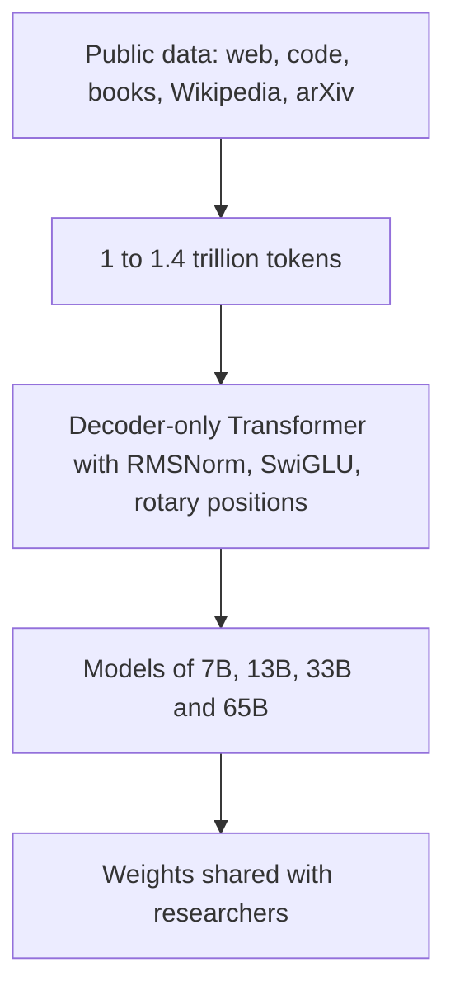

## The hook

In February 2023, the most capable language models were locked away. You could talk to them through a company's website or API, but you could not download them, inspect them or run them yourself. Studying how they worked was a privilege of a few labs.

Then Meta released LLaMA: a family of models from 7 to 65 billion parameters, trained only on public data, with a 13-billion-parameter version that beat GPT-3 on most benchmarks. Access was meant for approved researchers. Within about a week, the weights had leaked online. Within weeks after that, hobbyists had them running on laptops, and the open-source AI movement exploded.

## Before you start

You need the compute-optimal training idea from [The Giant Models Were Underfed](article:paper-chinchilla). LLaMA takes Chinchilla's lesson about data and pushes it further, for a different reason.

## The world before this paper

After [Chinchilla](article:paper-chinchilla), labs knew that the giant models of 2020 to 2021 had been undertrained. But Chinchilla's rule answers one particular question: what is the best model for a fixed **training** budget?

For a model that millions of people will use, training is a one-off cost. Running the model, its [[inference budget]], is paid on every single request, forever. A smaller model is cheaper and faster to run.

:::history
The LLaMA team at Meta AI, led by Hugo Touvron with Guillaume Lample and colleagues, many based in Paris, pointed out that the model that is cheapest to train to a given quality is not the one that is cheapest to use. Lample later co-founded the French AI company Mistral together with Arthur Mensch from the Chinchilla paper. Their bet: train smaller models for much longer than Chinchilla's rule suggests, accepting extra training cost, to get excellent models that are cheap to run.
:::

They also wanted their work to be reproducible and shareable, so they committed to using only publicly available data.

## The big idea

Build [[foundation model|foundation models]] for the inference era: train relatively small models on far more tokens than compute-optimal rules recommend, using only public data, with a carefully chosen set of known architectural improvements. Then share the weights with the research community.

:::analogy
Think of buying a car you will drive every day for ten years. The cheapest car to manufacture is not necessarily the cheapest to own; a slightly more expensive, fuel-efficient model saves money on every trip. LLaMA spent more on "manufacturing," training for longer, to get models that are much cheaper to "drive," to run for every user query.
:::

:::insight
If a model will answer many queries, it pays to train a smaller model on much more data than the training-optimal recipe suggests. Its performance keeps improving long after the "optimal" point.
:::

## How it works

### The data

LLaMA was trained on a mixture of publicly available sources:

| Source | Share of training data |
|---|---|
| Filtered CommonCrawl web pages | about 67% |
| C4 (another cleaned web dataset) | about 15% |
| GitHub code | about 4.5% |
| Wikipedia in 20 languages | about 4.5% |
| Books (public domain and others) | about 4.5% |
| arXiv scientific papers | about 2.5% |
| Stack Exchange | about 2% |

The 7B and 13B models were trained on 1 trillion tokens; the 33B and 65B models on 1.4 trillion tokens.

### The architecture

The model is a decoder-only Transformer, like [GPT-3](article:paper-gpt-3), with three improvements borrowed from recent research:

- **Pre-normalization with [[RMSNorm]].** Normalizing the input of each sub-layer, rather than the output, improved training stability.
- **[[SwiGLU]] activations** in the feed-forward layers, which had been shown to improve quality.
- **[[Rotary positional embedding|Rotary positional embeddings]]** instead of absolute position vectors, encoding position by rotating the query and key vectors so attention depends on relative distance.

### Why these three changes?

None of the three architectural tweaks was invented for LLaMA; each had appeared in earlier models such as GPT-3, PaLM and GPT-NeoX. The paper's contribution was a careful combination. Pre-normalization keeps the numbers flowing through a very deep network in a stable range, much like [Batch Normalization](article:paper-batch-normalization) did for vision. SwiGLU gives the feed-forward layers a learned "gate," letting each neuron decide how much of its input to pass on. Rotary embeddings encode position by rotating vectors, so the attention score between two tokens depends on how far apart they are rather than on their absolute positions. Together they became the default recipe for most of the open models that followed.

### Engineering for efficiency

The team used a memory-efficient implementation of attention that avoided storing the full attention weights, in the same spirit as [FlashAttention](article:paper-flashattention), and saved selected activations to avoid recomputing them. Training the 65B model processed about 380 tokens per second per GPU on 2,048 A100 GPUs, so 1.4 trillion tokens took roughly 21 days.

### A worked example: tokens per parameter

Compare how much data each model saw per parameter:

- LLaMA-7B: $1{,}000 \text{ billion} / 7 \text{ billion} \approx 143$ tokens per parameter.
- Chinchilla's rule of thumb: about 20 tokens per parameter.
- GPT-3: $300 \text{ billion} / 175 \text{ billion} \approx 1.7$ tokens per parameter.

LLaMA-7B was trained on about seven times more tokens per parameter than Chinchilla's recipe, and the paper reported that its performance was still improving when training stopped.

:::try-this
How many tokens per parameter did LLaMA-65B see, with 1.4 trillion tokens? Is that closer to Chinchilla's rule or to LLaMA-7B's ratio? ($1{,}400 / 65 \approx 21.5$, almost exactly Chinchilla's 20. The small models were the ones trained far beyond the rule.)
:::

## What they found

- **LLaMA-13B outperformed GPT-3 (175B)** on most of the benchmarks tested, despite being more than ten times smaller. It could run on a single GPU.
- **LLaMA-65B was competitive with the best large models of the time**, including Chinchilla-70B and PaLM-540B, on many tasks such as commonsense reasoning, closed-book question answering and reading comprehension.
- **Public data was enough.** Strong models could be built without proprietary datasets.
- **A small amount of instruction fine-tuning helped a lot.** A briefly instruction-tuned version of LLaMA-65B improved substantially on the MMLU knowledge benchmark.
- **Honest limits.** The paper reported LLaMA's scores on bias, toxicity and truthfulness benchmarks, showing that it, like other models, reflected biases in its data and could generate false or toxic text.

:::warning
Common misconception: "LLaMA was fully open source." The original release used a non-commercial research licence and required approval, and the training code and data mixture were described but not packaged for easy reproduction. "Open weights" became the more precise term for models like this.
:::

### Why open weights mattered

Before LLaMA, academic researchers studying large language models mostly had to work through paid APIs, seeing only inputs and outputs. With [[open weights]], they could inspect internal activations, test safety interventions, try new fine-tuning methods and measure exactly what changed. A model that ran on a single GPU meant universities and small companies could experiment at all. That access is a big reason the research covered in this track, from [LoRA](article:paper-lora) fine-tuning to efficient serving, moved so quickly in 2023.

## What it got wrong (or left open)

LLaMA's performance on some knowledge-heavy tests, such as MMLU, trailed the largest closed models, which the authors attributed partly to having fewer books and academic papers in the training data.

The base models were not chat assistants; they continued text and needed instruction tuning and alignment to be helpful and safe. The controlled release also did not hold: the leak raised hard questions about the risks and benefits of sharing powerful models openly, a debate that continues.

## What happened next

- Within weeks, Stanford's Alpaca fine-tuned LLaMA-7B to follow instructions for a few hundred dollars, and Vicuna and many others followed, often using [LoRA](article:paper-lora) to fine-tune cheaply.
- Projects like llama.cpp made LLaMA run on ordinary laptops and phones using quantisation.
- In July 2023, Meta released Llama 2 with a licence allowing commercial use, plus chat versions aligned with RLHF; Llama 3 followed in 2024, using preference methods including [DPO](article:paper-dpo).
- Open-weight models from many organisations followed, and serving engines like [vLLM](article:paper-vllm) made running them efficiently far easier.

## Key takeaways

- LLaMA optimised for inference cost by training relatively small models on many more tokens than compute-optimal rules suggest.
- It used only publicly available data and a decoder-only Transformer with RMSNorm, SwiGLU and rotary positional embeddings.
- LLaMA-13B beat GPT-3 on most benchmarks despite being more than ten times smaller, and LLaMA-65B rivalled Chinchilla and PaLM.
- The weights, released to researchers and quickly leaked, triggered an explosion of open-source fine-tuning, tools and models.
- LLaMA changed the AI landscape by making strong foundation models available outside a few large labs.
