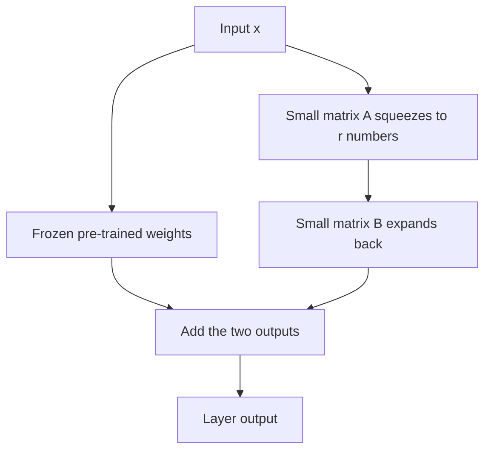

## The hook

Suppose you want GPT-3 to write in your company's style, or to answer questions about Indian tax law. The standard approach in 2020 was full fine-tuning: keep training all 175 billion parameters on your data. Then you have a new 175-billion-parameter model, about 350 gigabytes, just for one task. Want ten tasks? Ten giant copies.

In 2021, a team at Microsoft showed that you could freeze the entire model and train a tiny add-on instead, cutting the number of trainable parameters by around ten thousand times. The saved add-on for a task shrank from hundreds of gigabytes to tens of megabytes, small enough to email. They called it LoRA, and it became the standard way people customise large models, from chatbots to Stable Diffusion art styles.

## Before you start

You need [GPT-3](article:paper-gpt-3) to appreciate the scale problem, and a little comfort with the idea that a layer is a [[weight matrix]] multiplying a vector, from [Neural Networks from One Neuron Up](article:primer-neural-networks).

## The world before this paper

[[Fine-tuning]] all parameters works well, but it is expensive in three ways:

- **Memory to train.** Optimizers like [Adam](article:paper-adam) keep extra numbers for every trainable parameter, so training needs several times the model's own memory.
- **Storage.** Each task needs its own full copy of the model.
- **Switching.** Serving many customised models means loading many giant ones.

:::history
Researchers had proposed cheaper alternatives. [[Adapter|Adapters]] (2019) inserted small extra layers inside each Transformer block and trained only those, but the extra layers ran in sequence and added delay when the model was used. Prefix tuning and prompt tuning learned special input vectors instead, which used up part of the model's context window and could be hard to optimise. Edward Hu and colleagues wanted the efficiency of these methods without their costs.
:::

They were also inspired by a 2020 finding by Armen Aghajanyan and colleagues: pre-trained language models have a low "intrinsic dimension." Fine-tuning them seems to require changes in only a small number of directions, not all billions of parameters independently.

## The big idea

Freeze the original weights. Represent the **change** to each weight matrix as the product of two thin matrices, and train only those.

$$W' = W_0 + \Delta W = W_0 + BA$$

- $W_0$ is the pre-trained weight matrix, of size $d \times k$, kept as [[frozen weights]].
- $B$ is $d \times r$ and $A$ is $r \times k$, where the [[rank]] $r$ is tiny, like 1, 4 or 8.
- Their product $BA$ has the same shape as $W_0$, but it can only represent a "low-rank" update: changes along a few directions.

:::analogy
Think of a huge, professionally printed city map that you are not allowed to reprint. To adapt it for a cycling tour, you lay a thin transparent sheet over it and draw just a few routes and notes. The original map is untouched; the overlay is tiny and cheap; and you can swap overlays for a food tour or a heritage walk in seconds. LoRA's $BA$ is the overlay.
:::

:::insight
Adapting a big pre-trained model to a new task seems to need changes in only a few directions, so a tiny low-rank update can capture most of what full fine-tuning achieves.
:::

## How it works

### The forward pass

For an input $x$, the adapted layer computes

$$h = W_0 x + BAx$$

Both paths see the same input, and their outputs are added. The second path first squeezes $x$ down to $r$ numbers with $A$, then expands back up with $B$.

### Initialisation and scaling

$A$ starts with small random values and $B$ starts at **zero**, so $BA = 0$ at the beginning: the model starts out behaving exactly like the original. The update is also multiplied by a constant $\alpha / r$, which makes it easier to change $r$ without retuning the learning rate.

### Where to put it

In the paper's main experiments, LoRA was applied to the attention weight matrices of each Transformer layer, especially the query and value projections, leaving everything else frozen.

### No slowdown when deployed

Once training is done, compute $W_0 + BA$ and store it as one ordinary matrix. The deployed model has exactly the same shape and speed as the original, with zero extra [[inference latency]]. To switch tasks, subtract one $BA$ and add another.

### A worked example: counting parameters

Take one $4096 \times 4096$ weight matrix, a typical size in a large Transformer.

- Full fine-tuning trains $4096 \times 4096 = 16{,}777{,}216$ numbers.
- LoRA with $r = 8$ trains $B$ ($4096 \times 8$) and $A$ ($8 \times 4096$): $32{,}768 + 32{,}768 = 65{,}536$ numbers.

That is 256 times fewer for this matrix. Applied across a whole model, and only to some matrices, the savings become enormous.

:::try-this
Repeat the count for $r = 2$. How many trainable numbers, and how many times fewer than full fine-tuning? ($4096 \times 2 \times 2 = 16{,}384$, which is 1,024 times fewer. The paper found that even very small ranks like 1 or 2 often worked surprisingly well.)
:::

### Why would a low-rank update be enough?

A pre-trained model already knows grammar, facts and countless patterns. Adapting it to a new task, like writing legal summaries, mostly means **re-weighting** what it already knows, not learning everything from scratch. If those adjustments line up along a handful of directions, as the intrinsic dimension research suggested, then a rank-8 update is not a crude approximation of the "real" fine-tuning: it is nearly the whole story. The experiments below were designed to test exactly this.

## What they found

- **Matched full fine-tuning.** On RoBERTa and DeBERTa for language understanding benchmarks, and on GPT-2 and GPT-3 for generation tasks, LoRA performed on par with or better than full fine-tuning, and better than adapters, prefix tuning and other efficient methods.
- **Massive savings on GPT-3.** Compared with full fine-tuning of GPT-3 175B with Adam, LoRA reduced the number of trainable parameters by about 10,000 times and GPU memory needed for training by about 3 times. A task checkpoint shrank from roughly 350 GB to about 35 MB.
- **Tiny ranks suffice.** For GPT-3, ranks as small as 1 or 2 on the query and value matrices were competitive, supporting the idea that the needed update really is low-rank.
- **Faster training.** With far fewer gradients to compute and store, training throughput improved as well.
- **What the update does.** Analysing the learned $\Delta W$, the authors found it amplified directions that were already present in the pre-trained weights but not emphasised, rather than adding entirely new ones.

:::warning
Common misconception: "LoRA makes the model smaller or faster to run." It makes **fine-tuning** cheaper and task-specific storage tiny. The base model you deploy is still the same size; LoRA just lets one base model carry many cheap, swappable customisations.
:::

## What it got wrong (or left open)

LoRA still needs the full base model in memory during training, which for the largest models is itself a barrier. Choosing which matrices to adapt and which rank to use requires some experimentation, and the paper's guidelines came mostly from a few model families.

Serving many different LoRA updates in the same batch is also tricky if you merge them into the weights, since each request would need a different merged matrix. Keeping the update separate solves that, at the cost of a little extra computation.

And some tasks that differ greatly from pre-training may need more than a low-rank change; later studies found full fine-tuning can still win when teaching models substantially new knowledge.

## What happened next

- QLoRA (2023) combined LoRA with 4-bit quantisation of the frozen base model, making it possible to fine-tune a 65-billion-parameter model on a single 48 GB GPU.
- LoRA became the default way the open-source community customised models like [LLaMA](article:paper-llama), and Hugging Face's PEFT library made it a few lines of code.
- In image generation, LoRA files became the standard way to share styles and characters for Stable Diffusion, built on [latent diffusion](article:paper-latent-diffusion).
- Serving systems learned to host thousands of LoRA adapters on one base model, swapping them per request, alongside memory-efficient serving engines like [vLLM](article:paper-vllm).

## Key takeaways

- Full fine-tuning of huge models is costly in training memory, storage and switching between tasks.
- LoRA freezes the pre-trained weights and learns the update as the product of two thin matrices, B times A, with a very small rank.
- B starts at zero, so training begins from the original model, and the learned update can be merged into the weights for zero added latency.
- On GPT-3, LoRA cut trainable parameters by about 10,000 times and training memory by about 3 times while matching full fine-tuning quality.
- It became the standard method for cheaply customising large language and image models.
