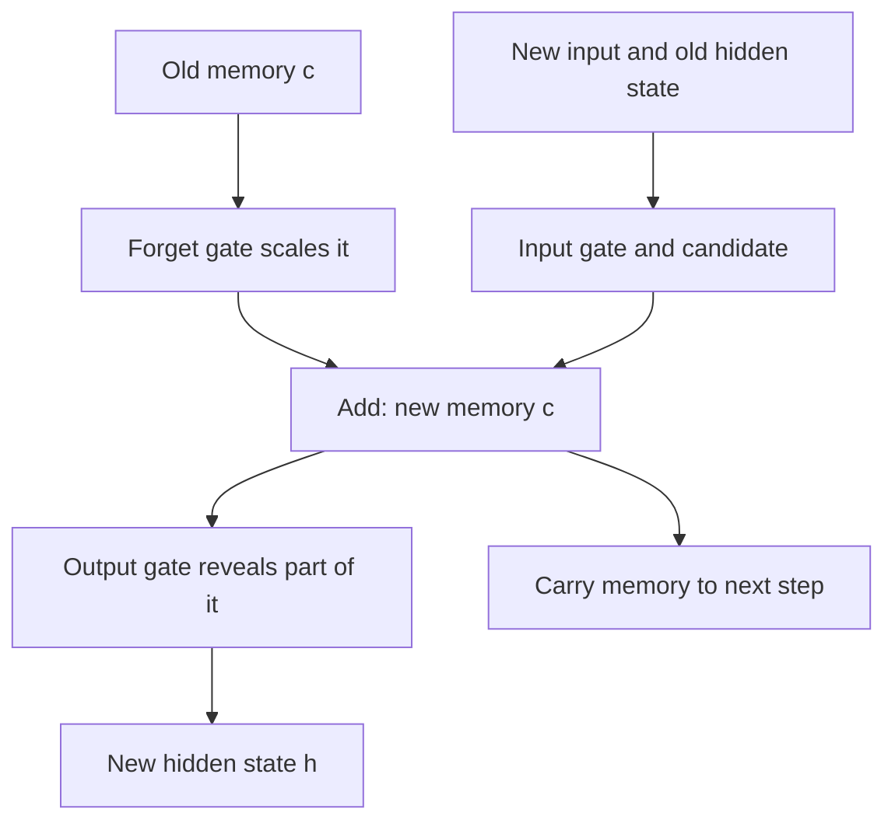

## The hook

Read this sentence: "The keys to the cabinet that my grandmother left me after she moved back to her village in Kerala **are** on the table." To pick "are" instead of "is," your brain had to remember that the subject was "keys," plural, across seventeen intervening words.

For years, neural networks simply could not do this. Information from early in a sequence faded away before it was needed. In 1997, Sepp Hochreiter and Jürgen Schmidhuber published a design with a protected memory lane and a set of learned doors to control it. They called it Long Short-Term Memory. For almost twenty years afterwards, if a computer understood your voice or translated your sentence, there was a good chance an LSTM was doing the work.

## Before you start

You need to know how [backpropagation](article:paper-backpropagation) sends error signals backward, and why those signals can fade, from the vanishing gradient section of [Backpropagation Without the Scary Math](article:primer-backprop-intuition).

## The world before this paper

Language, speech, music and stock prices are sequences. A [[recurrent neural network]] (RNN) handles them by reading one element at a time and keeping a [[hidden state]], a vector that is updated at every step and passed to the next. In principle, the hidden state can remember anything it has seen.

In practice, it could not. To learn that a word at step 5 matters for a decision at step 50, the error signal from step 50 must travel back through 45 steps. At each step, it is multiplied by the network's weights and by the slope of the activation function. If those factors are typically below 1, the signal shrinks exponentially, which is the [[vanishing gradient]] problem. If they are above 1, it explodes.

:::history
Sepp Hochreiter analysed this problem in detail in his 1991 diploma thesis at the Technical University of Munich, supervised by Jürgen Schmidhuber. Yoshua Bengio and colleagues published a similar analysis in 1994. Both showed that ordinary gradient-based training of recurrent networks was fundamentally bad at learning dependencies across long gaps. The question was whether the architecture itself could be changed to keep the signal alive.
:::

A tiny calculation shows how severe it is. If the signal is multiplied by 0.9 at each step, after 10 steps it is $0.9^{10} \approx 0.35$ of its original size. After 100 steps it is $0.9^{100} \approx 0.00003$. Learning from that is hopeless.

## The big idea

Give the network a special memory unit whose contents are carried forward by **adding**, not by repeated multiplication through squashing functions. If the memory is simply copied from one step to the next, the error signal can travel back along that path without shrinking. Hochreiter and Schmidhuber called this the [[constant error carousel]].

But an always-open memory lane would be overwhelmed by everything passing through. So they added [[gate|gates]]: small learned networks that decide when to write new information into the memory and when to read it out.

:::analogy
Think of the LSTM as a student with a notebook during a long lecture. The notebook is the [[cell state]]: what is written there stays put unless the student deliberately changes it. The student does not copy down every word. They decide what is worth writing (the input gate), what old notes to cross out (the forget gate, added later), and which notes to look at when answering a question (the output gate). The notebook is what lets them recall something from the first five minutes at the end of an hour.
:::

:::insight
Memory survives when it is carried forward almost unchanged and edited deliberately. LSTM's protected cell state plus learned gates turned a forgetful network into one that could hold information for hundreds or thousands of steps.
:::

## How it works

### The modern LSTM cell

The version used today includes the forget gate added a few years after the original paper. At each time step $t$, with new input $x_t$ and previous hidden state $h_{t-1}$:

$$f_t = \sigma(W_f [h_{t-1}, x_t] + b_f) \qquad \text{forget gate}$$
$$i_t = \sigma(W_i [h_{t-1}, x_t] + b_i) \qquad \text{input gate}$$
$$\tilde{c}_t = \tanh(W_c [h_{t-1}, x_t] + b_c) \qquad \text{candidate memory}$$
$$c_t = f_t \odot c_{t-1} + i_t \odot \tilde{c}_t \qquad \text{update the cell}$$
$$o_t = \sigma(W_o [h_{t-1}, x_t] + b_o), \qquad h_t = o_t \odot \tanh(c_t)$$

In plain words:

- $\sigma$ is the sigmoid, so every gate is a list of numbers between 0 (closed) and 1 (open).
- $[h_{t-1}, x_t]$ means "the previous hidden state and the new input, side by side." Every gate looks at both.
- $\odot$ means multiply position by position.
- The key line is the cell update: keep a fraction $f_t$ of the old memory, and add a fraction $i_t$ of the new candidate. That **addition** is what protects the gradient.
- The output gate decides how much of the memory to reveal as the hidden state $h_t$, which is what the rest of the network sees.

### A worked example

Track a single memory number. Suppose the cell holds $c_{t-1} = 0.8$, meaning something like "the subject is plural."

- At a word that is irrelevant, the network has learned $f_t = 1$ and $i_t = 0$. The new memory is $1 \times 0.8 + 0 \times \tilde{c}_t = 0.8$. Unchanged.
- Twenty such words later, the memory is still exactly $0.8$, and the error signal flowing back along this path is multiplied by $f_t = 1$ at every step, so it does not shrink at all.
- When a new subject appears, the network sets $f_t = 0$ and $i_t = 1$ with candidate $\tilde{c}_t = -0.6$ ("singular"). The memory becomes $0 \times 0.8 + 1 \times -0.6 = -0.6$. Old fact erased, new fact stored.

Compare an ordinary RNN, where the memory is pushed through a weight multiplication and a squashing function at every step, and twenty steps of shrinkage wipe it out.

:::try-this
Suppose the forget gate is 0.95 at every step and nothing new is written. Starting from a memory of 1.0, roughly how much remains after 20 steps? And after 100? ($0.95^{20} \approx 0.36$ and $0.95^{100} \approx 0.006$. A forget gate close to but not exactly 1 still leaks. Networks that need long memory learn to push it very close to 1.)
:::

### What the original paper had

The 1997 LSTM had the memory cell with its constant error carousel, an input gate and an output gate. It did not have a forget gate, so the cell could only accumulate. Felix Gers, Schmidhuber and Fred Cummins added the forget gate around 2000, after finding that cells in long, continuous streams of input needed a way to reset. That addition is now considered essential.

## What they found

The paper tested LSTM on a series of artificial tasks designed to require long-term memory, where the relevant signal and the moment it is needed are separated by many irrelevant steps. These included remembering a symbol over long noisy sequences and adding up specific numbers marked far apart in a long stream.

Ordinary recurrent networks and other methods of the time failed on the long-gap versions. LSTM solved them, learning to bridge time lags of more than 1,000 steps in some tasks, and often learned faster as well.

:::warning
Common misconception: "LSTMs remember everything forever." They can hold information for long periods, but they still have a fixed-size memory and read sequences one step at a time. On very long documents, important details still get squeezed out, a limitation that attention mechanisms later attacked directly.
:::

## What it got wrong (or left open)

Without the forget gate, the original design struggled with long continuous inputs, which is why it was added. More fundamentally, LSTMs are sequential: step 50 cannot be computed until step 49 is finished. That made them slow to train on modern hardware, which thrives on doing many things in parallel.

And a single hidden state vector still has to carry everything forward. In translation, squeezing a long sentence into that fixed-size vector became a bottleneck, as you will see in [Sequence to Sequence Learning](article:paper-seq2seq).

## What happened next

- LSTMs took a decade to catch on, then dominated. From around 2013 to 2017 they powered state-of-the-art speech recognition, handwriting recognition and machine translation, including Google's neural translation system launched in 2016 and the voice assistants of several major tech companies.
- A simplified relative, the gated recurrent unit (GRU), was proposed in 2014 by Kyunghyun Cho and colleagues.
- [Sequence to Sequence Learning](article:paper-seq2seq) used stacked LSTMs to translate whole sentences, and [Bahdanau attention](article:paper-bahdanau-attention) let them look back at every input word.
- The [Transformer](article:paper-attention-is-all-you-need) replaced recurrence entirely in 2017, but LSTM's central lesson, that protected additive paths keep gradients alive, also appears in the residual connections of [ResNet](article:paper-resnet).

## Key takeaways

- Ordinary recurrent networks cannot learn long-range dependencies because error signals vanish or explode as they travel back through many steps.
- LSTM adds a protected memory cell that is updated by addition, so error signals can flow back through time without shrinking.
- Learned gates decide what to write into the memory, what to forget and what to reveal at each step.
- The forget gate was added after the original paper and is now a standard part of every LSTM.
- LSTMs dominated speech and translation for years before Transformers replaced recurrence with attention.
