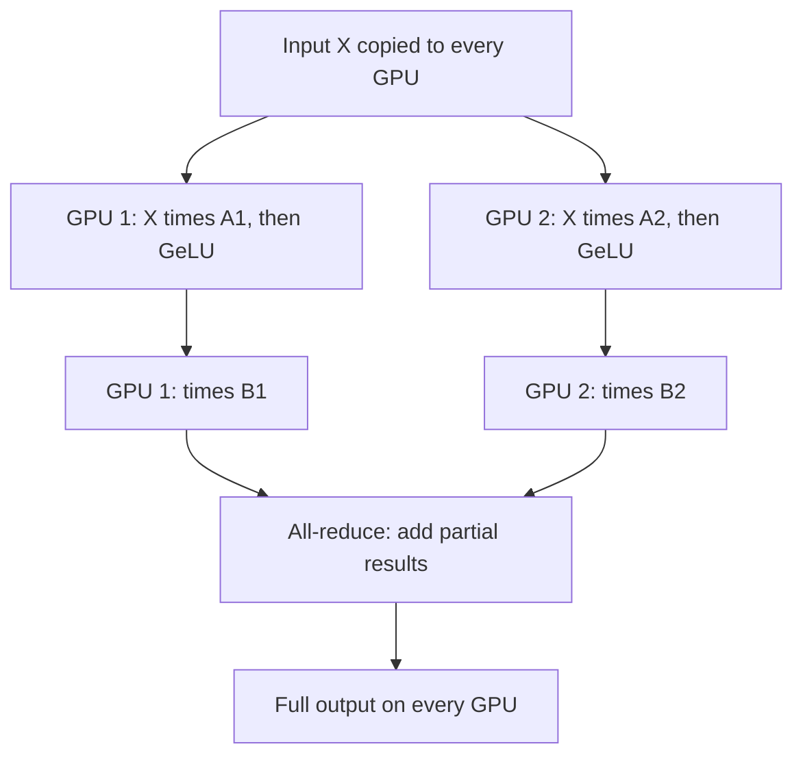

## The hook

In 2019, one of the best GPUs for AI had 32 gigabytes of memory. That sounds like a lot until you do the arithmetic for a language model with 8 billion parameters. Just storing the weights, the gradients and the optimizer's bookkeeping during training takes well over 100 gigabytes. The model simply does not fit.

So how do you train it? A team at NVIDIA found an answer that was almost elegant enough to be obvious in hindsight: cut every layer of the Transformer into slices, give each GPU one slice, and arrange the cuts so the GPUs barely need to talk to each other. They trained an 8.3-billion-parameter model, the largest Transformer language model at the time, and the technique became one of the foundations of every giant model since.

## Before you start

You should know the parts of a Transformer layer, self-attention and the feed-forward network, from [The Paper That Taught Machines Where to Look](article:paper-attention-is-all-you-need). It helps to remember that each layer is mostly big matrix multiplications.

## The world before this paper

The standard way to use many GPUs was [[data parallelism]]: give every GPU a full copy of the model, feed each one different training examples, and average their gradients after each step. It is simple and works beautifully, as long as the model fits on one GPU.

Why does a model need so much memory? In mixed-precision training with [Adam](article:paper-adam), each parameter typically needs around 16 bytes: the weight itself in two formats, its gradient, and Adam's two running averages. For 8.3 billion parameters, that is roughly 130 gigabytes, before even counting the activations stored for backpropagation.

:::history
Other teams were attacking the same wall. Google's GPipe (2018) used [[pipeline parallelism]], placing different layers on different devices. Mesh-TensorFlow offered a general way to describe how tensors are split across devices, but required a new framework and compiler. Mohammad Shoeybi, Mostofa Patwary, Raul Puri and colleagues at NVIDIA, led by Bryan Catanzaro, wanted something that ran in plain PyTorch with minimal changes.
:::

## The big idea

Use [[tensor parallelism]]: split the matrices **inside** each Transformer layer across GPUs, so every GPU does part of every layer at the same time. Choose the splits cleverly, so the GPUs only need to exchange results at a couple of points per layer.

:::analogy
Think of a team of accountants processing a huge spreadsheet with too many columns for one desk. Instead of passing the whole sheet from desk to desk, you give each accountant a vertical slice of the columns. Each works on their slice independently, and they only meet briefly at the end of each page to add up their subtotals. The trick is to cut the sheet where the calculations naturally separate, so the meetings are rare and short.
:::

:::insight
In a Transformer, the big matrix multiplications can be split so each GPU works almost independently. Choosing where to cut, by columns or by rows, decides whether the GPUs need to talk constantly or only twice per layer.
:::

## How it works

### Splitting the feed-forward network

A Transformer's feed-forward block computes $Y = \text{GeLU}(XA)$ and then $Z = YB$, where $A$ and $B$ are big weight matrices and GeLU is a non-linear activation.

**Step 1: split $A$ by columns.** With two GPUs, $A = [A_1, A_2]$. Each GPU computes $\text{GeLU}(XA_i)$ on its own half. This works because GeLU is applied element by element, so each half's activation can be computed without seeing the other half.

If instead you split $A$ by rows, each GPU would get only a partial sum, and you would have to add them up **before** GeLU, an extra communication step, since $\text{GeLU}(a + b) \neq \text{GeLU}(a) + \text{GeLU}(b)$.

**Step 2: split $B$ by rows.** Each GPU multiplies its half of $Y$ by its half of $B$, giving a partial result. Then a single [[all-reduce]] adds the partial results so every GPU has the full $Z$.

One all-reduce in the forward pass, and one in the backward pass. That is all the communication this block needs.

### Splitting self-attention

Attention is even more naturally parallel: its multiple heads are independent. Megatron gives each GPU a subset of the heads, with the query, key and value matrices split by columns accordingly. Each GPU computes attention for its own heads. The output projection is split by rows, and again one all-reduce combines the results.

### A worked example: why the split order matters

Take a tiny case with two GPUs. A row of input $x$ produces pre-activation values $[1.0, -2.0]$ from GPU 1's columns of $A$ and $[0.5, 3.0]$ from GPU 2's. Using ReLU for simplicity, each GPU applies the activation locally: GPU 1 gets $[1.0, 0]$ and GPU 2 gets $[0.5, 3.0]$. No communication needed.

Now imagine splitting by rows instead, where each GPU produces a partial sum of the **same** pre-activation value, say GPU 1 holds $-2.0$ and GPU 2 holds $3.0$ for one unit. The true value is $1.0$, and ReLU gives $1.0$. But applying ReLU separately would give $0 + 3.0 = 3.0$, which is wrong. The GPUs would have to talk first. Splitting by columns avoids this.

:::try-this
A unit's pre-activation is split by rows into partial sums of $4.0$ on GPU 1 and $-5.0$ on GPU 2. What does correct ReLU give, and what would you get by applying ReLU on each GPU separately and adding? (Correct: $\text{ReLU}(-1.0) = 0$. Separately: $4.0 + 0 = 4.0$. The mismatch is why the activation must come after a column split, not a row split.)
:::

### Combining with data parallelism

Tensor parallelism works best within a single server, where GPUs are connected by very fast links. Megatron combined it with data parallelism across servers: groups of 8 GPUs shared one copy of the model, split by tensors, and many such groups trained on different data.

## What they found

- **Scale.** They trained a GPT-2-style model with 8.3 billion parameters on 512 GPUs, using 8-way tensor parallelism and 64-way data parallelism.
- **Efficiency.** The system sustained 15.1 petaFLOPs across the 512 GPUs, with 76% [[scaling efficiency]] relative to a strong single-GPU baseline.
- **Better models.** The 8.3B model achieved state-of-the-art results on WikiText-103 (lower perplexity) and the LAMBADA word-prediction task, and a 3.9-billion-parameter BERT-style model set a new state of the art on the RACE reading comprehension test.
- **A BERT stability fix.** Scaling BERT-style models beyond a few hundred million parameters initially degraded quality; rearranging where layer normalization and residual connections sat in each block fixed it.

:::warning
Common misconception: "model parallelism means each GPU holds different layers." That is pipeline parallelism. Megatron-LM's tensor parallelism splits every layer across GPUs, so all GPUs work on every layer at the same time. Large modern training runs usually combine both, plus data parallelism.
:::

## What it got wrong (or left open)

Tensor parallelism needs very fast connections between GPUs, because it communicates inside every layer. Across servers connected by slower networks, efficiency drops sharply, which limited it to about 8 GPUs per model copy at the time.

It also does not reduce the memory used by optimizer states across data-parallel copies, which are duplicated on every group. And 8 billion parameters, while a record in 2019, was soon dwarfed; reaching hundreds of billions required combining several kinds of parallelism.

## What happened next

- In 2021, NVIDIA researchers combined tensor, pipeline and data parallelism ("3D parallelism") to train models with up to a trillion parameters efficiently.
- With Microsoft's DeepSpeed team, NVIDIA trained Megatron-Turing NLG, a 530-billion-parameter model, in 2021.
- Microsoft's ZeRO technique attacked the duplicated optimizer state, partitioning it across data-parallel GPUs.
- Megatron-style tensor parallelism became a standard ingredient in the training of large language models, and in serving them too, where systems like [vLLM](article:paper-vllm) split models across GPUs in the same way.
- Within each GPU, kernels like [FlashAttention](article:paper-flashattention) made the attention computation itself far more efficient.

## Key takeaways

- Large language models stopped fitting on a single GPU, because training state takes roughly 16 bytes per parameter.
- Megatron-LM's tensor parallelism splits the matrices inside each Transformer layer across GPUs, so all GPUs share the work of every layer.
- Splitting the first feed-forward matrix by columns and the second by rows needs only one all-reduce per block in each direction; attention is split by heads.
- The approach needs only a few communication operations added to ordinary PyTorch code, and trained an 8.3-billion-parameter model on 512 GPUs at 76% scaling efficiency.
- Combined with pipeline and data parallelism, it became a foundation for training models with hundreds of billions of parameters.
