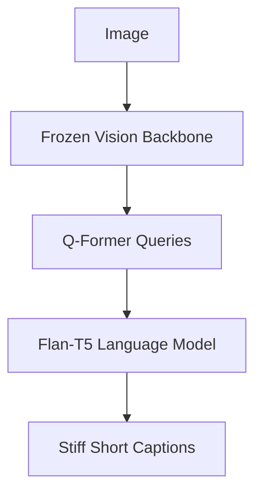
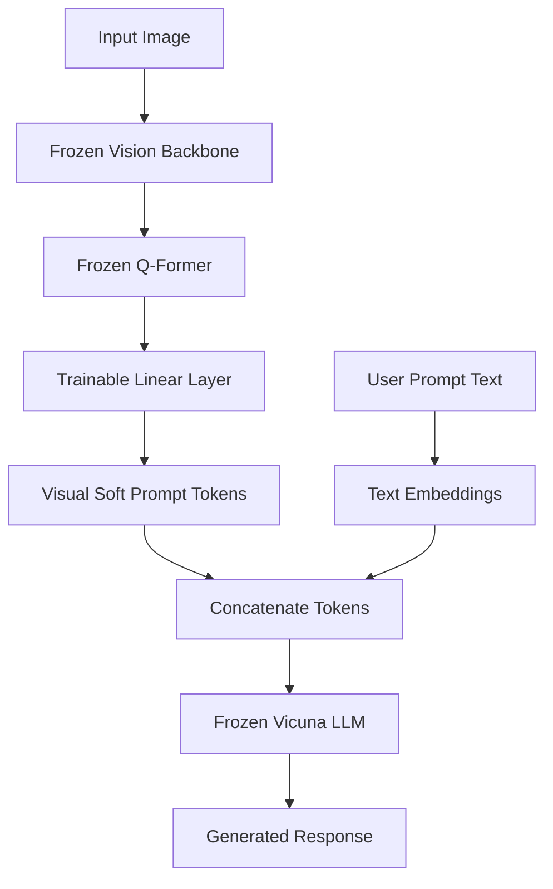
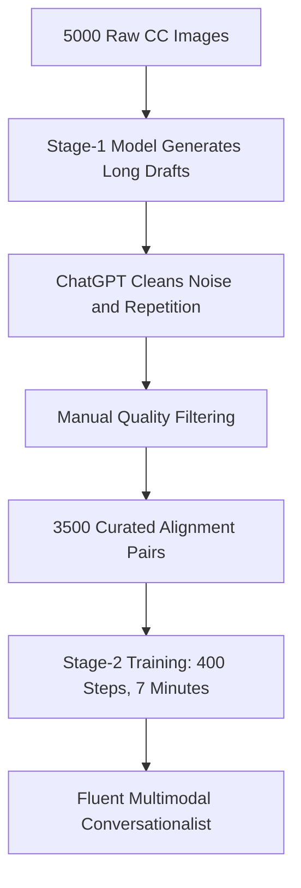

## The hook

In March 2023, OpenAI showed off GPT-4 turning a napkin sketch into working website code and dissecting internet memes frame by frame. The demonstrations looked like science fiction, but OpenAI kept the architecture entirely secret. Most machine learning researchers assumed that replicating those multimodal tricks would require millions of dollars in compute, custom supercomputers, and months of end-to-end training.

A month later, a research team from KAUST proved the entire field wrong. They built a system with the exact same party tricks using an off-the-shelf vision model, an open-source chatbot, and a single trainable matrix. 

They trained it in roughly ten hours on four consumer-grade cloud GPUs.

:::analogy
Imagine an expert courtroom translator who speaks fluent English and a forensic artist who only draws sketches. You do not need to teach the translator how to draw, nor do you need to send the artist to law school. You only need a small translation card that converts the artist's visual marks into word tokens the translator already understands.
:::

## Before you start

Before reading this, you should feel comfortable with:
- How [CLIP](article:paper-clip) turns images and text into comparable vector embeddings.
- How [LLaMA](article:paper-llama) models predict the next text token autoregressively.
- How [BLIP-2](article:paper-blip-2-bootstrapping-language-image-pre-training-with-frozen) uses queries to compress visual features into a language model.

## The world before this paper

In early 2023, vision-language models were stuck in an awkward middle ground.

Systems like Flamingo had demonstrated impressive few-shot learning by injecting visual cross-attention layers into language models. However, training Flamingo required billions of web images and industrial-scale infrastructure. 

[BLIP-2](article:paper-blip-2-bootstrapping-language-image-pre-training-with-frozen) solved the compute problem by freezing both the visual backbone and the language decoder, bridging them with a lightweight module called a [[Q-Former]]. Yet BLIP-2 relied on smaller language backbones like Flan-T5. When you showed BLIP-2 an image and asked for a humorous explanation or a recipe, it behaved like an image-captioning model from 2017: it spat out short, mechanical descriptions like "a dog on the floor" and refused to hold a conversation.



Other researchers tried stringing together separate systems. In models like Visual ChatGPT, a language model acted as an API router, writing Python scripts to call computer vision models in the background. It worked, but it felt disjointed. It could not glance at an image, appreciate the visual irony of a joke, and joke back with you in real time.

:::history
When GPT-4 launched, the research community debated whether OpenAI had trained an entirely new multimodal architecture from scratch on trillions of unified image-text tokens. Deyao Zhu and his collaborators hypothesized something much simpler: GPT-4's multimodal "intelligence" was not coming from a massive vision-language pretraining run. It was simply the emergent reasoning of an advanced language model that had been handed visual features.
:::

## The big idea

The authors hypothesized that modern large language models already possess the ability to write poems, debug HTML, outline recipes, and analyze humor. If an LLM can do all of that from text descriptions, it should be able to do it from raw images—provided you project those visual representations into the language model's native token space.

MiniGPT-4 connects a frozen EVA-CLIP vision encoder to a frozen [[Vicuna]] language model (a popular conversational model fine-tuned from [LLaMA](article:paper-llama)). 

The bridge between these two multi-billion-parameter giants is not a complex neural network. It is a single [[Linear Projection Layer]] containing a single weight matrix. 

By training only this matrix, the vision encoder's visual features are converted into continuous vectors that the language model processes as a [[Soft Prompt]]. To the language model, looking at an image feels no different than reading an introductory sentence.

:::insight
Advanced multimodal capabilities do not need to be learned from scratch. They naturally emerge when you map visual features directly into an instruction-tuned language model's embedding space.
:::

## How it works

The entire MiniGPT-4 pipeline consists of three components and a two-stage training strategy.



### 1. The Architecture

The visual front-end comes straight from BLIP-2:
1. An **EVA-CLIP ViT-G/14** processes the input image into rich feature grids.
2. A **Q-Former** uses 32 learnable queries to distill those features into 32 compact vectors.
3. A **Linear Projection Layer** projects each vector from the Q-Former's dimension ($d_v = 768$) to Vicuna's hidden dimension ($d_{llm} = 4096$ or $5120$).

If a single visual token vector coming out of the Q-Former is $v \in \mathbb{R}^{1 \times 768}$, the projection layer maps it using weight matrix $W \in \mathbb{R}^{768 \times 4096}$ and bias $b \in \mathbb{R}^{1 \times 4096}$:

$$z = v W + b$$

Where:
- $v$ is the raw vector summarizing one patch of visual queries.
- $W$ is the trainable projection matrix aligning vision with text.
- $b$ is the learnable bias vector.
- $z$ is the resulting 4,096-dimensional vector that looks like a normal word embedding to Vicuna.

The system prepends these 32 projected vectors to the user's tokenized prompt inside a conversational template:

`### Human: <ImageFeature></Img> What is funny about this picture? ### Assistant:`

The entire vision encoder and the entire Vicuna model remain frozen. Backpropagation updates only $W$ and $b$.

### 2. Stage 1: Aligning Sight with Syntax

In the first stage, the team trained the projection layer on roughly 5 million image-text pairs pulled from LAION, Conceptual Captions, and SBU. 

Using standard cross-entropy language modeling loss, the linear layer learned to translate visual query vectors into representations that allowed Vicuna to predict the accompanying image captions. The team ran this pretraining for 20,000 steps with a batch size of 256. 

The entire run took approximately 10 hours on four NVIDIA A100 GPUs.

### 3. The Language Collapse Problem

After Stage 1, MiniGPT-4 could recognize objects, understand complex scenes, and answer basic questions. But there was a glaring flaw: its conversational ability had collapsed.

Instead of speaking like the eloquent Vicuna chatbot, MiniGPT-4 began producing repetitive gibberish, trailing off mid-sentence, and repeating the same phrase over and over.

```
Stage 1 Output: "This image depicts a wooden bench in the snow on a sunny day. The bench is"
```

Why did this happen? 

The millions of web image-text pairs used in Stage 1 consisted of short, fragmented captions scraped from HTML `alt` tags. Because the model was trained exclusively on short web captions, it unlearned Vicuna's conversational pacing. This mirrors what happened to base language models before [InstructGPT](article:paper-instructgpt): pure pretraining yields knowledge, but alignment requires curated conversation.

:::warning
Pretraining an LLM on noisy, low-quality web alt-text damages its ability to generate natural, multi-sentence responses. Aligning the model with conversational data is essential.
:::

### 4. Stage 2: The 7-Minute Alignment Fix

To fix the degradation without spending weeks hand-labeling data, the researchers turned MiniGPT-4 on itself:

1. **Synthetic Generation:** They took 5,000 images from Conceptual Captions and used the Stage-1 model to write verbose descriptions using a prompt like *"Describe this image in detail. Say everything you see."*
2. **ChatGPT Post-Processing:** Because the Stage-1 outputs had repetition and grammar bugs, they fed each generated paragraph to ChatGPT with instructions to clean up errors, drop sentence fragments, and polish fluency.
3. **Filtering and Curation:** The team manually checked the results, filtering out common assistant apologies like *"I'm sorry, I made a mistake"*. 

They ended up with just 3,500 high-quality image-description pairs.

The authors then fine-tuned the linear projection layer on these 3,500 examples using a conversational prompt template. This second stage required a mere 400 training steps with a batch size of 12. 

It finished in approximately seven minutes on a single A100 GPU.



:::try-this
Imagine giving a student thousands of brief flashcards that say "dog running" or "red car". If you ask them to write an essay based on an image, they will struggle because they have only practiced writing two-word fragments. Giving them just 50 well-written sample essays fixes their tone immediately. That is precisely why 3,500 clean examples restored MiniGPT-4's fluency.
:::

## What they found

The results demonstrated that complex reasoning was already sitting dormant inside the language model, waiting for aligned visual signals.

### 1. Beating BLIP-2 at Complex Tasks

The authors created an evaluation set of 100 challenging multimodal tasks across four categories: meme interpretation, recipe generation, advertisement writing, and poem composition. Human evaluators judged whether the model fulfilled the prompt.

| Task | BLIP-2 Success Rate | MiniGPT-4 Success Rate |
| :--- | :--- | :--- |
| Meme Interpretation | 0 / 25 (0%) | 8 / 25 (32%) |
| Recipe Generation | 4 / 25 (16%) | 18 / 25 (72%) |
| Advertisement Drafting | 1 / 25 (4%) | 19 / 25 (76%) |
| Poem Writing | 0 / 25 (0%) | 20 / 25 (80%) |
| **Overall Average** | **5 / 100 (5%)** | **65 / 100 (65%)** |

BLIP-2 was essentially incapable of handling open-ended creative tasks. In contrast, MiniGPT-4 successfully answered nearly 80% of recipes, advertisements, and poems, and managed to dissect the punchlines of internet memes in nearly a third of tests.

### 2. Eliminating Repetition and Failures

The second alignment stage dramatically improved generation reliability. When evaluated on 100 test images from COCO:

- Detailed caption generation failure rate dropped from **35%** (before Stage 2) to **2%** (after Stage 2).
- Poem generation failure rate plummeted from **32%** to **1%**.

On COCO caption completeness—where ChatGPT judged whether a description captured all visual objects and relationships in the ground truth—MiniGPT-4 scored **66.2%**, dwarfing BLIP-2's **27.5%**.

### 3. The Q-Former Wasn't Even Essential

In an ablation study, the researchers tested what happened if they removed the Q-Former altogether. They took the raw visual tokens from the EVA-CLIP Vision Transformer and mapped them directly into Vicuna using only a linear layer.

| Architecture Variant | AOK-VQA Accuracy | GQA Accuracy |
| :--- | :--- | :--- |
| **MiniGPT-4 (Default)** | **58.2** | 32.2 |
| MiniGPT-4 without Q-Former | 56.9 | **33.4** |
| MiniGPT-4 with 3 Linear Layers | 49.7 | 31.0 |
| MiniGPT-4 with Fine-tuned Q-Former | 52.1 | 28.0 |

Removing the Q-Former barely affected benchmark performance (56.9 vs 58.2 on AOK-VQA, and slightly higher on GQA at 33.4 vs 32.2). Adding extra projection layers or fine-tuning the Q-Former actually hurt results. A single linear layer was all that was needed.

## What it got wrong (or left open)

While MiniGPT-4 proved that multimodal systems could be built cheaply, it highlighted several structural weaknesses in open multimodal models:

### 1. Object Hallucination
Because Vicuna is an autoregressive language model trained to produce compelling prose, it tends to invent visual elements to make its sentences flow better. 

Using the [[CHAIR]] metric (which counts the fraction of mentioned objects not present in the scene), MiniGPT-4 scored a hallucination rate of **9.6%** on long descriptions (averaging 175 words), compared to **7.2%** on short descriptions. In one notable failure case, MiniGPT-4 described non-existent white tablecloths in an image of an empty restaurant bar simply because restaurant descriptions frequently mention tablecloths.

### 2. Spatial Blindness
MiniGPT-4 had almost no spatial awareness. When shown a photo of a dining room and asked whether the windows were on the left side, the model answered confidently that they were on the left, even though they were clearly on the right. 

The web caption datasets used in Stage 1 rarely mention coordinates or relative object arrangements, leaving the projection layer blind to geometry.

### 3. Bounded by Frozen Encoders
Because the vision backbone and the LLM were both frozen, the model could never improve its visual resolution or learn new visual concepts beyond what EVA-CLIP had captured during its original training.

## What happened next

MiniGPT-4 triggered an immediate revolution in open-source multimodal research. Released alongside its contemporary LLaVA (Large Language and Vision Assistant), it established the modern blueprint for open-source multimodal models:

1. **Direct Linear Projections:** MiniGPT-4's ablation proving that the Q-Former could be discarded inspired subsequent models to drop intermediate querying modules in favor of simple multi-layer perceptrons (MLPs) connecting vision transformers directly to LLMs.
2. **Two-Stage Recipe:** The division between large-scale noisy pretraining and small-scale, high-quality conversational alignment became the standard training curriculum for open-source multimodal models.
3. **Synthetic Vision-Instruction Tuning:** MiniGPT-4 proved that using advanced text models to curate clean, conversational multimodal datasets was the fastest path to beating proprietary benchmarks.

By proving that a ten-hour training run and a single linear matrix could replicate GPT-4's most famous demos, MiniGPT-4 took multimodal AI out of the exclusive grasp of tech monopolies and handed it to the open-source community.

## Key takeaways

- Advanced multimodal reasoning is an emergent behavior of large language models, not a skill that must be trained into vision backbones from scratch.
- A single trainable linear projection layer is sufficient to align a frozen vision encoder with a frozen large language model.
- Pretraining on short, noisy web image-text pairs degrades conversational fluency, causing repetition and fragmented sentences.
- A secondary alignment phase on as few as 3,500 high-quality conversational descriptions eliminates language degradation in just a few hundred training steps.
- Current projection-based multimodal models remain vulnerable to object hallucination and lack fine-grained spatial reasoning.
