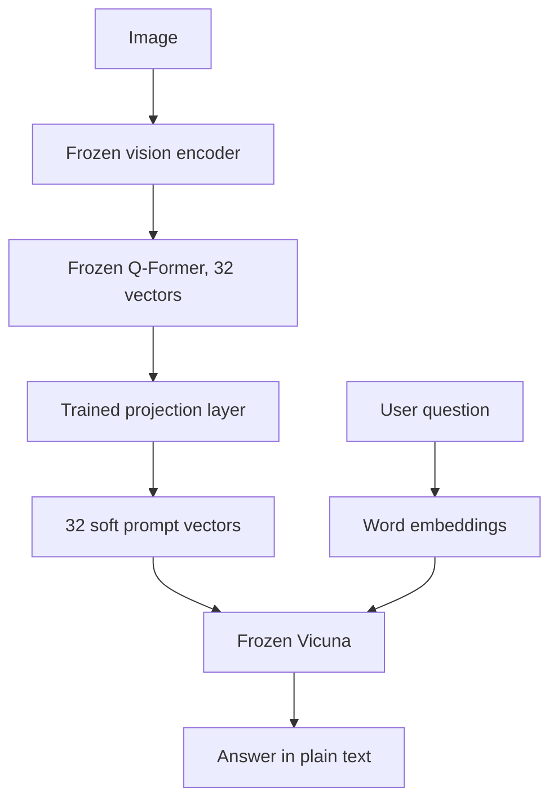

## The hook

In March 2023, OpenAI showed GPT-4 looking at a hand-drawn sketch of a website and writing the code for it. It could also look at a meme and explain the joke. Nobody outside OpenAI knew how it worked, and the guess was that it needed a giant, secret training run.

A month later, a small team released a model that did many of the same tricks. They had not trained a giant model at all. They took two existing models, froze both, and trained one small layer between them.

## Before you start

You should know how [CLIP](article:paper-clip) maps images and text into vectors, and how a language model such as [LLaMA](article:paper-llama) predicts the next token. It helps a lot to have read [the BLIP-2 article](article:paper-blip-2-bootstrapping-language-image-pre-training-with-frozen), because MiniGPT-4 borrows its whole visual front end.

## The world before this paper

By early 2023 there were two ways to give a language model eyes.

- **Train a big joint model.** Systems like DeepMind's Flamingo inserted new layers into a language model and trained on huge collections of images and text. Powerful, but far beyond a university budget.
- **Bolt on a light bridge.** [BLIP-2](article:paper-blip-2-bootstrapping-language-image-pre-training-with-frozen) kept a vision encoder and a language model [[Frozen model|frozen]] and trained only a small connector, the [[Q-Former]]. Cheap, but its language models were not chat models, so it tended to give short, caption-like answers.

A third route chained separate tools: a chatbot that called vision programs and read back their text output. It worked, but the language model never actually looked at the image.

:::history
Deyao Zhu, Jun Chen, Xiaoqian Shen, Xiang Li and Mohamed Elhoseiny, at King Abdullah University of Science and Technology (KAUST), posted MiniGPT-4 on arXiv in April 2023, weeks after the GPT-4 announcement. It later appeared at ICLR 2024. Their starting bet was simple: GPT-4's visual skills probably come from its strong language model, not from some special vision machinery.
:::

## The big idea

:::analogy
Picture a brilliant novelist who is blindfolded, and a sharp-eyed scout who can see everything but only speaks in a private shorthand. The novelist can already write poems, recipes and jokes. The scout already notices every detail. Neither needs retraining. You only need an interpreter with a small codebook who turns the scout's shorthand into words the novelist understands.
:::

In MiniGPT-4, the scout is the frozen vision side from BLIP-2. The novelist is [[Vicuna]], a frozen chatbot built on LLaMA. The interpreter is a single [[projection layer]]: one matrix and one bias vector.

Its output goes into Vicuna exactly where word embeddings would go. Vicuna reads these vectors as a [[soft prompt]]: they are not real words, but they sit in the same space, so the novelist treats them like a description of the scene.

:::insight
If the language model already knows how to write a recipe, explain a joke or draft a web page, you do not need to teach it those skills again for images. You only need to translate what the eye sees into the language model's own input space.
:::

## How it works

### Step 1: the scout looks

The image goes through BLIP-2's vision encoder, a large vision transformer (EVA-CLIP ViT-g/14). With 14 by 14 pixel patches on a 224 by 224 image, that is a grid of 16 × 16 = 256 patch features.

The Q-Former then uses 32 learnable queries to squeeze those features into 32 vectors of 768 numbers each. That is 8 times fewer vectors than patches.

### Step 2: the interpreter translates

The projection layer maps each 768-number vector into Vicuna's embedding size. For the 13-billion-parameter Vicuna, that size is 5,120. In symbols:

$$z = vW + b$$

Here $v$ is one of the 32 visual vectors (768 numbers), $W$ is the learned 768 by 5,120 matrix, $b$ is a learned bias of 5,120 numbers, and $z$ is the result: a vector shaped exactly like a word embedding.

### A worked example

Shrink everything so you can do it by hand. Say a visual vector has 3 numbers, $v = [0.5, -1.0, 2.0]$, and word embeddings have 2. Let the learned matrix and bias be:

| | column 1 | column 2 |
|---|---|---|
| row 1 | 1.0 | 0.0 |
| row 2 | 0.0 | -0.5 |
| row 3 | 0.4 | 0.2 |
| bias | 0.1 | 0.0 |

Then $z_1 = 0.5 × 1.0 + (-1.0) × 0 + 2.0 × 0.4 + 0.1 = 1.4$ and $z_2 = 0 + (-1.0) × (-0.5) + 2.0 × 0.2 + 0 = 0.9$, so $z = [1.4, 0.9]$.

Now suppose the language model's embedding for "dog" is $[1.0, 0.2]$ and for "car" is $[-0.3, 1.0]$. The cosine similarity of $z$ with "dog" is about 0.93, and with "car" about 0.28. The projected image vector lands near "dog". Training nudges $W$ and $b$ until images of dogs land near dog-like meaning, and so on for everything else. That is the interpreter filling in the codebook.

How big is the real codebook? $768 × 5{,}120 + 5{,}120 = 3{,}937{,}280$ numbers, about 3.9 million. Against a 13-billion-parameter language model, that is roughly 0.03 percent.

:::try-this
For the 7-billion-parameter Vicuna, whose embedding size is 4,096, how many numbers does the projection layer hold? (768 × 4,096 + 4,096 = 3,149,824, about 3.1 million.)
:::

### Step 3: stage one, learning the codebook

The first stage trained the projection layer on millions of image and short-caption pairs from public web datasets. The task was ordinary next-token prediction: given the 32 projected vectors, predict the caption. Because only the projection layer learns, this took roughly ten hours on four A100 GPUs.

Afterwards the model understood images surprisingly well. But it spoke badly. Answers repeated the same phrase, broke off mid-sentence, or wandered.

:::warning
Common misconception: "If the language model is frozen, its writing style cannot change." The weights do not change, but the inputs do. The interpreter was trained only on terse captions, so it learned to hand the novelist notes that pushed it toward short, broken text. What you feed a frozen model still shapes how it talks.
:::

### Step 4: stage two, a small set of good examples

The fix was data, not size. The authors used the stage-one model itself to write long descriptions of images, then asked ChatGPT to clean up repetition and grammar, then checked the results by hand. About 3,500 high-quality image and description pairs survived.

They fine-tuned the projection layer on these, wrapped in a conversation template ("Human: image, question. Assistant: answer"). This stage was tiny, minutes on a single GPU. In the analogy, the interpreter spent a short afternoon studying well-written reports, and learned to pass along full sentences.

## What they found

The paper's claims are mostly about abilities, shown through many examples:

- **GPT-4-like demos.** With visual features aligned to Vicuna, MiniGPT-4 could write detailed image descriptions and turn a hand-drawn draft of a web page into working website code.
- **Other emerging abilities.** It could write stories and poems inspired by an image, explain what is funny in a picture, and teach users how to cook a dish from a photo of food.
- **The second stage mattered.** Training only on short caption pairs produced unnatural language, with repetition and fragments. Fine-tuning on the curated detailed descriptions made generation more reliable and the model far more usable.
- **Everything was released.** Code, the trained model and the curated dataset were made public.

The deeper finding is the one the authors set out to test: much of the visual "intelligence" people saw in GPT-4 can come from the language model, once the eye's output is translated into its space. The novelist was already a novelist; it just needed someone to describe the scene.

## What it got wrong (or left open)

- **Hallucination.** Like its language model, MiniGPT-4 sometimes described objects that were not in the image, especially in long descriptions. A fluent novelist fills gaps with plausible details.
- **Weak spatial sense.** Questions about where things are, left or right, were unreliable. Short web captions rarely talk about position, so the codebook never learned it well.
- **Bounded by frozen parts.** The model can only see what the frozen encoder captured. If the scout misses a detail, no interpreter can recover it.
- **Evidence mostly by demonstration.** The case rests largely on qualitative examples of abilities, which makes careful comparison with other systems harder.

## What happened next

MiniGPT-4 arrived at almost the same moment as LLaVA ("Visual Instruction Tuning"), which also connected a CLIP vision encoder to Vicuna through a small learned projection and trained on instruction data generated with GPT models. Together they set the template for open vision-language assistants: a pre-trained vision encoder, a pre-trained LLM, a light connector, and a two-stage recipe of broad alignment followed by a small, high-quality instruction set.

Later open models kept that shape and refined the parts: small multi-layer connectors instead of one linear layer, higher image resolutions, and much larger instruction datasets. The same team released MiniGPT-v2 later in 2023, aimed at handling many vision-language tasks with one interface. The idea that careful, curated data in the final stage matters more than its size echoes [InstructGPT](article:paper-instructgpt) on the text side.

## Key takeaways

- MiniGPT-4 connects a frozen vision encoder and Q-Former to a frozen Vicuna chatbot with a single trained projection layer of a few million numbers.
- The paper supports the bet that GPT-4's flashiest image abilities come largely from a strong language model whose input has been aligned with visual features.
- Training only on short web captions made the model's language repetitive and fragmented, even though the language model itself was frozen.
- A second stage on a few thousand carefully curated detailed descriptions fixed the language problems in minutes of training.
- The frozen-encoder, light-connector, two-stage recipe became the standard starting point for open vision-language assistants.
