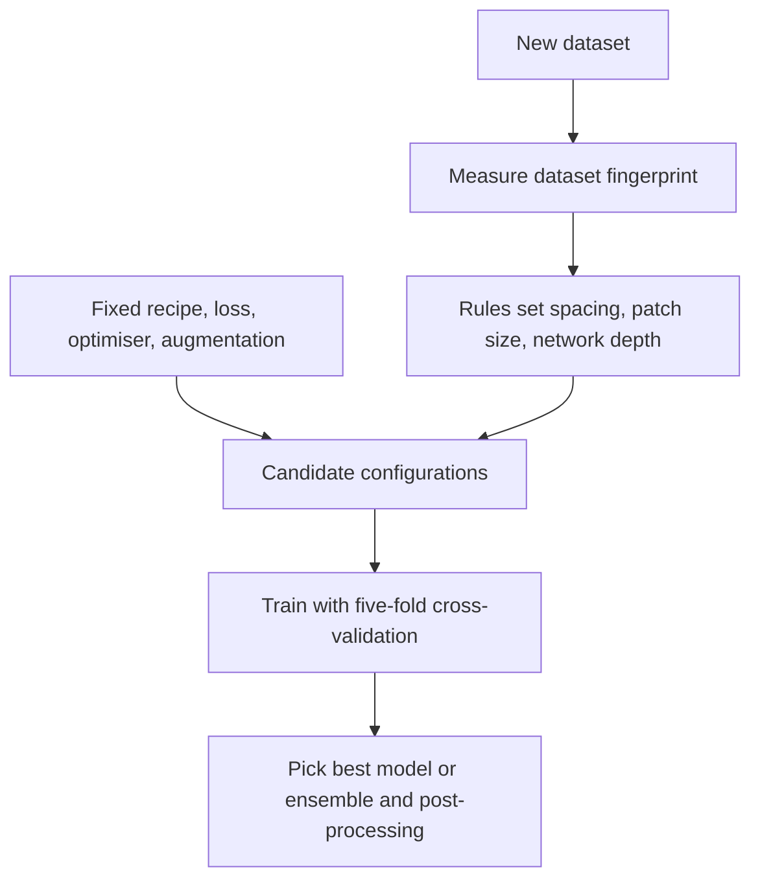

## The hook

A hospital hands you a folder of kidney CT scans and asks for a tumour segmentation model. You pick the U-Net, the standard tool, and then the questions pile up: resample the thick slices or not, how big a crop fits in your GPU, 2D or 3D, how to normalise brightness.

Get one of those wrong and an excellent architecture scores badly. A group in Heidelberg noticed that these dull choices, not the architecture, were where most medical imaging projects quietly won or lost.

## Before you start

You should know the encoder, decoder and skip connections of [U-Net](article:paper-unet), and what a loss function does from [the loss functions primer](article:primer-loss-functions). Knowing why we hold out validation data, from [the overfitting primer](article:primer-overfitting), helps with the last step.

## The world before this paper

After U-Net appeared in 2015, medical image segmentation produced a stream of variants: attention gates, residual blocks, dense connections, new losses. Each paper usually reported a gain on one or two datasets.

But medical data is wildly diverse. CT measures tissue density on a fixed scale; MRI brightness is arbitrary. Image sizes vary. [[Voxel spacing]] varies between scanners, and many scans are [[anisotropic]]. A model has to be adapted to every new dataset, and the abstract puts it plainly: designing these solutions is non-trivial and depends heavily on dataset properties and hardware.

So two questions were mixed together. Was a new method better because of its new block, or because its authors tuned the pipeline more carefully? Nobody could tell.

:::history
Fabian Isensee, Paul F. Jaeger, Simon A. A. Kohl, Jens Petersen and Klaus H. Maier-Hein, at the German Cancer Research Center (DKFZ) in Heidelberg, built nnU-Net, where "nn" stands for "no new net". An early version won the Medical Segmentation Decathlon in 2018, a challenge built to test exactly this kind of generality. The full method was published in Nature Methods.
:::

## The big idea

:::analogy
Think of a travelling chef hired to cook the same signature dish in a different kitchen every week. Some things never change: the recipe. Some things depend on the kitchen and can be worked out by measuring it: a smaller oven means a smaller tray and a longer bake. And a few things can only be settled by tasting: she cooks two or three versions and serves the one that tastes best.
:::

nnU-Net splits every design decision for a segmentation pipeline into those same three groups:

- **Fixed parameters** (the recipe): choices that work well everywhere, so they never change.
- **Rule-based parameters** (measuring the kitchen): choices computed from the dataset's properties and the GPU memory budget by explicit rules.
- **Empirical parameters** (tasting): the few choices settled by validation scores.

The architecture stays a plain U-Net. What is new is that a computer, not a tired PhD student, makes every other decision, the same way each time.

## How it works

### The recipe: fixed parameters

Every dataset gets the same core training recipe: a U-Net with plain convolution blocks, instance normalisation and leaky ReLU; a loss that adds [[Dice score|Dice]] loss to cross-entropy; stochastic gradient descent with Nesterov momentum and a slowly decaying learning rate; and heavy data augmentation (rotations, scaling, elastic deformation, brightness changes, mirroring).

### Measuring the kitchen: the dataset fingerprint

Before anything trains, nnU-Net reads the whole training set and records its [[dataset fingerprint]]: image sizes, voxel spacings, modality, and intensity statistics inside the labelled regions.

Rules then turn that fingerprint into settings:

- **Target spacing.** All scans are resampled to a common spacing, normally the dataset's median, with special handling for strongly anisotropic data.
- **Intensity normalisation.** For CT, intensities are clipped to a percentile range of the foreground and standardised with dataset-wide statistics, because CT values mean the same thing across scans. For MRI, each image is standardised on its own.
- **[[Patch]] size, batch size and depth.** The network trains on 3D crops. The rules pick the largest patch that fits the memory budget, then decide how many times to downsample each axis.

### A worked example: downsampling an anisotropic scan

Suppose the target spacing is 5.0 mm between slices and 0.8 mm within each slice, and the chosen patch is 40 × 160 × 160 voxels. Physically, that patch covers 40 × 5.0 = 200 mm by 160 × 0.8 = 128 mm by 128 mm.

If you halve all three axes at every pooling step, the coarse axis runs out of resolution while the fine axes still have plenty. nnU-Net's rules avoid this. Here is a simplified rule in the same spirit: halve an axis only if its current spacing is at most twice the finest spacing, and only while it keeps at least 4 voxels.

| Step | Patch shape (voxels) | Spacing (mm) | Axes halved |
|---|---|---|---|
| 0 | 40 × 160 × 160 | 5.0 × 0.8 × 0.8 | none |
| 1 | 40 × 80 × 80 | 5.0 × 1.6 × 1.6 | in-plane only |
| 2 | 40 × 40 × 40 | 5.0 × 3.2 × 3.2 | in-plane only |
| 3 | 20 × 20 × 20 | 10.0 × 6.4 × 6.4 | all three |
| 4 | 10 × 10 × 10 | 20.0 × 12.8 × 12.8 | all three |
| 5 | 5 × 5 × 5 | 40.0 × 25.6 × 25.6 | all three |

At step 3 the slice axis joins in, because 5.0 mm is now no more than twice 3.2 mm. From there the voxels are roughly the same shape in every direction, so 3D filters see the anatomy without squashing it. After step 5 another halving would leave only 2 voxels, so the network stops at five pooling steps.

This is the chef measuring the oven: no trial runs, just arithmetic on the dataset's own numbers.

:::try-this
A dataset has spacing 3.0 × 0.75 × 0.75 mm. Using the same rule, at which pooling step is the slice axis first halved? (Step 2. After step 1 the in-plane spacing is 1.5 mm, and 3.0 mm is no more than twice 1.5 mm, so the slice axis is halved at step 2.)
:::

### Tasting: empirical decisions

Some questions have no reliable rule, such as whether a 2D or 3D network suits this data. So nnU-Net trains several candidate configurations, each with five-fold [[cross-validation]]:

- a **2D U-Net** working slice by slice;
- a **3D full-resolution U-Net** on 3D patches;
- for large images, a **3D cascade**, where a first network segments a downsampled image and a second refines the result at full resolution.

It then keeps the best single configuration or an ensemble of two, based on validation scores. Finally it tests a post-processing step that keeps only the largest connected region of each predicted structure, and switches it on only if validation improves.

:::warning
Common misconception: "Keeping only the largest connected region always cleans up the output." For a single organ such as the liver it removes stray specks. For scattered lesions, it would delete real tumours. That is why nnU-Net treats it as a tasting decision, judged on validation data, not a fixed rule.
:::

:::insight
Most of a segmentation model's success lives in the pipeline around the network. Write down expert pipeline knowledge as rules, and a plain U-Net becomes a strong default for almost any dataset.
:::

## What they found

The claims in the paper's abstract are broad and striking:

- **No manual tuning needed.** nnU-Net configured itself for each new dataset, including preprocessing, architecture, training and post-processing.
- **Beat most specialised methods.** Without manual intervention, it surpassed most existing approaches on a large set of public datasets from international biomedical segmentation competitions, including highly specialised solutions built for those specific tasks.
- **Accessible to non-experts.** It runs out of the box and needs no compute beyond standard network training, so state-of-the-art segmentation no longer requires an expert to hand-tune each project.

The lesson for the field was uncomfortable: a carefully configured plain U-Net was often a stronger baseline than the novel architectures papers were comparing against. In the chef's terms, a well-measured kitchen beat a fancier recipe.

## What it got wrong (or left open)

- **Training cost.** Training several configurations with five folds each means many full training runs per dataset. That is far cheaper than architecture search, but still expensive.
- **Rules come from experience.** The heuristics encode what worked on the datasets the authors knew. Unusual data, such as some microscopy, may need human adjustment.
- **Tuned for overlap.** The default loss and selection target overlap measures such as Dice. Tasks where boundary distance or detecting tiny objects matters most may need different choices.
- **It explains less than it achieves.** nnU-Net shows that configuration matters enormously, but not which single decisions matter most for a given dataset.

## What happened next

nnU-Net became the default baseline in medical image segmentation. Challenge entries and new architecture papers are now routinely compared against it, and many winning entries build directly on it. The authors later released nnU-Net v2, a rewritten and more extensible version of the framework.

Its broader message travelled too: before crediting a new architecture, check the pipeline around it. The same spirit appears in [UNet++](article:paper-unet-redesigning-skip-connections-to-exploit-multiscale-feat), which also builds on U-Net, and in general advice about [what makes machine learning work in practice](article:paper-few-useful-things).

## Key takeaways

- nnU-Net, "no new net", keeps a standard U-Net and automates every other decision in the segmentation pipeline.
- It splits decisions into fixed parameters, rule-based parameters computed from a dataset fingerprint, and empirical decisions settled by cross-validation.
- Rules such as spacing-aware downsampling let one method handle scans with very different resolutions and slice thicknesses.
- Without manual tuning, it beat most specialised methods across many public segmentation competitions.
- Its success showed that careful pipeline configuration often matters more than architectural novelty.
