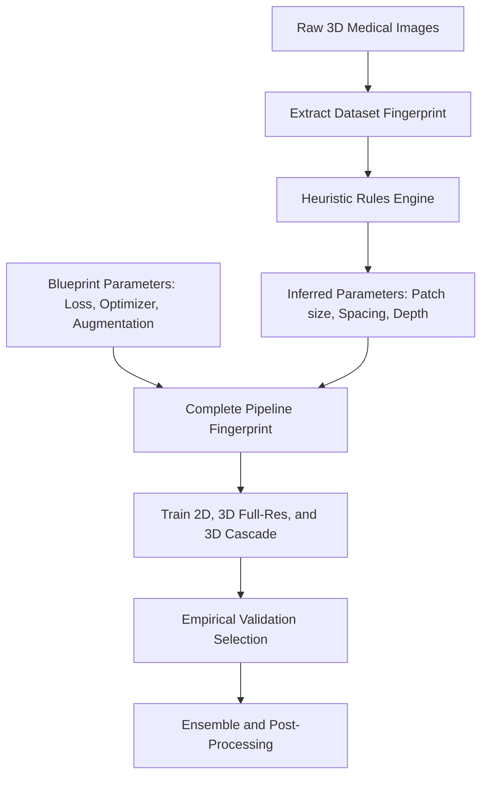
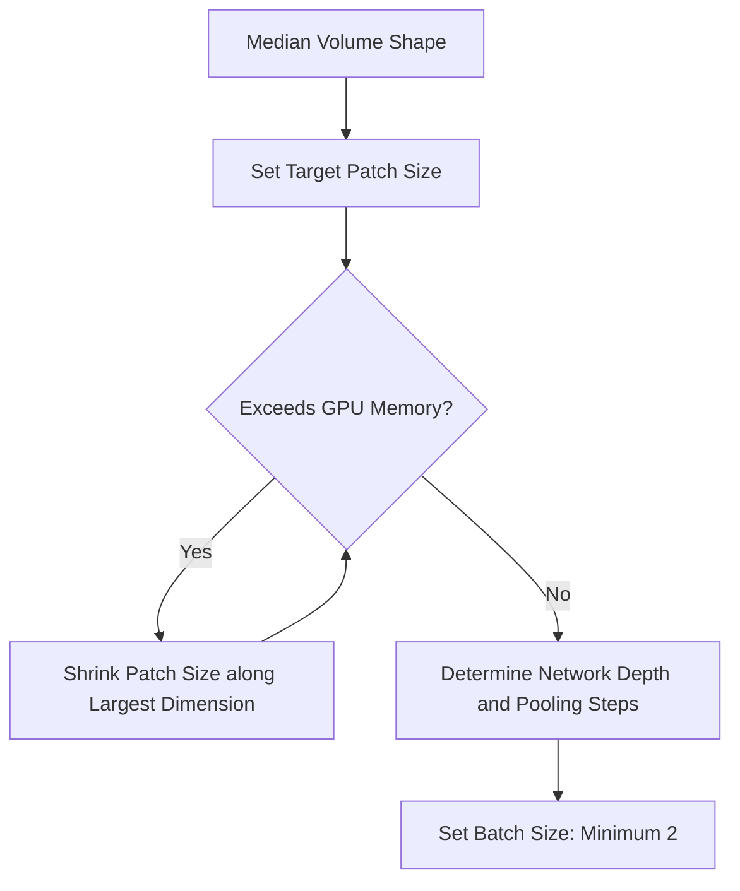

## The hook

In 2019, hundreds of researchers entered an international competition to spot kidney tumors in 3D scans. Nearly every team used the same core model: the famous U-Net. Yet their scores were scattered from the top of the leaderboard all the way to the bottom.

If everyone used the same model family, why did so many fail?

A team of medical imaging researchers from Heidelberg decided to investigate. They entered a bare-bones, classic U-Net with zero architectural bells or whistles. No attention gates. No dilated convolutions. No residual blocks.

Their plain model swept the competition and took first place. The secret was not the network at all. The secret was the invisible plumbing around it.

## Before you start

To get the most out of this article, make sure you are comfortable with:
- How encoder-decoder networks segment images using skip connections in [The U-Shaped Network That Learned From Thirty Images](article:paper-unet).
- How models measure mistakes using cross-entropy and Dice loss in [How Wrong Is the Model?](article:primer-loss-functions).
- How models overfit or fail to generalize in [Memorizing vs Learning](article:primer-overfitting).

## The world before this paper

In 2015, the medical imaging world fell in love with the U-Net. It was elegant, intuitive, and fast.

Then came the flood. Over the next five years, researchers published thousands of papers proposing small tweaks. One paper added squeeze-and-excitation blocks. Another swapped normal convolutions for dilated ones. Another plugged in attention heads.

:::history
By 2019, the original U-Net paper had collected over twelve thousand citations. Almost every new paper claimed a 1% or 2% boost over a "baseline". But each trick was usually tested on a single private dataset, or on just one public benchmark. Nobody checked whether these fancy tricks helped across different medical imaging tasks.
:::

Meanwhile, real clinical data is messy and diverse. A 3D computed tomography (CT) scan measures tissue density in standard physical units. A magnetic resonance imaging (MRI) scan measures magnetic signals with arbitrary brightness scales. 

Worse, image spacing varies. One hospital scanner might capture crisp 1-millimeter cubic voxels. Another captures slices 5 millimeters apart. If you feed these volumes directly into a neural network, a round tumor gets squished into an oval.

To make an algorithm work on a new dataset, an engineer had to make dozens of interlocking choices:
- How should we resample voxels with different slice thicknesses?
- What patch size fits inside GPU memory without cutting off organ context?
- What batch size keeps gradient updates stable without crashing the machine?
- Should we normalize pixels with a global z-score or per-case percentiles?

Getting any single choice wrong crippled the model. Most engineers adjusted these dials by trial and error.

Automated machine learning (AutoML) existed, but searching through thousands of possible pipelines took hundreds of GPU days per dataset. Clinics did not have that kind of hardware or time.

## The big idea

Fabian Isensee and his co-authors made a bold claim: you do not need a new neural network architecture. You just need to configure the classic U-Net properly.

They called their system **nnU-Net**, short for **No New Net**.

Instead of guessing hyperparameters or running slow, expensive search loops, nnU-Net treats pipeline design as an expert recipe book. It scans the target dataset once to create a summary of its geometry. Then, it uses clear rules derived from physics and medical imaging experience to choose every single setting.

:::analogy
Imagine hiring a bespoke tailor. A bad tailor guesses your measurements, stitches a random garment, tries it on you, and rips out seams over ten fittings. 

nnU-Net is a master tailor with a strict measuring tape. It takes your exact proportions (the [[Dataset Fingerprint]]), grabs a classic, time-tested suit pattern (the U-Net [[Blueprint Parameters]]), and cuts the cloth to fit your body on the very first try using proven tailoring formulas.
:::

:::insight
A simple model configured with rigorous engineering will beat a sophisticated model configured by guesswork almost every time.
:::

## How it works

nnU-Net splits the massive space of design decisions into three clean buckets:



### 1. The Dataset Fingerprint

Before training a single neuron, nnU-Net reads every image file in the training folder. It extracts a summary called the [[Dataset Fingerprint]]:
- **Image shapes:** How tall, wide, and deep are the volumes?
- **Voxel spacing:** What is the physical distance between voxels along the $x$, $y$, and $z$ axes (e.g., $0.7 \times 0.7 \times 5.0\text{ mm}$)?
- **Modalities:** Are these CT scans with calibrated Hounsfield units, or MRIs with uncalibrated intensities?
- **Class labels:** What fraction of the volume belongs to background, organs, or tumors?

### 2. Blueprint Parameters: The Unchanging Foundation

Next, nnU-Net fixes a set of [[Blueprint Parameters]]. These settings never change, regardless of whether you are segmenting a brain, a prostate, or a kidney:
- **Architecture template:** A classic encoder-decoder U-Net with plain convolutional blocks, leaky ReLU activations, and instance normalization.
- **Loss function:** A balanced combination of cross-entropy loss and soft Dice loss:
$$\mathcal{L} = \mathcal{L}_{\text{Dice}} + \mathcal{L}_{\text{CE}}$$
- **Optimization:** Stochastic gradient descent with Nesterov momentum, initialized at a learning rate of $0.01$ and decayed using a polynomial schedule over 1,000 epochs.
- **Aggressive augmentation:** Random rotations, scaling, elastic deformations, gamma adjustments, and mirroring.

The authors kept these settings identical across all tasks because their experiments proved that these choices are universally robust.

### 3. Inferred Parameters: The Heuristic Rules

This is where the magic happens. nnU-Net uses deterministic heuristic rules to turn the [[Dataset Fingerprint]] into [[Inferred Parameters]].

Consider voxel spacing. If an abdominal scan has thick $5\text{ mm}$ slices in the $z$-direction but $0.8\text{ mm}$ resolution in $x$ and $y$, applying a symmetric 3D convolution treats all axes equally. This distorts anatomical features.

nnU-Net detects this anisotropy automatically. If the slice thickness along one axis is more than three times the in-plane resolution, nnU-Net drops downsampling along the thick axis during the first pooling layers.

Here is how nnU-Net balances patch size, network depth, and batch size inside GPU memory:



Instead of guessing a patch size, nnU-Net starts at the median shape of the preprocessed volumes. If that volume exceeds available GPU memory (calibrated for a standard 11 GB VRAM card in the 2020 paper), it reduces the patch size iteratively along the largest dimensions.

Once the patch size is locked, the number of pooling layers is fixed: downsample until the feature map resolution hits a minimum floor (such as $4 \times 4 \times 4$ voxels).

The complete collection of these choices forms the [[Pipeline Fingerprint]].

:::try-this
Suppose your CT dataset has an average volume size of $128 \times 512 \times 512$ voxels. If an isotropic 3D convolution reduces each dimension by a factor of 2 at each pooling layer:
1. How many downsampling steps can you take before the first axis ($128$) drops below $8$?
2. What happens if you downsample all three axes 5 times? 

*Answer:*
1. $128 \to 64 \to 32 \to 16 \to 8$. That is 4 steps.
2. After 5 steps, the first axis becomes 4, but the other axes are $16$. If you keep downsampling the small axis blindly, you collapse its spatial context to a single voxel while the other dimensions still have room. nnU-Net stops downsampling an axis as soon as it gets too small!
:::

### 4. Empirical Parameters: Letting Validation Decide

Even with smart heuristics, one question remains: should you use a 2D network, a 3D network, or a multi-stage approach?

To resolve this, nnU-Net automatically trains three distinct model setups using 5-fold cross-validation:
1. **2D U-Net:** Processes individual 2D slices. This excels when slice thickness is very large and 3D context is unreliable.
2. **3D Full-Resolution U-Net:** Processes full-resolution 3D patches. This captures fine spatial details across all axes.
3. **3D U-Net Cascade:** A two-stage pipeline. Stage 1 runs on aggressively downsampled images to capture coarse global context. Stage 2 takes high-resolution patches alongside the coarse predictions to refine fine boundaries.

Once cross-validation finishes, nnU-Net inspects the validation scores. It selects the single best configuration or builds an ensemble of the best two.

Finally, it tests [[Non-largest Component Suppression]]. If an organ like the liver is known to be a single connected piece, wiping away small floating specks of false-positive predictions improves the score. nnU-Net checks whether this step helps on the validation folds; if it does, it turns the filter on for final deployment.

These validation-driven choices are the [[Empirical Parameters]].

:::warning
Never apply post-processing filters blindly. If you are segmenting multiple scattered lung nodules or metastatic lesions, suppressing non-largest components will delete real tumors! nnU-Net only enables this filter if validation metrics explicitly improve.
:::

## What they found

The authors validated nnU-Net against the toughest benchmarks in biomedical imaging. They tested it across 10 international competitions, spanning 19 distinct datasets and 49 individual segmentation tasks.

The result stunned the community:
- nnU-Net set a **new state of the art in 29 out of 49 tasks**.
- In the remaining 20 tasks, its off-the-shelf score was either matching or close to the winning bespoke method.
- It accomplished all of this without a human changing a single line of code between tasks.

```
Task Coverage Across Competitions:
[=============================         ] 29 / 49 New State of the Art
[======================================] 49 / 49 Top-Tier Leaderboard Ranks
```

To drive the point home, the authors scrutinized the KiTS 2019 challenge leaderboard. All top 15 teams used a 3D U-Net variation. Some added attention gates; others added residual connections. 

Yet teams using the exact same architectural modification finished hundreds of places apart. nnU-Net entered the open leaderboard with a plain, unaugmented 3D U-Net backbone and beat them all.

To test whether popular architectural additions actually help, the authors ran an ablation study across ten different tasks from the Medical Segmentation Decathlon. They tested nine common variations, including:
- Swapping the optimizer to Adam (from [The Optimizer Almost Everyone Uses](article:paper-adam))
- Adding residual shortcut connections (from [Why Deeper Got Worse, and the Shortcut That Fixed It](article:paper-resnet))
- Replacing instance normalization with batch normalization (from [The Simple Fix That Made Deep Networks Train Fast](article:paper-batch-normalization))
- Removing data augmentation

Five of the nine variants took first place on at least one specific dataset. But across all ten datasets combined, not a single architectural trick consistently beat the standard nnU-Net baseline.

When evaluated across diverse challenges, the plain baseline had the best overall ranking.

## What it got wrong (or left open)

nnU-Net was a triumph of engineering discipline, but it had boundaries:

- **Dice-centric optimization:** The blueprint heuristics and loss functions are tuned to optimize overlap metrics like the Sørensen-Dice coefficient. For medical tasks where boundary accuracy or distance metrics (like Hausdorff distance) matter far more, the default setup can fall short.
- **Extreme domain anomalies:** On rare microscopy tasks like the CREMI synaptic cleft benchmark, nnU-Net placed 6th out of 39 teams. That is respectable for zero manual tuning, but top-ranked entries used handcrafted, electron-microscopy-specific filters and customized boundary losses.
- **Compute footprint for auto-selection:** Training three separate configurations across five cross-validation folds means training 15 deep models per dataset. While vastly faster than neural architecture search, it still demands substantial GPU compute to find the best configuration.

## What happened next

nnU-Net permanently altered medical image analysis. Before this paper, researchers could publish incremental papers simply by stitching a new block onto a U-Net and beating an untuned baseline on a single MRI dataset.

nnU-Net demolished that practice. Reviewers began requiring authors to compare their novel architectures against nnU-Net. More often than not, proposed architectural novelties failed to beat the properly tuned baseline.

The authors later released **nnU-Net v2**, rewriting the codebase into an extensible framework supporting 2D, 3D, multi-modal, and multi-GPU training. 

Today, nnU-Net is the standard starting point in academic competitions and clinical translation. It proved that in applied machine learning, mastering data preprocessing, resolution matching, and hyperparameter stability matters far more than inventing fancy new network layers.

## Key takeaways

- The abbreviation nnU-Net stands for "No New Net", emphasizing that careful pipeline configuration beats architectural novelty.
- Variations in image resolution, slice thickness, and voxel spacing across medical scanners make standardized data preprocessing essential.
- nnU-Net condenses years of domain experience into explicit heuristic rules that map image metadata directly to network hyperparameters.
- The pipeline automates the trade-off between patch size, batch size, and GPU memory without requiring expensive automated search loops.
- Standardizing the surrounding pipeline exposed that many popular architectural modifications fail to deliver real improvements across diverse datasets.
