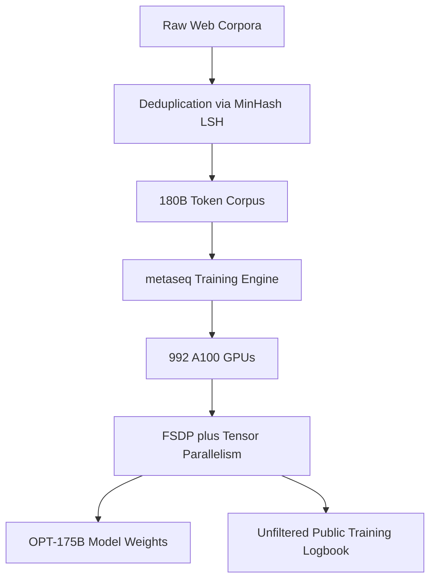
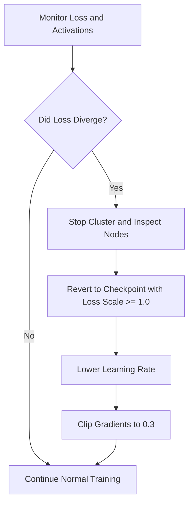

## The hook

In May 2020, OpenAI revealed [GPT-3](article:paper-gpt-3). It showed the world that a 175-billion-parameter Transformer could write prose, translate code, and solve puzzles from just a few examples. 

Then came the lockdown.

OpenAI did not release the model weights. They did not release the training code. They offered a paid web API where you sent a prompt and received a response. If you were an academic researcher curious about why the model behaved the way it did, how toxic it was under the surface, or how to fix its biases, you were out of luck. You could not look at the numbers inside the box.

In May 2022, a team at Meta AI changed that. They built an exact architectural clone of GPT-3 called OPT-175B, handed the full weights to researchers for free, and took an extraordinary step: they published their raw, unfiltered training logbook.

:::analogy
Imagine a commercial airline that builds a supersonic jet engine but only lets passengers peek through cabin windows, barring outside mechanics from entering the hangar. 

The OPT team reverse-engineered that exact engine, handed the blueprints and keys to university labs, and published the grease-stained maintenance diary documenting every emergency engine stall and mid-air repair along the way.
:::

## Before you start

To get the most out of this paper, you should feel comfortable with:
- How decoder-only Transformers predict tokens autoregressively.
- Sharding giant models across multiple machines, introduced in [Megatron-LM](article:paper-megatron-lm).
- The basic philosophy of scaling parameters and data from [Scaling Laws](article:paper-scaling-laws).

## The world before this paper

By early 2022, frontier language models lived exclusively behind corporate gates. Google had PaLM, DeepMind had Gopher and [Chinchilla](article:paper-chinchilla), and OpenAI had GPT-3. 

Outside these corporate walls, independent researchers were stuck. Open-source communities like EleutherAI had trained models up to 20 billion parameters, but nobody had released an open, dense model at the 175-billion frontier scale.

:::history
Because researchers only had black-box API access to GPT-3, scientific inquiry stalled. You cannot inspect the attention heads of an API. You cannot test gradient-based defenses against hallucinations. You cannot measure whether safety patches are fixing underlying representations or merely slapping a superficial filter over dirty outputs. The scientific community was being locked out of the biggest breakthrough in modern AI.
:::

Building an open 175-billion-parameter model was not just a question of money. Training a model that large requires orchestrating hundreds of GPUs for months without crashing. When closed labs succeeded, they published polished papers showing smooth, descending loss curves. They never talked about the sleepless nights, the burned hardware, or the numerical explosions that nearly derailed their runs.

## The big idea

The OPT project had two goals:

1. **Democratize frontier scale:** Train a family of decoder-only models matching GPT-3 (from 125 million up to 175 billion parameters) and release the model weights to the research community under a non-commercial license.
2. **Radical transparency:** Publish the entire training codebase, called `[[metaseq]]`, alongside an unedited logbook chronicling every crash, failed experiment, and hardware headache encountered during training.

Instead of pretending that ultra-scale training is a clean science, the authors revealed it for what it was: an intense engineering battle against flaky hardware and unstable math.



## How it works

To make OPT-175B an authentic counterweight to GPT-3, the researchers matched its blueprint almost layer for layer. 

OPT-175B features 96 Transformer layers, 96 attention heads, a hidden dimension ($d_{\text{model}}$) of 12,288, and a context window of 2,048 tokens. But building the architecture was the easy part. The real difficulty lay in feeding it data, splitting it across hardware, and preventing the numbers inside from exploding.

### 1. Curating the 180-billion-token diet

The team assembled a pre-training corpus of roughly 180 billion tokens by stitching together three primary sources:
- **RoBERTa corpora:** BookCorpus, Stories, and CCNews v2.
- **The Pile:** A filtered collection containing Wikipedia, Project Gutenberg, Common Crawl, HackerNews, and arXiv.
- **Pushshift.io Reddit:** Conversational threads from Reddit, preserving the longest comment chains to provide dialogue-like context.

Before training, they ran MinHash Locality-Sensitive Hashing to remove duplicate documents. Duplicate web pages bias models into memorizing repeated phrases and cause instability during training.

### 2. Distributed training on 992 GPUs

A 175-billion-parameter model stored in 16-bit floating-point numbers requires 350 gigabytes of memory just to hold its weights. Add optimizer states and activations, and you need over a terabyte of memory per forward-backward pass. It cannot fit on a single 80GB GPU.

Instead of using traditional pipeline parallelism (which chops layers across machines and leaves GPUs idling while waiting for previous layers), the team built `[[metaseq]]`. They combined two techniques:
- **Megatron-LM Tensor Parallelism:** Slicing the matrix multiplication operations *within* each layer across 8 GPUs inside a single server.
- **`[[Fully Sharded Data Parallel (FSDP)]]`:** Splitting the optimizer states, gradients, and model parameters across different worker nodes rather than duplicating them everywhere.

By combining these, they kept 992 NVIDIA A100 GPUs humming at up to 147 TFLOP/s per GPU.



### 3. Taming the math: half-precision and loss scaling

The model was trained in 16-bit floating point (FP16), while the AdamW optimizer states were stored in 32-bit floating point (FP32). 

FP16 uses only 5 bits for its exponent, meaning it can only represent numbers between roughly $6 \times 10^{-5}$ and $65,504$. In deep models, backpropagated gradients often drop well below $10^{-5}$. If they do, hardware rounds them to zero—a disaster called underflow.

To survive this, the team used `[[Dynamic Loss Scaling]]`. Before backpropagation begins, the loss is multiplied by a large scale factor $S$:

$$\text{Scaled Loss} = S \times \text{Loss}$$

Every gradient computed by the chain rule gets inflated by $S$:

$$g_{\text{scaled}} = S \times \frac{\partial \text{Loss}}{\partial w}$$

After gradients travel backward through the network, the optimizer unscales them back to their true magnitude before updating the weights:

$$g_{\text{true}} = \frac{g_{\text{scaled}}}{S}$$

If gradients get too large and overflow into `Inf` or `NaN`, the update is skipped, $S$ is halved, and training tries again.

:::try-this
Suppose an unscaled gradient at layer 90 has the value $0.00002$. 
In standard FP16, the smallest non-zero normalized number is roughly $0.00006$. Without loss scaling, your gradient turns into $0.0$, and that weight never learns!
If the dynamic loss scaler multiplies the loss by $S = 1024$, what does the gradient become inside the FP16 registers? 
*(Answer: $0.00002 \times 1024 = 0.02048$, a value easily handled by 16-bit floats.)*
:::

### 4. Surviving hardware rot and loss spikes

The team's logbook documented what happens when you push a cluster to its limits:
- **Dead hardware:** Over two months, hardware faults forced at least 35 manual restarts, more than 70 automated restarts, and the replacement of over 100 host servers.
- **Loss divergences:** At several points during training, the loss suddenly spiked toward infinity.

The engineers spotted an early warning signal: just before the model diverged, the `[[Dynamic Loss Scaling|loss scale factor]]` $S$ crashed toward zero, while the $L_2$ norm of the final layer's activations skyrocketed. 

When this happened, the team stepped in manually. They rolled the model back to an earlier healthy checkpoint where $S \ge 1.0$, reduced the learning rate, and shrank the gradient clipping threshold from $1.0$ down to $0.3$. These interventions kept the run on track.

:::insight
State-of-the-art LLM training is not set-and-forget. At the 100B+ parameter scale, it requires active babysitting: detecting numerical ripples, rolling back to earlier checkpoints, and lowering learning rates mid-flight.
:::

## What they found

Did this open replica match GPT-3? Across standard NLP benchmarks, the answer was largely yes.

```
Model Performance Overview (Zero-shot NLP Averages)
-------------------------------------------------------
OPT-175B:   Matched GPT-3 on 10 of 14 standard benchmarks
            Lags behind on: ARC Challenge, MultiRC
            Carbon Cost: ~75 tons CO2eq vs ~500 tons (GPT-3)
```

The authors evaluated OPT-175B against GPT-3 across 16 standard language tasks (including HellaSwag, PIQA, StoryCloze, and SuperGLUE). 

In zero-shot and few-shot tests, OPT-175B closely tracked GPT-3's performance curve across most tasks. It struggled slightly on ARC Challenge and MultiRC, but held parity across the rest.

### Carbon footprint: seven times greener

One of the paper's proudest results was environmental. While training GPT-3 was estimated to have produced roughly 500 metric tons of $\text{CO}_2$ equivalent, training OPT-175B produced an estimated 75 tons.

This 7x reduction came from two factors:
1. Moving from older V100 infrastructure to 80GB NVIDIA A100 GPUs.
2. High hardware utilization (147 TFLOP/s per GPU) achieved by pairing FSDP with tensor parallelism, leaving fewer idle clock cycles.

### Dialogue capabilities

Because the training diet included Pushshift.io Reddit conversations, OPT-175B was surprisingly capable at chatting out of the box. 

Without any fine-tuning, OPT-175B scored a unigram F1 of 0.185 on the ConvAI2 dialogue benchmark. That matched BlenderBot 1—a dedicated conversational model that had undergone extensive supervised fine-tuning.

### The dark side of Reddit: bias and toxicity

Open access also gave researchers an unfiltered look at model flaws. 

On the `[[CrowS-Pairs]]` benchmark, which measures stereotypical social bias (where lower scores mean less bias), OPT-175B scored 69.5 compared to GPT-3's 67.2. It exhibited higher bias across almost every category, including gender, sexual orientation, and race.

```
CrowS-Pairs Stereotype Scores (Lower is Better)
Category            GPT-3       OPT-175B
----------------------------------------
Gender              62.6        65.7
Race / Color        64.7        68.6
Sexual Orientation  76.2        78.6
Overall Average     67.2        69.5
```

When evaluated using `[[Nucleus Sampling]]` on RealToxicityPrompts, OPT-175B generated toxic completions more frequently than either GPT-3 or PaLM. Feeding raw internet forum discussions into a massive neural net gave it an encyclopedic command of human toxicity.

:::warning
More pre-training data is not automatically better. Injecting large amounts of unmoderated social media text gave OPT-175B strong conversational rhythm, but it also baked in high toxicity and stereotype bias.
:::

## What it got wrong (or left open)

OPT-175B was an intentional clone of GPT-3, which meant it also inherited GPT-3's foundational flaws.

### 1. It could not follow instructions

If you typed a command like *"Write a list of three ingredients for pancakes,"* OPT-175B often failed. Instead of executing the instruction, it would output:
> *"Person 2: Why do you want pancakes? Person 1: Because I'm hungry."*

As an unaligned base model, it simply predicted likely web text. Because its dataset was full of conversational transcripts, it treated direct commands as scripts for a dialogue between two characters. Making models follow direct requests required reinforcement learning from human feedback, as demonstrated in [InstructGPT](article:paper-instructgpt).

### 2. Under-trained by modern standards

OPT-175B trained on 180 billion tokens. Just two months before OPT was released, DeepMind published [Chinchilla](article:paper-chinchilla), proving that a 175-billion-parameter model needs over 3.5 *trillion* tokens to reach compute optimality. By modern standards, OPT-175B was drastically under-trained, leaving immense performance on the table.

### 3. Hallucinations and repetition

The model frequently got stuck in repetitive token loops and hallucinated falsehoods with total confidence. Without external search tools like [RAG](article:paper-rag), the authors warned that OPT was completely unsuited for real-world deployment.

## What happened next

The release of OPT was the spark that ignited the open LLM movement.

By giving universities, non-profits, and independent labs access to 175B-scale weights and the `[[metaseq]]` codebase, Meta proved that massive models did not have to remain locked inside corporate headquarters. 

Researchers used OPT to build new parameter-efficient fine-tuning techniques, develop bias mitigations, and audit hallucination rates.

Less than a year later, Meta followed up with [LLaMA](article:paper-llama), shifting the open-source paradigm from cloning GPT-3 to training smaller, hyper-optimized models on trillions of tokens. 

The lessons logged in the OPT maintenance diary—from FSDP sharding tricks to managing activation norm spikes—became foundational engineering wisdom, paving the direct path toward modern open-weight giants like [Llama 3](article:paper-the-llama-3-herd-of-models).

## Key takeaways

- OPT-175B matched GPT-3's scale and general language performance while consuming roughly one-seventh of the carbon footprint to train.
- Meta openly released all model weights and an unfiltered training logbook, giving academic researchers their first direct access to a 175-billion-parameter foundation model.
- Training at the 100B+ scale requires active intervention: hardware failures, dynamic loss scale collapses, and activation spikes forced frequent checkpoint rollbacks and mid-flight hyperparameter tuning.
- Base models mirror their data: incorporating unfiltered Reddit conversations gave OPT conversational ability, but significantly increased its toxicity and bias relative to other frontier models.
