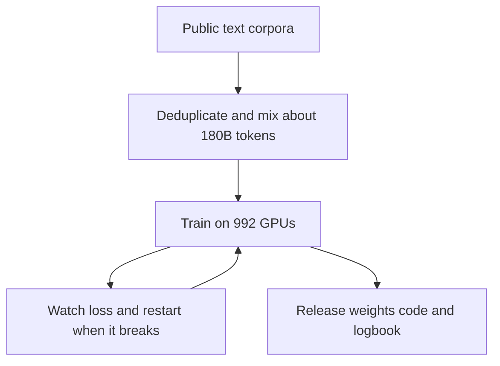

## The hook

Suppose you are a researcher in 2021 and you want to know why GPT-3 says biased things. You can type prompts into a paid API and read the answers. You cannot look at a single weight or activation, and you cannot retrain it to test a fix. Studying the most talked-about model in AI meant poking a sealed box from outside.

In May 2022, a team at Meta AI released a model of the same size class for researchers to download, along with the code that trained it and a logbook full of crashes. Why would anyone publish their failures, and what did the diary reveal about training at this scale?

## Before you start

You should know how [GPT-3](article:paper-gpt-3) learns from next-token prediction and few-shot prompts, how [Megatron-LM](article:paper-megatron-lm) splits a layer across GPUs, and the idea from [scaling laws](article:paper-scaling-laws) that bigger models trained on more data predictably get better.

## The world before this paper

By early 2022 the largest language models lived inside a few companies. GPT-3 was available only through an API. Other large models, such as DeepMind's [Chinchilla](article:paper-chinchilla), were described in papers but not released. Open community efforts existed, but their models were much smaller than 175 billion parameters.

That gap mattered for science. Questions about bias, toxicity and memorisation need direct access to a model. So does any study of the training process itself, which closed papers described only in polished summaries.

:::history
Susan Zhang, Stephen Roller, Naman Goyal, Mikel Artetxe and colleagues at Meta AI posted the OPT paper on arXiv in May 2022. They released a suite of decoder-only models from 125 million to 175 billion parameters. The smaller models were openly downloadable; the 175B model was available to researchers on request under a non-commercial licence.
:::

## The big idea

:::analogy
Think of a famous restaurant that serves a remarkable dish through a takeaway window. You can order it and taste it, but nobody may enter the kitchen. One day another kitchen cooks a dish of the same kind and quality, gives researchers the leftovers to take apart, and pins up its cooking diary, burnt batches included.
:::

OPT is that second kitchen. The dish is a GPT-3-class model. The leftovers are the [[open weights]]. The cooking diary is the logbook: notes on hardware failures, restarts and the times the training run nearly went wrong.

The abstract states the goal and the claim plainly. OPT-175B is comparable to GPT-3, the team developed it with about one seventh of GPT-3's estimated carbon footprint, and they shared code and the logbook. The model itself was not meant to be new. The openness was.

## How it works

### The recipe: copy the shape of GPT-3

OPT-175B follows GPT-3's architecture closely: a decoder-only Transformer with 96 layers, 96 attention heads and a hidden size of 12,288. Keeping the shape the same means any difference in behaviour comes from data and training, not from a new design.

The training text, about 180 billion tokens, came from sources used to train RoBERTa, a subset of the Pile, and Reddit conversations from the Pushshift collection. For Reddit, the team kept the longest chain of comments in each thread to turn discussion trees into documents. They also removed near-duplicate documents across sources.

### Fitting the model on the stove

A 175-billion-parameter model does not fit on one GPU. Here is a rough estimate of the memory for the model alone, before activations, using the paper's setup of 16-bit weights and 32-bit Adam optimizer state:

| Item | Bytes per parameter | Total for 175B parameters |
|---|---|---|
| Weights, 16-bit | 2 | 350 GB |
| Gradients, 16-bit | 2 | 350 GB |
| Adam first moment, 32-bit | 4 | 700 GB |
| Adam second moment, 32-bit | 4 | 700 GB |
| **Total** | **12** | **about 2.1 TB** |

An 80 GB GPU holds a small fraction of that. The team trained on 992 80GB A100 GPUs using two kinds of splitting. [[Tensor parallelism]], from Megatron-LM, cuts each layer's matrix multiplications across several GPUs. [[Fully Sharded Data Parallel]] spreads the weights, gradients and optimizer state across all the GPUs, so each holds only its slice. Spread perfectly across 992 GPUs, 2.1 TB is about 2.1 GB each, leaving room for activations.

The paper reports up to 147 TFLOP/s per GPU. A quick sanity check uses the usual rule that training costs about 6 × parameters × tokens operations: 6 × 175e9 × 180e9 ≈ 1.9e23. At 147 TFLOP/s on all 992 GPUs without a single pause, that is about 15 days. The real run took considerably longer, and the logbook shows why.

### Cooking in 16-bit: loss scaling

OPT trained with [[mixed precision]]. 16-bit floats save memory and time, but they cannot represent very small numbers. The smallest normal 16-bit value is about 6.1e-5; below that, precision drops until values around 1e-8 become exactly zero. Many gradients in a deep network are that small.

[[Loss scaling]] fixes this. Before backpropagation, multiply the loss by a scale $S$. Every gradient is then multiplied by $S$ too:

$$g_{\text{scaled}} = S \cdot \frac{\partial L}{\partial w}, \qquad g = \frac{g_{\text{scaled}}}{S}$$

Here $L$ is the loss, $w$ is one weight, $g$ is the gradient you actually want, and $g_{\text{scaled}}$ is what the 16-bit hardware stores. You divide by $S$ before the update, so the step size is unchanged. With dynamic loss scaling, $S$ drops whenever gradients overflow to infinity and grows back when things are calm.

Here is what happens to a gradient of 1e-8, checked with Python's 16-bit floats:

| Scale $S$ | Stored in 16-bit | After dividing by $S$ |
|---|---|---|
| 1 | 0 | 0, the update is lost |
| 1,024 | about 1.03e-5 | about 1.001e-8 |
| 65,536 | about 6.55e-4 | about 9.997e-9 |

:::try-this
A gradient of 3e-5 is stored in 16-bit with no scaling. Does it survive? (Yes, roughly: it lands at about 2.998e-5. It is below the smallest normal value, so it is stored with reduced precision, but it is not zero. Scaling by 1,024 moves it to about 0.0307, where precision is much better.)
:::

### The burnt batches

The logbook is the most unusual part of the paper. Hardware failed regularly at this scale, forcing many restarts from checkpoints and the replacement of faulty machines.

Worse were [[loss divergence|loss divergences]]: the loss would suddenly spike and not recover. The team noticed that the dynamic loss scale collapsing towards zero was a warning sign, along with the activations in the final layer growing large. Their response was the kitchen's response to a burning pan: go back to the last good checkpoint, turn the heat down by lowering the learning rate, and carry on. They also tightened gradient clipping during the run.

:::insight
At this scale, a training run is not a single clean job. It is weeks of watching, restarting and adjusting, and OPT was among the first large-model papers to show that process openly instead of only the final loss curve.
:::

## What they found

The headline result is in the abstract: OPT-175B is comparable to GPT-3. Across a range of standard zero-shot and few-shot tasks, its average accuracy tracked GPT-3's closely, though it fell behind on some individual tasks.

The paper also reports:

- **Lower estimated carbon footprint.** About one seventh of GPT-3's estimate, helped by newer hardware and efficient training.
- **Decent dialogue out of the box.** Because of the Reddit data, the base model handled open conversation reasonably well without dialogue fine-tuning.
- **Bias and toxicity.** On the paper's evaluations, OPT-175B showed stereotypical bias and toxic outputs, in several tests more than GPT-3. The authors linked part of this to the unmoderated social-media text in the training mix.

That last finding is exactly what open weights make possible: anyone with access could now measure and attack these problems directly, in the kitchen rather than through the window.

:::warning
Common misconception: "OPT was a new kind of model that beat GPT-3." It was deliberately a close copy in size and shape, aiming to match GPT-3, not beat it. Its contribution was access and transparency, not a new architecture or better scores.
:::

## What it got wrong (or left open)

- **A base model, not an assistant.** OPT-175B was a [[base model]]. The authors note it handles direct instructions poorly; it often treats a command as the start of a dialogue and continues the conversation instead of doing the task. Following instructions needed the kind of training shown in [InstructGPT](article:paper-instructgpt).
- **Underfed by later standards.** Chinchilla, posted shortly before OPT, suggested about 20 training tokens per parameter for the best use of compute. For 175 billion parameters that is about 3.5 trillion tokens, nearly 20 times what OPT-175B saw.
- **Repetition and made-up facts.** Like other base models, it could loop on the same phrase and state false things confidently. The authors judged it not ready for commercial deployment.
- **Limited access at the top.** The 175B weights required a research request, so "open" was partial for the largest model.

## What happened next

OPT showed that a company could release a model at this scale and that researchers would use it. Studies of bias, memorisation and efficient fine-tuning used the OPT family because the weights were in hand.

The next open release from Meta changed the recipe. [LLaMA](article:paper-llama) trained smaller models on far more tokens, following Chinchilla's lesson, and matched or beat much larger models. Later, [Llama 3](article:paper-the-llama-3-herd-of-models) published an even more detailed engineering account of training at scale, continuing the habit of showing the kitchen as well as the dish.

## Key takeaways

- OPT-175B was built to match GPT-3 in size and quality, and its real contribution was releasing weights, code and a training logbook to researchers.
- Training a 175-billion-parameter model needed both tensor parallelism and fully sharded data parallelism, because the weights and optimizer state alone take about 2 terabytes.
- Loss scaling multiplies the loss before backpropagation so tiny gradients survive 16-bit arithmetic, then divides it back out before the update.
- The logbook showed that large runs need constant supervision: hardware failures, loss spikes, rollbacks to earlier checkpoints and lower learning rates.
- Open access let researchers measure OPT's bias, toxicity and poor instruction following directly, problems that later models addressed with more data and alignment training.
